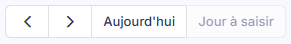

# Saisie de caisse


**Où le trouver :** Menu **Traitements › Saisie de caisse**



**En bref** — Cet écran permet d'enregistrer, pour chaque jour travaillé, le Z de caisse de la journée : recettes, règlements, remises en banque, sorties et autres entrées de caisse.

* Pour choisir la journée : utilisez le mini-calendrier, ou bouton \[Jour à saisir] pour revenir à la journée attendue.
* Pour sauvegarder la saisie en cours : bouton \[Enregistrer].
* Pour clôturer la journée : vérifiez que les encaissements égalent les recettes, puis bouton \[Valider la caisse].


La saisie de caisse vous permet d'enregistrer, pour chaque jour travaillé, le Z de caisse de la journée. Elle s'effectue en deux temps : le choix de la journée, puis la saisie des informations de cette journée.

<figure><figcaption>
Écran « Saisie de caisse » de la nouvelle interface
</figcaption></figure>

Pour l'ouvrir, dans l'écran Révision, cliquez sur ⋮ (Plus d'actions), puis sur **Saisie de caisse** (rubrique Saisie). L'écran s'ouvre dans un panneau, à droite, intitulé « Saisie de caisse », sous le nom de la société et l'exercice. Le panneau s'ouvre directement sur la journée à saisir ; pour choisir une autre journée, utilisez le mini-calendrier de sa colonne de gauche. La croix « Fermer » du bandeau de titre referme le panneau.

Une seconde présentation subsiste : la page « Saisie de caisse », un calendrier mensuel plein écran (aucune entrée de menu n'y mène plus : la barre de menus des écrans restés en page pleine ne propose plus que « Révision » et « Editions » ; l'écran Révision n'a plus de barre de menus). La rubrique a) décrit les deux présentations ; la rubrique b) décrit la journée de caisse telle que le panneau l'affiche.

## Le choix de la journée de caisse

<figure><figcaption>
Bouton [Aujourd'hui]
</figcaption></figure>

<figure><figcaption>
Bouton [Jour à saisir]
</figcaption></figure>

<figure><figcaption>
Bouton [Importer un Z de caisse]
</figcaption></figure>

### Dans le panneau « Saisie de caisse »

La colonne de gauche porte, de haut en bas : la liste « Journal de caisse », accompagnée d'un engrenage (infobulle « Paramètres de la saisie de caisse du journal ») ; un mini-calendrier du mois, avec les pictogrammes « Mois précédent » et « Mois suivant » ; l'encart « Le mois en bref » (« Recettes du mois », « Panier moyen » et « Journées validées », sous la forme « 0 / 1 ») ; et, en bas, le bouton \[Jour à saisir], grisé à l'ouverture.

Dans le mini-calendrier, seule la journée à saisir est active : les autres jours ouvrés sont grisés, avec l'infobulle « Saisie indisponible · Saisie en cours: » suivie de la date de la saisie en cours ; les jours de fermeture portent l'infobulle « Fermeture hebdomadaire ». Une légende rappelle les états : « Validée », « En cours », « À saisir », « Fermeture », « Indisponible » et « Aujourd'hui ».

### Dans la page « Saisie de caisse » : le calendrier plein écran

Le logiciel affiche le mois sous la forme d'un calendrier, une colonne par jour de la semaine, avec le nom du mois et l'année au-dessus. Il se positionne sur le mois contenant la prochaine journée à saisir : la saisie de caisse est séquentielle, les journées se saisissent donc dans l'ordre.

La couleur de chaque case vous indique l'état de la journée :

* **bleu** : jour de fermeture (hebdomadaire ou exceptionnelle), marqué « Fermé ». La case n'est pas cliquable.
* **blanc** : jour ouvré qui n'est pas encore saisissable, la journée à saisir n'étant pas atteinte.
* **avec un montant en euros** : journée dont la saisie de caisse existe ; le montant est celui des recettes de la journée. La légende, sous le calendrier, distingue les saisies validées et les saisies en cours.

Les jours qui n'appartiennent pas au mois affiché — les derniers jours du mois précédent et les premiers du mois suivant, qui complètent les semaines du calendrier — gardent la couleur de leur état, mais en teinte atténuée.

La **journée à saisir** est la seule case cliquable du calendrier ; sa date vous est rappelée en haut à droite, dans l'étiquette orange « Jour à saisir : » suivie de la date. Sa case est encadrée d'orange et affiche le montant des recettes de la journée (« 0,00 € » tant que rien n'est saisi).

En haut à droite du calendrier, quatre commandes vous permettent de vous déplacer dans le temps :

Pictogramme « Précédent » (chevron vers la gauche) : il affiche le mois précédent.

Pictogramme « Suivant » (chevron vers la droite) : il affiche le mois suivant.

bouton **\[Aujourd'hui]** : il revient au mois courant.

bouton **\[Jour à saisir]** : il vous ramène à la journée attendue, dont la date est rappelée dans l'étiquette orange en haut à droite. Il était grisé à l'ouverture.

Au-dessus du calendrier, trois indicateurs : « Recettes du mois », « Solde de caisse » (« — » à l'ouverture) et « Jours saisis (jours ouvrés échus) », accompagné d'une jauge. Sous le calendrier, une légende explique les repères : « Saisie validée », « Saisie en cours », « A saisir », « Fermeture (hebdomadaire ou exceptionnelle) », « Saisie indisponible », « Jour à saisir », « Aujourd'hui » et « Jour avec une pièce jointe ».

### Attention : ouvrir une journée la crée

Le simple fait de cliquer sur la case de la journée à saisir crée la saisie de caisse de cette journée. Si vous ouvrez la fiche pour la consulter puis revenez au calendrier, sans rien saisir ni enregistrer, la case passe malgré tout en saisie en cours et porte le montant « 0,00 € » : la journée est désormais comptée comme en cours. N'ouvrez donc la journée que lorsque vous êtes prêt à la saisir. Le panneau du menu ⋮ s'ouvre directement sur la journée à saisir : par prudence, n'ouvrez-le que dans les mêmes conditions.

bouton **\[Importer un Z de caisse]**

Il figure au bandeau bas du calendrier.

bouton **\[Edition]**

Il figure au bandeau bas du calendrier.

## La saisie des informations de la journée

La journée s'affiche à droite du mini-calendrier. Son en-tête rappelle le journal (« Journée de caisse · CAI Caisse »), la date en toutes lettres et un badge d'état (« Saisie en cours »), puis une ligne de synthèse (« Nombre de ventes non renseigné · 0,00 € TTC »). Les rubriques se suivent : « Informations du jour », « Recettes du jour », « Règlements du jour », « Remises en banque », « Sorties de caisse » et « Autres entrées de caisse ». Les trois dernières sont repliées à l'ouverture : un clic sur leur titre les déploie, et leur total est rappelé à droite du titre. La colonne de droite porte trois cartes : « Synthèse de la journée », « Écriture de caisse » et « Contrôles avant validation ».

### Rubrique « Informations du jour »

| Champ                      | Ce qu'il faut savoir                                                                                   |
| -------------------------- | ------------------------------------------------------------------------------------------------------ |
| **Date**                   | Non modifiable. C'est la date de la journée de caisse en cours de saisie.                              |
| **Nombre de ventes**       | Pour calculer le panier moyen du jour, indiquez ici le nombre de ventes de la journée.                 |
| **Solde début de journée** | Non modifiable. Il correspond au solde de fin de journée de la saisie de caisse précédente.            |
| **Solde fin de journée**   | Non modifiable. Il correspond au solde de début de journée, modifié par les mouvements du jour.        |
| **Pièce justificative**    | Le bouton « Joindre le ticket Z » permet d'attacher, par exemple, l'impression scannée du Z de caisse. |

### Rubrique « Recettes du jour »

Une ligne par type de vente paramétré pour la caisse. Les **libellés des lignes** ne se saisissent pas ici : ils proviennent du paramétrage de votre caisse, que vous ouvrez avec l'engrenage placé à côté de la liste « Journal de caisse » : il ouvre un second panneau, « Paramètres de la saisie de caisse », qui prévient lorsqu'une journée est en cours : « Une journée de caisse est en cours : l'enregistrement l'efface (montants et pièce jointe). Les journées validées ne changent pas. » Les lignes que vous voyez sont donc celles de votre propre dossier. Le titre de la rubrique donne le total TTC et, à droite, le rappel « Saisissez le montant dans le mode du paramétrage : HT et TVA se calculent. » Le tableau comporte les colonnes suivantes :

| Champ             | Ce qu'il faut savoir                                                                                                                                                                                                     |
| ----------------- | ------------------------------------------------------------------------------------------------------------------------------------------------------------------------------------------------------------------------ |
| **Libellé**       | Le type de vente, repris du paramétrage de la caisse, avec le numéro du compte de vente en dessous. Il n'est pas modifiable ici.                                                                                         |
| **TVA**           | Le taux, affiché d'après le code TVA indiqué dans le paramétrage de la saisie de caisse.                                                                                                                                 |
| **Montant saisi** | C'est la valeur que vous saisissez : le chiffre d'affaires total pour ce type de vente, dans le mode qu'indique l'unité affichée à droite de la zone (« TTC » sur le dossier relevé), selon le paramétrage de la caisse. |
| **HT, TVA, TTC**  | Calculés par le logiciel d'après le montant saisi et le code TVA indiqué dans le paramétrage de la saisie de caisse ; ces trois colonnes sont vides à l'ouverture.                                                       |
| **Commentaire**   | —                                                                                                                                                                                                                        |

À chaque saisie, le logiciel met à jour la ligne « Total des ventes », qui donne les totaux HT, TVA et TTC, ainsi que le « Panier moyen TTC : » (« Non calculable » à l'ouverture).

### Rubrique « Règlements du jour »

Une ligne par mode de règlement paramétré pour la caisse. Le titre donne le total de la rubrique et, à droite, un badge d'équilibre (« Équilibré » à l'ouverture). La ligne des espèces porte la mention « alimente la caisse » et ne comporte qu'une zone de montant ; les autres modes de règlement ont les colonnes suivantes :

| Champ                 | Ce qu'il faut savoir                                          |
| --------------------- | ------------------------------------------------------------- |
| **Mode de règlement** | Repris du paramétrage de la caisse.                           |
| **Compte**            | Le numéro du compte rattaché au mode de règlement.            |
| **Nombre**            | C'est le nombre de paiements effectués avec ce mode.          |
| **Montant**           | C'est le montant global des paiements effectués avec ce mode. |
| **Commentaire**       | —                                                             |

Le logiciel affiche sous le tableau le « Total des règlements ».

### Rubrique « Remises en banque »

Rubrique repliée à l'ouverture, dont le total est rappelé dans le titre. Le remplissage de ce tableau est facultatif : il vous permet d'indiquer, par mode de règlement, le montant remis en banque.

| Champ           | Ce qu'il faut savoir                                                                                                                                                               |
| --------------- | ---------------------------------------------------------------------------------------------------------------------------------------------------------------------------------- |
| **Libellé**     | Le mode de règlement, repris du paramétrage de la caisse.                                                                                                                          |
| **Banque**      | Pour que la ligne soit valide. La liste déroulante, propre à chaque ligne et vide à l'ouverture, vous propose vos banques : indiquez celle dans laquelle vous effectuez la remise. |
| **Nombre**      | C'est le nombre d'éléments remis — le nombre de chèques, par exemple.                                                                                                              |
| **Montant**     | Pour que la ligne soit valide. C'est le total remis pour le mode de règlement considéré.                                                                                           |
| **Commentaire** | —                                                                                                                                                                                  |

### Rubrique « Sorties de caisse »

Rubrique repliée à l'ouverture, dont le total est rappelé dans le titre. Le remplissage de ce tableau est facultatif : il vous permet de saisir, par type de dépense, les règlements que vous avez effectués avec la caisse.

| Champ           | Ce qu'il faut savoir                                                  |
| --------------- | --------------------------------------------------------------------- |
| **Libellé**     | Le type de dépense, repris du paramétrage de la caisse.               |
| **Compte**      | Le numéro du compte rattaché au type de dépense.                      |
| **Montant**     | C'est le montant total des sorties pour le type de dépense considéré. |
| **Commentaire** | —                                                                     |

### Rubrique « Autres entrées de caisse »

Rubrique repliée à l'ouverture, dont le total est rappelé dans le titre. Le remplissage de ce tableau est facultatif : il vous permet de saisir les entrées en caisse qui ne sont pas des règlements clients — un apport personnel ou une augmentation du fonds de caisse, par exemple.

| Champ           | Ce qu'il faut savoir                                                |
| --------------- | ------------------------------------------------------------------- |
| **Libellé**     | Le type d'entrée, repris du paramétrage de la caisse.               |
| **Compte**      | Le numéro du compte rattaché au type d'entrée.                      |
| **Montant**     | C'est le montant total des entrées pour le type d'entrée considéré. |
| **Commentaire** | —                                                                   |

### Les trois cartes de la colonne de droite

| Champ                          | Ce qu'il faut savoir                                                                                                                                                                                                                                                                                                                                                                                   |
| ------------------------------ | ------------------------------------------------------------------------------------------------------------------------------------------------------------------------------------------------------------------------------------------------------------------------------------------------------------------------------------------------------------------------------------------------------ |
| **Synthèse de la journée**     | Le total des ventes TTC et le panier moyen, puis les lignes « Ventes HT », « TVA collectée », « Règlements reçus », « Crédits clients (net) », « Écart recettes / règlements », « Solde début », « + Espèces et entrées », « - Sorties et remises » et « Solde fin de caisse » (0,00 € chacune à l'ouverture).                                                                                         |
| **Écriture de caisse**         | Un badge indique l'état de comptabilisation (« Non comptabilisée » à l'ouverture) ; tant qu'aucun montant n'est saisi, la carte précise « Aucun montant n'est saisi : la validation ne générera pas d'écriture. »                                                                                                                                                                                      |
| **Contrôles avant validation** | La carte annonce le nombre de points à vérifier (« 2 points à vérifier » à l'ouverture) et liste cinq contrôles : « Nombre de ventes renseigné », « Recettes du jour saisies », « Règlements égaux aux recettes », « Solde de caisse positif » et « Banque renseignée pour chaque remise ». Un contrôle satisfait s'affiche avec une coche, un contrôle à vérifier avec un point d'exclamation orange. |

**Le pied du panneau**

À gauche, le message « Tout est enregistré » à l'ouverture. À droite, dans l'ordre : bouton **\[Annuler les modifications]** (grisé à l'ouverture), bouton **\[Valider la caisse]**, bouton **\[Enregistrer]**, bouton **\[Dé-valider la caisse]** (grisé à l'ouverture, la journée n'étant pas validée) et le pictogramme « Autres actions » (⋮), qui propose « Éditer la caisse du jour », « Importer les ventes », « Paramètres de la caisse » et « Vider la saisie » (en rouge).

bouton **\[Enregistrer]**

Il sauvegarde les informations déjà saisies.

**Fermer le panneau**

Il n'y a plus de bouton \[Retour] dans le panneau : la croix « Fermer » du bandeau de titre le referme.
