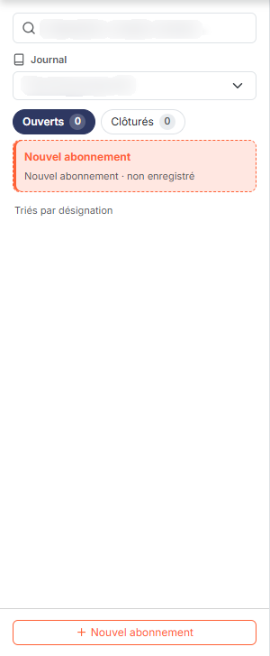
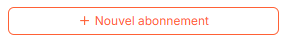
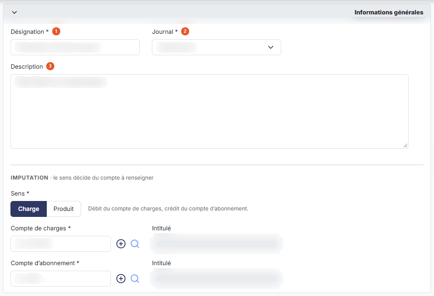
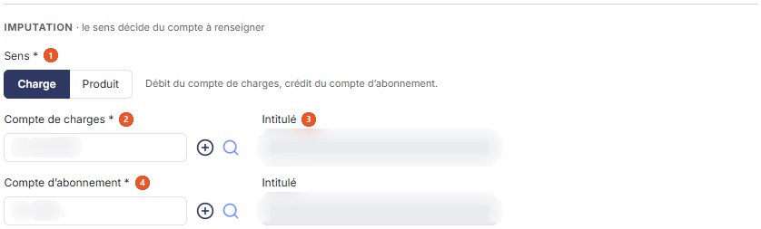
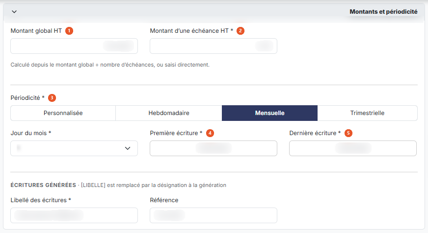
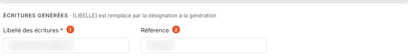
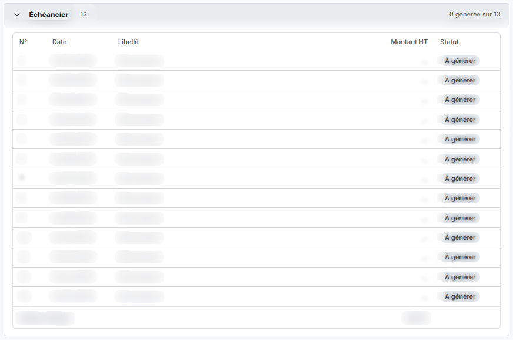
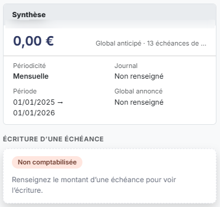
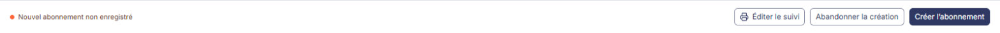

# Abonnements


**En bref** — Cet écran enregistre une charge ou un produit récurrent (loyer, contrat d'entretien…) une seule fois ; le logiciel génère ensuite les écritures de chaque échéance.

* Pour créer un abonnement : bouton \[Nouvel abonnement], renseignez le formulaire, puis bouton \[Enregistrer].
* Pour passer les écritures des échéances : bouton \[Générer les écritures].
* Pour revenir en arrière : bouton \[Annuler les modifications].


Un abonnement vous permet d'enregistrer une charge ou un produit qui revient à intervalles réguliers — un loyer, un contrat d'entretien, une prestation mensuelle — en le décrivant une seule fois : le logiciel se charge ensuite de générer les écritures correspondantes à chaque échéance.

<figure><figcaption>
Écran « Abonnements » de la nouvelle interface
</figcaption></figure>

Cette option affiche la liste des abonnements du dossier annuel en cours et vous permet de les créer, de les modifier, de les dupliquer, de les supprimer et de générer leurs écritures.

Pour l'ouvrir, cliquez, dans l'écran Révision, sur ⋮ (Plus d'actions), puis, dans la rubrique Abonnements, sur Abonnements d'écritures. L'option s'ouvre dans un panneau à droite de l'écran, qui affiche d'emblée le premier abonnement de la liste. Si le dossier annuel n'a encore aucun abonnement, le panneau s'ouvre sur une liste vide : son bandeau de titre porte « Abonnements », le nom de la société et les dates de l'exercice ; la liste indique « Aucun abonnement ouvert. » et le bouton \[Créer un abonnement] permet de commencer. Le bandeau de titre du panneau porte « ABONNEMENT », puis la désignation de l'abonnement affiché, son statut (« Ouvert ») et son sens (« Charge »), une ligne de résumé (« 12 échéances mensuelles de 100,00 € · OD · Op. diverses · du 15/01/2019 au 15/12/2019 » sur le dossier relevé) et, à droite, la croix qui referme le panneau.

Le panneau comporte trois volets : à gauche la liste des abonnements, au centre le formulaire de l'abonnement affiché, à droite sa synthèse. Une rangée de boutons occupe le pied du panneau.

## La liste des abonnements

<figure><figcaption>
Rubrique « La liste des abonnements »
</figcaption></figure>

<figure><figcaption>
Bouton [Nouvel abonnement]
</figcaption></figure>

Elle occupe le volet de gauche. De haut en bas, on y trouve : une zone de recherche (« Désignation, compte, montant… ») ; le filtre **Journal :**, une liste qui propose « Tous les journaux », choix retenu par défaut, puis les journaux avec le nombre d'abonnements de chacun (« OD · Op. diverses (1) » sur le dossier relevé) ; deux pastilles **« Ouverts »** et **« Clôturés »**, chacune suivie du nombre d'abonnements correspondants ; la mention « Triés par désignation » ; puis les abonnements, présentés chacun sous la forme d'une carte.

Une carte rappelle la désignation de l'abonnement, le montant de son échéance, son journal, sa périodicité, l'intitulé de son compte d'abonnement, un compteur (« 12/12 » sur le dossier relevé) et son sens sous la forme d'une pastille (« Charge » ou « Produit »). La carte de l'abonnement affiché dans le formulaire est sélectionnée.

bouton **\[Nouvel abonnement]**

Il se trouve en bas du volet de la liste. Il ouvre un formulaire vierge pour créer un abonnement.

## Le formulaire d'un abonnement

Le volet central présente l'abonnement en quatre cartes : « Informations générales », « Imputation », « Montants et périodicité » et « Écritures générées », suivies d'une section « Échéancier ». Les champs suivis d'un astérisque sont obligatoires.

## Carte « Informations générales »

<figure><figcaption>
Rubrique « Carte « Informations générales » »
</figcaption></figure>

| Champ              | Ce qu'il faut savoir                                                                                                                                                                                                                                                  |
| ------------------ | --------------------------------------------------------------------------------------------------------------------------------------------------------------------------------------------------------------------------------------------------------------------- |
| 1. **Désignation** | Le nom de l'abonnement, tel qu'il apparaîtra dans la liste. Champ obligatoire.                                                                                                                                                                                        |
| 2. **Journal**     | Choisissez dans la liste le journal dans lequel les écritures seront générées. La liste reprend les journaux du dossier, sous la forme du code suivi de son libellé. Champ obligatoire : tant que vous n'avez pas choisi, la liste affiche l'invite « Sélectionnez ». |
| 3. **Description** | Zone de texte libre, sur plusieurs lignes, où vous pouvez consigner tout ce qui vous sera utile pour retrouver l'objet de l'abonnement.                                                                                                                               |

## Carte « Imputation »

<figure><figcaption>
Rubrique « Carte « Imputation » »
</figcaption></figure>

Le sens que vous retenez décide du compte à renseigner.

| Champ                      | Ce qu'il faut savoir                                                                                                                                                                                                                                                                                                    |
| -------------------------- | ----------------------------------------------------------------------------------------------------------------------------------------------------------------------------------------------------------------------------------------------------------------------------------------------------------------------- |
| 1. **Sens**                | Choisissez « Charge » (choix par défaut) ou « Produit » au moyen des deux boutons placés côte à côte. Champ obligatoire. Avec « Charge », le texte « Débit du compte de charges, crédit du compte d'abonnement. » vous rappelle l'écriture qui sera passée. Ce choix commande le champ de compte affiché juste dessous. |
| 2. **Compte de charges**   | Ce champ n'apparaît que si le sens est « Charge ». Saisissez le compte à mouvementer, ou recherchez-le au moyen du pictogramme « Loupe » placé à sa droite ; le pictogramme « + » (infobulle « Créer ») voisin sert à créer un compte. Champ obligatoire.                                                               |
| 3. **Intitulé**            | Le logiciel affiche ici l'intitulé du compte de charges ou de produits que vous avez retenu. Vous ne pouvez pas le modifier.                                                                                                                                                                                            |
| 3. **Intitulé**            | Le logiciel affiche ici l'intitulé du compte d'abonnement retenu. Vous ne pouvez pas le modifier.                                                                                                                                                                                                                       |
| 4. **Compte d'abonnement** | Saisissez le compte de contrepartie de l'abonnement, ou recherchez-le au moyen du pictogramme « Loupe » ; le pictogramme « + » (infobulle « Créer ») voisin sert à créer un compte. Champ obligatoire.                                                                                                                  |
| **Compte de produits**     | Ce champ remplace le précédent si le sens est « Produit ». Il fonctionne de la même manière. Champ obligatoire.                                                                                                                                                                                                         |

## Carte « Montants et périodicité »

<figure><figcaption>
Rubrique « Carte « Montants et périodicité » »
</figcaption></figure>

| Champ                            | Ce qu'il faut savoir                                                                                                                                                                                                                                                                                                                                                                                                                                                                                                                                                                                                                                                                                                                                                                                                                                                                                                                                                                                                                                                                                                                   |
| -------------------------------- | -------------------------------------------------------------------------------------------------------------------------------------------------------------------------------------------------------------------------------------------------------------------------------------------------------------------------------------------------------------------------------------------------------------------------------------------------------------------------------------------------------------------------------------------------------------------------------------------------------------------------------------------------------------------------------------------------------------------------------------------------------------------------------------------------------------------------------------------------------------------------------------------------------------------------------------------------------------------------------------------------------------------------------------------------------------------------------------------------------------------------------------- |
| 1. **Montant global HT**         | Montant hors taxes de l'ensemble de l'abonnement. Ce champ n'est pas obligatoire.                                                                                                                                                                                                                                                                                                                                                                                                                                                                                                                                                                                                                                                                                                                                                                                                                                                                                                                                                                                                                                                      |
| 2. **Montant d'une échéance HT** | Montant hors taxes qui sera passé à chaque échéance. Champ obligatoire. Une aide placée sous le champ précise : « Calculé depuis le montant global ÷ nombre d'échéances, ou saisi directement. »                                                                                                                                                                                                                                                                                                                                                                                                                                                                                                                                                                                                                                                                                                                                                                                                                                                                                                                                       |
| 3. **Périodicité**               | 
Choisissez le rythme des échéances au moyen de quatre boutons : « Personnalisée », « Hebdomadaire », « Mensuelle » (choix par défaut) et « Trimestrielle ». Champ obligatoire. Sur un abonnement déjà enregistré, les quatre boutons sont grisés et la note « Périodicité figée : l'abonnement est enregistré. » s'affiche. Selon le choix retenu, le logiciel affiche le complément d'information dont il a besoin : avec la périodicité « Personnalisée », le bouton « Ajouter une échéance » de la section « Échéancier » (voir plus bas) ajoute une échéance, et une commande de suppression est disponible sur chaque ligne ; avec la périodicité « Hebdomadaire », le champ <strong>Jour de la semaine :</strong>, où vous choisissez un jour de lundi à dimanche ; avec la périodicité « Mensuelle », le champ <strong>Jour du mois :</strong>, où vous choisissez un jour de 1 à 31 ; avec la périodicité « Trimestrielle », le champ <strong>Mois du trimestre :</strong>, où vous désignez le premier, le deuxième ou le troisième mois du trimestre, ainsi que le champ <strong>Jour du mois :</strong>.
 |
| 4. **Première écriture**         | Date de la première échéance. Le logiciel vous propose le premier jour de l'exercice ; vous pouvez saisir une autre date ou la choisir dans le calendrier qui s'ouvre au clic dans le champ. Champ obligatoire.                                                                                                                                                                                                                                                                                                                                                                                                                                                                                                                                                                                                                                                                                                                                                                                                                                                                                                                        |
| 5. **Dernière écriture**         | Date de la dernière échéance. Le logiciel vous propose le dernier jour de l'exercice. Champ obligatoire.                                                                                                                                                                                                                                                                                                                                                                                                                                                                                                                                                                                                                                                                                                                                                                                                                                                                                                                                                                                                                               |

## Carte « Écritures générées »

<figure><figcaption>
Rubrique « Carte « Écritures générées » »
</figcaption></figure>

| Champ                        | Ce qu'il faut savoir                                                                                                                                                                                                                                                                                                                                |
| ---------------------------- | --------------------------------------------------------------------------------------------------------------------------------------------------------------------------------------------------------------------------------------------------------------------------------------------------------------------------------------------------- |
| 1. **Libellé des écritures** | Libellé qui sera porté sur chaque écriture générée. Le logiciel vous propose le mot « Abonnement » suivi du mot LIBELLE entre crochets droits : ce second mot est un jeton, que le logiciel remplace par la désignation de l'abonnement au moment de la génération des écritures. Vous pouvez remplacer ce libellé par le vôtre. Champ obligatoire. |
| 2. **Référence**             | Référence qui sera portée sur chaque écriture générée. Ce champ n'est pas obligatoire.                                                                                                                                                                                                                                                              |

## Section « Échéancier »

<figure><figcaption>
Rubrique « Section « Échéancier » »
</figcaption></figure>

Elle indique, en tête, le nombre d'échéances et celui des écritures déjà générées (« 12 · 0 générée sur 12 » lors du relevé), puis liste les échéances, que le logiciel calcule d'après les deux dates et la périodicité, en cinq colonnes : **N°**, **Date**, **Libellé**, **Montant HT** et **Statut** (« À générer » sur les douze lignes lors du relevé).

## La synthèse de l'abonnement

<figure><figcaption>
Rubrique « La synthèse de l'abonnement »
</figcaption></figure>

Le volet de droite se compose de trois blocs.

| Champ                       | Ce qu'il faut savoir                                                                                                                                                                                                                                                                                                                                                                                                                                               |
| --------------------------- | ------------------------------------------------------------------------------------------------------------------------------------------------------------------------------------------------------------------------------------------------------------------------------------------------------------------------------------------------------------------------------------------------------------------------------------------------------------------ |
| **Synthèse**                | Le logiciel calcule ici le montant total qu'entraînera l'abonnement (« 1 200,00 € Global anticipé » lors du relevé), avec le nombre d'échéances et leur montant, pour que vous puissiez le rapprocher du montant global que vous avez saisi : une pastille (« Conforme au montant global ») le confirme. Le bloc rappelle aussi la périodicité, la période (« 15/01/2019 → 15/12/2019 »), le montant global annoncé et le journal. Vous ne pouvez rien y modifier. |
| **Solde**                   | Ce bloc vous indique où en est l'abonnement : un pourcentage, puis « Écritures enregistrées » (12 / 12 lors du relevé), « Montant global enregistré » et « Reste à générer ». En les rapprochant du nombre d'échéances et du montant global anticipé, vous voyez immédiatement ce qui reste à générer.                                                                                                                                                             |
| **Écriture d'une échéance** | Ce bloc montre l'écriture d'une échéance (celle du 15/01/2019, la première, lors du relevé) : une pastille d'état (« Non comptabilisée »), la date, le journal, le montant, le libellé, puis les lignes au débit (D) et au crédit (C) avec le compte, son intitulé et le montant.                                                                                                                                                                                  |

## Le pied du panneau

<figure><figcaption>
Rubrique « Le pied du panneau »
</figcaption></figure>

Le pied affiche le message « Tout est enregistré · 0 écriture restant à générer » (état lors du relevé) et porte, à droite, les boutons suivants.

bouton **\[Générer les écritures]**

Il lance la génération des écritures des échéances de l'abonnement dans le journal que vous avez retenu.

bouton **\[Éditer le suivi]**

Il permet d'éditer le suivi de l'abonnement.

bouton **\[Annuler les modifications]**

Il annule les modifications apportées au formulaire ; il est grisé tant que vous n'avez rien modifié.

bouton **\[Enregistrer]**

Il enregistre les modifications apportées au formulaire.

Le pictogramme ⋮ « Autres actions » ouvre un menu de trois entrées.

L'entrée **Dupliquer** crée un nouvel abonnement reprenant les caractéristiques de celui-ci, ce qui vous évite de tout ressaisir pour un abonnement voisin.

L'entrée **Clôturer l'abonnement** clôture l'abonnement.

L'entrée **Supprimer** demande la suppression de l'abonnement.

**Attention** : dès le premier enregistrement, la **Désignation :** passe en lecture seule. La **Périodicité :**, et le complément d'information qu'elle commande, restent en revanche modifiables tant qu'aucune écriture n'a été générée ni rattachée à l'abonnement ; ils apparaissent grisés dès qu'une écriture existe, et lorsque l'abonnement ou l'exercice est clôturé. Les autres champs du formulaire restent saisissables.
