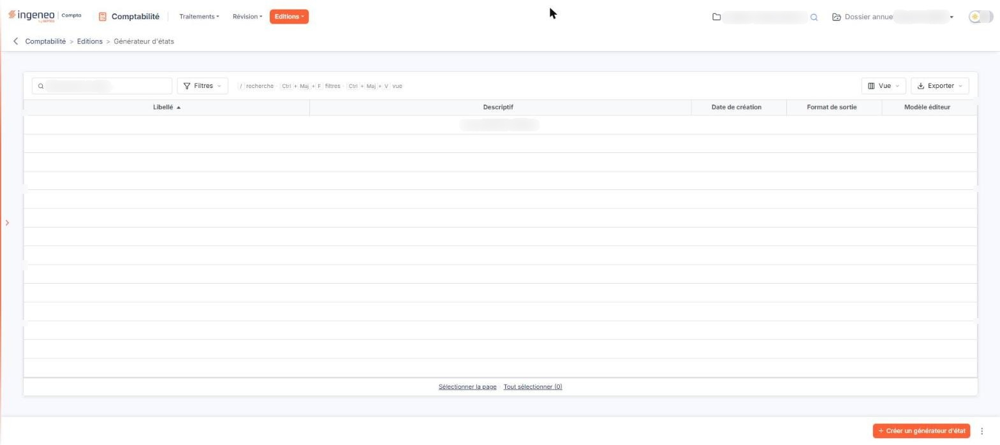
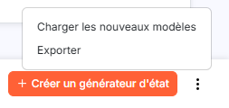
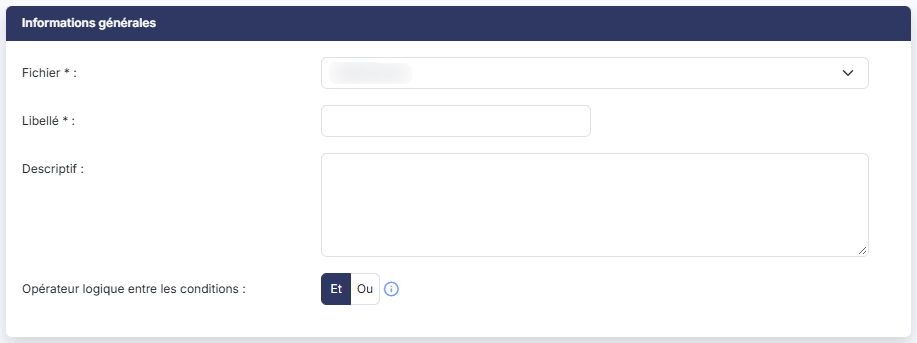
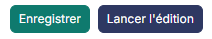
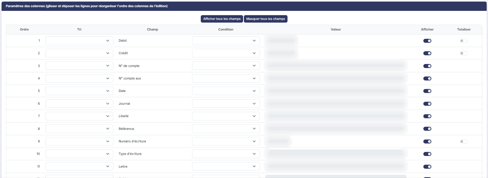
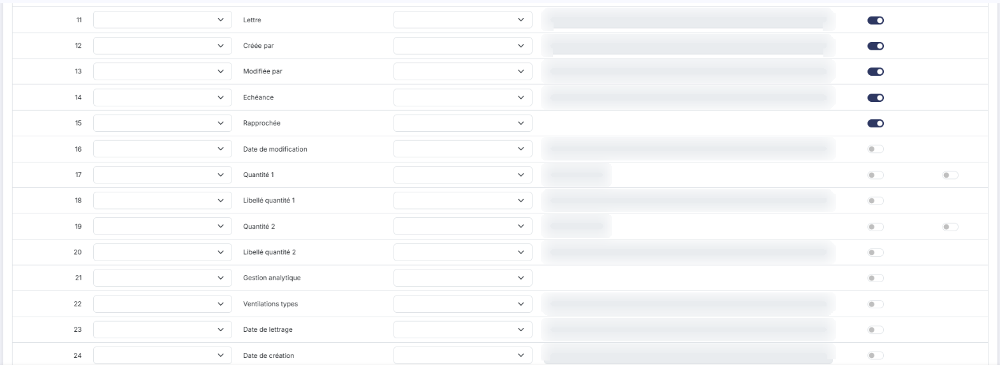
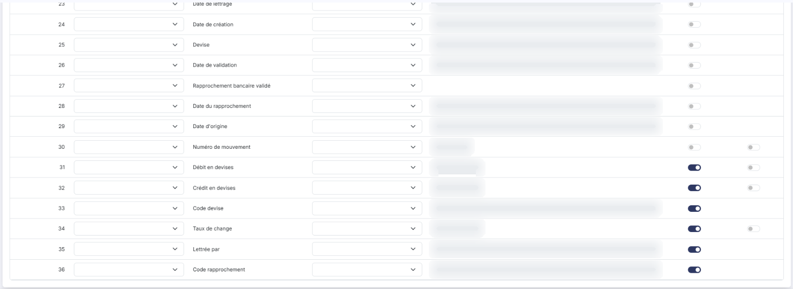
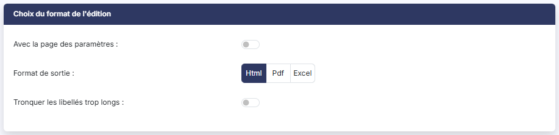

# Générateur d'états


**Où le trouver :** Menu **Editions › Générateur d'états**



**En bref** — Le générateur d'états permet de construire vos propres éditions à partir des données du dossier, de les conserver et de les relancer à tout moment.

* Pour créer un état : bouton \[Créer un générateur d'état], définissez-le dans le panneau « Nouvel état », puis bouton \[Enregistrer].
* Pour produire l'édition d'un état enregistré : panneau des éditions (⋮ Plus d'actions, puis Éditions), entrée « Générateur d'états » de « États personnalisés », puis bouton \[Générer l'édition].
* Pour récupérer les modèles livrés : bouton \[Charger les nouveaux modèles].


Le générateur d'états vous permet de construire vos propres éditions à partir des données du dossier, au lieu de vous limiter aux éditions livrées avec le logiciel. Vous désignez les données à éditer, vous choisissez les colonnes qui les présentent, les critères qui les sélectionnent et le format de sortie, puis vous conservez cette définition pour la relancer aussi souvent que nécessaire.

<figure><figcaption>
Écran « Générateur d'états » de la nouvelle interface
</figcaption></figure>

La page présente la liste des états déjà enregistrés sur le dossier et vous permet d'en créer de nouveaux.

## La liste des états

La grille présente les états enregistrés sur le dossier. Elle comporte les colonnes suivantes :

* **Libellé** : le nom sous lequel l'état a été enregistré.
* **Descriptif** : le commentaire qui accompagne l'état.
* **Date de création** : la date à laquelle l'état a été créé.
* **Format de sortie** : le format dans lequel l'état est produit, tel qu'il a été retenu dans la fiche.
* **Modèle éditeur**

Tant qu'aucun état n'a été enregistré sur le dossier, la grille affiche « Aucun élément à afficher. ».

## Les boutons de la liste

<figure><figcaption>
Bouton [Charger les nouveaux modèles]
</figcaption></figure>

bouton **\[Créer un générateur d'état]**

Placé en bas à droite de l'écran, il ouvre à droite le panneau « Nouvel état », qui est la fiche de définition d'un nouvel état, décrite ci-dessous.

bouton **\[Charger les nouveaux modèles]**

Il vous propose les modèles d'états livrés avec le logiciel qui ne figurent pas encore dans votre dossier : le logiciel rapproche les libellés et ne retient que ceux qui manquent. Vous désignez ceux qui vous intéressent, et ils viennent s'ajouter à la liste du dossier.

Si aucun modèle n'est disponible, ou si le dossier les contient déjà tous, le logiciel vous en informe et n'ouvre aucune fenêtre.

bouton **\[Exporter]**

Il recopie vers d'autres sociétés les états retenus dans la liste, ce qui vous évite de redéfinir le même état dossier par dossier. Sélectionnez-les d'abord : sans sélection, le logiciel refuse l'export et vous invite à retenir au moins un élément. Une fenêtre « Exporter » vous laisse ensuite désigner les destinations, puis valider.

bouton **\[Supprimer]**

Il supprime les états retenus dans la liste. Sélectionnez-les également au préalable.

Ces quatre boutons ne sont pas présentés à tout le monde : chacun dépend d'un droit distinct, et celui dont votre profil ne dispose pas n'apparaît pas au bas de la page.

## La fiche d'un état

<figure><figcaption>
Rubrique « « Informations générales » »
</figcaption></figure>

La fiche s'ouvre dans un panneau à droite de l'écran, intitulé « Nouvel état » à la création et « État » suivi du libellé de l'état à la modification. Elle se présente en trois cartes :

* « Informations générales » : le **Fichier** (champ obligatoire), le **Libellé** (champ obligatoire) et le **Descriptif** de l'état.
* « Sortie » : le format dans lequel l'édition sera produite, par trois boutons **Html**, **Pdf** et **Excel**, puis deux interrupteurs, **Avec la page des paramètres** et **Tronquer les libellés trop longs**, désactivés à l'ouverture (le second devient **Masquer les entêtes et pieds de page** quand le format Excel est retenu). Un « Récapitulatif » résume l'état en cours de composition : colonnes affichées (« 21 affichées sur 36 »), critères, tri et totaux. C'est le choix du format que la liste des états rappelle dans sa colonne **Format de sortie**.
* « Contenu de l'état » : un aperçu des colonnes de l'édition, avec les menus \[Filtres] et \[Colonnes] (voir la rubrique e).

## Le choix du fichier, qui commande toute la fiche

La liste **Fichier** désigne les données sur lesquelles l'état est construit : c'est elle qui détermine ce que votre édition pourra présenter. En comptabilité, elle est particulièrement fournie — dix-sept fichiers — et ceux-ci portent des noms métier, et non des noms techniques : les **Ecritures**, le **Plan comptable**, les **Comptes auxiliaires** ou les **Sections** de l'analytique, par exemple.

Commencez toujours par ce choix : tant qu'aucun fichier n'est retenu, la carte « Contenu de l'état » n'a rien à vous proposer, et changer de fichier redéfinit entièrement la liste des champs.

## Le contenu de l'état : colonnes et critères

Dès qu'un fichier est retenu, la carte « Contenu de l'état » se remplit : elle présente un aperçu des colonnes de l'édition, un en-tête par champ affiché. Tant qu'aucun fichier n'est retenu, elle indique « Choisissez un fichier : ses champs apparaîtront ici. ». Le nombre de champs dépend du fichier, et il peut être important — le fichier **Ecritures** en présente trente-six, du **Débit** et du **Crédit** au **N° de compte**, à la **Date**, au **Journal** ou au **Libellé**, dont vingt et un sont affichés à l'ouverture d'un nouvel état.

Deux menus, au-dessus de l'aperçu, composent l'état :

* bouton **\[Filtres]** : il sert à poser les critères qui sélectionnent les données à éditer. Il propose « Combiner les critères » sur « Tous (ET) » (toutes les conditions doivent être respectées, choix retenu à l'ouverture) ou sur « Au moins un (OU) » (une condition suffit), puis une liste « + Ajouter un critère sur… » pour désigner le champ du critère, et les liens « Vider les filtres » et « Appliquer ». Tant qu'aucun critère n'est posé, le menu indique « Aucun critère : l'état sort toutes les lignes du fichier. »
* bouton **\[Colonnes]** : il indique le nombre de colonnes affichées (« 21/36 ») et ouvre la liste des champs. Chaque champ porte une poignée pour le déplacer, une case « Aff. » qui l'affiche ou le masque dans l'édition, un choix « Tri » (sur « – » à l'ouverture : le Récapitulatif indique alors « Tri : Ordre du fichier ») et un bouton « Total » (Σ). Le total n'est offert que sur les champs qui se prêtent à une somme — un entier, un montant, une quantité — ; sur les autres, le bouton est grisé.

Pour changer l'ordre des colonnes de l'édition, faites glisser un en-tête de l'aperçu, ou la poignée d'une ligne du menu \[Colonnes], et déposez-le à la place voulue. Une phrase sous l'aperçu rappelle les gestes : cliquer sur un en-tête pour trier, glisser un en-tête pour déplacer la colonne ; les colonnes triées le sont de gauche à droite ; le signe Σ marque une colonne totalisée.

Pour ne pas reprendre les champs un à un lorsque la liste est longue, le menu \[Colonnes] propose en tête les liens « Tout afficher » et « Tout masquer ».

## Les boutons de la fiche

<figure><figcaption>
Bouton [Enregistrer]
</figcaption></figure>

bouton **\[Enregistrer]**

Il conserve la définition de l'état. Celui-ci rejoint alors la liste du dossier et peut être relancé à tout moment.

bouton **\[Annuler]**

Placé en pied du panneau, à gauche de \[Enregistrer], il referme le panneau sans rien enregistrer. Si la fiche a été modifiée, la fenêtre « Abandon des modifications » prévient que « Les modifications non enregistrées de cet état seront perdues. » et demande de confirmer l'abandon, par le bouton \[Confirmer] ou le bouton \[Annuler]. La croix de l'en-tête referme aussi le panneau.

**Lancer l'édition d'un état**

La fiche ne comporte plus de bouton \[Lancer l'édition] ni de bouton \[Retour]. Pour produire l'édition d'un état enregistré, dans l'écran Révision, cliquez sur ⋮ (Plus d'actions), puis sur Éditions : le panneau « Éditions » propose, en dernière rubrique, « États personnalisés », l'entrée « Générateur d'états » (également présente dans le menu « Editions » de la barre de menus des pages pleines). Cette entrée liste les états du dossier, groupés par fichier (par exemple « ECRITURES (1) »), chacun avec son descriptif et son format ; elle porte un bouton \[Créer un état], une zone de recherche, un menu \[Filtres] et une carte « Sortie » (format, interrupteurs, Récapitulatif, « Aucun état choisi pour l'instant. » tant que rien n'est sélectionné). Le pied du panneau porte le bouton \[Générer l'édition], grisé tant qu'aucun état n'est choisi.

## Autres vues de l'écran

<figure><figcaption>
« Paramètres des colonnes (glisser et déposer les lignes pour réorganiser l'ordre des colonnes de l'édition) »
</figcaption></figure>

<figure><figcaption>
« Paramètres des colonnes (glisser et déposer les lignes pour réorganiser l'ordre des colonnes de l'édition) »
</figcaption></figure>

<figure><figcaption>
« Paramètres des colonnes (glisser et déposer les lignes pour réorganiser l'ordre des colonnes de l'édition) »
</figcaption></figure>

<figure><figcaption>
« Choix du format de l'édition »
</figcaption></figure>
