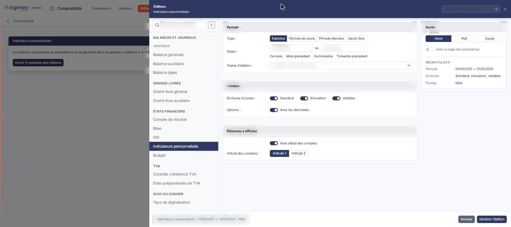
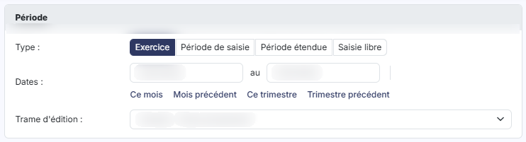
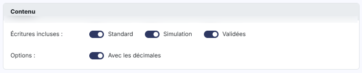
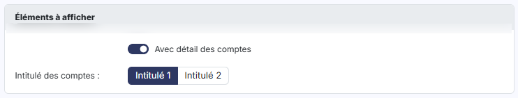
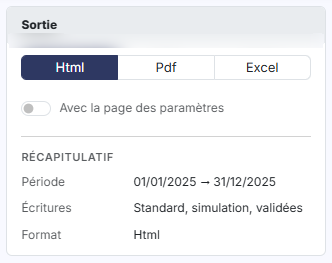
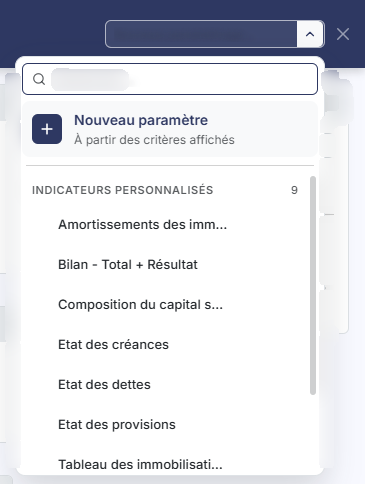
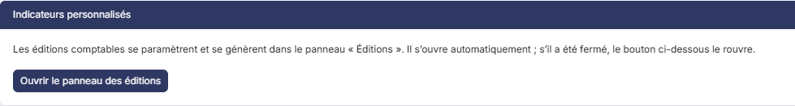

# Indicateurs personnalisés


**Où le trouver :** Menu **Editions › Indicateurs personnalisés**



**En bref** — Cette édition produit un indicateur à partir d'une trame d'édition : vous choisissez la période, la trame, le niveau de détail et le format du document.

* Pour éditer : choisissez la période, la trame et le format, puis bouton \[Générer l'édition].
* Pour réutiliser vos critères : liste « Nouveau paramétrage… » en haut du panneau, puis sélectionnez un paramétrage enregistré.


Cette page vous permet d'éditer un indicateur à partir d'une trame d'édition. Vous choisissez la période, la trame à utiliser, le niveau de détail souhaité, puis le format dans lequel le document est produit. Vous le générez avec le bouton **\[Générer l'édition]**.

<figure><figcaption>
Écran « Indicateurs personnalisés » de la nouvelle interface
</figcaption></figure>

Pour l'ouvrir, dans l'écran Révision, cliquez sur ⋮ (Plus d'actions), puis sur « Éditions » ; dans la liste de gauche du panneau qui s'ouvre, choisissez « Indicateurs personnalisés » (groupe « États financiers »).

Cette édition ne s'ouvre plus dans une page de paramétrage : elle se paramètre et se génère dans le **panneau d'éditions**, commun à toutes les éditions comptables. La page qui s'affiche derrière porte le titre de l'édition et le bouton **\[Ouvrir le panneau des éditions]** : le panneau s'ouvre de lui-même ; si vous l'avez fermé, ce bouton le rouvre.

Le panneau est un tiroir intitulé « Éditions », suivi du nom de l'édition. **À gauche**, la liste des quatorze éditions en cinq groupes — « Balances et journaux », « Grands-livres », « États financiers », « TVA » et « Suivi du dossier » — avec une zone « Rechercher une édition » et un bouton « Replier la liste » ; cliquer sur une autre édition change de formulaire sans quitter le panneau. **Au centre**, le formulaire, présenté en cartes. **À droite**, la carte « Sortie » et le « Récapitulatif » des critères retenus. **En en-tête**, la liste des paramétrages enregistrés (voir plus bas) et la croix « Fermer ». **Dans le pied**, un résumé de l'édition (nom, dates, format) et, à droite, le bouton **\[Générer l'édition]**. Le pied ne porte pas de bouton \[Annuler] : le panneau se referme par la croix « Fermer » de l'en-tête.

Les critères se présentent en trois cartes, dans l'ordre suivant : « Période », « Contenu » et « Éléments à afficher ». Dans le module Comptabilité, il n'y a ni carte « Périmètre », ni choix d'un dossier de révision : ils n'existent que dans le module Compta expert.

## Carte « Période »

<figure><figcaption>
Rubrique « a) Carte « Période » »
</figcaption></figure>

| Champ               | Ce qu'il faut savoir                                                                                                                                                                                                                                                                                                                                                                                                                                                                                                                                                                                                                                                                                                                                                                    |
| ------------------- | --------------------------------------------------------------------------------------------------------------------------------------------------------------------------------------------------------------------------------------------------------------------------------------------------------------------------------------------------------------------------------------------------------------------------------------------------------------------------------------------------------------------------------------------------------------------------------------------------------------------------------------------------------------------------------------------------------------------------------------------------------------------------------------- |
| **Type**            | 
Quatre boutons, « Exercice », « Période de saisie », « Période étendue » et « Saisie libre ». Ce choix renseigne automatiquement la fourchette de dates. <strong>Dates : … au</strong> les deux champs affichent la fourchette correspondant au type choisi, et vous pouvez les saisir quel que soit le type : ils ne sont plus en lecture seule. Modifier une date fait passer le type sur « Saisie libre ». Le type « Période étendue » les laisse vides. Il n'y a plus de pictogramme « Calendrier » : le calendrier s'ouvre au clic dans la zone de date. Quatre raccourcis, placés sous les dates, remplissent la fourchette en un clic : « Ce mois », « Mois précédent », « Ce trimestre » et « Trimestre précédent ». Ils font passer le type sur « Saisie libre ».
 |
| **Trame d'édition** | Cette liste réunit les modèles d'indicateurs disponibles. Les modèles livrés avec le logiciel ont un libellé encadré d'astérisques, par exemple « _Achats - Frais accessoires_ » ; ceux qui ont été créés pour le dossier n'en portent pas. Le logiciel propose par défaut le premier modèle de la liste.                                                                                                                                                                                                                                                                                                                                                                                                                                                                               |

## Carte « Contenu »

<figure><figcaption>
Rubrique « b) Carte « Contenu » »
</figcaption></figure>

| Champ                  | Ce qu'il faut savoir                                                                                 |
| ---------------------- | ---------------------------------------------------------------------------------------------------- |
| **Écritures incluses** | Trois interrupteurs, « Standard », « Simulation » et « Validées ». Les trois sont actifs par défaut. |
| **Avec les décimales** | Interrupteur actif par défaut.                                                                       |

## Carte « Éléments à afficher »

<figure><figcaption>
Rubrique « c) Carte « Éléments à afficher » »
</figcaption></figure>

| Champ                       | Ce qu'il faut savoir                                                                                                                                            |
| --------------------------- | --------------------------------------------------------------------------------------------------------------------------------------------------------------- |
| **Avec détail des comptes** | Interrupteur actif par défaut. Le champ « Intitulé des comptes » reste présenté lorsque vous le désactivez.                                                     |
| **Intitulé des comptes**    | Vous choisissez lequel des deux intitulés du compte est repris dans l'édition, « Intitulé 1 » ou « Intitulé 2 ». Le logiciel retient « Intitulé 1 » par défaut. |

## Carte « Sortie » (à droite du formulaire)

<figure><figcaption>
Rubrique « d) Carte « Sortie » (à droite du formulaire) »
</figcaption></figure>

| Champ                           | Ce qu'il faut savoir                                                                                                                                                                                                                                                                                                      |
| ------------------------------- | ------------------------------------------------------------------------------------------------------------------------------------------------------------------------------------------------------------------------------------------------------------------------------------------------------------------------- |
| **Format**                      | 
Trois formats sont proposés, en boutons : « Html », « Pdf » et « Excel ». Le logiciel retient « Html » par défaut. Les deux champs suivants ne s'affichent que si vous retenez le format « Pdf » ; ils disparaissent avec les formats « Html » et « Excel ».
                                                    |
| **Orientation**                 | Deux choix, « Portrait » et « Paysage ».                                                                                                                                                                                                                                                                                  |
| **Largeur**                     | Deux choix, « Fixe » et « Ajustée ». L'infobulle du pictogramme « Information » précise : « Ajuste la taille si la largeur des colonnes dépasse la largeur de la page ». Le passage au format « Pdf » positionne ce champ sur « Ajustée » : si vous préférez la largeur fixe, choisissez-la après avoir retenu le format. |
| **Avec la page des paramètres** | Interrupteur désactivé par défaut.                                                                                                                                                                                                                                                                                        |

Sous la carte, le « Récapitulatif » rappelle la période, les écritures incluses et le format retenus ; il ajoute l'orientation lorsque vous choisissez « Pdf ».

## Le bouton et les paramétrages enregistrés

<figure><figcaption>
Rubrique « Liste « Nouveau paramétrage… » »
</figcaption></figure>

bouton **\[Générer l'édition]**

Il lance la production de l'indicateur dans le format retenu, à partir de l'ensemble des critères saisis.

**Liste « Nouveau paramétrage… »**

Placée en haut du tiroir, elle remplace les anciens boutons \[Mémoriser les paramètres] et \[Charger les paramètres]. Elle propose un champ « Rechercher… », « Nouveau paramètre » (« À partir des critères affichés ») puis les paramétrages déjà enregistrés pour cette édition, regroupés sous l'intitulé « Indicateurs personnalisés » suivi de leur nombre. Sélectionnez un paramétrage pour renseigner le panneau en une seule fois.

## Autres vues de l'écran

<figure><figcaption>
Bouton [Ouvrir le panneau des éditions]
</figcaption></figure>
