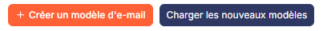
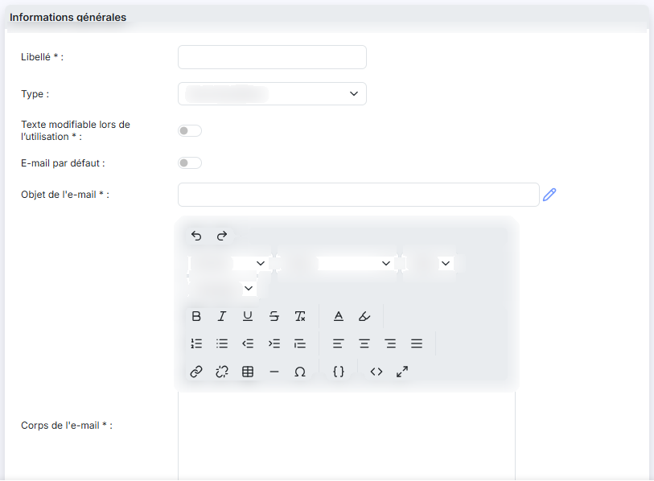
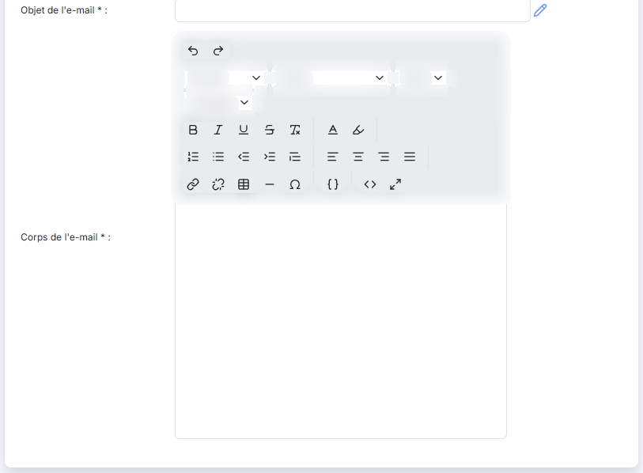
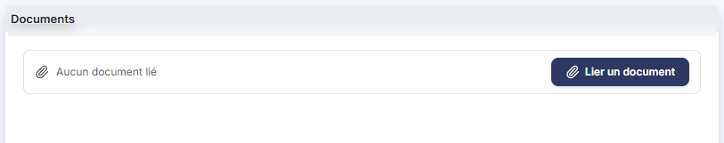
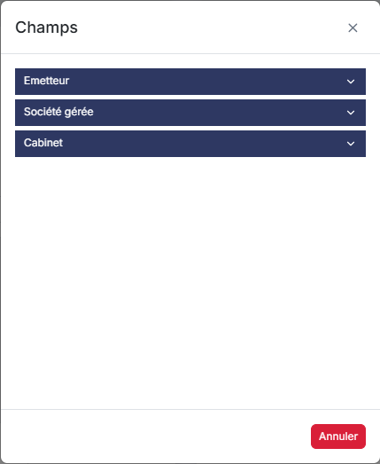

# E-mails


**Où le trouver :** Panneau **Paramètres** › **Modèles** › **E-mails**



**En bref** — Cet écran permet de préparer à l'avance les e-mails que le logiciel envoie pour vous : objet, corps du message et documents joints, que vous choisissez ensuite à l'envoi.

* Pour créer un modèle : bouton \[Nouveau], renseignez la fiche, puis bouton \[Enregistrer].
* Pour récupérer les modèles de l'éditeur : bouton \[Charger les nouveaux modèles].
* Pour copier vos modèles vers d'autres sociétés : bouton \[Exporter].


Cette option vous permet de préparer à l'avance les e-mails que le logiciel enverra pour vous : leur objet, le corps du message, et les documents qui les accompagnent. Vous n'avez plus, au moment de l'envoi, qu'à choisir le modèle qui convient.

<figure><figcaption>
Écran « E-mails » de la nouvelle interface
</figcaption></figure>

Chaque modèle porte un **type**, qui dit à quelle occasion il vous sera proposé — un envoi de pièces, une relance, un envoi de déclarations… Pour un même type, vous pouvez désigner un modèle comme étant celui que le logiciel retient par défaut.

Le message n'est pas figé pour autant : vous y insérez des **champs dynamiques**, c'est-à-dire des codes que le logiciel remplace par la bonne valeur au moment de l'envoi — le nom de votre correspondant, la raison sociale du dossier, les coordonnées de votre cabinet. Un seul modèle sert ainsi pour tous vos destinataires.

## La liste des modèles

<figure><figcaption>
Bouton [Nouveau]
</figcaption></figure>

À l'ouverture de l'option, le logiciel affiche les modèles enregistrés pour le dossier. La liste comporte quatre colonnes :

| Champ             | Ce qu'il faut savoir                                                       |
| ----------------- | -------------------------------------------------------------------------- |
| **Libellé**       | Le nom que vous avez donné au modèle.                                      |
| **Type**          | L'occasion à laquelle le modèle vous sera proposé.                         |
| **Objet du mail** | L'objet du message, tel qu'il partira.                                     |
| **Par défaut**    | Oui ou Non, selon que le modèle est celui retenu par défaut pour son type. |

Les trois premières colonnes sont triables.

La colonne **Type** n'affiche pas le mot que vous avez choisi dans la fiche, mais la valeur que le logiciel emploie en interne : un modèle enregistré avec le type « Envoi de pièces » apparaît ici sous la mention « Piece ». Ne vous étonnez donc pas de ne pas y retrouver le libellé de la liste déroulante.

Une case à cocher précède chaque ligne : elle sert à désigner les modèles sur lesquels porteront les **Boutons \[Exporter]** et **\[Supprimer]** de la barre de pied d'écran. L'en-tête de cette première colonne réunit les commandes de la liste, et le pied porte la pagination habituelle avec le compteur des lignes affichées.

**Les commandes d'une ligne**

Chaque ligne porte trois commandes, présentées dans cet ordre :

**Modifier** (pictogramme « Crayon ») : ouvre la fiche du modèle.

**Supprimer** (pictogramme « Croix ») : supprime le modèle.

**Dupliquer** (pictogramme « Feuille avec flèche ») : reprend le contenu du modèle pour en créer un autre. C'est le moyen de partir d'un modèle existant plutôt que d'une fiche vierge.

bouton **\[Nouveau]**

Il ouvre une fiche vierge pour créer un modèle.

bouton **\[Charger les nouveaux modèles]**

Il vous propose les modèles publiés par l'éditeur dans la base modèle, et reprend dans votre dossier ceux que vous retenez. C'est ainsi que vous récupérez un modèle livré après la mise en service de votre dossier, sans avoir à le ressaisir.

bouton **\[Exporter]**

Il ouvre la fenêtre d'export du logiciel — la même que dans les autres options de paramétrage — pour recopier vers d'autres sociétés les modèles dont vous avez coché la case en début de ligne.

bouton **\[Supprimer]**

Il supprime les modèles dont vous avez coché la case en début de ligne.

## La fiche d'un modèle

<figure><figcaption>
Rubrique « Rubrique « Informations générales » »
</figcaption></figure>

<figure><figcaption>
Rubrique « Rubrique « Informations générales » »
</figcaption></figure>

<figure><figcaption>
Rubrique « Rubrique « Documents » »
</figcaption></figure>

<figure><figcaption>
Rubrique « Les champs dynamiques »
</figcaption></figure>

La fiche est la même en création et en modification. Les libellés suivis d'un astérisque rouge sont obligatoires. Elle se compose de deux rubriques, « Informations générales » puis « Documents ».

**Rubrique « Informations générales »**

| Champ                                                                                  | Ce qu'il faut savoir                                                                                                                                                                                                                                                                                                                                                                                                                                                                             |
| -------------------------------------------------------------------------------------- | ------------------------------------------------------------------------------------------------------------------------------------------------------------------------------------------------------------------------------------------------------------------------------------------------------------------------------------------------------------------------------------------------------------------------------------------------------------------------------------------------ |
| 
<strong>Libellé</strong> <em>Obligatoire</em>
                                | Le nom du modèle, celui qui vous sera présenté au moment de choisir.                                                                                                                                                                                                                                                                                                                                                                                                                             |
| **Type**                                                                               | L'occasion à laquelle le modèle vous sera proposé. La liste en propose huit, dans cet ordre : « Changement de mot de passe », « Courrier client », « Création utilisateur », « Demandes infos client », « Envoi de pièces », « Envoi déclarations », « Envoi dossier CAC » et « Relance ». À la création, le logiciel présélectionne « Envoi de pièces ».                                                                                                                                        |
| 
<strong>Texte modifiable lors de l’utilisation</strong> <em>Obligatoire</em>
 | Sur Oui, vous pourrez retoucher le message au moment de l'envoi ; sur Non, le corps du message vous est présenté en lecture seule et part tel que vous l'avez écrit ici.                                                                                                                                                                                                                                                                                                                         |
| **E-mail par défaut**                                                                  | Sur Oui, ce modèle devient celui que le logiciel retient pour son type. C'est cette valeur que reprend la colonne « Par défaut » de la liste.                                                                                                                                                                                                                                                                                                                                                    |
| 
<strong>Objet de l'e-mail</strong> <em>Obligatoire</em>
                      | L'objet du message. Un pictogramme placé à droite du champ, dont l'infobulle indique « Insérer un champ dynamique », ouvre la fenêtre décrite ci-dessous.                                                                                                                                                                                                                                                                                                                                        |
| 
<strong>Corps de l'e-mail</strong> <em>Obligatoire</em>
                      | 
Le texte du message, saisi dans un éditeur de texte enrichi. <strong>Les champs dynamiques</strong> Le pictogramme placé à droite de l'objet ouvre la fenêtre « Champs ». Cliquez sur la ligne du renseignement voulu : le logiciel insère son code, entre crochets, à l'endroit où se trouve le curseur. Le bouton <strong>[Annuler]</strong> referme la fenêtre sans rien insérer. Les renseignements y sont rangés sous trois bandeaux, que vous dépliez l'un après l'autre :
 |
| **Émetteur**                                                                           | La personne qui envoie le message — sa civilité, son nom, son prénom, sa fonction.                                                                                                                                                                                                                                                                                                                                                                                                               |
| **Société gérée**                                                                      | Le dossier auquel se rapporte l'envoi — son contact, sa raison sociale, son adresse, ses identifiants et ses renseignements juridiques.                                                                                                                                                                                                                                                                                                                                                          |
| **Cabinet**                                                                            | Les mêmes renseignements, pour votre cabinet.                                                                                                                                                                                                                                                                                                                                                                                                                                                    |

Les deux derniers bandeaux emploient les mêmes libellés — « Nom du contact », « Raison sociale de la société »… — et seuls leurs codes diffèrent. C'est donc le bandeau, et non le libellé, qui vous dit de qui l'on parle : prenez le renseignement sous « Société gérée » pour parler du dossier, et sous « Cabinet » pour parler de vous.

Le corps du message dispose du même mécanisme sous un autre nom : le bouton « Insérer des champs » de la barre d'outils de l'éditeur.

**Rubrique « Documents »**

Vous joignez ici les documents qui accompagneront les envois faits avec ce modèle. La grille en présente la **Description**, le **Nom du fichier**, la **Date** et le nom de celui qui l'a déposé (**Créé par**) ; tant qu'aucun document n'est joint, elle affiche « Liste vide ».

Trois boutons, sous la grille, disent d'où vient le document : bouton **\[Nouveau doc depuis mon poste]**, bouton **\[Nouveau doc depuis la GED]** et bouton **\[Nouveau doc depuis l'OCR]**.

bouton **\[Enregistrer]**

Il enregistre le modèle et vous ramène à la liste.

bouton **\[Retour]**

Il vous ramène à la liste sans enregistrer votre saisie.
