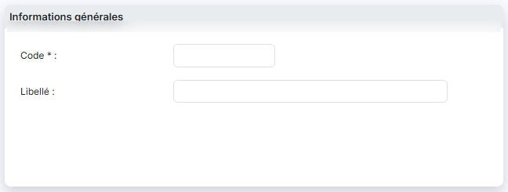
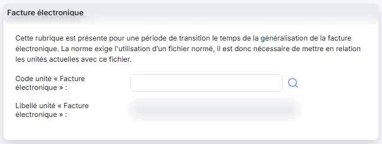

# Unités


**Où le trouver :** Panneau **Paramètres** › **Données** › **Tiers et commercial** › **Unités**



**En bref** — Cet écran gère les unités utilisées avec les quantités dans les écritures, lorsque la gestion des quantités est activée dans les paramètres.

* Pour créer une unité : bouton \[Nouveau], renseignez le code, puis bouton \[Enregistrer].
* Pour supprimer des unités : cochez-les, puis bouton \[Supprimer].


Cette option vous permet de gérer les unités qui seront utilisées conjointement avec les quantités dans les écritures, si le paramètre « Gestion des quantités » dans les écritures a été activé dans le menu « Paramètres », option « Paramètres généraux ».

<figure><figcaption>
Écran « Unités » de la nouvelle interface
</figcaption></figure>

## La liste des unités

À l'ouverture de l'option, le logiciel affiche la liste des unités du dossier. Elle comporte deux colonnes, l'une et l'autre triables :

| Champ       | Ce qu'il faut savoir                                  |
| ----------- | ----------------------------------------------------- |
| **Code**    | Code de l'unité, celui que vous désignerez en saisie. |
| **Libellé** | Intitulé en clair de l'unité.                         |

Rien n'oblige le code à être abrégé : « Kg » et « Heures » se côtoient sans difficulté dans une même liste.

Une case à cocher précède chaque ligne : elle sert à désigner les unités sur lesquelles portera le bouton **\[Supprimer]** de la barre de pied d'écran. L'en-tête de cette première colonne réunit les commandes de la liste, et le pied porte la pagination habituelle avec le compteur des lignes affichées.

**Les commandes d'une ligne**

Chaque ligne porte trois commandes, présentées dans cet ordre :

**Modifier** (pictogramme « Crayon ») : ouvre la fiche de l'unité.

**Supprimer** (pictogramme « Croix ») : supprime l'unité.

**Dupliquer** (pictogramme « Feuille avec flèche ») : reprend le contenu de l'unité pour en créer une autre. C'est le moyen de repartir d'une unité existante, le code d'une unité n'étant plus modifiable une fois celle-ci enregistrée.

bouton **\[Nouveau]**

Il ouvre une fiche vierge pour créer une unité.

bouton **\[Supprimer]**

Il supprime les unités dont vous avez coché la case en début de ligne.

## La fiche d'une unité

<figure><figcaption>
Rubrique « Rubrique « Informations générales » »
</figcaption></figure>

<figure><figcaption>
Rubrique « Rubrique « Facture électronique » »
</figcaption></figure>

Les libellés suivis d'un astérisque rouge sont obligatoires. Elle se compose de deux rubriques.

**Rubrique « Informations générales »**

| Champ                                                | Ce qu'il faut savoir                                                                                                                                                                                                                                                                                                                                                                                                                                                                                                                                                        |
| ---------------------------------------------------- | --------------------------------------------------------------------------------------------------------------------------------------------------------------------------------------------------------------------------------------------------------------------------------------------------------------------------------------------------------------------------------------------------------------------------------------------------------------------------------------------------------------------------------------------------------------------------- |
| 
<strong>Code</strong> <em>Obligatoire</em>
 | Code de l'unité. Vous le saisissez à la création ; en modification, il vous est présenté grisé et ne peut plus être changé. Pour corriger un code mal saisi, dupliquez l'unité depuis la liste, puis supprimez celle d'origine.                                                                                                                                                                                                                                                                                                                                             |
| **Libellé**                                          | 
Intitulé en clair de l'unité. <strong>Rubrique « Facture électronique »</strong> Le logiciel affiche en tête de rubrique le texte suivant : « Cette rubrique est présente pour une période de transition le temps de la généralisation de la facture électronique. La norme exige l'utilisation d’un fichier normé, il est donc nécessaire de mettre en relation les unités actuelles avec ce fichier. » Autrement dit, vous rapprochez ici chacune de vos unités de l'unité correspondante du référentiel normé, celui que la facture électronique impose.
 |
| **Code unité « Facture électronique »**              | Code de l'unité correspondante dans le référentiel normé. Le pictogramme « Loupe » placé à droite du champ ouvre la fenêtre de recherche décrite ci-dessous.                                                                                                                                                                                                                                                                                                                                                                                                                |
| **Libellé unité « Facture électronique »**           | Le logiciel affiche le libellé du code normé retenu ; ce champ ne se saisit pas.                                                                                                                                                                                                                                                                                                                                                                                                                                                                                            |

Ces deux champs ne portent pas d'astérisque : ils peuvent rester vides.

**La fenêtre « Recherche »**

Elle porte un champ **Contenu recherché :** et un bouton **\[Rechercher]**, puis affiche les unités normées correspondantes sous la mention « Cliquez pour sélectionner » : un clic sur la ligne voulue reporte le code dans la fiche. Un pictogramme d'information, à côté du bouton, rappelle les raccourcis clavier de cette fenêtre — lancer la recherche, passer d'un résultat à l'autre, sélectionner. La croix, en haut à droite, referme la fenêtre sans rien reporter.

bouton **\[Enregistrer]**

Il enregistre l'unité et vous ramène à la liste.

bouton **\[Retour]**

Il vous ramène à la liste sans enregistrer votre saisie.
