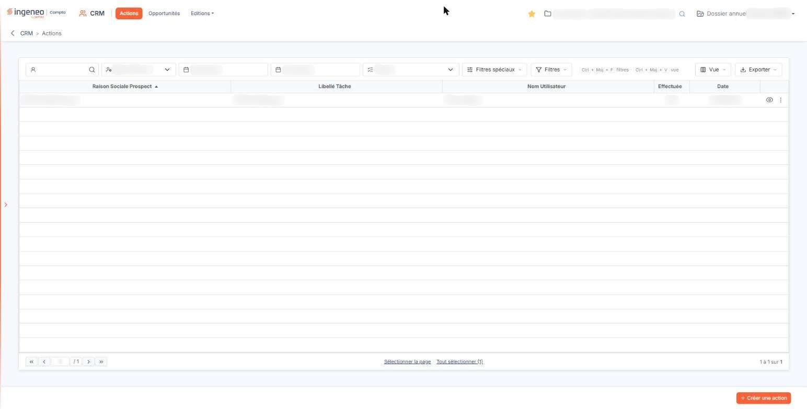
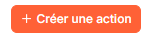
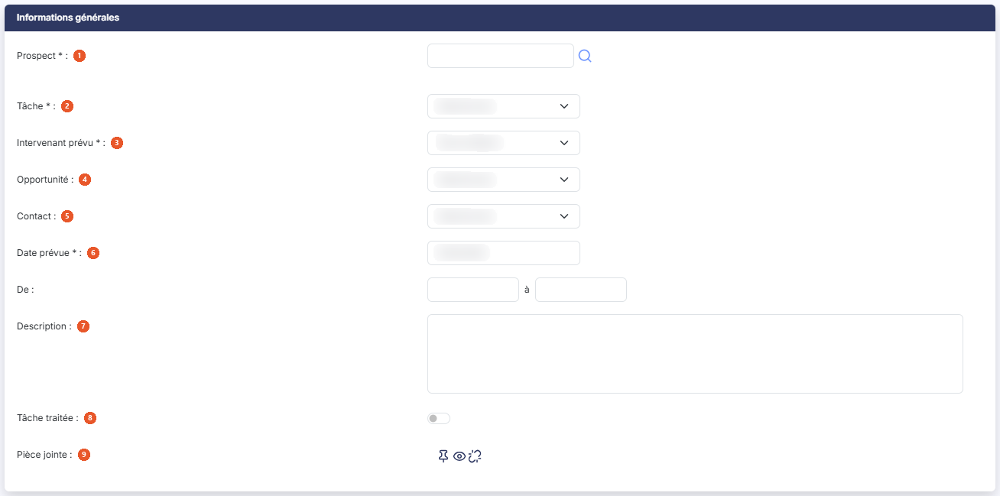
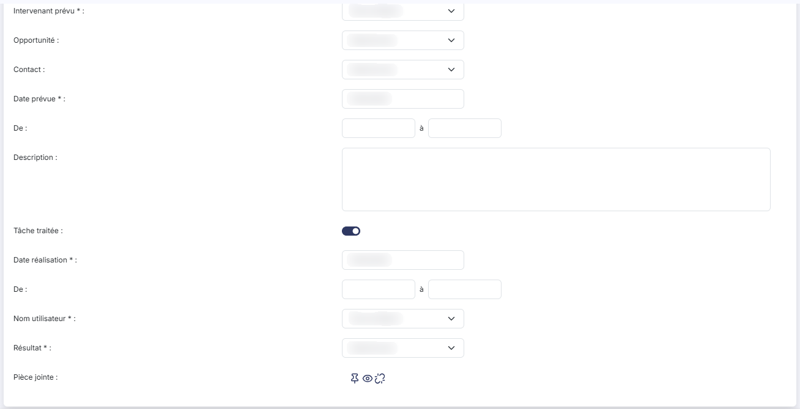

# Actions


**Où le trouver :** Menu **Actions**



**En bref** — Cet écran est le tableau de bord de vos actions commerciales : il montre ce qui vous reste à faire sur l'exercice en cours et permet d'ajouter, de modifier ou de supprimer des actions.

* Pour planifier une démarche : bouton \[Créer une action], renseignez le prospect, la tâche, l'intervenant prévu et la date prévue, puis bouton \[Enregistrer].
* Pour clôturer une action menée : ouvrez-la par le pictogramme « Modifier », activez « Tâche traitée », renseignez la date de réalisation, le nom de l'utilisateur et le résultat, puis bouton \[Enregistrer].
* Pour voir les actions du jour : bouton \[Filtres spéciaux], puis bouton \[Juste aujourd'hui].


## Les filtres d'affichage

<figure><figcaption>
Écran « Actions » de la nouvelle interface
</figcaption></figure>

Une barre de filtres est présentée au-dessus de la liste. Elle est renseignée d'office à l'ouverture de l'écran, de sorte que vous voyez immédiatement vos actions en cours sans avoir rien à saisir.

| Champ                 | Ce qu'il faut savoir                                                                                                                                                                                                                                                                                                                                                                                                                                                                                                                              |
| --------------------- | ------------------------------------------------------------------------------------------------------------------------------------------------------------------------------------------------------------------------------------------------------------------------------------------------------------------------------------------------------------------------------------------------------------------------------------------------------------------------------------------------------------------------------------------------- |
| **Prospect**          | Une zone de saisie accompagnée du pictogramme « Loupe », qui vous permet de rechercher le prospect dont vous voulez voir les actions.                                                                                                                                                                                                                                                                                                                                                                                                             |
| **Intervenant**       | Le logiciel vous propose d'office **votre propre nom**, pour que vous arriviez sur vos actions et non sur celles de tout le cabinet. La liste contient également le choix « Tous » ainsi que le nom de chacun des intervenants.                                                                                                                                                                                                                                                                                                                   |
| **Du**                | **Au :** deux dates, préremplies avec le premier et le dernier jour de l'exercice en cours. Le calendrier s'ouvre en cliquant dans le champ.                                                                                                                                                                                                                                                                                                                                                                                                      |
| **Tâche**             | 
Le choix « Toutes », suivi de chacune des tâches que vous avez paramétrées. Reportez-vous à l'option « Tâches » du menu « Paramétrage » de la présente aide en ligne. La liste se recharge d'elle-même dès que vous modifiez l'un de ces filtres : il n'y a plus de bouton [Afficher] ni de bouton [Annuler les filtres]. Lorsqu'un filtre diffère de l'affichage de départ, un lien « Tout effacer » apparaît à droite de la barre. bouton <strong>[Filtres spéciaux]</strong> : il ouvre un petit menu qui regroupe deux réglages.
 |
| **Période**           | Le bouton **\[Juste aujourd'hui]** place la date du jour dans les deux zones « Du » et « Au », pour vous montrer d'un seul geste ce qui est prévu pour la journée.                                                                                                                                                                                                                                                                                                                                                                                |
| **Actions terminées** | Un interrupteur « Inclure », **désactivé** à l'ouverture. Les actions déjà traitées sont donc masquées tant que vous ne l'activez pas pour les voir.                                                                                                                                                                                                                                                                                                                                                                                              |

bouton **\[Filtres]** : il ouvre un volet « Filtrer » où vous construisez vos propres critères sur les colonnes de la liste (« + Ajouter un critère sur… »). Le bouton **\[Filtrer]** du volet les applique et le lien « Vider les filtres » les retire.

## La liste des actions

La liste présente cinq colonnes, chacune triable en cliquant sur son titre :

| Champ                       | Ce qu'il faut savoir                                                                 |
| --------------------------- | ------------------------------------------------------------------------------------ |
| **Raison Sociale Prospect** | Le prospect auquel l'action se rapporte.                                             |
| **Libellé Tâche**           | La tâche à accomplir, choisie dans votre paramétrage.                                |
| **Nom Utilisateur**         | L'intervenant chargé de l'action.                                                    |
| **Effectuée**               | Indique si l'action a été marquée comme traitée (« Non » tant qu'elle ne l'est pas). |
| **Date**                    | La date prévue de l'action, au format jour/mois/année.                               |

Cette liste ne propose aucune autre colonne : le menu qu'ouvre le bouton **\[Vue]**, rubrique « Colonnes affichées », n'en contient que ces cinq (« 5 colonnes affichées sur 5 »). Ce menu vous permet aussi d'enregistrer la disposition de la liste sous « Mes vues » (« Enregistrer la vue actuelle ») et de revenir aux colonnes d'origine (« Rétablir les colonnes d'origine »).

bouton **\[Exporter]** : il ouvre un menu consacré à « La liste affichée » : « Aperçu » (édition HTML), « Imprimer », « Exporter en Excel », « Exporter en PDF » et « Envoyer la liste par e-mail ».

Lorsqu'aucune action ne répond à vos filtres, le logiciel affiche « Aucun élément à afficher. ».

Le fonctionnement commun à toutes les listes — tris, largeur et choix des colonnes, navigation entre les pages, cases de sélection — est décrit au chapitre : Généralités / Fonctionnement général / Fonctionnement d'une grille de la présente aide en ligne.

## Les pictogrammes de chaque ligne

Les commandes d'une ligne apparaissent à son survol, à droite, dans la dernière colonne. Un clic sur la ligne la sélectionne.

Le pictogramme « Modifier » ouvre la fiche de l'action.

Le pictogramme « Afficher l'aperçu » vous emmène sur la **saisie unifiée** du prospect concerné, c'est-à-dire sur l'écran qui rassemble sur une seule page les informations générales du prospect, ses contacts, ses opportunités et ses actions. Cet écran est décrit à l'option « Prospects » du menu « Paramétrage » de la présente aide en ligne.

Le pictogramme « Autres actions » (trois points) ouvre un menu qui propose « Supprimer » : cette entrée supprime l'action, après confirmation.

## Les boutons de la liste

<figure><figcaption>
Bouton [Créer une action]
</figcaption></figure>

bouton **\[Créer une action]** : placé en bas à droite de l'écran, il ouvre une fiche d'action vierge.

Sous la liste, les liens « Sélectionner la page » et « Tout sélectionner (n) » sélectionnent les lignes de la page ou toutes celles de la liste. Dès qu'une ligne est sélectionnée, un bandeau apparaît en bas de l'écran (« 1 action sélectionnée ») avec un bouton **\[Supprimer]** : il supprime, après confirmation, les actions sélectionnées.

## La fiche d'une action

<figure><figcaption>
Rubrique « La fiche d'une action »
</figcaption></figure>

La fiche ne comporte qu'une seule rubrique, « Informations générales ». Les champs suivis d'un astérisque rouge sont obligatoires.

| Champ                                                                | Ce qu'il faut savoir                                                                                                                                                                                                                                                                                                                                                                                                                                                                                                                                                            |
| -------------------------------------------------------------------- | ------------------------------------------------------------------------------------------------------------------------------------------------------------------------------------------------------------------------------------------------------------------------------------------------------------------------------------------------------------------------------------------------------------------------------------------------------------------------------------------------------------------------------------------------------------------------------- |
| 
1. <strong>Prospect</strong> <em>Obligatoire</em>
          | Le prospect concerné. En création, vous le recherchez à l'aide du pictogramme « Loupe ». Une fois l'action enregistrée, ce champ n'est plus modifiable : il apparaît sur fond gris, sans pictogramme de recherche, et l'astérisque disparaît. Une action reste donc attachée au prospect pour lequel vous l'avez créée.                                                                                                                                                                                                                                                         |
| 
2. <strong>Tâche</strong> <em>Obligatoire</em>
             | La nature de la démarche à mener, choisie parmi les tâches que vous avez paramétrées.                                                                                                                                                                                                                                                                                                                                                                                                                                                                                           |
| 
3. <strong>Intervenant prévu</strong> <em>Obligatoire</em>
 | La personne à qui l'action est confiée. Le logiciel vous propose d'office votre propre nom.                                                                                                                                                                                                                                                                                                                                                                                                                                                                                     |
| 4. **Opportunité**                                                   | Il vous permet de rattacher l'action à l'une de vos opportunités, afin de retrouver ensuite, depuis l'opportunité, toutes les démarches qui ont été menées pour l'emporter.                                                                                                                                                                                                                                                                                                                                                                                                     |
| 5. **Contact**                                                       | Il désigne la personne, chez le prospect, avec laquelle la démarche est menée. Un pictogramme « Œil » (Visualiser contact) est placé à droite de la liste. Il ne dépend pas du contact que vous avez choisi : il vous ouvre une fenêtre intitulée « Contact » qui vous présente la fiche du **prospect** de l'action — sa raison sociale, sa date de création, son origine et le nom de son créateur — puis, sous la rubrique « Adresse », la liste de ses adresses, qui sont aussi ses contacts. Un bouton **\[Nouveau]** placé sous cette liste vous permet d'en ajouter une. |
| 
6. <strong>Date prévue</strong> <em>Obligatoire</em>
       | La date à laquelle l'action doit être menée, proposée d'office à la date du jour ; le calendrier s'ouvre en cliquant dans le champ. Une fois l'action enregistrée, cette date n'est plus modifiable. Sous la date, deux petites zones « De : … à … » vous permettent de préciser, si vous le souhaitez, l'heure de début et l'heure de fin prévues.                                                                                                                                                                                                                             |
| 7. **Description**                                                   | Une zone de plusieurs lignes où vous consignez ce qui doit être fait, ou ce qui a été dit.                                                                                                                                                                                                                                                                                                                                                                                                                                                                                      |
| 8. **Tâche traitée**                                                 | Un interrupteur, **désactivé** tant que la démarche n'est pas accomplie. Son activation déplie trois informations supplémentaires, décrites au paragraphe suivant.                                                                                                                                                                                                                                                                                                                                                                                                              |
| 9. **Pièce jointe**                                                  | Elle vous permet de conserver un document avec l'action — un compte rendu de visite, une proposition envoyée, un courrier reçu. Trois pictogrammes la gouvernent : « Lier un document », « Visualiser le document » et « Supprimer le document ».                                                                                                                                                                                                                                                                                                                               |

bouton **\[Enregistrer]** : il valide la fiche et vous ramène à la liste.

Pour quitter la fiche sans rien enregistrer, utilisez la flèche « Revenir en arrière » placée à gauche du fil d'Ariane.

## Clôturer une action : le passage de « Tâche traitée » à Oui

<figure><figcaption>
Rubrique « Clôturer une action »
</figcaption></figure>

Lorsque la démarche a été menée, vous rouvrez l'action et vous activez l'interrupteur « Tâche traitée ». Le logiciel affiche alors, entre ce choix et la pièce jointe, trois informations qui décrivent la réalisation — et qui sont toutes les trois obligatoires, car c'est ce compte rendu qui donne sa valeur à votre suivi commercial.

| Champ                                                            | Ce qu'il faut savoir                                                                                                                                                                                                                                                                                                                                                                                                 |
| ---------------------------------------------------------------- | -------------------------------------------------------------------------------------------------------------------------------------------------------------------------------------------------------------------------------------------------------------------------------------------------------------------------------------------------------------------------------------------------------------------- |
| 
<strong>Date réalisation</strong> <em>Obligatoire</em>
 | La date à laquelle la démarche a réellement eu lieu, proposée d'office à la date du jour et non à la date prévue. Comme pour la date prévue, deux petites zones « De : … à … » vous permettent de préciser l'heure de début et l'heure de fin.                                                                                                                                                                       |
| 
<strong>Nom utilisateur</strong> <em>Obligatoire</em>
  | La personne qui a effectivement mené la démarche. Elle peut différer de l'intervenant qui était prévu.                                                                                                                                                                                                                                                                                                               |
| 
<strong>Résultat</strong> <em>Obligatoire</em>
         | L'issue de la démarche. Les résultats qui vous sont proposés ici **dépendent de la tâche choisie plus haut** : chaque résultat que vous paramétrez est rattaché à une tâche, et seuls les résultats de cette tâche vous sont présentés. Un rendez-vous n'a pas les mêmes issues possibles qu'un envoi de documentation. Reportez-vous à l'option « Résultats » du menu « Paramétrage » de la présente aide en ligne. |

Désactiver à nouveau l'interrupteur « Tâche traitée » masque ces trois informations.
