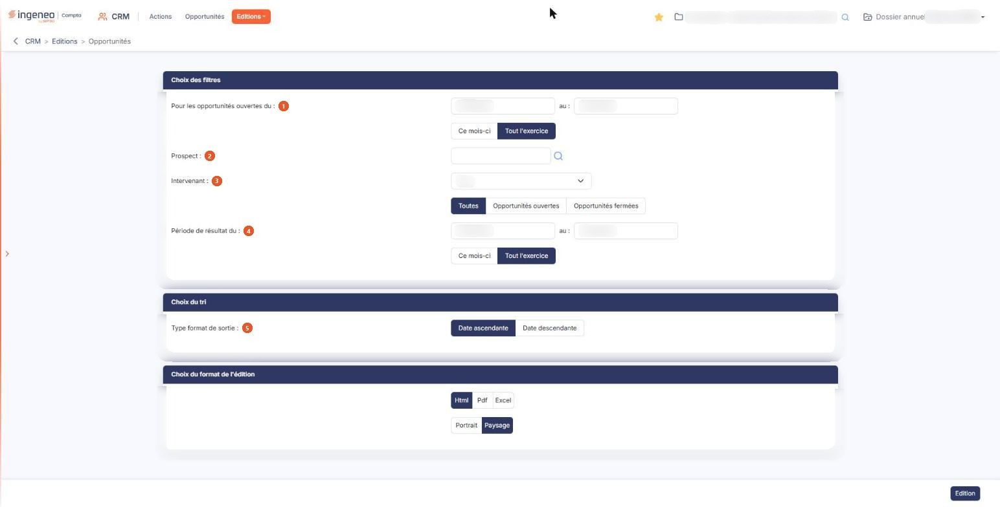

# Opportunités — édition


**Où le trouver :** Menu **Opportunités**



**En bref** — Cet écran prépare l'état de vos opportunités, une ligne par affaire, avec le total du chiffre d'affaires espéré et ce même total pondéré par les probabilités.

* Pour éditer votre portefeuille en cours : choisissez « Opportunités ouvertes », le format et l'orientation, puis bouton \[Edition].
* Pour limiter l'état à un intervenant ou à un prospect : renseignez « Intervenant » ou « Prospect » dans la rubrique « Choix des filtres », puis bouton \[Edition].


Cette option vous édite l'état de vos opportunités : une ligne par opportunité, avec le prospect concerné, l'intervenant qui la suit, le chiffre d'affaires espéré et sa probabilité de réussite, puis des totaux par intervenant et un total général — le chiffre d'affaires espéré, ce même chiffre d'affaires pondéré par les probabilités et le chiffre d'affaires facturé.

<figure><figcaption>
Écran « Opportunités » de la nouvelle interface
</figcaption></figure>

C'est l'édition qui vous donne la valeur de votre portefeuille d'affaires à un instant donné. Vous n'y saisissez rien : vous choisissez ce que l'état doit contenir, puis vous le lancez.

L'écran se compose de trois rubriques de paramétrage et d'un seul bouton, en bas de page.

## Rubrique « Choix des filtres »

Cinq choix vous sont proposés, du haut vers le bas.

| Champ                                           | Ce qu'il faut savoir                                                                                                                                                                                                                                                                                                                                                                                                                                                                                                                                                                                                 |
| ----------------------------------------------- | -------------------------------------------------------------------------------------------------------------------------------------------------------------------------------------------------------------------------------------------------------------------------------------------------------------------------------------------------------------------------------------------------------------------------------------------------------------------------------------------------------------------------------------------------------------------------------------------------------------------- |
| 1. **Pour les opportunités ouvertes du : … au** | 
Deux dates ; un clic dans une date ouvre un calendrier où vous choisissez le jour. Elles portent sur la <strong>date d'ouverture</strong> de l'opportunité : seules celles ouvertes dans cet intervalle sont retenues. Le logiciel vous propose au départ du 1er janvier au 31 décembre. Sous ces deux dates, deux options vous les remplissent d'un clic : « Ce mois-ci » les ramène au mois en cours, « Tout l'exercice » les rouvre à l'année entière. Le logiciel vous propose « Tout l'exercice ». Vous pouvez aussi saisir les dates vous-même, dans ce cas ne tenez pas compte de ces deux options.
 |
| 2. **Prospect**                                 | Le champ vous propose les noms au fur et à mesure de votre saisie, et la loupe placée à droite vous ouvre une fenêtre de sélection : vous y cherchez le prospect par sa raison sociale et vous le choisissez d'un clic sur sa ligne.                                                                                                                                                                                                                                                                                                                                                                                 |
| 3. **Intervenant**                              | 
La liste s'ouvre sur « Tous », qui n'écarte personne. Vient ensuite un choix sans libellé, entre « Toutes », « Opportunités ouvertes » et « Opportunités fermées ». Il porte sur l'état de l'opportunité : « Opportunités ouvertes » ne retient que les affaires en cours, « Opportunités fermées » celles qui sont conclues ou abandonnées, et « Toutes » ne trie pas. Le logiciel vous propose « Toutes ».
                                                                                                                                                                                               |
| 4. **Période de résultat du : … au**            | Deux dates, qui s'ouvrent elles aussi sur un calendrier au clic, et des deux mêmes options « Ce mois-ci » et « Tout l'exercice », là encore sur « Tout l'exercice » au départ. Elles portent, cette fois, sur la **date de fermeture** de l'opportunité, c'est-à-dire sur la date à laquelle son résultat a été constaté. Une opportunité encore ouverte n'a pas de date de fermeture : elle n'est pas écartée par ces deux dates.                                                                                                                                                                                   |

Ces deux périodes se cumulent : vous pouvez ainsi éditer les affaires ouvertes sur l'année et conclues sur le dernier trimestre.

## Rubrique « Choix du tri »

**Type format de sortie** : malgré son intitulé, ce choix ne concerne pas le format du document mais l'**ordre des lignes**, comme l'annonce le titre de la rubrique. « Date ascendante » classe les opportunités de la plus ancienne à la plus récente, « Date descendante » fait l'inverse ; dans les deux cas, c'est la date d'ouverture qui sert de référence. Le logiciel vous propose « Date ascendante ».

## Rubrique « Choix du format de l'édition »

<figure><figcaption>
Rubrique « Choix du format de l'édition »
</figcaption></figure>

Deux choix, sans libellé.

Le premier est le format du document : « Html » vous l'affiche dans un nouvel onglet de votre navigateur, « Pdf » et « Excel » sont les deux autres formats proposés. Le logiciel vous propose « Html ».

Le second est l'orientation de la page, « Portrait » ou « Paysage ». Le logiciel vous propose « Paysage », l'état comportant neuf colonnes.

## Bouton \[Edition]

<figure><figcaption>
Bouton [Edition]
</figcaption></figure>

Il lance l'édition, dans le format que vous avez choisi. Vos choix ne sont pas conservés d'une fois sur l'autre : l'écran se rouvre sur les valeurs proposées par le logiciel.

## Le document produit

Le document s'ouvre dans un nouvel onglet, sous le titre « Opportunités ».

L'en-tête rappelle le nom du dossier, la période (« Période du 01/01/2026 au 31/12/2026 ») et, à droite, la date, l'heure et le nom de la personne qui a lancé l'édition. Une bande de chiffres le complète : « Opportunités » (avec le nombre de celles qui sont ouvertes), « CA espéré » (« ouvertes et gagnées »), « CA pondéré » (« selon la probabilité »), « Taux de transformation » (un tiret et « aucune opportunité fermée » tant qu'aucune n'est fermée) et « CA facturé », puis une légende des quatre couleurs d'intensité du CA pondéré (« 0 à 25 % », « 25 à 50 % », « 50 à 75 % », « 75 à 100 % »).

Sous la bande, un bloc replié, « Paramètres de l'édition », rappelle en une ligne ce que vous avez demandé. Cliquez dessus pour le déplier : il reprend les deux périodes par leurs **dates**, suivies entre parenthèses du libellé de l'option retenue — par exemple « Du 01/01/2026 au 31/12/2026 (tout l'exercice) » —, puis le prospect, l'intervenant, le type d'opportunité et le tri.

Le détail est présenté en **une carte par intervenant** : le nom de l'intervenant en est le titre, suivi du nombre de ses opportunités (« 1 opportunité ») et, à droite, de son CA pondéré. Chaque carte porte neuf colonnes :

| Champ           | Ce qu'il faut savoir                                                                                                                             |
| --------------- | ------------------------------------------------------------------------------------------------------------------------------------------------ |
| 2. **Prospect** | Le prospect sur lequel elle est ouverte.                                                                                                         |
| **Libellé**     | Le libellé de l'opportunité.                                                                                                                     |
| **Créée le**    | Sa date de création.                                                                                                                             |
| **Ouverte le**  | Sa date d'ouverture.                                                                                                                             |
| **CA espéré**   | Le chiffre d'affaires que vous en attendez.                                                                                                      |
| **Probabilité** | Le taux de la probabilité de réussite que vous lui avez affectée.                                                                                |
| **CA pondéré**  | Le CA espéré après application de la probabilité ; la cellule est colorée selon la légende de la bande de chiffres.                              |
| **Résultat**    | **CA facturé :** les deux dernières colonnes de la carte ; le résultat s'affiche en pastille (« En cours » pour une opportunité encore ouverte). |

Les montants sont alignés à droite, avec deux décimales ; la probabilité s'affiche en pourcentage (« 75 % »).

Chaque carte se ferme sur une ligne « Total » (CA espéré, CA pondéré, CA facturé), et un bandeau « Total général » clôt le document : « Opportunités » (leur nombre), « CA espéré », « CA pondéré » et « CA facturé ». Une opportunité de 10 000,00 à 75 % compte ainsi pour 10 000,00 dans le CA espéré et pour 7 500,00 dans le CA pondéré. Le CA pondéré est la valeur prudente de votre portefeuille, le CA espéré sa valeur maximale.

Si aucune opportunité ne répond à vos critères, le logiciel n'édite ni carte ni total général : sous la bande de chiffres (à zéro) et le bloc des paramètres, le document ne porte que la mention « Aucune opportunité ne correspond aux filtres. ».
