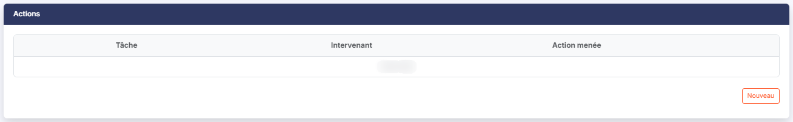
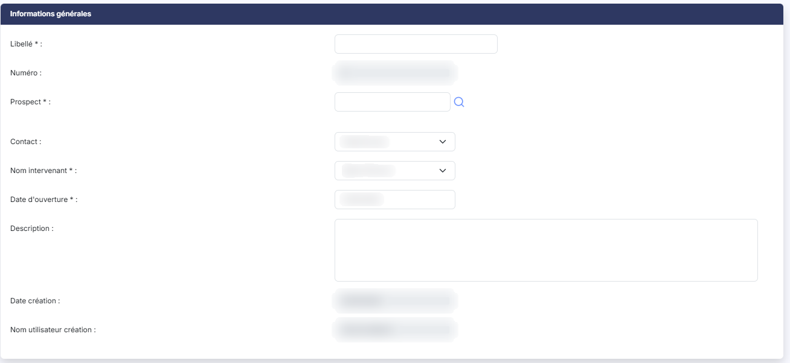
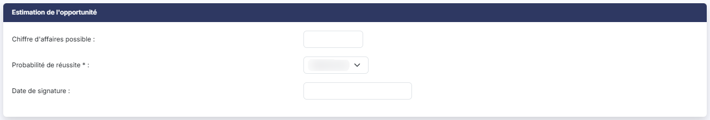
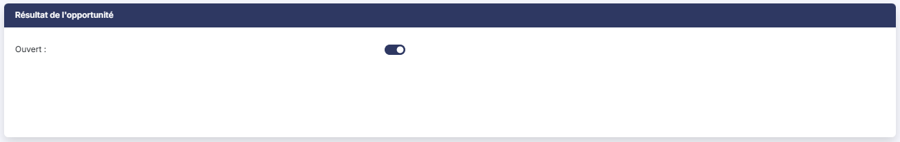
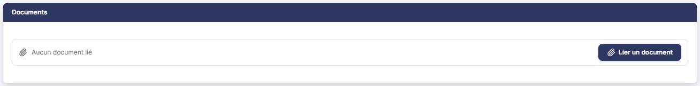
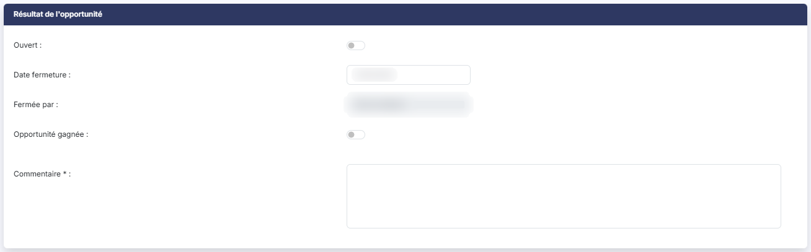

# Opportunités


**Où le trouver :** Menu **Opportunités**



**En bref** — Cet écran suit les affaires que vous espérez remporter chez vos prospects, de leur ouverture à leur fermeture, avec leur chiffre d'affaires possible, leur probabilité de réussite et leur résultat.

* Pour ouvrir une affaire : bouton \[Créer une opportunité], renseignez le libellé, le prospect, l'intervenant et la probabilité de réussite, puis bouton \[Enregistrer].
* Pour clôturer une affaire : désactivez l'interrupteur « Ouvert », indiquez si l'opportunité est gagnée, saisissez le commentaire, puis bouton \[Enregistrer].
* Pour revoir les affaires closes : bouton \[Filtres spéciaux], puis activez l'interrupteur « Inclure » sous « Opportunités fermées ».


## Les filtres d'affichage

<figure><figcaption>
Écran « Opportunités » de la nouvelle interface
</figcaption></figure>

<figure><figcaption>
Rubrique « Actions »
</figcaption></figure>

| Champ           | Ce qu'il faut savoir                                                                                                                                                                                                             |
| --------------- | -------------------------------------------------------------------------------------------------------------------------------------------------------------------------------------------------------------------------------- |
| **Prospect**    | Une zone de saisie accompagnée du pictogramme « Loupe », qui vous permet de rechercher le prospect dont vous voulez voir les opportunités.                                                                                       |
| **Intervenant** | Le logiciel vous propose d'office **votre propre nom**, pour que vous arriviez sur vos affaires et non sur celles de tout le cabinet. La liste contient également le choix « Tous » ainsi que le nom de chacun des intervenants. |

La liste se recharge d'elle-même dès que vous modifiez l'un de ces filtres : il n'y a plus de bouton \[Afficher] ni de bouton \[Annuler les filtres].

bouton **\[Filtres spéciaux]** : il ouvre un petit menu qui, sous « Opportunités fermées », propose un interrupteur « Inclure », **désactivé** à l'ouverture. Vous ne voyez donc, à l'ouverture, que les affaires encore en cours ; les affaires closes, gagnées ou perdues, ne réapparaissent que si vous activez cet interrupteur.

bouton **\[Filtres]** : il ouvre un volet « Filtrer » où vous construisez vos propres critères sur les colonnes de la liste (« + Ajouter un critère sur… »). Le bouton **\[Filtrer]** du volet les applique et le lien « Vider les filtres » les retire.

Contrairement à l'option « Actions », cet écran ne comporte **ni filtre de période, ni filtre de tâche** : une opportunité se suit sur toute sa durée de vie, qui n'est pas bornée par l'exercice.

## La liste des opportunités

La liste présente cinq colonnes, chacune triable en cliquant sur son titre :

| Champ               | Ce qu'il faut savoir                                                                                                                          |
| ------------------- | --------------------------------------------------------------------------------------------------------------------------------------------- |
| **Raison Sociale**  | Le prospect chez qui l'affaire est ouverte.                                                                                                   |
| **Libellé**         | Le nom que vous avez donné à l'opportunité.                                                                                                   |
| **Nom Intervenant** | La personne qui suit l'affaire.                                                                                                               |
| **CA Possible**     | Le chiffre d'affaires que vous espérez, aligné à droite et présenté avec deux décimales et un séparateur de milliers, sans symbole monétaire. |
| **Ouvert**          | « Oui » tant que l'affaire est en cours.                                                                                                      |

Contrairement à l'option « Actions », cet écran met à votre disposition, dans le menu qu'ouvre le bouton **\[Vue]** (rubrique « Colonnes affichées », qui annonce « 5 colonnes affichées sur 17 »), un grand nombre de colonnes supplémentaires que vous pouvez faire apparaître : Numéro, Date d'ouverture, Description, Date de création, Probabilité, Date de Signature, Date de Fermeture, Commentaire, Nom Utilisateur Creation, Nom Utilisateur Fermeture, Gagnée et CA Géneré. Vous pouvez ainsi vous constituer une liste de suivi commercial complète sans passer par une édition. Le même menu vous permet d'enregistrer la disposition de la liste sous « Mes vues » (« Enregistrer la vue actuelle ») et de revenir aux colonnes d'origine (« Rétablir les colonnes d'origine »).

bouton **\[Exporter]** : il ouvre un menu consacré à « La liste affichée » : « Aperçu » (édition HTML), « Imprimer », « Exporter en Excel », « Exporter en PDF » et « Envoyer la liste par e-mail ».

Lorsqu'aucune opportunité ne répond à vos filtres, le logiciel affiche « Aucun élément à afficher. ».

Le fonctionnement commun à toutes les listes — tris, largeur et choix des colonnes, navigation entre les pages, cases de sélection — est décrit au chapitre : Généralités / Fonctionnement général / Fonctionnement d'une grille de la présente aide en ligne.

## Les pictogrammes de chaque ligne

<figure><figcaption>
Rubrique « Informations générales »
</figcaption></figure>

Les commandes d'une ligne apparaissent à son survol, à droite, dans la dernière colonne. Un clic sur la ligne la sélectionne.

Le pictogramme « Modifier » ouvre la fiche de l'opportunité.

Le pictogramme « Afficher l'aperçu » vous emmène sur la **saisie unifiée** du prospect concerné, c'est-à-dire sur l'écran qui rassemble sur une seule page les informations générales du prospect, ses contacts, ses opportunités et ses actions. Cet écran est décrit à l'option « Prospects » du menu « Paramétrage » de la présente aide en ligne.

Le pictogramme « Dupliquer » reprend les caractéristiques de l'opportunité choisie dans une nouvelle fiche, en lui attribuant le numéro suivant. Le logiciel vous laisse sur la fiche du double et affiche, en bas à droite, une notification verte « Vous êtes positionné sur la fiche dupliquée. », qui s'efface d'elle-même. Prenez garde : ce double est **déjà enregistré** — il figure dans la liste des opportunités avant même que vous ayez cliqué sur \[Enregistrer]. Si vous y renoncez, il vous faut donc le supprimer. C'est un gain de temps appréciable lorsque vous suivez, chez un même prospect ou dans une même campagne, plusieurs affaires très voisines.

Le pictogramme « Autres actions » (trois points) ouvre un menu qui propose « Supprimer » : cette entrée supprime l'opportunité, après confirmation.

## Les boutons de la liste

<figure><figcaption>
Bouton [Créer une opportunité]
</figcaption></figure>

bouton **\[Créer une opportunité]** : placé en bas à droite de l'écran, il ouvre une fiche d'opportunité vierge.

Sous la liste, les liens « Sélectionner la page » et « Tout sélectionner (n) » sélectionnent les lignes de la page ou toutes celles de la liste. Dès qu'une ligne est sélectionnée, un bandeau apparaît en bas de l'écran (« 1 opportunité sélectionnée ») avec un bouton **\[Supprimer]** : il supprime, après confirmation, les opportunités sélectionnées.

## La fiche d'une opportunité

<figure><figcaption>
Rubrique « Estimation de l'opportunité »
</figcaption></figure>

<figure><figcaption>
Rubrique « Résultat de l'opportunité »
</figcaption></figure>

<figure><figcaption>
Rubrique « Documents »
</figcaption></figure>

<figure><figcaption>
Rubrique « Résultat de l'opportunité »
</figcaption></figure>

La fiche est organisée en cinq rubriques qui se présentent toujours dans cet ordre : « Informations générales », « Estimation de l'opportunité », « Résultat de l'opportunité », « Actions » et « Documents ». Les champs suivis d'un astérisque rouge sont obligatoires.

Elle se termine par le bouton **\[Enregistrer]**, qui valide votre saisie et vous ramène à la liste. Pour quitter la fiche sans rien enregistrer, utilisez la flèche « Revenir en arrière » placée à gauche du fil d'Ariane.

### Rubrique « Informations générales »

| Champ                                                            | Ce qu'il faut savoir                                                                                                                                                                                                                                                                                                         |
| ---------------------------------------------------------------- | ---------------------------------------------------------------------------------------------------------------------------------------------------------------------------------------------------------------------------------------------------------------------------------------------------------------------------- |
| 
<strong>Libellé</strong> <em>Obligatoire</em>
          | Le nom sous lequel vous reconnaîtrez l'affaire dans vos listes et vos éditions.                                                                                                                                                                                                                                              |
| **Numéro**                                                       | Non modifiable, présenté sur fond gris. Le logiciel attribue lui-même ce numéro, et vous propose déjà le numéro suivant au moment où vous créez une opportunité.                                                                                                                                                             |
| 
<strong>Prospect</strong> <em>Obligatoire</em>
         | Le prospect chez qui l'affaire est ouverte. En création, vous le recherchez à l'aide du pictogramme « Loupe ». Une fois l'opportunité enregistrée, ce champ n'est plus modifiable : il apparaît sur fond gris, sans pictogramme de recherche. Une opportunité reste donc attachée au prospect pour lequel vous l'avez créée. |
| **Contact**                                                      | La personne, chez le prospect, avec laquelle l'affaire se traite.                                                                                                                                                                                                                                                            |
| 
<strong>Nom intervenant</strong> <em>Obligatoire</em>
  | La personne du cabinet qui suit l'affaire.                                                                                                                                                                                                                                                                                   |
| 
<strong>Date d'ouverture</strong> <em>Obligatoire</em>
 | La date à laquelle vous avez identifié l'affaire, proposée d'office à la date du jour ; le calendrier s'ouvre en cliquant dans le champ.                                                                                                                                                                                     |
| **Description**                                                  | Une zone de plusieurs lignes où vous décrivez le besoin du prospect et le contexte de l'affaire.                                                                                                                                                                                                                             |
| **Date création**                                                | **Nom utilisateur création :** non modifiables, présentés sur fond gris. Le logiciel y inscrit lui-même la date de création de la fiche et le nom de la personne qui l'a créée. Ces deux informations ne se confondent pas avec la date d'ouverture et l'intervenant : elles tracent la saisie, non l'affaire.               |

### Rubrique « Estimation de l'opportunité »

C'est cette rubrique qui donne sa valeur à votre portefeuille d'affaires : elle chiffre ce que vous espérez, et la confiance que vous y placez.

| Champ                                                                   | Ce qu'il faut savoir                                                                                                                                                  |
| ----------------------------------------------------------------------- | --------------------------------------------------------------------------------------------------------------------------------------------------------------------- |
| **Chiffre d'affaires possible**                                         | Le montant que l'affaire représenterait si vous l'emportiez.                                                                                                          |
| 
<strong>Probabilité de réussite</strong> <em>Obligatoire</em>
 | Vous choisissez ici l'une des probabilités que vous avez paramétrées. Reportez-vous à l'option « Probabilités » du menu « Paramétrage » de la présente aide en ligne. |
| **Date de signature**                                                   | La date à laquelle vous espérez conclure ; le calendrier s'ouvre en cliquant dans le champ.                                                                           |

### Rubrique « Résultat de l'opportunité »

Tant que l'affaire est en cours, cette rubrique ne contient qu'une seule information :

| Champ                                                       | Ce qu'il faut savoir                                                                                                                                                                                                                                                                                                                                                                                                            |
| ----------------------------------------------------------- | ------------------------------------------------------------------------------------------------------------------------------------------------------------------------------------------------------------------------------------------------------------------------------------------------------------------------------------------------------------------------------------------------------------------------------- |
| **Ouvert**                                                  | 
Un interrupteur, <strong>activé</strong>. C'est en le désactivant que vous clôturez l'affaire. Le logiciel affiche alors quatre informations supplémentaires :
                                                                                                                                                                                                                                                        |
| **Date fermeture**                                          | Proposée d'office à la date du jour ; le calendrier s'ouvre en cliquant dans le champ.                                                                                                                                                                                                                                                                                                                                          |
| **Fermée par**                                              | Non modifiable, présenté sur fond gris. Le logiciel y inscrit votre nom.                                                                                                                                                                                                                                                                                                                                                        |
| **Opportunité gagnée**                                      | Un interrupteur, **désactivé**. C'est lui qui distingue une affaire remportée d'une affaire perdue.                                                                                                                                                                                                                                                                                                                             |
| 
<strong>Commentaire</strong> <em>Obligatoire</em>
 | 
Dès lors que l'affaire est fermée. Une zone de plusieurs lignes où vous expliquez pourquoi vous l'avez emportée, ou pourquoi elle vous a échappé. Cette exigence n'est pas une formalité : c'est ce commentaire qui rendra vos affaires perdues exploitables plus tard. Si vous activez ensuite <strong>Opportunité gagnée :</strong>, une cinquième information apparaît, insérée entre ce choix et le commentaire :
 |
| **Chiffre d'affaires généré**                               | Le chiffre d'affaires réellement obtenu, que vous pouvez ainsi comparer au chiffre d'affaires possible que vous aviez estimé à l'ouverture.                                                                                                                                                                                                                                                                                     |

Activer à nouveau l'interrupteur « Ouvert » masque l'ensemble de ces informations.

### Rubrique « Actions »

Cette rubrique rassemble les démarches que vous avez menées pour emporter l'affaire. Elle se présente sous la forme d'une petite liste à trois colonnes — **Tâche**, **Intervenant** et **Action menée** — et affiche « Liste vide » tant qu'aucune action n'est rattachée à l'opportunité.

Le bouton **\[Nouveau]**, placé sous cette liste, vous permet d'y ajouter une action sans quitter la fiche de l'opportunité.

Une action peut également être rattachée à une opportunité depuis sa propre fiche, par le champ « Opportunité ». Reportez-vous à l'option « Actions » de la présente aide en ligne.

### Rubrique « Documents »

Elle vous permet de conserver avec l'affaire les documents qui s'y rapportent : le cahier des charges du prospect, votre proposition, le courrier de notification.

En modification, la rubrique présente d'abord la liste des documents déjà rattachés, à trois colonnes — **Nom du document**, **Date** et **Créé par** —, qui affiche « Liste vide » tant qu'aucun document n'est lié. Sous cette liste, le message « Aucun document lié » accompagne le bouton **\[Lier un document]**, qui remplace l'ancienne zone « Ajouter un fichier : ». En création, seuls ce message et ce bouton sont présentés : la liste n'apparaît qu'une fois l'opportunité enregistrée.
