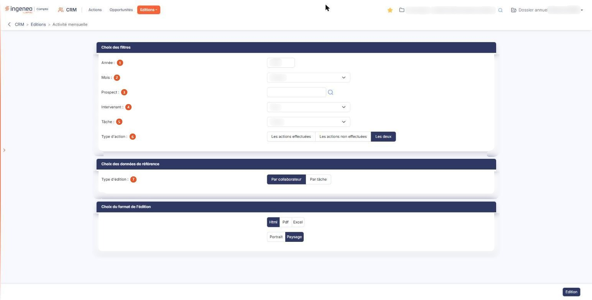
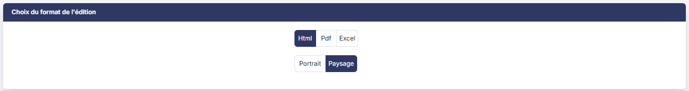

# Activité mensuelle


**Où le trouver :** Menu **Editions › Activité mensuelle**



**En bref** — Cet écran prépare l'édition du nombre d'actions d'un mois, jour par jour, par collaborateur ou par tâche, pour voir d'un coup d'œil qui a fait quoi, et quand.

* Pour éditer le mois : choisissez l'année et le mois, le type d'édition et le format, puis bouton \[Edition].
* Pour ne compter que les actions faites : choisissez « Les actions effectuées » dans « Type d'action », puis bouton \[Edition].


Cette option édite le compte des actions de votre CRM sur un mois, jour par jour.

<figure><figcaption>
Écran « Activité mensuelle » de la nouvelle interface
</figcaption></figure>

Vous obtenez un tableau à une ligne par collaborateur — ou par tâche, selon ce que vous demandez — et à une colonne par jour du mois, chaque case portant le nombre d'actions de ce jour, et la dernière colonne le total du mois. C'est l'état qui vous dit d'un coup d'œil qui a fait quoi, et quand : la charge de prospection d'une équipe, la répartition des relances dans le mois, le mois d'un collaborateur avant un entretien.

Les actions sont comptées d'après leur **date prévue**, et non d'après leur date de réalisation.

L'écran ne fait rien d'autre que préparer cette édition : vous y choisissez ce que vous voulez compter, sous quelle forme, et dans quel format.

## Rubrique « Choix des filtres »

| Champ                | Ce qu'il faut savoir                                                                                                                                                                                                                                                                                |
| -------------------- | --------------------------------------------------------------------------------------------------------------------------------------------------------------------------------------------------------------------------------------------------------------------------------------------------- |
| 1. **Année**         | L'année du mois à éditer. Le logiciel vous propose l'année en cours.                                                                                                                                                                                                                                |
| 2. **Mois**          | Le mois à éditer, choisi dans une liste des douze mois en toutes lettres, de « Janvier » à « Décembre ». Le logiciel vous propose le mois en cours.                                                                                                                                                 |
| 3. **Prospect**      | Pour n'éditer que les actions d'un seul prospect. Laissez la zone vide pour les prendre tous. Vous pouvez saisir directement le début de la raison sociale, le logiciel vous proposant les prospects correspondants au fil de votre frappe, ou vous servir du pictogramme « Loupe » placé à droite. |
| 4. **Intervenant**   | La valeur de départ est « Tous ».                                                                                                                                                                                                                                                                   |
| 5. **Tâche**         | Pour n'éditer que les actions portant une tâche donnée. La liste propose « Toutes », puis les tâches de votre paramétrage.                                                                                                                                                                          |
| 6. **Type d'action** | Trois choix, dont un seul à la fois : « Les actions effectuées », « Les actions non effectuées », ou « Les deux », qui est le choix proposé au départ. Le libellé que vous retenez est rappelé en tête du document produit.                                                                         |

## Le pictogramme « Loupe » du prospect

Il ouvre la fenêtre « Prospect », qui vous présente la liste de vos prospects par raison sociale. La liste s'affiche dès l'ouverture de la fenêtre. Pour la restreindre, saisissez tout ou partie d'une raison sociale dans la zone de recherche « Rechercher par raison Sociale… » : la liste se filtre à mesure de votre saisie, sans bouton d'affichage. Vous pouvez aussi naviguer de page en page. Cliquez sur la ligne voulue : elle est retenue (surlignée) et un bouton \[Sélectionner] apparaît en bas de la fenêtre, à côté de \[Annuler] ; cliquez dessus pour reprendre le prospect dans le critère et refermer la fenêtre (les raccourcis affichés à côté de la zone de recherche indiquent aussi « Entrée sélectionner »). Le bouton \[Annuler], ou la croix de l'en-tête, referme la fenêtre sans rien choisir.

## Rubrique « Choix des données de référence »

**Type d'édition** : deux choix, dont un seul à la fois.

« Par collaborateur », qui est le choix proposé au départ : le document présente une ligne par intervenant.

« Par tâche » : le document présente une ligne par tâche, et il la détaille par résultat — une ligne par couple tâche / résultat, sous la forme « tâche - résultat ». Les actions dont le résultat n'est pas renseigné forment donc une ligne dont le libellé se termine par un tiret suivi d'un blanc.

Ce choix ne change rien à l'écran : les mêmes filtres et les mêmes formats vous restent proposés. Il ne change que la première colonne du document et la façon dont les actions y sont regroupées.

## Rubrique « Choix du format de l'édition »

<figure><figcaption>
Rubrique « Choix du format de l'édition »
</figcaption></figure>

Deux choix vous sont proposés, sans libellé de champ.

Le premier est le format : « Html », qui est le choix de départ, « Pdf », ou « Excel ».

Le second est l'orientation de la page, « Portrait » ou « Paysage ». Le choix de départ est « Paysage ».

## Bouton \[Edition]

<figure><figcaption>
Bouton [Edition]
</figcaption></figure>

C'est le seul bouton de l'écran, en bas à droite, hors du contenu de la page. Il lance l'édition, qui s'ouvre dans un nouvel onglet de votre navigateur.

Selon les droits qui vous sont accordés, il peut ne pas vous être proposé.

## Le document obtenu

Il est titré « Actions mensuelles ». Sous le titre figurent le nom du dossier et la période demandée (par exemple « Période Novembre 2026 »), et à droite la date, l'heure et le nom de la personne qui a lancé l'édition. Une bande de chiffres résume le mois : « Actions », « Effectuées », « Collaborateurs », « Prospects » et « Jours avec action », ce dernier suivi du nombre de jours du mois (« sur 30 » pour novembre).

Un bloc replié, « Paramètres de l'édition », rappelle en une ligne ce que vous avez demandé : prospect, intervenant, tâche, type d'action et type d'édition. Cliquez dessus pour le déplier : il détaille alors la période, le prospect, l'intervenant, la tâche, le type d'action et le type d'édition.

Le tableau qui suit porte en première colonne l'intervenant — ou la tâche, si vous avez demandé une édition par tâche —, puis une colonne par jour du mois, dont l'en-tête rappelle sur deux lignes l'abréviation du jour de la semaine et son quantième, et enfin une colonne « Total ».

Chaque case porte le nombre d'actions du jour ; les jours sans action restent vides. La colonne « Total » cumule le mois de la ligne.

Quand aucune action ne répond à vos critères, le logiciel n'édite aucun tableau : sous la bande de chiffres et le bloc des paramètres, le document ne porte que la mention « Aucune action sur la période. ». Si vous ne l'attendiez pas, vérifiez d'abord le mois et l'année, puis le type d'action.
