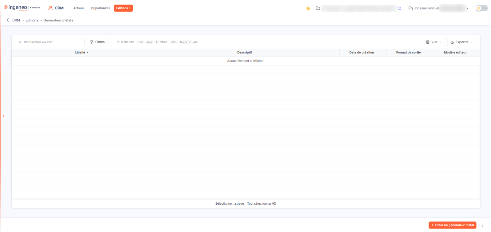
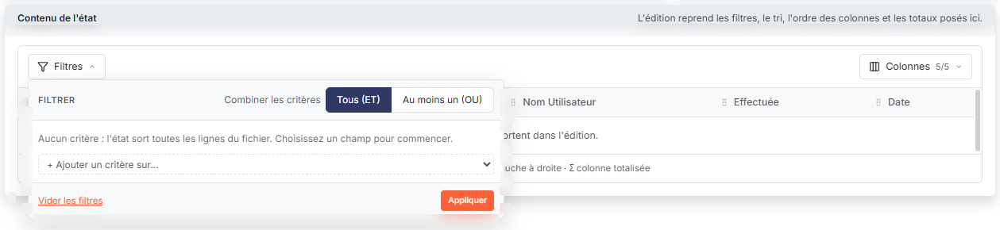
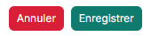
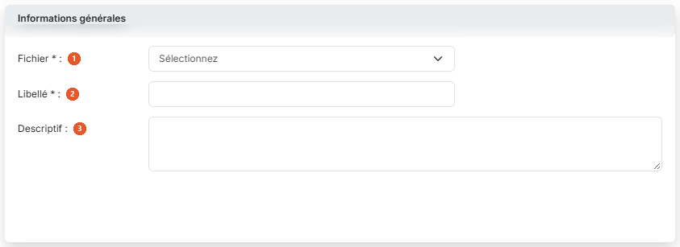
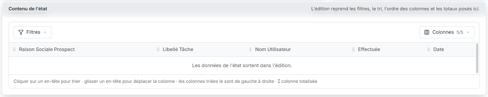
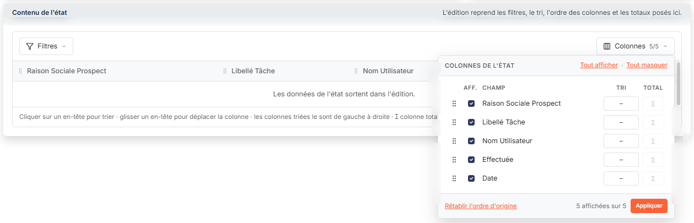
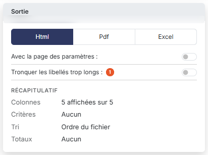

# Générateur d'états


**Où le trouver :** Menu **Editions › Générateur d'états**



**En bref** — Cet écran vous permet de composer vous-même une édition à partir des données du CRM — fichier, colonnes, conditions et format — puis de la conserver pour la relancer plus tard.

* Pour créer un état : bouton \[Créer un générateur d'état], choisissez le fichier, saisissez le libellé, réglez les colonnes, puis bouton \[Enregistrer].
* Pour choisir les champs édités : bouton \[Colonnes], liens « Tout afficher » ou « Tout masquer », case « Aff. » ligne par ligne, puis bouton \[Appliquer].
* Pour choisir le format du document : carte « Sortie », « Format de sortie » (« Html », « Pdf » ou « Excel »), puis bouton \[Enregistrer].


Le générateur d'états vous permet de composer vous-même une édition à partir des données du module, puis de la conserver pour la relancer plus tard. Vous désignez le fichier à éditer, les colonnes que vous souhaitez y voir et l'ordre dans lequel elles se présentent, les lignes à retenir, et le format du document produit.

<figure><figcaption>
Écran « Générateur d'états » de la nouvelle interface
</figcaption></figure>

L'option s'ouvre sur la liste des états que vous avez déjà enregistrés. Tant que vous n'en avez créé aucun, le logiciel affiche « Aucun élément à afficher. ».

## La liste des états

<figure><figcaption>
Bouton [Filtres]
</figcaption></figure>

Elle présente cinq colonnes :

| Champ                | Ce qu'il faut savoir                        |
| -------------------- | ------------------------------------------- |
| **Libellé**          | Le nom que vous avez donné à l'état.        |
| **Descriptif**       | Le commentaire que vous y avez associé.     |
| **Date de création** | La date à laquelle l'état a été enregistré. |
| **Format de sortie** | Le format retenu pour l'impression.         |
| **Modèle éditeur**   | Dernière colonne de la liste.               |

La liste présente aussi une barre de recherche, bouton **\[Filtres]**, bouton **\[Vue]** et bouton **\[Exporter]**. Leur fonctionnement, commun à toutes les listes, est décrit dans la page commune « Les listes ».

## Les boutons de la liste

<figure><figcaption>
Bouton [Annuler]
</figcaption></figure>

bouton **\[Créer un générateur d'état]**

Il ouvre à droite le panneau « Nouvel état », qui est la fiche de création d'un état, décrite ci-dessous ; la liste reste derrière. Pour quitter le panneau sans rien enregistrer, cliquez sur \[Annuler] ; si vous avez commencé à choisir ou à saisir quelque chose, le logiciel demande de confirmer l'abandon (« Abandon des modifications »).

## Rubrique « Informations générales »

<figure><figcaption>
Rubrique « Informations générales »
</figcaption></figure>

| Champ             | Ce qu'il faut savoir                                                                                                                                                                                                                                                                                                                                                                                                                                                                                                                                                                                                                                                  |
| ----------------- | --------------------------------------------------------------------------------------------------------------------------------------------------------------------------------------------------------------------------------------------------------------------------------------------------------------------------------------------------------------------------------------------------------------------------------------------------------------------------------------------------------------------------------------------------------------------------------------------------------------------------------------------------------------------- |
| 1. **Fichier**    | 
Zone obligatoire. C'est ce choix qui commande tout le reste de la fiche : le logiciel remplit ensuite la carte « Contenu de l'état » avec les champs du fichier retenu. Tant que vous n'avez rien retenu, la liste affiche « Sélectionnez ». Les fichiers proposés sont propres à ce module. Vous disposez ici de six fichiers, qui portent le nom technique du fichier précédé de « GRC » : « GRCAction », « GRCContact », « GRCOpportunite », « GRCOrigineProspect », « GRCProspect » et « GRCTache ». Retenez celui qui correspond à la notion que vous voulez éditer : « GRCAction » pour vos actions commerciales, « GRCProspect » pour vos prospects.
 |
| 2. **Libellé**    | Zone obligatoire. C'est sous ce nom que l'état apparaîtra dans la liste. La zone n'accepte que 22 caractères : au-delà, les caractères que vous frappez ne s'inscrivent pas, et le logiciel ne vous affiche aucun message.                                                                                                                                                                                                                                                                                                                                                                                                                                            |
| 3. **Descriptif** | Zone de texte facultative, dans laquelle vous précisez à quoi sert cet état.                                                                                                                                                                                                                                                                                                                                                                                                                                                                                                                                                                                          |

## Rubrique « Contenu de l'état »

<figure><figcaption>
Rubrique « Contenu de l'état »
</figcaption></figure>

<figure><figcaption>
Bouton [Colonnes]
</figcaption></figure>

Le bandeau de la carte rappelle que l'édition reprend les filtres, le tri, l'ordre des colonnes et les totaux posés ici. Tant qu'aucun fichier n'est retenu, la carte affiche « Choisissez un fichier : ses champs apparaîtront ici. ». Dès que vous avez choisi un fichier, elle présente un aperçu des colonnes de l'édition et deux menus, \[Filtres] et \[Colonnes]. Une phrase sous l'aperçu rappelle que l'on clique sur un en-tête pour trier, que l'on glisse un en-tête pour déplacer la colonne, que les colonnes triées le sont de gauche à droite et que le signe Σ marque une colonne totalisée.

bouton **\[Filtres]**

Il sert à poser des critères. Le menu s'ouvre sur « Filtrer » : le réglage « Combiner les critères » vaut « Tous (ET) » à l'ouverture — toutes les conditions doivent être respectées — ou « Au moins un (OU) » — une condition au moins doit l'être. Tant que rien n'est posé, le menu indique « Aucun critère : l'état sort toutes les lignes du fichier. Choisissez un champ pour commencer. ». La liste « + Ajouter un critère sur… » vous fait choisir le champ du critère, y compris un champ que l'aperçu n'affiche pas ; le bouton \[Vider les filtres] retire les critères et le bouton \[Appliquer] les prend en compte.

bouton **\[Colonnes]**

Il indique le nombre de colonnes affichées (« 5/5 » pour le fichier « GRCAction »). Il s'ouvre sur « Colonnes de l'état » et liste les champs avec, pour chacun, une case d'affichage (« Aff. »), un choix de tri (« Tri ») et une totalisation (« Total »). Les liens « Tout afficher » et « Tout masquer » cochent ou décochent d'un coup toutes les cases d'affichage ; le bouton \[Rétablir l'ordre d'origine] remet les champs dans leur ordre de départ, et le bouton \[Appliquer] valide le réglage. L'ordre des colonnes de l'édition se règle aussi en glissant les champs de la liste ou les en-têtes de l'aperçu.

À l'ouverture, seule une partie des champs est affichée, et ce partage dépend du fichier retenu : les cinq champs de « GRCAction » le sont tous (« 5/5 »), alors que « GRCProspect » n'en affiche que deux sur trente-trois (« 2/33 »). Le choix de la totalisation n'est offert que pour les champs qui portent un nombre — par exemple « Nombre de salariés » dans le fichier « GRCProspect » ; pour les autres, la colonne « Total » est grisée, comme pour les cinq champs de « GRCAction ».

À la différence du nom du fichier, les champs portent bien leur libellé métier. Le fichier « GRCAction » en propose cinq : « Raison Sociale Prospect », « Libellé Tâche », « Nom Utilisateur », « Effectuée » et « Date ».

Les comparaisons que le logiciel vous propose pour un critère dépendent de la nature du champ : une date, un texte et une donnée qui ne vaut qu'oui ou non ne s'interrogent pas de la même façon. Dans le fichier « GRCAction », le champ « Effectuée » ne vous propose ainsi que « Est vrai » et « Est faux », là où « Raison Sociale Prospect » vous en propose onze, dont « Commence par », « Contient » et « Se termine par », qui n'ont pas de sens pour une date — sur un champ date ou un champ nombre, ces trois-là ne vous sont pas proposées et il n'en reste que huit.

## Carte « Sortie »

<figure><figcaption>
Rubrique « Sortie »
</figcaption></figure>

La carte « Sortie », en haut à droite du panneau, commande la présentation du résultat. Elle présente, dans cet ordre, **Format de sortie :** — « Html », « Pdf » ou « Excel », l'écran s'ouvrant sur « Html » —, **Avec la page des paramètres :** (interrupteur désactivé à l'ouverture), puis les réglages propres au format retenu. Sous les réglages, un « Récapitulatif » résume l'état en cours de composition : Colonnes (« 5 affichées sur 5 » pour « GRCAction »), Critères (« Aucun »), Tri (« Ordre du fichier ») et Totaux (« Aucun »).

La composition de la carte change en effet avec le format. Choisissez donc d'abord le format de sortie : le logiciel ne vous présente ensuite que les réglages qui s'y appliquent.

| Champ                                    | Ce qu'il faut savoir                                                                 |
| ---------------------------------------- | ------------------------------------------------------------------------------------ |
| 1. **Tronquer les libellés trop longs**  | (interrupteur désactivé à l'ouverture) n'est proposé qu'avec le format « Html ».     |
| **Masquer les entêtes et pieds de page** | (interrupteur désactivé) n'est proposé qu'avec les formats « Pdf » et « Excel ».     |
| **Orientation**                          | « Portrait » (choix par défaut) ou « Paysage », proposé avec le seul format « Pdf ». |

## Les boutons de la fiche

<figure><figcaption>
Bouton [Enregistrer]
</figcaption></figure>

bouton **\[Enregistrer]**

bouton **\[Annuler]**

Il referme le panneau sans rien enregistrer ; si vous avez modifié quelque chose, le logiciel demande d'abord de confirmer l'abandon. Vous retrouvez la liste de vos états. Le pied du panneau ne porte que \[Annuler] et \[Enregistrer].
