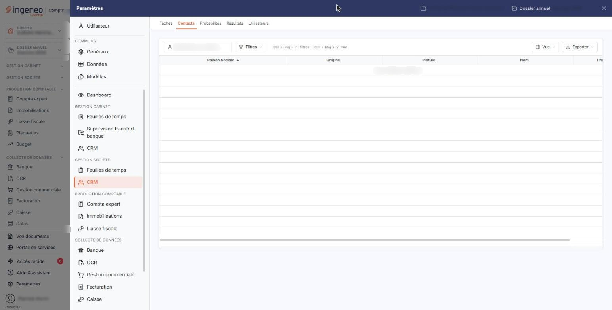

# Contacts


**Où le trouver :** Panneau **Paramètres** › **CRM** › **Contacts**



**En bref** — Cet écran rassemble en une seule liste les contacts de tous vos prospects, pour retrouver une personne sans savoir chez quel prospect elle est enregistrée. Les contacts se créent depuis la fiche du prospect.

* Pour retrouver une personne : saisissez ce dont vous vous souvenez dans la zone « Rechercher un contact… », la liste se restreint d'elle-même.
* Pour afficher d'autres informations : bouton \[Vue], rubrique « Colonnes affichées », puis « Appliquer ».
* Pour créer ou modifier un contact : ouvrez la fiche du prospect concerné et servez-vous de la rubrique « Adresses ».


Cette option se trouve dans le panneau « Paramètres », rubrique « CRM » de la section « Gestion société », onglet « Contacts ». Elle rassemble en une seule liste tous les contacts de vos prospects, quel que soit le prospect auquel ils appartiennent. Elle vous sert à retrouver une personne dont vous ne savez plus chez quel prospect elle est enregistrée : la recherche et les filtres de la liste vous y aident.

<figure><figcaption>
Écran « Contacts » de la nouvelle interface
</figcaption></figure>

Un contact n'est pas un enregistrement autonome : c'est une **adresse rattachée à un prospect**. Vous le créez et vous le modifiez depuis la fiche du prospect, rubrique « Adresses ». C'est la raison pour laquelle cette option ne comporte ni bouton de création, ni bouton de suppression : elle vous donne la vue d'ensemble, la saisie reste chez le prospect.

## La zone de recherche

**Rechercher un contact…** : saisissez ce dont vous vous souvenez ; la liste se restreint d'elle-même, sans bouton à actionner. Ce que vous saisissez reste appliqué comme un critère de filtre : le bouton « Tout effacer » qui apparaît alors à côté de « Filtres » l'enlève.

La zone cherche à la fois dans l'intitulé, le nom, le prénom, les e-mails professionnel et personnel, le téléphone, la première ligne de l'adresse et la raison sociale ; elle filtre la liste au fil de la frappe. Le volet « Filtres » décrit plus bas, lui, pose un critère colonne par colonne.

Videz la zone pour retrouver la totalité des contacts.

## Les boutons « Filtres », « Vue » et « Exporter »

Ils sont placés sur la même ligne que la zone de recherche.

| Champ                  | Ce qu'il faut savoir                                                                                                                                                                                                                                                                                                                                                                                                              |
| ---------------------- | --------------------------------------------------------------------------------------------------------------------------------------------------------------------------------------------------------------------------------------------------------------------------------------------------------------------------------------------------------------------------------------------------------------------------------- |
| **Bouton \[Filtres]**  | Ouvre le volet « Filtrer ». Le lien « + Ajouter un critère sur… » vous propose chacune des colonnes de la liste, y compris celles qui ne sont pas affichées, pour y poser un critère ; « Vider les filtres » les retire et « Filtrer » applique ceux que vous venez de poser.                                                                                                                                                     |
| **Bouton \[Vue]**      | Ouvre le menu des vues. « Mes vues » reprend vos présentations enregistrées (« Aucune vue enregistrée » tant que vous n'en avez pas), « Enregistrer la vue actuelle » mémorise la vôtre, et « Colonnes affichées » vous permet de choisir les colonnes à montrer — le menu indique « 5 colonnes affichées sur 29 » — puis de valider par « Appliquer » ; « Rétablir les colonnes d'origine » revient à la présentation de départ. |
| **Bouton \[Exporter]** | Propose, pour la liste affichée, « Aperçu édition HTML », « Imprimer », « Exporter en Excel », « Exporter en PDF » et « Envoyer la liste par e-mail ».                                                                                                                                                                                                                                                                            |

## La liste des contacts

La liste présente cinq colonnes : **Raison Sociale** — le prospect auquel le contact est rattaché —, **Origine** — l'origine de ce prospect, telle qu'elle est définie dans l'option « Origines Prospects » —, puis **Intitule**, **Nom** et **Prenom**, qui sont les informations du contact lui-même. Les cinq colonnes sont triables.

Vous pouvez faire apparaître d'autres informations à l'aide du menu « Vue », rubrique « Colonnes affichées ». Sont disponibles, en plus des cinq colonnes ci-dessus : les informations du prospect — Code, Date de création, Créé par, N° de TVA intracommunautaire, Siren, Siret, Groupe, Nombre de salariés, Commercial, Descriptif — et les informations du contact — Commentaire, Civilité, Fonction, Téléphone, Mobile, Fax, E-mail perso., E-mail pro., Adresse 1, Adresse 2, Adresse 3, Code Postal, Ville, Pays.

Quand aucun contact ne répond à votre recherche, ou qu'aucun contact n'existe encore, la liste affiche « Aucun élément à afficher. ».

Chaque ligne comporte une commande d'aperçu qui ouvre l'écran « Saisie unifiée » du prospect auquel appartient le contact, décrit à la page « Prospects » ; elle n'est proposée qu'aux utilisateurs qui ont le droit d'édition des contacts.

Cette liste est plus dépouillée que les autres listes du module : elle ne comporte aucune action de création ni de suppression. Le fonctionnement des listes du logiciel, la personnalisation des colonnes et la barre de pagination sont décrits dans le chapitre « Généralités » en tête de la présente aide.

## Créer ou modifier un contact

Rendez-vous sur la fiche du prospect concerné, par l'onglet « Prospects » de la rubrique « Données » (menu déroulant « Tiers et commercial ») du panneau « Paramètres », et servez-vous du bouton de création de la rubrique « Adresses ». Vous y saisissez l'intitulé du contact, sa civilité, son nom et son prénom, sa fonction, ses adresses électroniques, ses numéros de téléphone, son adresse postale, et vous indiquez s'il s'agit de l'adresse par défaut du prospect.
