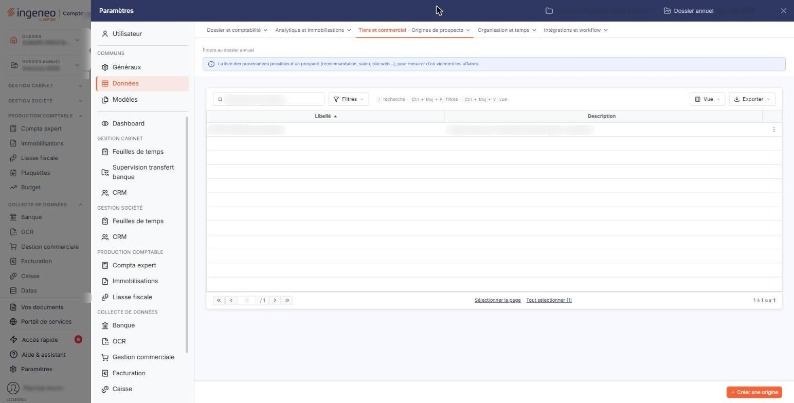
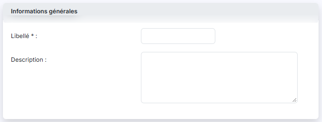
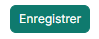

# Origines de prospects


**Où le trouver :** Panneau **Paramètres** › **Données** › **Tiers et commercial** › **Origines de prospects**



**En bref** — Cet écran tient la liste des origines de vos prospects, c'est-à-dire la façon dont ils sont arrivés jusqu'à vous ; ces origines alimentent le champ « Origine » de la fiche prospect.

* Pour ajouter une origine : bouton \[Créer une origine], saisissez un libellé unique, puis bouton \[Enregistrer].
* Pour supprimer une origine : changez d'abord l'origine des prospects qui l'emploient, puis choisissez « Supprimer » dans le menu « Autres actions » de sa ligne.


Cette option permet de tenir la liste des origines de vos prospects, c'est-à-dire la façon dont chacun d'eux est arrivé jusqu'à vous : un salon, une recommandation, votre site internet, un appel entrant, une campagne de communication. C'est vous qui décidez du découpage : le logiciel ne vous impose aucune origine et n'en crée aucune de lui-même.

<figure><figcaption>
Écran « Origines de prospects » de la nouvelle interface
</figcaption></figure>

Une origine créée ici alimente le champ « Origine » de la fiche de vos prospects.

Une origine ne comporte que deux informations : un libellé et une description. Elle ne porte aucun autre paramétrage.

## La liste des origines

L'écran s'ouvre directement sur la liste de vos origines, triée par ordre croissant de libellé. Au-dessus de la liste figurent une zone « Rechercher une origine… » et trois boutons : bouton **\[Filtres]**, bouton **\[Vue]** et bouton **\[Exporter]**.

Elle présente deux colonnes :

| Champ           | Ce qu'il faut savoir                                                                                               |
| --------------- | ------------------------------------------------------------------------------------------------------------------ |
| **Libellé**     | Le nom que vous avez donné à l'origine. C'est ce libellé qui est proposé dans les fiches prospects.                |
| **Description** | Le complément d'information que vous y avez associé. Il ne sert qu'ici, à vous rappeler ce que recouvre l'origine. |

Il n'y a pas de colonne « Code » : si vous souhaitez numéroter vos origines, faites-le à l'intérieur du libellé.

Le fonctionnement commun des listes — recherche, filtres, choix des colonnes, sélection des lignes, navigation entre les pages — est décrit dans la page commune « Les listes ».

## Les pictogrammes de chaque ligne

Le pictogramme « Modifier » ouvre la fiche de l'origine.

Le pictogramme « Autres actions » (trois points) ouvre un menu qui propose « Supprimer » : cette entrée supprime l'origine, après confirmation. Une origine déjà affectée à un prospect ne peut pas être supprimée : le logiciel refuse et vous affiche « Une des origines prospects ne peut être supprimée car elle est affectée à un prospect au moins. ». Pour vous en défaire, changez d'abord l'origine des prospects qui l'emploient.

Selon les droits qui vous sont accordés, l'un ou l'autre de ces pictogrammes peut ne pas vous être proposé : la modification et la suppression font l'objet de deux autorisations distinctes.

## Bouton \[Créer une origine]

<figure><figcaption>
Bouton [Créer une origine]
</figcaption></figure>

Placé en bas à droite de l'écran, il ouvre une fiche vide, pour créer une origine.

## Bouton \[Supprimer] du bandeau de sélection

Dès qu'une ligne est sélectionnée, un bandeau apparaît en bas de l'écran avec un bouton \[Supprimer] : il supprime en une fois, après confirmation, toutes les origines que vous avez sélectionnées. Le logiciel les traite les unes après les autres et s'arrête à la première qu'il ne peut pas supprimer : si l'une d'elles est affectée à un prospect, il vous affiche le même refus qu'à la suppression ligne à ligne, et les origines suivantes de votre sélection ne sont pas traitées.

## La fiche d'une origine — rubrique « Informations générales »

<figure><figcaption>
Rubrique « Informations générales »
</figcaption></figure>

La fiche ne comporte qu'une rubrique et deux champs. La création et la modification présentent exactement le même formulaire, et les deux champs restent modifiables après enregistrement, y compris le libellé. Aucun identifiant n'est affiché.

| Champ                                                   | Ce qu'il faut savoir                                                                                                                                                                                                                                                          |
| ------------------------------------------------------- | ----------------------------------------------------------------------------------------------------------------------------------------------------------------------------------------------------------------------------------------------------------------------------- |
| 
<strong>Libellé</strong> <em>Obligatoire</em>
 | 30 caractères au maximum. Deux origines ne peuvent pas porter le même libellé ; si vous reprenez un libellé existant, le logiciel refuse l'enregistrement en vous affichant « Le libellé que vous indiquez est déjà utilisé, veuillez en choisir un autre s'il vous plait. ». |
| **Description**                                         | 1024 caractères au maximum. C'est une zone de plusieurs lignes.                                                                                                                                                                                                               |

Modifier le libellé d'une origine déjà employée ne rompt rien : les prospects concernés suivent le nouveau libellé, puisque c'est l'origine qui leur est rattachée et non le texte de son libellé.

## Bouton \[Enregistrer]

<figure><figcaption>
Bouton [Enregistrer]
</figcaption></figure>

Il enregistre la fiche et vous ramène à la liste. Si un contrôle échoue, le logiciel vous laisse sur la fiche et affiche le motif du refus sous le champ concerné.

## Sortir de la fiche sans enregistrer

Utilisez le chevron « Retour » placé à gauche des onglets du panneau : il revient à la liste sans rien enregistrer.
