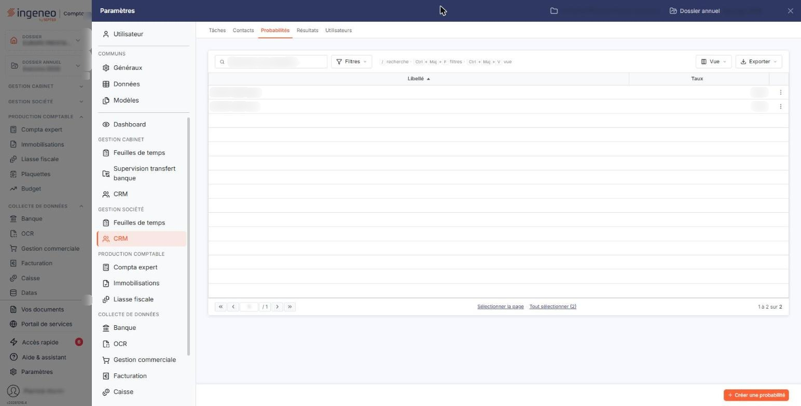
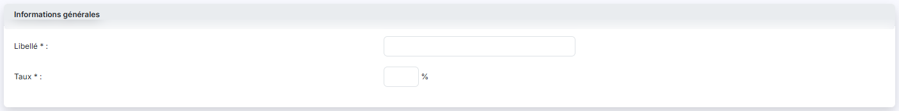

# Probabilites


**Où le trouver :** Panneau **Paramètres** › **CRM** › **Probabilites**



**En bref** — Cet écran tient la liste des probabilités de réussite proposées dans vos opportunités ; chacune associe un libellé à un taux qui pondère le chiffre d'affaires espéré.

* Pour ajouter une probabilité : bouton \[Créer une probabilité], saisissez le libellé et le taux, puis bouton \[Enregistrer].
* Pour modifier une probabilité : pictogramme « Modifier » de sa ligne, puis bouton \[Enregistrer] ; les opportunités déjà créées conservent l'ancien taux.


Cette option se trouve dans le panneau « Paramètres », rubrique « CRM » de la section « Gestion société », onglet « Probabilités ». Elle permet de tenir la liste des probabilités de réussite que vous proposerez dans vos opportunités : la chance que vous vous donnez de transformer une affaire en cours en affaire gagnée.

<figure><figcaption>
Écran « Probabilites » de la nouvelle interface
</figcaption></figure>

Chaque probabilité associe un libellé, que vous choisissez librement — « Faible », « Sérieuse », « Quasi certaine », ou une simple valeur chiffrée — et un taux exprimé en pourcentage. C'est ce taux qui sert ensuite à pondérer le chiffre d'affaires espéré de vos opportunités : une affaire à 10 000,00 € affectée d'une probabilité de 75 % pèse 7 500,00 € dans le chiffre d'affaires pondéré de l'édition des opportunités.

C'est un fichier libre : le logiciel ne vous impose ni nombre, ni découpage, et n'en crée aucun de lui-même. À vous de définir l'échelle qui correspond à la façon dont votre cabinet suit son développement.

## La liste des probabilités

L'écran s'ouvre directement sur la liste de vos probabilités. Au-dessus de la liste, la zone « Rechercher une probabilité… » et les boutons « Filtres », « Vue » et « Exporter » vous permettent de retrouver une probabilité, d'ajuster les colonnes et d'éditer ou exporter la liste affichée.

Elle présente deux colonnes, toutes deux triables :

| Champ       | Ce qu'il faut savoir                                                                                                                                                                           |
| ----------- | ---------------------------------------------------------------------------------------------------------------------------------------------------------------------------------------------- |
| **Libellé** | Le nom que vous avez donné à la probabilité. C'est ce libellé qui est proposé dans vos opportunités.                                                                                           |
| **Taux**    | Le pourcentage associé, aligné à droite et affiché avec deux décimales — par exemple 75,00. Le symbole % n'est pas repris dans la liste ; il figure en revanche à côté du champ dans la fiche. |

Ce sont les deux seules colonnes existantes : le menu « Vue » (« 2 colonnes affichées sur 2 ») ne vous propose rien d'autre à afficher.

Un clic sur une ligne la sélectionne ; les boutons « Sélectionner la page » et « Tout sélectionner (n) » sélectionnent respectivement toutes les lignes de la page affichée et toutes les lignes de la liste. Le fonctionnement des listes du logiciel, la personnalisation des colonnes et la barre de pagination sont décrits dans le chapitre « Généralités » en tête de la présente aide.

## Les pictogrammes de chaque ligne

Le pictogramme « Modifier » ouvre la fiche de la probabilité.

Le pictogramme « Autres actions » (trois points) ouvre un menu dont l'entrée « Supprimer » supprime la probabilité, après confirmation.

Ne vous étonnez pas de ne pas trouver « Supprimer » sur toutes vos lignes : **une probabilité employée par au moins une opportunité n'est pas supprimable**, et le logiciel ne propose alors pas « Supprimer » dans le menu « Autres actions » de sa ligne. La ligne reste modifiable. Pour vous défaire d'une probabilité devenue inutile, changez d'abord la probabilité des opportunités qui l'emploient.

Selon les droits qui vous sont accordés, l'un ou l'autre de ces pictogrammes peut ne pas vous être proposé : la modification et la suppression font l'objet de deux autorisations distinctes.

## Bouton \[Créer une probabilité]

<figure><figcaption>
Bouton [Créer une probabilité]
</figcaption></figure>

Placé en bas à droite de l'écran, hors du contenu, il ouvre une fiche vide, pour créer une probabilité.

## Bouton \[Supprimer]

Il apparaît, dans le bandeau de sélection, dès que vous avez sélectionné des lignes. Il supprime en une fois, après confirmation, toutes les probabilités que vous avez sélectionnées dans la liste. Celles qui sont employées par une opportunité sont laissées en place, et le logiciel vous les nomme dans un message : « Suppression impossible - Les probabilités suivantes sont utilisées dans un paramétrage : … ». Les autres, elles, sont bien supprimées.

## La fiche d'une probabilité — rubrique « Informations générales »

<figure><figcaption>
Rubrique « Informations générales »
</figcaption></figure>

La fiche ne comporte qu'une rubrique et deux champs. La création et la modification présentent exactement le même formulaire, et les deux champs restent modifiables après enregistrement — y compris sur une probabilité employée par une opportunité.

| Champ                                                   | Ce qu'il faut savoir                                                                                                                                                                                                                                                              |
| ------------------------------------------------------- | --------------------------------------------------------------------------------------------------------------------------------------------------------------------------------------------------------------------------------------------------------------------------------- |
| 
<strong>Libellé</strong> <em>Obligatoire</em>
 | 30 caractères au maximum. Deux probabilités ne peuvent pas porter le même libellé ; si vous reprenez un libellé existant, le logiciel refuse l'enregistrement en vous affichant « Le libellé que vous indiquez est déjà utilisé, veuillez en choisir un autre s'il vous plait. ». |
| 
<strong>Taux</strong> <em>Obligatoire</em>
    | Saisissez le pourcentage, le symbole % étant rappelé à droite du champ. Le taux accepte deux décimales et s'affiche ensuite sous la forme 75,00.                                                                                                                                  |

Prenez garde en modifiant le taux d'une probabilité déjà employée : c'est le taux, et non le libellé, qui est enregistré dans vos opportunités. Vos opportunités déjà créées conservent donc l'ancien taux, et la probabilité que vous venez de modifier peut cesser de leur correspondre. Pour la même raison, évitez de donner le même taux à deux probabilités différentes : le logiciel les considérerait toutes les deux comme employées dès que l'une d'elles le serait, et vous ne pourriez plus supprimer ni l'une ni l'autre.

## Bouton \[Enregistrer]

<figure><figcaption>
Bouton [Enregistrer]
</figcaption></figure>

Placé en bas à droite de la fiche, il enregistre la fiche et vous ramène à la liste. Si un contrôle échoue, le logiciel vous laisse sur la fiche et affiche le motif du refus sous le champ concerné.

## Le chevron « Retour »

Placé dans la barre d'onglets du panneau, il revient à la liste sans rien enregistrer.
