# Prospects


**Où le trouver :** Panneau **Paramètres** › **Données** › **Tiers et commercial** › **Prospects**



**En bref** — Cet écran est le fichier de vos prospects : vous y créez, retrouvez, complétez et supprimez la fiche des entreprises que vous démarchez, point de rattachement des opportunités et des actions.

* Pour créer un prospect : bouton \[Créer un prospect], saisissez le code prospect et la raison sociale, puis bouton \[Enregistrer].
* Pour remplir la fiche automatiquement : saisissez le numéro de Siren, puis bouton \[Lire Siren].
* Pour voir d'un coup les contacts, opportunités et actions d'un prospect : pictogramme « Œil » de sa ligne, qui ouvre la saisie unifiée.


Cette option est le fichier de vos prospects. C'est ici que vous créez la fiche d'une entreprise que vous démarchez, que vous la retrouvez, que vous la complétez et que vous la supprimez.

<figure>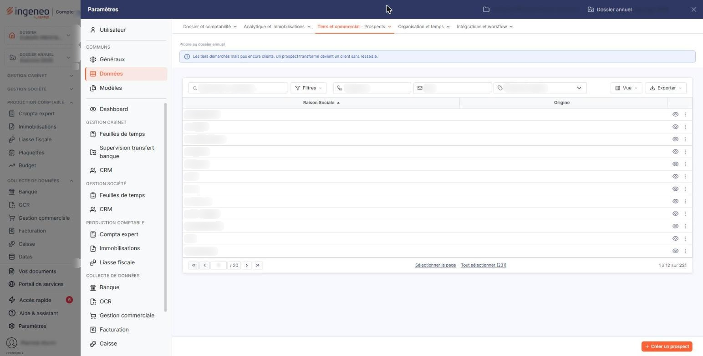<figcaption>
Écran « Prospects » de la nouvelle interface
</figcaption></figure>

La fiche d'un prospect porte son identification (code, raison sociale, numéros d'identité, secteur, famille, groupe, effectif, origine, commercial chargé du dossier) et ses adresses, qui sont aussi ses contacts. Elle sert ensuite de point de rattachement à tout le reste du module : c'est sur un prospect que vous ouvrez des opportunités, et c'est sur une opportunité que vous enregistrez vos actions.

Un prospect n'est pas un client, mais les deux fiches sont de même nature : lorsque vous transformez un premier devis en facture, la fiche du prospect devient une fiche client. C'est pourquoi un code déjà employé par un client vous est refusé, et inversement.

Depuis la liste, un pictogramme vous ouvre un second écran, la saisie unifiée, qui rassemble sur une seule page le prospect, ses contacts, ses opportunités et ses actions. Il est décrit au paragraphe j) ci-dessous.

## La zone de recherche

Au-dessus de la liste figurent une zone « Rechercher un prospect… », deux champs **Téléphone** et **Mail**, et une liste d'origines.

**Origine** : la liste des origines que vous avez paramétrées dans « Origines de prospects » (panneau « Paramètres », rubrique « Données », « Tiers et commercial »). Elle s'ouvre sur « Toutes les origines ».

## Les filtres et l'export de la liste

La liste présente aussi bouton **\[Filtres]**, bouton **\[Vue]** et bouton **\[Exporter]**. Leur fonctionnement, commun à toutes les listes, est décrit dans la page commune « Les listes ».

## La liste des prospects

La liste s'affiche avec deux colonnes :

| Champ              | Ce qu'il faut savoir            |
| ------------------ | ------------------------------- |
| **Raison Sociale** | Le nom du prospect.             |
| **Origine**        | L'origine qui lui est affectée. |

Ne vous étonnez pas d'y voir plus de lignes que vous n'avez de prospects : dans ce module, la liste vous présente aussi vos clients, puisqu'un client est un ancien prospect.

Le choix des colonnes affichées se fait par le bouton **\[Vue]** ; le fonctionnement commun des listes — tri, sélection des lignes, navigation entre les pages — est décrit dans la page commune « Les listes ».

## Les pictogrammes de chaque ligne

Le pictogramme « Modifier » ouvre la fiche du prospect.

Le pictogramme « Œil » (Afficher l'aperçu) ouvre l'écran de saisie unifiée du prospect, décrit au paragraphe j).

Le pictogramme « Autres actions » (trois points) ouvre un menu qui propose « Supprimer » : cette entrée supprime le prospect, après confirmation. Un prospect déjà employé ailleurs n'est pas supprimable : le logiciel refuse et vous affiche « Le prospect "…" ne peut être supprimé. », en rappelant son code.

Selon les droits qui vous sont accordés, l'un ou l'autre de ces pictogrammes peut ne pas vous être proposé.

## Bouton \[Créer un prospect]

<figure>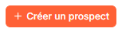<figcaption>
Bouton [Créer un prospect]
</figcaption></figure>

Placé en bas à droite de l'écran, il ouvre une fiche vide, pour créer un prospect.

## Bouton \[Supprimer] du bandeau de sélection

Dès qu'une ligne est sélectionnée, un bandeau apparaît en bas de l'écran avec un bouton \[Supprimer] : il supprime en une fois, après confirmation, tous les prospects sélectionnés. Le logiciel les traite les uns après les autres et s'arrête au premier qu'il ne peut pas supprimer, en vous affichant le même refus qu'à la suppression ligne à ligne ; les prospects suivants de votre sélection ne sont alors pas traités.

## La fiche d'un prospect — rubrique « Identification »

<figure>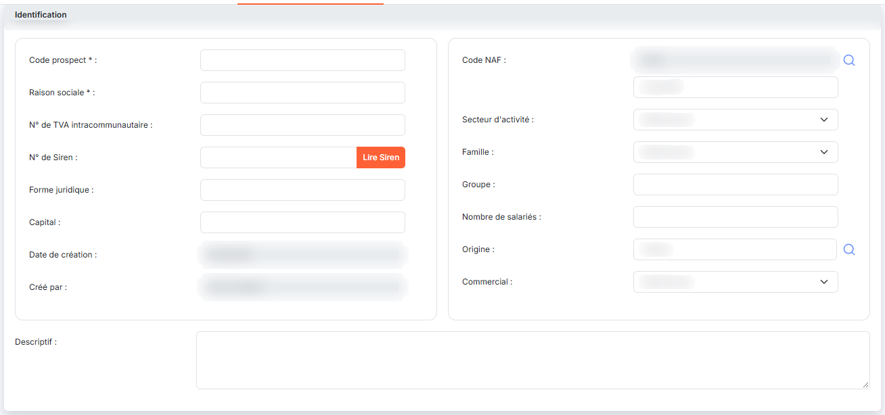<figcaption>
Rubrique « Identification »
</figcaption></figure>

La création et la modification vous présentent le même formulaire. En modification, tous les champs restent modifiables, sauf **Date de création :** et **Créé par :**, qui gardent la trace de la création, et sauf la première zone du **Code NAF :**, qui n'est jamais saisie directement.

| Champ                                                          | Ce qu'il faut savoir                                                                                                                                                                                                                                                                                                                                                                                                                                                                                                    |
| -------------------------------------------------------------- | ----------------------------------------------------------------------------------------------------------------------------------------------------------------------------------------------------------------------------------------------------------------------------------------------------------------------------------------------------------------------------------------------------------------------------------------------------------------------------------------------------------------------- |
| 
<strong>Code prospect</strong> <em>Obligatoire</em>
  | 20 caractères au maximum, sans espace. C'est votre identifiant du prospect. Il doit être unique, et il ne peut pas non plus reprendre le code d'un client : le logiciel vous répond alors « Le code prospect que vous indiquez est déjà utilisé pour un client. La fiche d'un prospect est transférée en tant que client lors du transfert d'un premier devis en facture. », et « Le code prospect que vous indiquez est déjà utilisé, veuillez en choisir un autre s'il vous plait. » s'il s'agit d'un autre prospect. |
| 
<strong>Raison sociale</strong> <em>Obligatoire</em>
 | 99 caractères au maximum. C'est le nom sous lequel le prospect apparaît dans toutes les listes du module.                                                                                                                                                                                                                                                                                                                                                                                                               |
| **N° de TVA intracommunautaire**                               | —                                                                                                                                                                                                                                                                                                                                                                                                                                                                                                                       |
| **N° de Siren**                                                | Le bouton placé à sa droite est décrit au paragraphe i).                                                                                                                                                                                                                                                                                                                                                                                                                                                                |
| **Forme juridique**                                            | —                                                                                                                                                                                                                                                                                                                                                                                                                                                                                                                       |
| **Capital**                                                    | Saisi sous forme de montant.                                                                                                                                                                                                                                                                                                                                                                                                                                                                                            |
| **Code NAF**                                                   | Deux zones. La première, en lecture seule, reçoit le code ; la seconde son libellé. La loupe placée à droite vous ouvre la recherche dans la nomenclature, et reporte les deux zones.                                                                                                                                                                                                                                                                                                                                   |
| **Secteur d'activité**                                         | Liste déroulante alimentée par le fichier des secteurs d'activité. Si aucun secteur n'a été créé, elle ne contient que « Sélectionnez ».                                                                                                                                                                                                                                                                                                                                                                                |
| **Famille**                                                    | Liste déroulante alimentée par le fichier des familles, dans les mêmes conditions.                                                                                                                                                                                                                                                                                                                                                                                                                                      |
| **Groupe**                                                     | Le nom du groupe auquel appartient le prospect.                                                                                                                                                                                                                                                                                                                                                                                                                                                                         |
| **Nombre de salariés**                                         | —                                                                                                                                                                                                                                                                                                                                                                                                                                                                                                                       |
| **Origine**                                                    | La façon dont le prospect est arrivé jusqu'à vous. Vous saisissez le libellé d'une origine existante, ou vous la choisissez par la loupe placée à droite, qui ouvre la fenêtre « Sélection d'une origine ». Le champ n'accepte que des origines paramétrées : si le texte que vous saisissez ne correspond à aucune d'elles, le logiciel vide la zone lorsque vous en sortez. L'origine n'est pas obligatoire dans cette fiche — elle l'est en revanche dans l'écran de saisie unifiée.                                 |
| **Date de création**                                           | Inactif. Le logiciel la renseigne à la date du jour lors de la création.                                                                                                                                                                                                                                                                                                                                                                                                                                                |
| **Créé par**                                                   | Inactif. Le logiciel y inscrit votre nom lors de la création.                                                                                                                                                                                                                                                                                                                                                                                                                                                           |
| **Descriptif**                                                 | 1024 caractères au maximum. C'est une zone de plusieurs lignes.                                                                                                                                                                                                                                                                                                                                                                                                                                                         |
| **Commercial**                                                 | Liste déroulante des intervenants. Elle désigne le collaborateur qui suit ce prospect.                                                                                                                                                                                                                                                                                                                                                                                                                                  |

## La fiche d'un prospect — rubrique « Adresses »

<figure>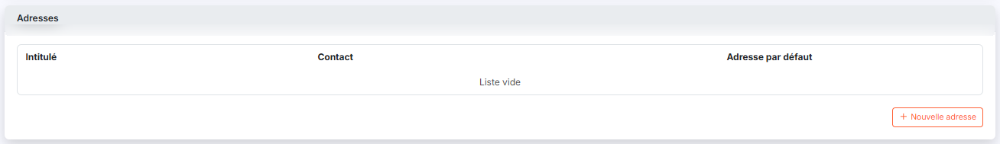<figcaption>
Rubrique « Adresses »
</figcaption></figure>

<figure>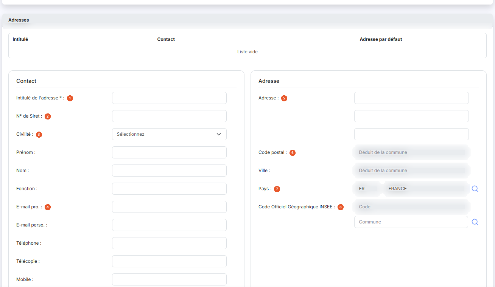<figcaption>
Rubrique « Adresses »
</figcaption></figure>

<figure>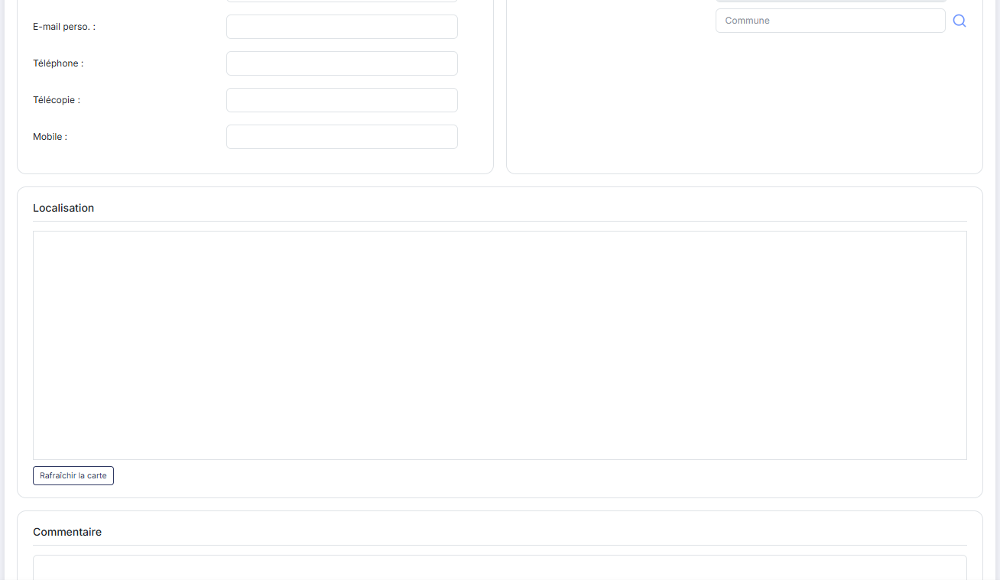<figcaption>
Rubrique « Adresses »
</figcaption></figure>

<figure>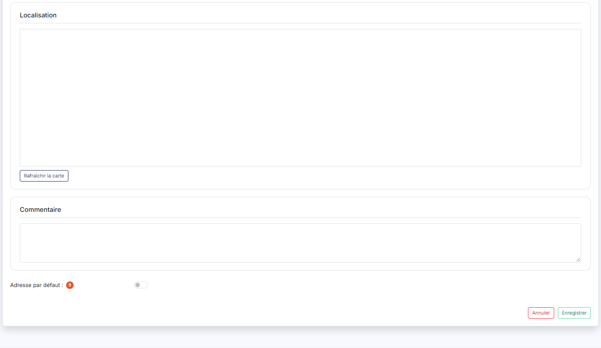<figcaption>
Rubrique « Adresses »
</figcaption></figure>

Cette rubrique tient à la fois les adresses et les contacts du prospect : une ligne y porte un lieu et la personne qui s'y trouve. Elle se présente sous forme d'une petite liste à trois colonnes — **Intitulé**, **Contact** et **Adresse par défaut** — et affiche « Liste vide » tant que vous n'avez rien saisi.

Le bouton **\[Nouvelle adresse]**, placé sous cette liste (son libellé est précédé d'un « + »), ouvre un bloc de saisie sous la liste, et non une fenêtre. Vous y trouvez :

| Champ                                                                    | Ce qu'il faut savoir                                                                                                                                                                            |
| ------------------------------------------------------------------------ | ----------------------------------------------------------------------------------------------------------------------------------------------------------------------------------------------- |
| 
1. <strong>Intitulé de l'adresse</strong> <em>Obligatoire</em>
 | C'est le nom sous lequel l'adresse apparaît dans la liste — par exemple « Siège », « Usine », « Facturation ».                                                                                  |
| 2. **N° de Siret**                                                       | Le numéro de l'établissement concerné.                                                                                                                                                          |
| 3. **Civilité**                                                          | , **Prénom :**, **Nom :** et **Fonction :** identifient la personne à contacter à cette adresse.                                                                                                |
| 4. **E-mail pro.**                                                       | , **E-mail perso. :**, **Téléphone :**, **Télécopie :** et **Mobile :** sont ses coordonnées.                                                                                                   |
| 5. **Adresse**                                                           | Trois zones superposées, pour la voie, le complément et le lieu-dit.                                                                                                                            |
| 6. **Code postal**                                                       | **Ville :** complètent l'adresse postale. Ils sont en lecture seule (« Déduit de la commune ») : ils ne se saisissent pas, ils se remplissent d'après la commune retenue plus bas dans le bloc. |
| 7. **Pays**                                                              | Une zone de code et une zone de libellé, que la loupe placée à droite vous permet de choisir dans la liste des pays. L'écran propose « FR » et « FRANCE » à l'ouverture.                        |
| 8. **Code Officiel Géographique INSEE**                                  | Le code officiel de la commune. Le code est en lecture seule ; sous lui, la zone **Commune**, accompagnée d'une loupe placée à droite, sert à chercher la commune par son nom.                  |
| 9. **Adresse par défaut**                                                | Interrupteur Oui / Non, positionné sur Non. L'adresse par défaut est celle que le logiciel retient lorsqu'une seule adresse est attendue.                                                       |
| **Commentaire**                                                          | Sur plusieurs lignes.                                                                                                                                                                           |

À droite du bloc, un cadre de carte vous situe l'adresse. Il reste vide tant que l'adresse saisie n'est pas reconnue ; le bouton de rafraîchissement placé dessous la fait rechercher à nouveau.

Le bloc porte ses propres boutons d'enregistrement et d'annulation, qui ne concernent que l'adresse en cours de saisie : ils ne sont pas ceux du bas de l'écran, qui enregistrent la fiche entière.

## Bouton \[Lire Siren]

Placé à droite du numéro de Siren, il interroge le répertoire des entreprises et remplit la fiche à votre place : la raison sociale, le code NAF, le numéro de TVA intracommunautaire, le capital, la forme juridique et le nombre de salariés, ainsi que l'adresse du siège, qui vient s'ajouter à la rubrique « Adresses ». L'activité déclarée est ajoutée à la suite du descriptif.

Renseignez le numéro de Siren avant de cliquer : sans cela, le logiciel vous répond « Veuillez tout d'abord renseigner un Siren. ».

## L'écran de saisie unifiée

<figure>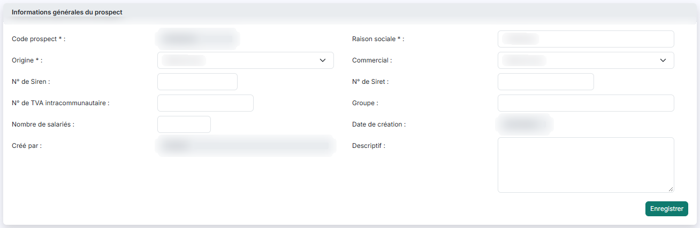<figcaption>
Rubrique « L'écran de saisie unifiée »
</figcaption></figure>

<figure>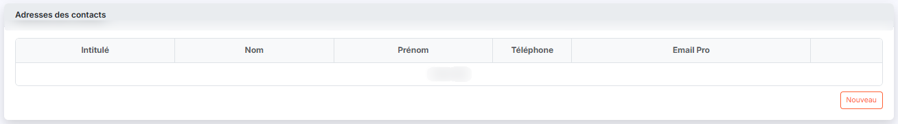<figcaption>
Rubrique « L'écran de saisie unifiée »
</figcaption></figure>

<figure>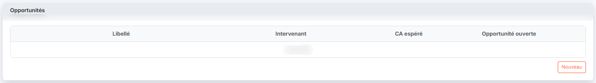<figcaption>
Rubrique « L'écran de saisie unifiée »
</figcaption></figure>

<figure>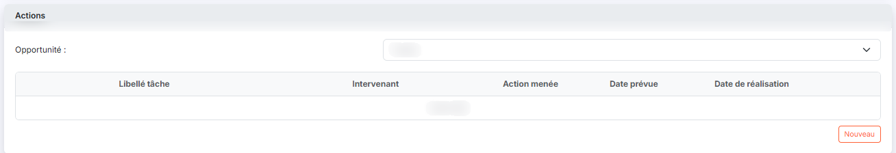<figcaption>
Rubrique « L'écran de saisie unifiée »
</figcaption></figure>

Le pictogramme « Œil » d'une ligne de la liste vous ouvre un écran à part, intitulé « Saisie unifiée », qui rassemble sur une seule page tout ce qui est attaché au prospect choisi. Cet écran n'a pas d'entrée dans le menu : vous y accédez par le pictogramme « Œil » d'une liste. Et la liste des prospects n'est pas la seule à vous le proposer : le même pictogramme, sur une ligne de la liste des **actions** ou de la liste des **opportunités**, vous ouvre ce même écran, positionné sur le prospect de la ligne choisie. L'écran est long, vous devez faire défiler la page pour en voir la fin, et vous en sortez par la flèche « Revenir en arrière » du fil d'Ariane (depuis le panneau « Paramètres », par le chevron « Retour » de la barre d'onglets).

Il présente quatre rubriques, dans cet ordre.

**1. « Informations générales du prospect »** — vous y retrouvez l'essentiel de la fiche du prospect : **Code prospect \* :** (que le logiciel a attribué et que vous ne pouvez pas modifier ici), **Raison sociale \* :**, **Origine \* :**, **Descriptif :**, **N° de TVA intracommunautaire :**, **N° de Siren :**, **N° de Siret :**, **Groupe :**, **Nombre de salariés :**, **Commercial :**, puis **Date de création :** et **Créé par :**, tous deux inactifs.

Prenez garde à deux différences avec la fiche du prospect : l'origine est ici **obligatoire**, et cette rubrique porte **son propre bouton d'enregistrement**, placé sous les champs. C'est lui qui enregistre les informations générales, et lui seul ; les trois rubriques suivantes s'enregistrent chacune de leur côté. Le bas de l'écran ne comporte donc pas de bouton d'enregistrement.

**2. « Adresses des contacts »** — la liste des contacts du prospect, avec les colonnes **Intitulé**, **Nom**, **Prénom**, **Téléphone** et **Email Pro**. Elle affiche « Liste vide » lorsque le prospect n'a aucun contact. Le bouton de création placé dessous vous ouvre la saisie d'un nouveau contact.

**3. « Opportunités »** — la liste des opportunités ouvertes sur ce prospect, avec les colonnes **Libellé**, **Intervenant**, **CA espéré** et **Opportunité ouverte**, cette dernière valant Oui ou Non. Chaque ligne porte un pictogramme « Crayon » pour la modifier et un pictogramme « Croix » pour la supprimer ; le bouton de création placé sous la liste en ouvre une nouvelle.

**4. « Actions »** — la liste des actions menées ou à mener, avec les colonnes **Libellé Tache**, **Intervenant**, **Action menée**, **Date Prévue** et **Date Réalisation**. Au-dessus de la liste, le filtre **Opportunité :** vous permet de n'afficher que les actions d'une opportunité ; il s'ouvre sur « Toutes ». Comme pour les opportunités, chaque ligne se modifie par le pictogramme « Crayon » et se supprime par le pictogramme « Croix », et le bouton de création placé sous la liste en ajoute une.

## Bouton \[Enregistrer]

<figure>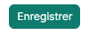<figcaption>
Bouton [Enregistrer]
</figcaption></figure>

Il enregistre la fiche du prospect, adresses comprises, et vous ramène à la liste. Si un contrôle échoue, le logiciel vous laisse sur la fiche et affiche le motif du refus sous le champ concerné.

## Sortir de la fiche sans enregistrer

Utilisez le chevron « Retour » placé à gauche des onglets du panneau : il revient à la liste sans rien enregistrer.
