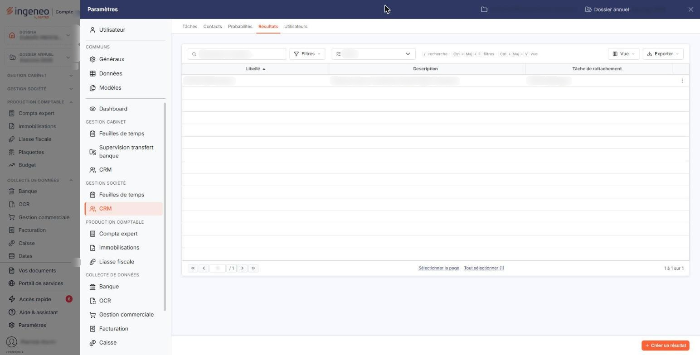
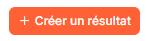
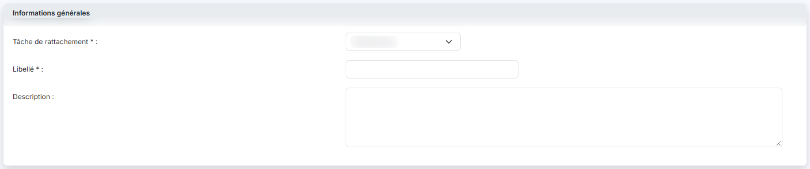

# Resultats


**Où le trouver :** Panneau **Paramètres** › **CRM** › **Resultats**



**En bref** — Cet écran tient la liste des résultats que vous indiquerez au terme de vos actions ; chaque résultat est rattaché à une tâche et n'est proposé que sur les actions qui la portent.

* Pour créer les résultats d'une tâche à la suite : choisissez-la dans la liste « Tâche », puis bouton \[Créer un résultat], saisissez le libellé et bouton \[Enregistrer].
* Pour voir les résultats d'une seule tâche : choisissez-la dans la liste déroulante « Tâche » au-dessus de la liste.


Cette option se trouve dans le panneau « Paramètres », rubrique « CRM » de la section « Gestion société », onglet « Résultats ». Elle permet de tenir la liste des résultats que vous pourrez indiquer au terme de vos actions : ce qu'a donné le rendez-vous, l'appel ou la relance que vous aviez prévu.

<figure><figcaption>
Écran « Resultats » de la nouvelle interface
</figcaption></figure>

Un résultat n'existe jamais seul : il est **rattaché à une tâche**, et il ne vous est proposé que sur les actions qui portent cette tâche. Vous décrivez ainsi, tâche par tâche, les issues possibles — une tâche « Rendez-vous de découverte » pourra se conclure par « Devis à établir », « Sans suite » ou « À relancer », là où une tâche « Relance téléphonique » aura ses propres issues.

C'est un fichier libre : le logiciel ne vous impose ni nombre, ni découpage, et n'en crée aucun de lui-même. Commencez par créer vos tâches — onglet « Tâches » du même panneau — puis venez leur rattacher leurs résultats.

## La zone de recherche

**Tâche** : cette liste déroulante, placée dans la barre au-dessus de la liste, vous permet de n'afficher que les résultats d'une tâche donnée. Elle propose « Tâche », qui est la valeur de départ et ne retient aucune tâche, puis vos tâches. À côté d'elle, la zone « Rechercher un résultat… » et les boutons « Filtres », « Vue » et « Exporter » complètent la barre.

Il n'y a pas de bouton d'affichage : la liste se recharge d'elle-même dès que vous changez de tâche.

Dès que vous choisissez une tâche, le bouton « Tout effacer » apparaît à côté du bouton « Filtres » ; il sert à retirer les filtres appliqués et à retrouver la liste complète. Il n'est pas affiché tant qu'aucun filtre n'est appliqué.

## La liste des résultats

Elle présente trois colonnes, toutes triables :

| Champ                     | Ce qu'il faut savoir                                                                                                 |
| ------------------------- | -------------------------------------------------------------------------------------------------------------------- |
| **Libellé**               | Le nom que vous avez donné au résultat. C'est ce libellé qui vous est proposé sur vos actions.                       |
| **Description**           | Le complément d'information que vous y avez associé. Il ne sert qu'ici, à vous rappeler ce que recouvre le résultat. |
| **Tâche de rattachement** | La tâche sur laquelle ce résultat est proposé.                                                                       |

Ce sont les trois seules colonnes existantes : le menu « Vue » (« 3 colonnes affichées sur 3 ») ne vous propose rien d'autre à afficher.

Un clic sur une ligne la sélectionne ; les boutons « Sélectionner la page » et « Tout sélectionner (n) » sélectionnent respectivement toutes les lignes de la page affichée et toutes les lignes de la liste. Le fonctionnement des listes du logiciel, la personnalisation des colonnes et la barre de pagination sont décrits dans le chapitre « Généralités » en tête de la présente aide.

## Les pictogrammes de chaque ligne

Le pictogramme « Modifier » ouvre la fiche du résultat.

Le pictogramme « Autres actions » (trois points) ouvre un menu dont l'entrée « Supprimer » supprime le résultat, après confirmation. Un résultat déjà indiqué sur une action ne peut pas être supprimé : le logiciel refuse et vous affiche « Le résultat "…" ne peut être supprimé car il est affecté à une action au moins. », en vous rappelant le libellé concerné.

Selon les droits qui vous sont accordés, l'un ou l'autre de ces pictogrammes peut ne pas vous être proposé : la modification et la suppression font l'objet de deux autorisations distinctes.

## Bouton \[Créer un résultat]

<figure><figcaption>
Bouton [Créer un résultat]
</figcaption></figure>

Placé en bas à droite de l'écran, hors du contenu, il ouvre une fiche vide, pour créer un résultat.

Si vous aviez restreint la liste à une tâche avec la liste déroulante « Tâche », le logiciel vous propose d'emblée cette tâche comme tâche de rattachement : c'est la façon la plus rapide de créer les résultats d'une tâche les uns après les autres.

## Bouton \[Supprimer]

Il apparaît, dans le bandeau de sélection, dès que vous avez sélectionné des lignes. Il supprime en une fois, après confirmation, tous les résultats que vous avez sélectionnés dans la liste. Le logiciel vérifie d'abord votre sélection entière : s'il y trouve ne serait-ce qu'un résultat affecté à une action, il n'en supprime **aucun** et vous affiche « Un des résultat ne peut être supprimé car il est affecté à une action au moins. ». Décochez le résultat en cause et recommencez.

## La fiche d'un résultat — rubrique « Informations générales »

<figure><figcaption>
Rubrique « Informations générales »
</figcaption></figure>

La fiche ne comporte qu'une rubrique et trois champs. La création et la modification présentent exactement le même formulaire, et les trois champs restent modifiables après enregistrement, y compris la tâche de rattachement.

| Champ                                                                 | Ce qu'il faut savoir                                                                                                                                                                                                                                                                                                                                                                                                                                                                                             |
| --------------------------------------------------------------------- | ---------------------------------------------------------------------------------------------------------------------------------------------------------------------------------------------------------------------------------------------------------------------------------------------------------------------------------------------------------------------------------------------------------------------------------------------------------------------------------------------------------------- |
| 
<strong>Tâche de rattachement</strong> <em>Obligatoire</em>
 | Présenté en premier, avant le libellé. Choisissez la tâche sur laquelle ce résultat devra être proposé. La valeur de départ est « Sélectionnez » : si vous la laissez telle quelle, le logiciel refuse l'enregistrement en vous affichant « La tâche de rattachement est obligatoire. ».                                                                                                                                                                                                                         |
| 
<strong>Libellé</strong> <em>Obligatoire</em>
               | 30 caractères au maximum. Deux résultats **rattachés à la même tâche** ne peuvent pas porter le même libellé ; en revanche, rien ne vous empêche de reprendre le même libellé sur deux tâches différentes, ce qui est même l'usage courant — « Sans suite » a sa place sur plusieurs tâches. Si vous reprenez un libellé déjà employé sur la même tâche, le logiciel refuse l'enregistrement en vous affichant « Le libellé que vous indiquez est déjà utilisé, veuillez en choisir un autre s'il vous plait. ». |
| **Description**                                                       | 1024 caractères au maximum. C'est une zone de plusieurs lignes.                                                                                                                                                                                                                                                                                                                                                                                                                                                  |


Notez que le choix neutre de la liste des tâches n'est pas écrit de la même façon selon l'endroit : « Tâche » dans la barre de la liste, « Sélectionnez » dans la fiche.


## Bouton \[Enregistrer]

<figure><figcaption>
Bouton [Enregistrer]
</figcaption></figure>

Placé en bas à droite de la fiche, il enregistre la fiche et vous ramène à la liste. Si un contrôle échoue, le logiciel vous laisse sur la fiche et affiche le motif du refus sous le champ concerné.

## Le chevron « Retour »

Placé dans la barre d'onglets du panneau, il revient à la liste sans rien enregistrer.
