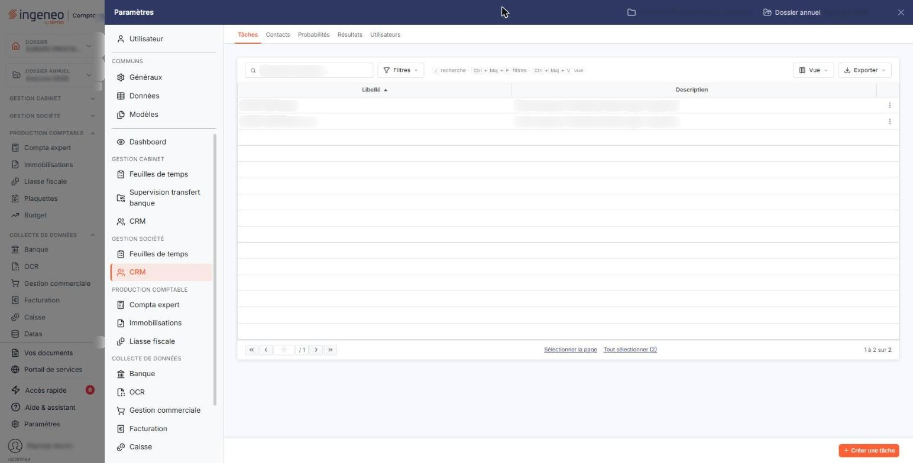
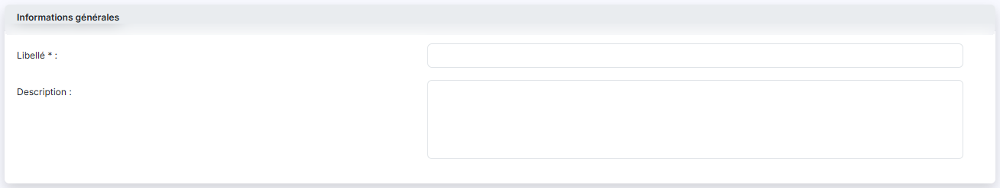

# Taches


**Où le trouver :** Panneau **Paramètres** › **CRM** › **Taches**



**En bref** — Cet écran tient la liste des tâches, c'est-à-dire la nature de vos démarches commerciales (appel, rendez-vous, relance…). C'est par lui que l'on commence la mise en place du module.

* Pour ajouter une tâche : bouton \[Créer une tâche], saisissez un libellé court de 30 caractères au maximum, puis bouton \[Enregistrer].
* Pour supprimer une tâche devenue inutile : détachez d'abord les actions et les résultats qui la désignent, puis choisissez « Supprimer » dans le menu « Autres actions » de sa ligne.


Une tâche décrit la **nature** d'une démarche commerciale : un appel téléphonique, un rendez-vous, l'envoi d'une documentation, une relance, une visite de courtoisie. C'est votre propre vocabulaire de travail, et le logiciel n'en propose aucune d'avance : c'est à vous de dresser la liste qui correspond à votre façon de prospecter.

<figure><figcaption>
Écran « Taches » de la nouvelle interface
</figcaption></figure>

Ce paramétrage commande deux choses dans le reste du module :

* chaque action que vous créez désigne obligatoirement une tâche ; sans tâche paramétrée, la liste « Tâche » de la fiche action reste vide et aucune action ne peut être enregistrée ;
* chaque résultat que vous paramétrez est rattaché à une tâche, de sorte que les issues proposées à la clôture d'une action soient celles qui conviennent à sa nature. Reportez-vous à l'onglet « Résultats » du panneau, voisin de celui-ci.

C'est donc par cette option que l'on commence lorsqu'on met le module en place.

La tâche sert enfin de critère de filtre dans la liste des actions, et de critère de regroupement dans l'édition d'activité mensuelle.

## La liste des tâches

L'écran, qui se trouve dans le panneau « Paramètres » (section « Gestion société », rubrique « CRM », onglet « Tâches »), s'ouvre directement sur la liste de vos tâches. Contrairement aux options « Actions » et « Opportunités », il ne comporte **aucun filtre prédéfini** : seulement une zone de recherche « Rechercher une tâche… » en haut de la liste, ainsi que les boutons \[Filtres], \[Vue] et \[Exporter].

La liste présente deux colonnes, toutes deux triables en cliquant sur leur titre :

| Champ           | Ce qu'il faut savoir                                                                                                                                                        |
| --------------- | --------------------------------------------------------------------------------------------------------------------------------------------------------------------------- |
| **Libellé**     | Le nom que vous avez donné à la tâche. C'est lui qui apparaîtra dans la liste « Tâche » de vos fiches actions et dans la colonne « Libellé Tâche » de la liste des actions. |
| **Description** | Le complément d'information que vous y avez associé. Il ne figure que dans cette liste, et sert à préciser à vos collaborateurs ce que recouvre exactement la tâche.        |

Ces deux colonnes sont les seules disponibles : le menu qu'ouvre le bouton **\[Vue]**, rubrique « Colonnes affichées », annonce « 2 colonnes affichées sur 2 ». Ce menu vous permet aussi d'enregistrer la disposition de la liste sous « Mes vues » (« Enregistrer la vue actuelle ») et de revenir aux colonnes d'origine (« Rétablir les colonnes d'origine »). Le bouton **\[Filtres]** ouvre un volet « Filtrer » où vous construisez vos propres critères (« + Ajouter un critère sur… »), que le lien « Vider les filtres » retire. Le bouton **\[Exporter]** ouvre un menu consacré à « La liste affichée » : « Aperçu » (édition HTML), « Imprimer », « Exporter en Excel », « Exporter en PDF » et « Envoyer la liste par e-mail ».

Lorsqu'aucune tâche n'est encore paramétrée, le logiciel affiche « Aucun élément à afficher. ».

Le fonctionnement commun à toutes les listes — tris, largeur et choix des colonnes, navigation entre les pages, cases de sélection — est décrit au chapitre : Généralités / Fonctionnement général / Fonctionnement d'une grille de la présente aide en ligne.

## Les pictogrammes de chaque ligne

Au survol d'une ligne, ses commandes apparaissent à droite, dans la dernière colonne. Il n'y en a que **deux**, contre trois ou quatre sur les autres listes du module : il n'y a ici ni aperçu, ni duplication. Un clic sur la ligne la sélectionne.

Le pictogramme « Modifier » ouvre la fiche de la tâche.

Le pictogramme « Autres actions » (trois points) ouvre un menu qui propose « Supprimer » : cette entrée supprime la tâche, après confirmation.

Ces commandes sont présentes sur toutes les lignes, y compris sur une tâche déjà utilisée. Mais une tâche employée ailleurs dans le module **ne peut pas être supprimée**, et le logiciel veille lui-même à votre place : après confirmation, il refuse et vous en donne la raison — « La tâche "..." ne peut être supprimée car elle est liée à une action. » lorsqu'une action la désigne, « La tâche "..." ne peut être supprimée car elle est liée à un résultat. » lorsqu'un résultat lui est rattaché. La tâche reste en place.

Pour supprimer malgré tout une tâche devenue inutile, commencez donc par la détacher : supprimez ou réaffectez les actions qui la désignent — la liste des actions vous les montre en filtrant sur la tâche concernée — puis les résultats qui en dépendent, que l'onglet « Résultats » vous montre dans sa colonne « Tâche de rattachement ».

## Les boutons de la liste

<figure><figcaption>
Bouton [Créer une tâche]
</figcaption></figure>

bouton **\[Créer une tâche]** : placé en bas à droite du panneau, il ouvre une fiche de tâche vierge.

Sous la liste, les liens « Sélectionner la page » et « Tout sélectionner (n) » sélectionnent les lignes de la page ou toutes celles de la liste. Dès qu'une ligne est sélectionnée, un bandeau apparaît en bas de l'écran avec un bouton **\[Supprimer]** : il supprime, après confirmation, les tâches sélectionnées.

## La fiche d'une tâche

<figure><figcaption>
Rubrique « La fiche d'une tâche »
</figcaption></figure>

<figure><figcaption>
Bouton [Enregistrer]
</figcaption></figure>

La fiche ne comporte qu'une seule rubrique, « Informations générales », et deux champs. Elle se présente de façon strictement identique en création et en modification : aucun champ ne devient non modifiable une fois la tâche enregistrée, et aucune rubrique supplémentaire n'apparaît.

| Champ                                                   | Ce qu'il faut savoir                                                                                                                                                                               |
| ------------------------------------------------------- | -------------------------------------------------------------------------------------------------------------------------------------------------------------------------------------------------- |
| 
<strong>Libellé</strong> <em>Obligatoire</em>
 | Sur une seule ligne, limité à **30 caractères**. Choisissez un libellé court et parlant : c'est ce texte, et lui seul, que vos collaborateurs verront dans la liste déroulante de la fiche action. |
| **Description**                                         | Sur plusieurs lignes, limité à 1024 caractères.                                                                                                                                                    |

bouton **\[Enregistrer]** : il valide la fiche et vous ramène à la liste.

Pour quitter la fiche sans rien enregistrer, utilisez le chevron « Retour » placé à gauche des onglets du panneau.
