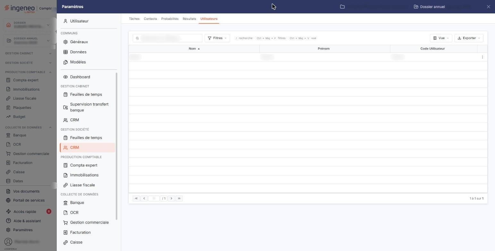
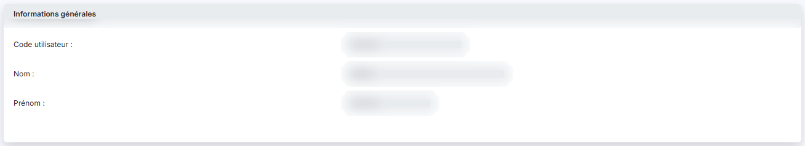
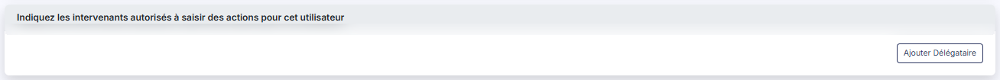
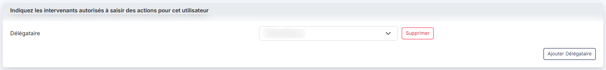

# Utilisateurs


**Où le trouver :** Panneau **Paramètres** › **CRM** › **Utilisateurs**



**En bref** — Cet écran désigne, utilisateur par utilisateur, ses délégataires : les intervenants autorisés à modifier ses actions et ses opportunités dans le CRM.

* Pour accorder une délégation : pictogramme « Modifier » de l'utilisateur, bouton \[Ajouter Délégataire], choisissez la personne, puis bouton \[Enregistrer].
* Pour retirer une délégation : bouton \[Supprimer] de sa ligne, puis bouton \[Enregistrer].


Cette option se trouve dans le panneau « Paramètres », rubrique « CRM » de la section « Gestion société », onglet « Utilisateurs ». Elle sert à désigner, utilisateur par utilisateur, ses **délégataires** : la rubrique de la fiche les présente comme « les intervenants autorisés à saisir des actions pour cet utilisateur ».

<figure><figcaption>
Écran « Utilisateurs » de la nouvelle interface
</figcaption></figure>

Concrètement, la délégation ouvre un droit de **modification** : le délégataire peut modifier les actions et les opportunités de l'utilisateur qui l'a désigné, alors qu'il ne le pourrait pas sans elle. Elle s'apprécie module par module : celle que vous accordez ici vaut pour le CRM.

C'est le seul paramétrage de cette option. Vous n'y créez pas d'utilisateur et vous n'en supprimez pas : la liste des utilisateurs est tenue ailleurs, dans l'administration de votre abonnement, et le logiciel ne présente ici que les utilisateurs actifs qui ont accès à la société gérée en cours (hors société du cabinet, les collaborateurs du cabinet n'y figurent pas, sauf vous-même). Vous ne faites que compléter chaque utilisateur présenté de ses délégataires.

## La liste des utilisateurs

L'écran s'ouvre directement sur la liste. Au-dessus de la liste, la zone « Rechercher un utilisateur… » et les boutons « Filtres », « Vue » et « Exporter » vous permettent de retrouver un utilisateur, d'ajuster les colonnes et d'éditer ou exporter la liste affichée.

Elle présente trois colonnes, toutes triables :

| Champ                | Ce qu'il faut savoir          |
| -------------------- | ----------------------------- |
| **Nom**              | Le nom de l'utilisateur.      |
| **Prénom**           | Son prénom.                   |
| **Code Utilisateur** | Son code d'accès au logiciel. |

Ce sont les trois seules colonnes existantes : le menu « Vue » ne vous propose rien d'autre à afficher. Le fonctionnement des listes du logiciel, la personnalisation des colonnes et la barre de pagination sont décrits dans le chapitre « Généralités » en tête de la présente aide.

Il n'y a aucun bouton sous cette liste : ni création, ni suppression.

## Le pictogramme de chaque ligne

Le pictogramme « Modifier » ouvre la fiche de l'utilisateur. La ligne ne comporte aucune autre commande : il n'y a ni suppression, ni duplication.

Selon les droits qui vous sont accordés, ce pictogramme peut ne pas vous être proposé : la fiche fait l'objet d'une autorisation propre.

## La fiche — rubrique « Informations générales »

<figure><figcaption>
Rubrique « Informations générales »
</figcaption></figure>

Cette première rubrique est un simple rappel : ses trois champs vous sont présentés en lecture seule et ne peuvent pas être modifiés ici.

| Champ                | Ce qu'il faut savoir                                           |
| -------------------- | -------------------------------------------------------------- |
| **Code utilisateur** | Le code d'accès de l'utilisateur.                              |
| **Nom**              | **Prénom :** son identité, présentés côte à côte sous le code. |

Pour les corriger, passez par la fiche de l'utilisateur dans l'administration de votre abonnement.

## La fiche — rubrique « Indiquez les intervenants autorisés à saisir des actions pour cet utilisateur »

<figure><figcaption>
Rubrique « Indiquez les intervenants autorisés à saisir des actions pour cet utilisateur »
</figcaption></figure>

C'est la rubrique de travail de cet écran, et son titre est la consigne elle-même. Elle est vide tant qu'aucune délégation n'a été accordée.

Chaque délégation tient sur une ligne, composée d'une seule information suivie de son bouton de suppression :

**Délégataire** : la liste déroulante des utilisateurs. L'utilisateur dont vous tenez la fiche n'y figure pas : on ne se délègue pas à soi-même. La liste s'ouvre sur son premier nom, déjà sélectionné — il n'y a pas de valeur vide en tête —, alors prenez garde à bien choisir la personne voulue avant d'enregistrer.

Ajoutez autant de lignes que de délégataires. N'indiquez pas deux fois la même personne : le logiciel refuse l'enregistrement et vous laisse sur la fiche.

## Bouton \[Ajouter Délégataire]

<figure><figcaption>
Bouton [Ajouter Délégataire]
</figcaption></figure>

Il ajoute une ligne à la rubrique. Il reste sous les lignes déjà créées : chaque clic en ajoute une de plus.

## Bouton \[Supprimer]

Chaque ligne porte le sien, à droite de la liste déroulante. Il retire la délégation. La suppression n'est acquise qu'à l'enregistrement de la fiche.

## Bouton \[Enregistrer]

<figure><figcaption>
Bouton [Enregistrer]
</figcaption></figure>

Il enregistre les délégations de l'utilisateur et vous ramène à la liste. Si un contrôle échoue, le logiciel vous laisse sur la fiche.

## Le chevron « Retour »

Placé dans la barre d'onglets du panneau, il revient à la liste sans rien enregistrer.
