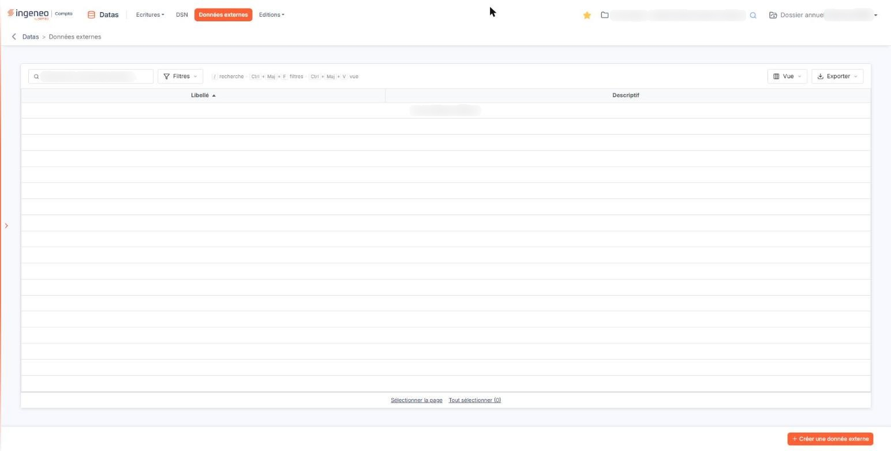
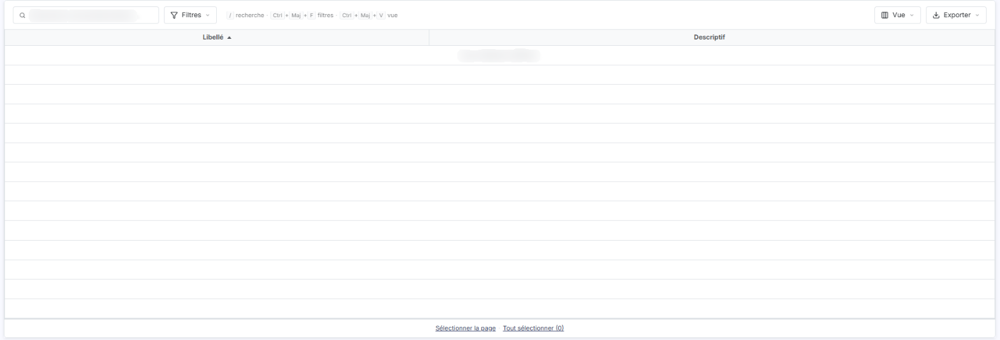
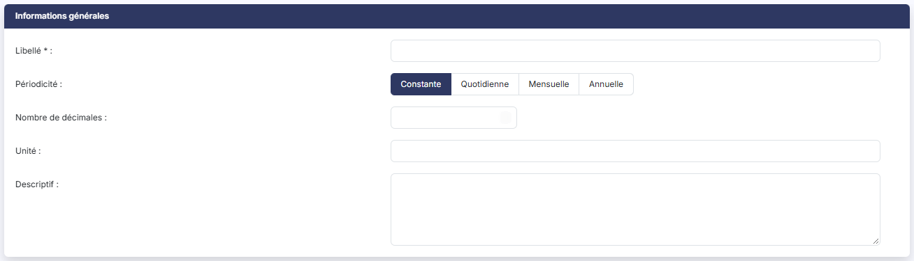

# Données externes


**Où le trouver :** Menu **Données externes**



**En bref** — Cet écran liste les données externes de la société, données complémentaires que vous saisissez vous-même pour les utiliser dans les graphiques, et vous permet d'en créer.

* Pour créer une donnée externe : bouton \[Créer une donnée externe], renseignez « Libellé : » et « Périodicité : », puis bouton \[Enregistrer].
* Pour retrouver une donnée : saisissez son libellé dans la barre « Rechercher une donnée externe… », ou bouton \[Filtres], puis bouton \[Filtrer].
* Pour retirer des données externes : sélectionnez-les d'un clic sur leur ligne, puis bouton \[Supprimer].


## La grille des données externes

<figure><figcaption>
Écran « Données externes » de la nouvelle interface
</figcaption></figure>

<figure><figcaption>
Rubrique « La grille des données externes »
</figcaption></figure>

Par défaut, la grille affiche deux colonnes, **Libellé** et **Descriptif**, et l'écran n'a ni totaux ni onglet. Au-dessus de la grille, une barre « Rechercher une donnée externe… » permet de retrouver une donnée, et trois menus règlent l'affichage : Bouton \[Filtres] (« Ajouter un critère sur… », puis Bouton \[Filtrer] ou « Vider les filtres »), Bouton \[Vue] et Bouton \[Exporter]. Le menu Bouton \[Exporter], intitulé « La liste affichée », propose Aperçu (édition HTML), Imprimer, Exporter en Excel, Exporter en PDF et Envoyer la liste par e-mail. Le menu Bouton \[Vue] propose « Mes vues » (« Aucune vue enregistrée. » tant que vous n'en avez pas enregistré, avec Bouton \[Enregistrer la vue actuelle]) et « Colonnes affichées » : dix colonnes sont disponibles, dont Créée le, Créée par, Modifiée le, Modifiée par, Unité et Utilisation, en plus des deux colonnes par défaut ; Bouton \[Appliquer] valide votre choix et Bouton \[Rétablir les colonnes d'origine] revient aux deux colonnes.

À l'ouverture, la grille est triée sur la colonne **Libellé**, par ordre croissant, et vous pouvez la trier sur le **Descriptif**.

Tant qu'aucune donnée externe n'a été créée, la grille affiche « Aucun élément à afficher. ».

Il n'y a plus de case à cocher : un clic sur une ligne la sélectionne. Sous la grille, Bouton \[Sélectionner la page] sélectionne les lignes de la page et Bouton \[Tout sélectionner (n)] toutes les données externes, n étant leur nombre.

## Bouton \[Créer une donnée externe]

<figure><figcaption>
Bouton [Créer une donnée externe]
</figcaption></figure>

<figure><figcaption>
Bouton [Créer une donnée externe]
</figcaption></figure>

Il ouvre la fiche d'une nouvelle donnée externe.

Une donnée externe se saisit en deux temps : d'abord les informations générales qui la décrivent, puis, une fois cette description enregistrée, les valeurs elles-mêmes.

La fiche ne présente qu'une rubrique, « Informations générales », avec les champs **Libellé :**, **Périodicité :**, **Nombre de décimales :**, **Unité :** et **Descriptif :**. La périodicité se choisit entre « Constante », « Quotidienne », « Mensuelle » et « Annuelle » ; « Constante » est proposée, et le nombre de décimales est proposé à 2. Le bouton **\[Enregistrer]** se trouve dans le pied de l'écran ; pour revenir à la liste, utilisez la flèche « Revenir en arrière », à gauche du fil d'Ariane.

Le libellé est obligatoire, et il doit être unique. Le logiciel le refuse s'il est déjà employé par une autre donnée externe, s'il dépasse trente caractères ou s'il comporte des caractères spéciaux ; les lettres accentuées, les espaces, le tiret, le souligné et le point sont acceptés. Le nombre de décimales, lui, ne peut pas dépasser quatre.

Pour utiliser vos données externes dans les indicateurs graphiques, reportez-vous à l'aide du module « Vision expert », menu « Contenu », sous-menu « Les indicateurs personnalisés ».

## Bouton \[Supprimer]

Il supprime les données externes que vous avez sélectionnées dans la grille.

Il n'est pas affiché tant que la grille est vide. Aucune donnée externe n'existant sur ce dossier, l'endroit où il apparaît une fois des lignes sélectionnées n'a pas pu être observé.
