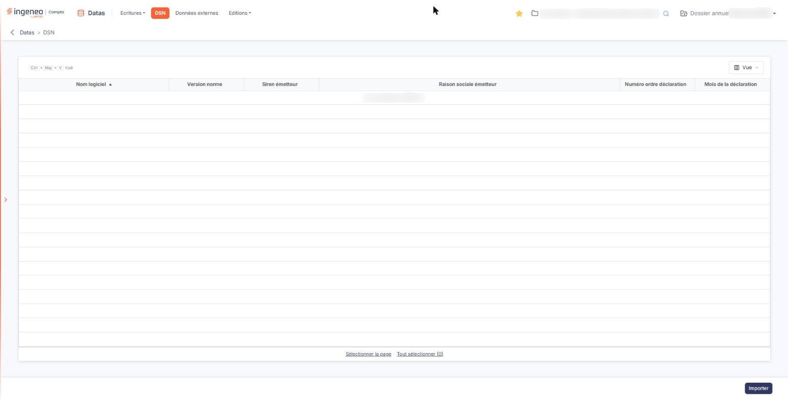
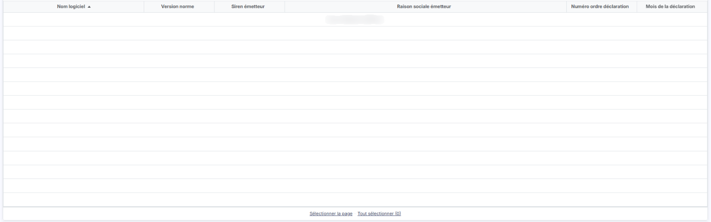
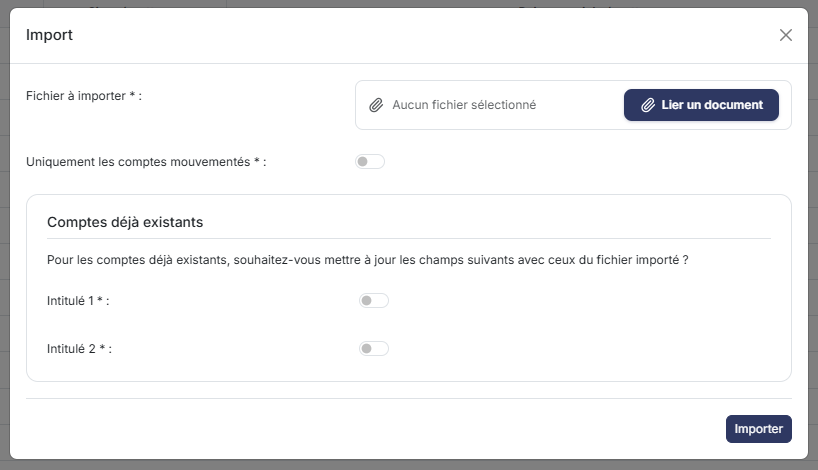

# DSN


**Où le trouver :** Menu **DSN**



**En bref** — Cet écran fait entrer dans le module « Datas » des déclarations sociales nominatives à partir d'un fichier, et liste celles déjà reçues.

* Pour importer une déclaration : bouton \[Importer], puis chargez votre fichier de déclaration dans la fenêtre d'import.
* Pour retirer des déclarations : sélectionnez-les d'un clic sur leur ligne, puis bouton \[Supprimer].
* Pour afficher d'autres colonnes : bouton \[Vue], cochez les colonnes voulues dans « Colonnes affichées », puis bouton \[Appliquer].


## La grille des déclarations

<figure><figcaption>
Écran « DSN » de la nouvelle interface
</figcaption></figure>

<figure><figcaption>
Rubrique « La grille des déclarations »
</figcaption></figure>

Chaque ligne est une déclaration reçue. Les colonnes reprennent les informations d'en-tête de la déclaration, dans cet ordre :

* **Nom logiciel** : le logiciel qui a produit la déclaration ;
* **Version norme** ;
* **Siren émetteur** ;
* **Raison sociale émetteur** ;
* **Numéro ordre déclaration** ;
* **Mois de la déclaration**.

À l'ouverture, la grille est triée sur la colonne **Nom logiciel**, par ordre croissant. Vous pouvez trier sur chacune des autres colonnes.

Tant qu'aucune déclaration n'a été reçue, la grille affiche « Aucun élément à afficher. ».

Le menu Bouton \[Vue] propose deux rubriques : « Mes vues » (« Aucune vue enregistrée. » tant que vous n'en avez pas enregistré, avec Bouton \[Enregistrer la vue actuelle]) et « Colonnes affichées », où vous cochez les colonnes à montrer. Quinze colonnes sont disponibles et les six ci-dessus sont affichées par défaut ; les neuf autres sont : Année, Mois, Éditeur logiciel, Version logiciel, SIREN de l'établissement, Nic de l'établissement, Adresse, Code postal et Ville. Bouton \[Appliquer] valide votre choix et Bouton \[Rétablir les colonnes d'origine] revient aux six colonnes par défaut.

Il n'y a plus de case à cocher : un clic sur une ligne la sélectionne. Sous la grille, Bouton \[Sélectionner la page] sélectionne les lignes de la page et Bouton \[Tout sélectionner (n)] toutes les déclarations, n étant leur nombre.

## Bouton \[Importer]

<figure><figcaption>
Bouton [Importer]
</figcaption></figure>

<figure><figcaption>
Bouton [Importer]
</figcaption></figure>

Il ouvre une fenêtre d'import, dans laquelle vous chargez votre fichier de déclaration.

## Bouton \[Supprimer]

Il supprime les déclarations que vous avez sélectionnées dans la grille.

Il n'est pas affiché tant que la grille est vide. Aucune déclaration n'existant sur ce dossier, l'endroit où il apparaît une fois des lignes sélectionnées n'a pas pu être observé.
