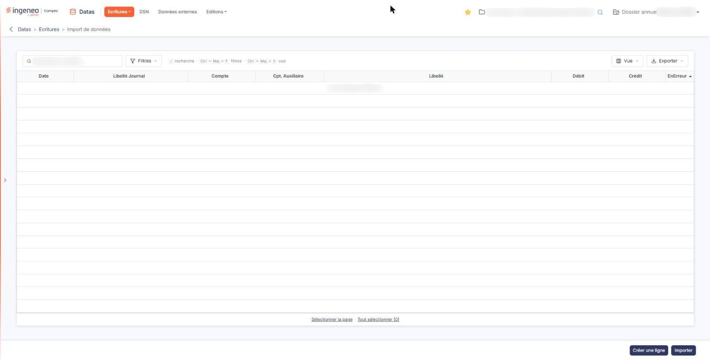
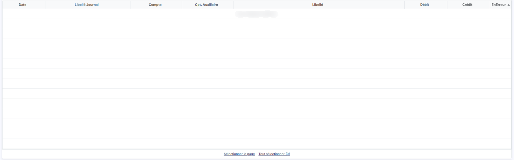
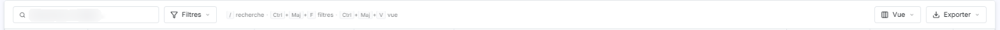
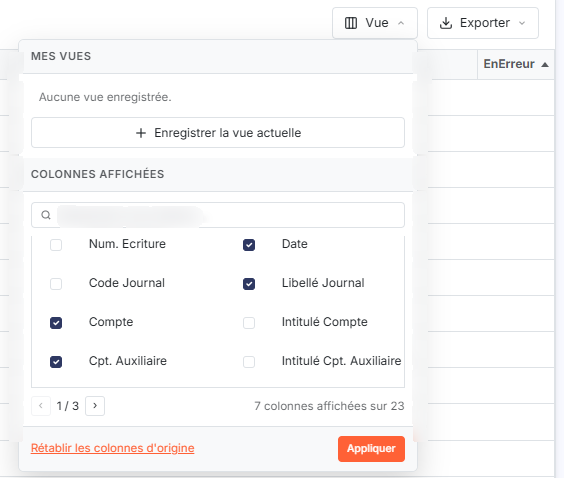
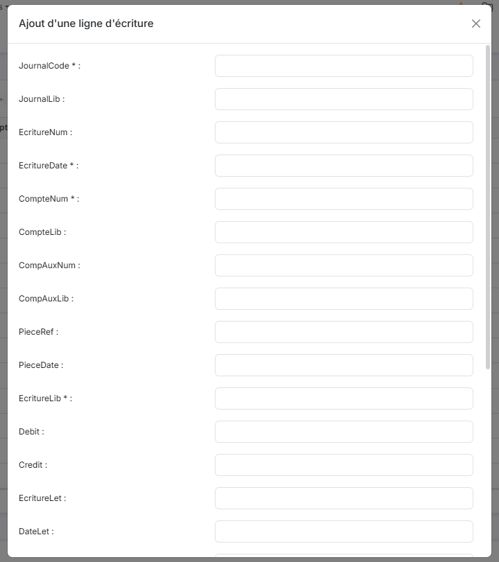
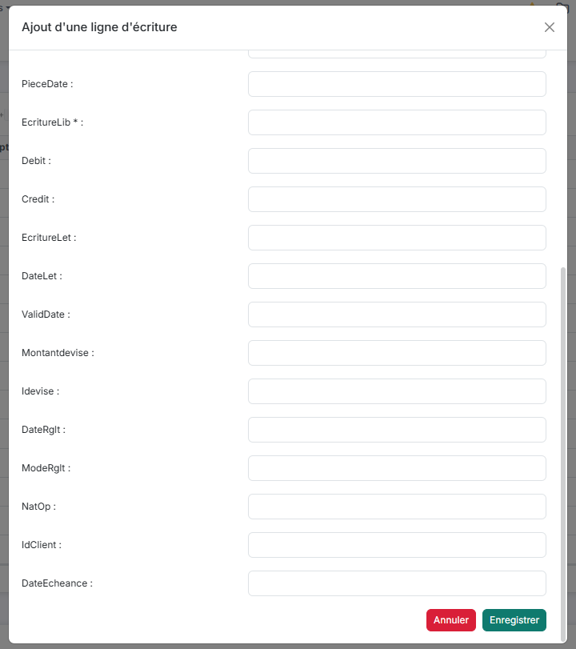
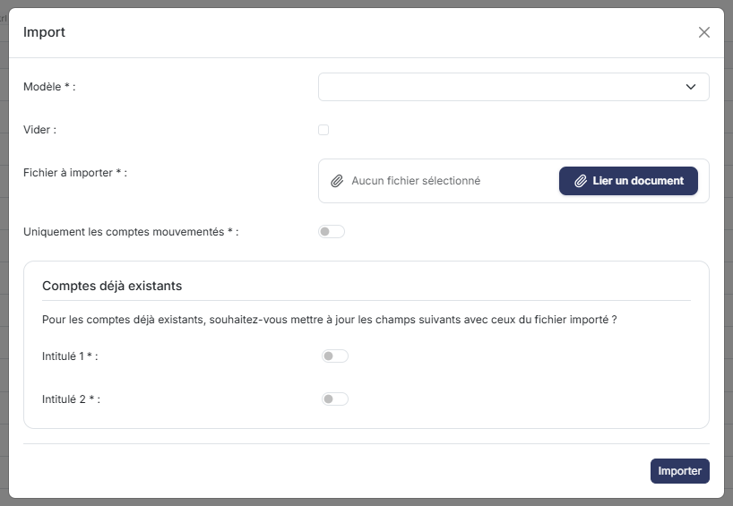

# Import de données


**Où le trouver :** Menu **Ecritures › Import de données**



**En bref** — Cet écran fait entrer dans le module des écritures venues d'un autre logiciel, à partir d'un fichier, et signale les lignes en anomalie avant leur prise en compte.

* Pour importer un fichier d'écritures : bouton \[Importer], puis chargez votre fichier dans la fenêtre d'import.
* Pour repérer les lignes à corriger : laissez la grille triée sur la colonne EnErreur, les lignes en anomalie remontent en tête de liste.
* Pour ajouter une ligne à la main : bouton \[Créer une ligne], renseignez au moins JournalCode, EcritureDate, CompteNum et EcritureLib, puis bouton \[Enregistrer].


Cette option vous permet de faire entrer dans le module « Datas » des écritures venues d'un autre logiciel, à partir d'un fichier.

<figure><figcaption>
Écran « Import de données » de la nouvelle interface
</figcaption></figure>

Les lignes du fichier ne rejoignent pas directement l'option « Visualisation » : elles sont d'abord présentées dans la grille de cet écran, où le logiciel vous signale celles qui présentent une anomalie et où vous pouvez en ajouter.

Vous y accédez par la barre du module : menu « Écritures », puis « Import de données ».

L'écran comporte donc trois parties : une barre d'outils (zone de recherche, Bouton \[Filtres], Bouton \[Vue] et Bouton \[Exporter]), la grille des lignes à importer et les boutons de bas d'écran. Il n'a ni totaux, ni onglet.

## La grille des lignes à importer

<figure><figcaption>
Rubrique « La grille des lignes à importer »
</figcaption></figure>

Ses colonnes se présentent dans cet ordre :

* **Date** : date de l'écriture ;
* **Libellé Journal** ;
* **Compte** ;
* **Cpt. Auxiliaire** ;
* **Libellé** ;
* **Débit** ;
* **Crédit** ;
* **EnErreur** : cette colonne, dont l'intitulé s'affiche bien en un seul mot, indique les lignes qui présentent une anomalie.

À l'ouverture, la grille est triée sur la colonne **EnErreur** : les lignes à corriger remontent donc d'elles-mêmes en tête de liste. Vous pouvez trier sur chacune des autres colonnes.

Une ligne est signalée en erreur lorsqu'il lui manque l'une des informations indispensables à une écriture : le code du journal, la date de l'écriture, le numéro de compte, le libellé de l'écriture, ou un montant au débit ou au crédit. Elle l'est aussi lorsque l'une de ces valeurs est trop longue, par exemple un code journal de plus de quatre caractères ou un libellé d'écriture de plus de trente-cinq.

Tant qu'aucune ligne n'a été importée, la grille affiche « Aucun élément à afficher. ».

La grille ne comporte plus de case à cocher ni de pictogrammes en tête de colonne : la sélection se fait en cliquant sur une ligne, et les commandes de ligne forment la dernière colonne de la grille. Sous la grille, « Sélectionner la page » sélectionne les lignes de la page affichée et « Tout sélectionner (n) » toutes les lignes de la liste ; « n » vaut 0 tant que la grille est vide. Les sept premières colonnes se déplacent et s'élargissent ; la colonne **EnErreur** reste en place.

## La barre d'outils

<figure><figcaption>
Rubrique « La barre d'outils »
</figcaption></figure>

<figure><figcaption>
Rubrique « La barre d'outils »
</figcaption></figure>

Elle est placée au-dessus de la grille :

* **Rechercher un libellé…** : zone de recherche rapide sur le libellé des lignes ;
* Bouton \[Filtres] : ouvre le volet « Filtrer ». Tant qu'aucun critère n'est posé, il affiche « Aucun critère. Choisissez une colonne pour commencer. » ; « + Ajouter un critère sur… » propose les colonnes de la liste ; Bouton \[Vider les filtres] et Bouton \[Filtrer] terminent le volet ;
* Bouton \[Vue] : ouvre le menu « Mes vues » (« Enregistrer la vue actuelle ») puis la liste « Colonnes affichées ». Cette liste compte 23 colonnes, dont 7 sont affichées à l'ouverture (les sept premières colonnes décrites ci-dessus) ; elle se parcourt par pages de huit colonnes. Cochez ou décochez les colonnes voulues, puis cliquez sur Bouton \[Appliquer] ; « Rétablir les colonnes d'origine » ramène l'affichage de départ. Les colonnes supplémentaires sont : **Num. Ecriture**, **Code Journal**, **Intitulé Compte**, **Intitulé Cpt. Auxiliaire**, **Date Validation**, **Lettre**, **Date Lettrage**, **Montant Devise**, **Devise**, **Date Rglt.**, **Mode Rglt.**, **Nature Opération**, **Id. Client**, **Réf. Pièce**, **Date Pièce** et **Date d'échéance** ;
* Bouton \[Exporter] : le menu, intitulé « La liste affichée - n ligne(s) d'écriture », propose « Aperçu édition HTML », « Imprimer », « Exporter en Excel », « Exporter en PDF » et « Envoyer la liste par e-mail ».

## Bouton \[Créer une ligne]

<figure><figcaption>
Bouton [Créer une ligne]
</figcaption></figure>

<figure><figcaption>
Bouton [Créer une ligne]
</figcaption></figure>

<figure><figcaption>
Bouton [Créer une ligne]
</figcaption></figure>

Placé en bas à droite de l'écran, hors de la grille, il vous permet d'ajouter vous-même une ligne d'écriture à celles du fichier, sans passer par un import. Il ouvre la fenêtre « Ajout d'une ligne d'écriture », dont les champs portent les noms techniques des colonnes du fichier (JournalCode, EcritureDate, CompteNum, EcritureLib, Debit, Credit, etc.). Quatre sont marqués d'un astérisque : JournalCode, EcritureDate, CompteNum et EcritureLib. La fenêtre se ferme par Bouton \[Annuler] ; Bouton \[Enregistrer] valide la ligne.

## Bouton \[Importer]

<figure><figcaption>
Bouton [Importer]
</figcaption></figure>

<figure><figcaption>
Bouton [Importer]
</figcaption></figure>

Placé à droite de \[Créer une ligne], il ouvre une fenêtre d'import, dans laquelle vous chargez votre fichier.
