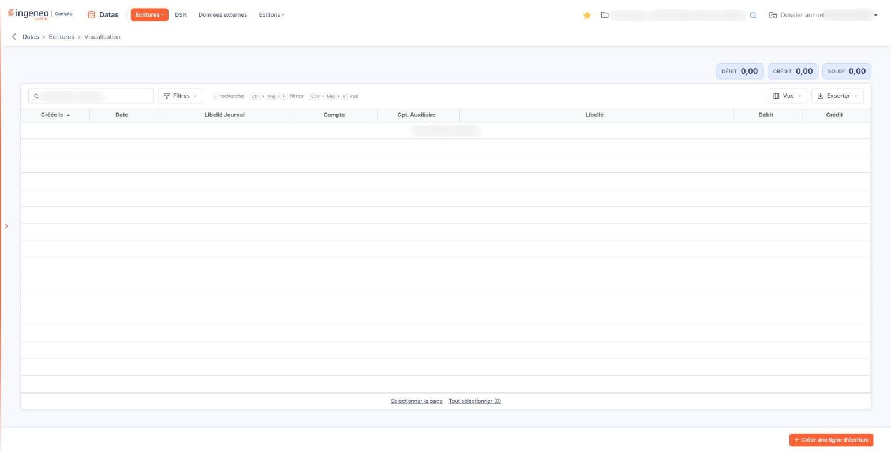
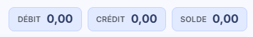
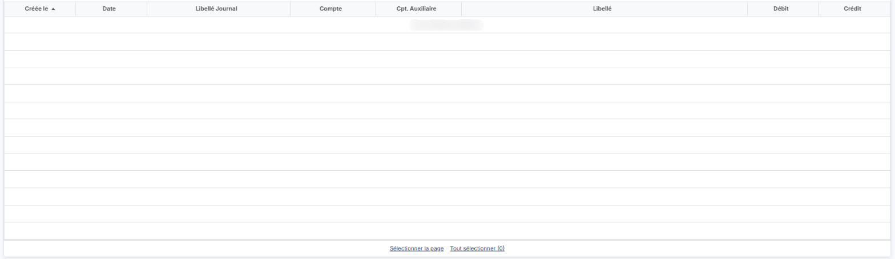
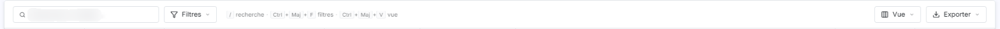
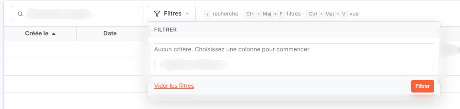
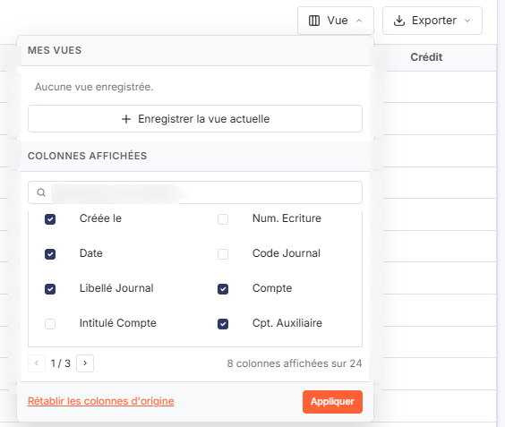
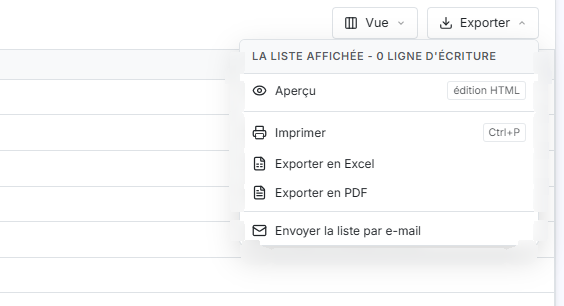
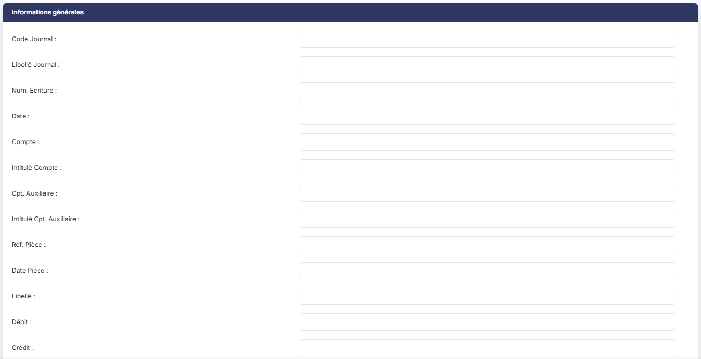
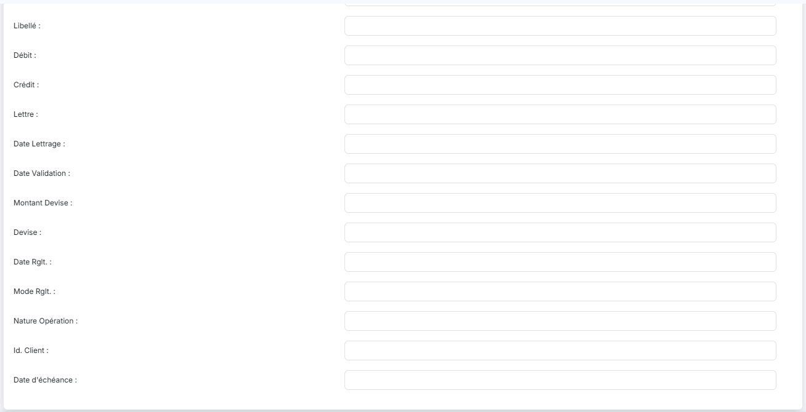

# Visualisation


**Où le trouver :** Menu **Ecritures › Visualisation**



**En bref** — Cet écran montre les lignes d'écritures présentes dans le module « Datas », qui alimentent les indicateurs du tableau de bord, avec leurs totaux Débit, Crédit et Solde.

* Pour retrouver des lignes : saisissez un libellé dans « Rechercher un libellé », ou bouton \[Filtres], puis bouton \[Filtrer].
* Pour saisir une ligne d'écriture : bouton \[Créer une ligne d'écriture], renseignez la rubrique « Informations générales », puis bouton \[Enregistrer].
* Pour sortir la liste : bouton \[Exporter], puis « Exporter en Excel » ou « Exporter en PDF ».


Cette option vous montre les lignes d'écritures présentes dans le module « Datas » : ce sont elles qui servent de matière aux indicateurs du tableau de bord.

<figure><figcaption>
Écran « Visualisation » de la nouvelle interface
</figcaption></figure>

Vous y accédez par la barre du module : menu « Écritures », puis « Visualisation ».

L'écran se compose de trois totaux, en haut à droite, d'une barre d'outils (zone de recherche, Bouton \[Filtres], Bouton \[Vue] et Bouton \[Exporter]) et de la grille des lignes d'écritures. Il n'a ni onglet, ni rubrique.

## Les totaux

<figure><figcaption>
Rubrique « Les totaux »
</figcaption></figure>

Ils sont au nombre de trois, affichés côte à côte au-dessus de la grille : **Débit**, **Crédit** et **Solde**. Ces trois valeurs sont calculées par le logiciel et ne se saisissent pas. Lorsqu'aucune ligne n'est présente, elles affichent 0,00.

## La grille des lignes d'écritures

<figure><figcaption>
Rubrique « La grille des lignes d'écritures »
</figcaption></figure>

Chaque ligne de la grille est une ligne d'écriture, et non une écriture entière. Les colonnes se présentent dans cet ordre :

* **Créée le** : date à laquelle la ligne est entrée dans le module ;
* **Date** : date de l'écriture ;
* **Libellé Journal** ;
* **Compte** ;
* **Cpt. Auxiliaire** ;
* **Libellé** ;
* **Débit** ;
* **Crédit**.

À l'ouverture, la grille est triée sur la colonne **Créée le**, de la plus ancienne à la plus récente. Vous pouvez trier sur chacune des autres colonnes.

Tant qu'aucune ligne d'écriture n'a été importée, la grille affiche « Aucun élément à afficher. ».

La grille ne comporte plus de case à cocher ni de pictogrammes en tête de colonne : la sélection se fait en cliquant sur une ligne. Le fonctionnement commun des listes est décrit dans la page commune « Les listes ». Sous la grille, « Sélectionner la page » sélectionne les lignes de la page affichée et « Tout sélectionner (n) » toutes les lignes de la liste ; « n » vaut 0 tant que la grille est vide.

## La barre d'outils

<figure><figcaption>
Rubrique « La barre d'outils »
</figcaption></figure>

<figure><figcaption>
Rubrique « La barre d'outils »
</figcaption></figure>

<figure><figcaption>
Rubrique « La barre d'outils »
</figcaption></figure>

<figure><figcaption>
Rubrique « La barre d'outils »
</figcaption></figure>

Elle est placée au-dessus de la grille :

* **Rechercher un libellé…** : zone de recherche rapide sur le libellé des lignes ;
* Bouton \[Filtres] : ouvre le volet « Filtrer ». Tant qu'aucun critère n'est posé, il affiche « Aucun critère. Choisissez une colonne pour commencer. » ; « + Ajouter un critère sur… » propose les colonnes de la liste, y compris celles qui ne sont pas affichées ; Bouton \[Vider les filtres] et Bouton \[Filtrer] terminent le volet ;
* Bouton \[Vue] : ouvre le menu « Mes vues », qui indique « Aucune vue enregistrée. » tant que vous n'en avez pas créé et propose « Enregistrer la vue actuelle », puis la liste « Colonnes affichées ». Cette liste compte 24 colonnes, dont 8 sont affichées à l'ouverture (celles décrites ci-dessus) ; elle se parcourt par pages de huit colonnes, avec une zone de recherche de colonne. Cochez ou décochez les colonnes voulues, puis cliquez sur Bouton \[Appliquer] ; « Rétablir les colonnes d'origine » ramène l'affichage de départ. Les colonnes supplémentaires sont : **Num. Ecriture**, **Code Journal**, **Intitulé Compte**, **Intitulé Cpt. Auxiliaire**, **Date Validation**, **Lettre**, **Date Lettrage**, **Montant Devise**, **Devise**, **Date Rglt.**, **Mode Rglt.**, **Nature Opération**, **Id. Client**, **Réf. Pièce**, **Date Pièce** et **Date d'échéance** ;
* Bouton \[Exporter] : le menu, intitulé « La liste affichée - n ligne(s) d'écriture », propose « Aperçu édition HTML », « Imprimer », « Exporter en Excel », « Exporter en PDF » et « Envoyer la liste par e-mail ».

## Bouton \[Créer une ligne d'écriture]

<figure><figcaption>
Bouton [Créer une ligne d'écriture]
</figcaption></figure>

<figure><figcaption>
Bouton [Créer une ligne d'écriture]
</figcaption></figure>

<figure><figcaption>
Bouton [Créer une ligne d'écriture]
</figcaption></figure>

Placé en bas à droite de l'écran, hors de la grille, il ouvre la saisie d'une nouvelle ligne d'écriture. C'est le seul bouton d'action présenté lorsque la grille est vide. La saisie s'ouvre sur toute la page, en une seule rubrique, « Informations générales », qui reprend les champs des colonnes de la liste (journal, numéro d'écriture, date, compte, compte auxiliaire, pièce, libellé, débit, crédit, lettrage, devise, règlement, échéance…) ; Bouton \[Enregistrer] se trouve en bas de l'écran. Pour revenir à la liste, utilisez la flèche « Revenir en arrière », à gauche du fil d'Ariane.
