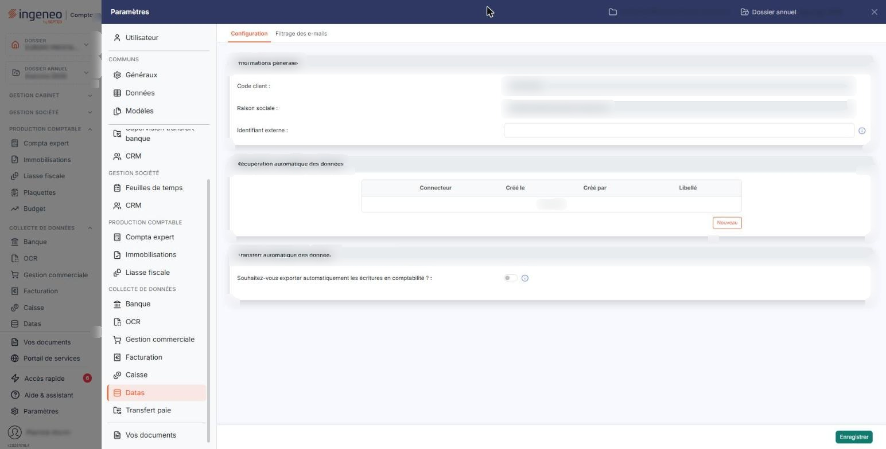
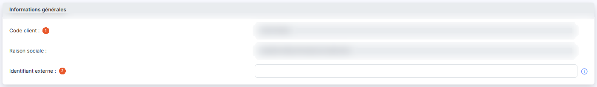
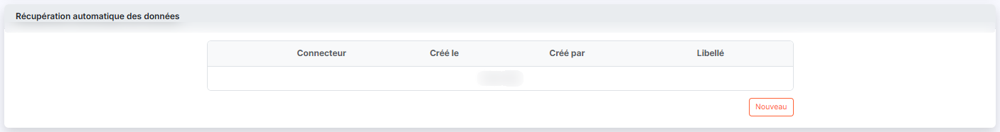
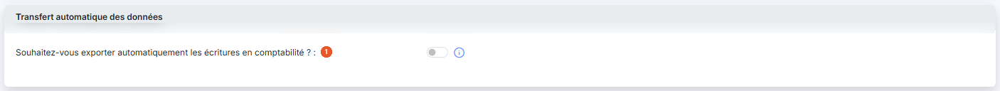

# Configuration


**Où le trouver :** Panneau **Paramètres** › **Datas** › **Configuration**



**En bref** — Cet écran rassemble le paramétrage du module pour la société gérée : identification, connecteurs qui alimentent ses écritures et transfert automatique de ces écritures vers la comptabilité.

* Pour rattacher un connecteur à la société gérée : bouton \[Nouveau] de la rubrique « Récupération automatique des données », puis bouton \[Enregistrer].
* Pour transférer automatiquement les écritures en comptabilité : activez « Souhaitez-vous exporter automatiquement les écritures en comptabilité ? », puis bouton \[Enregistrer].
* Pour lier la société au connecteur externe : renseignez « Identifiant externe : », puis bouton \[Enregistrer].


Cette option rassemble le paramétrage du module pour la société gérée sur laquelle vous êtes positionné : son identification, les connecteurs qui alimentent automatiquement ses écritures, et le transfert automatique de ces écritures vers la comptabilité.

<figure><figcaption>
Écran « Configuration » de la nouvelle interface
</figcaption></figure>

Cet écran se trouve dans le panneau Paramètres, que vous ouvrez par l'entrée « Paramètres » en bas de la barre latérale gauche (hors tableau de bord, cette barre est masquée : cliquez sur le bord gauche de l'écran pour l'ouvrir) : le panneau s'ouvre sur la rubrique « Datas », onglet « Configuration ».

L'écran se présente comme un formulaire unique, en trois rubriques toujours affichées : « Informations générales », « Récupération automatique des données » et « Transfert automatique des données ». Aucun champ n'y est signalé comme obligatoire. Son bouton de bas de panneau est \[Enregistrer] : cet écran n'offre ni retour ni annulation, et vous le quittez en changeant d'onglet ou en fermant le panneau.

## Rubrique « Informations générales »

<figure><figcaption>
Rubrique « Informations générales »
</figcaption></figure>

| Champ                      | Ce qu'il faut savoir                                                                                                                                                                                 |
| -------------------------- | ---------------------------------------------------------------------------------------------------------------------------------------------------------------------------------------------------- |
| 1. **Code client**         | **Raison sociale :** ces deux zones reprennent l'identification de la société gérée. Elles sont en lecture seule : elles ne se modifient pas ici.                                                    |
| 2. **Identifiant externe** | C'est le seul champ modifiable de la rubrique. Son pictogramme d'information précise « Ce champ va vous permettre de faire le lien avec le connecteur externe permettant de récupérer les données. » |

## Rubrique « Récupération automatique des données »

<figure><figcaption>
Rubrique « Récupération automatique des données »
</figcaption></figure>

Cette rubrique présente, sous la forme d'un tableau à quatre colonnes — **Connecteur**, **Créé le**, **Créé par** et **Libellé** —, les connecteurs rattachés à cette société gérée. Tant qu'aucun connecteur n'est rattaché, le logiciel affiche « Liste vide ».

Le bouton **\[Nouveau]**, placé dans la rubrique, vous permet de rattacher un connecteur à cette société gérée.

Un connecteur n'est pas créé ici : les connecteurs vers les API des autres éditeurs sont activés et paramétrés une seule fois pour tout le cabinet, dans le module « Supervision Datas », option « Connecteurs » ; reportez-vous à l'aide de ce module. Cette rubrique ne fait que désigner, parmi eux, celui qui alimentera cette société gérée.

Les modifications que vous faites dans cette rubrique ne sont enregistrées qu'au moment où vous cliquez sur le bouton \[Enregistrer] de bas d'écran.

## Rubrique « Transfert automatique des données »

<figure><figcaption>
Rubrique « Transfert automatique des données »
</figcaption></figure>

| Champ                                                                          | Ce qu'il faut savoir                                                                                                                                                                                                                                                                                                                                        |
| ------------------------------------------------------------------------------ | ----------------------------------------------------------------------------------------------------------------------------------------------------------------------------------------------------------------------------------------------------------------------------------------------------------------------------------------------------------- |
| 1. **Souhaitez-vous exporter automatiquement les écritures en comptabilité ?** | 
Cet interrupteur commande toute la rubrique. Son pictogramme d'information précise « Si vous répondez Oui toutes les écritures ajoutées dans le module Datas seront transférées automatiquement en comptabilité. » Tant qu'il est désactivé, la rubrique ne contient rien d'autre que lui. Activez-le : une seconde question apparaît au-dessous.
 |
| **Souhaitez-vous purger les écritures existantes avant chaque export ?**       | Cet interrupteur n'est proposé que lorsque le précédent est activé. Activé, il fait supprimer les écritures déjà présentes en comptabilité avant chaque transfert, de sorte que la comptabilité ne contienne que ce que le module vient de lui envoyer. Désactivé, les écritures s'ajoutent à celles qui s'y trouvent déjà.                                 |

Le transfert automatique vaut pour toutes les façons d'alimenter le module : l'import que vous faites vous-même depuis le module, l'import automatique de fichiers et l'alimentation par une API.

bouton **\[Enregistrer]**

C'est le bouton de bas de panneau. Il enregistre les trois rubriques, y compris les connecteurs que vous venez de rattacher.
