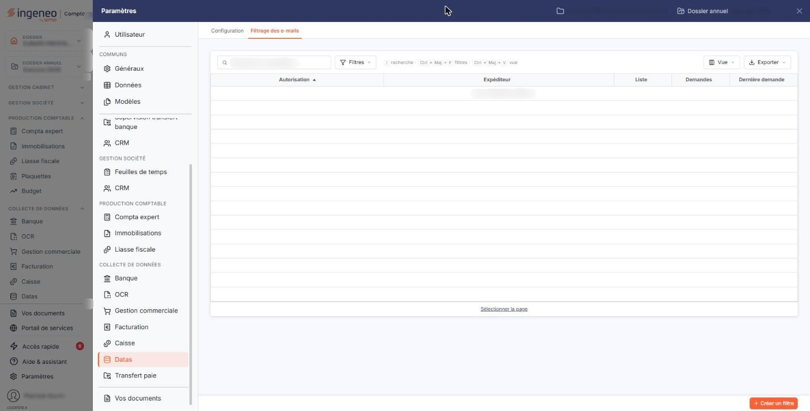
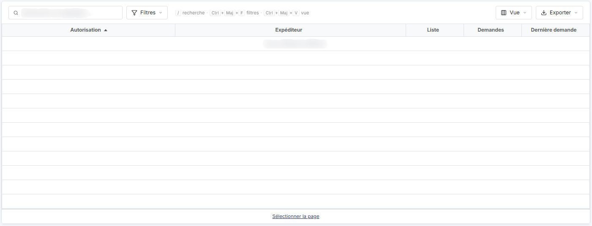
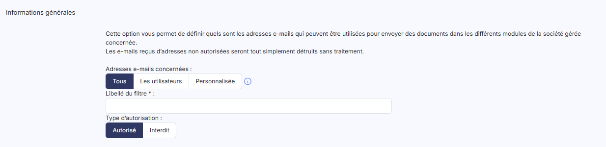

# Filtrage des e-mails


**Où le trouver :** Panneau **Paramètres** › **Datas** › **Filtrage des e-mails**



**En bref** — Cet écran définit quelles adresses e-mail sont autorisées ou interdites pour envoyer des fichiers à importer pour la société gérée, au moyen de règles de filtrage.

* Pour créer une règle : bouton \[Créer un filtre], choisissez l'Autorisation « Tous », « Les utilisateurs » ou « Personnalisée », puis enregistrez.
* Pour trancher une adresse en « Liste grise » : sélectionnez sa ligne d'un clic, puis bouton \[Mettre en autorisé] ou bouton \[Mettre en interdit].
* Pour retirer une règle : sélectionnez-la, puis bouton \[Supprimer] ; l'adresse redevient inconnue, pas interdite.


Le module peut recevoir des fichiers à importer par courrier électronique. Cette option vous permet de définir quelles adresses e-mail sont autorisées à envoyer ces fichiers pour la société gérée sur laquelle vous êtes positionné, et lesquelles ne le sont pas.

<figure><figcaption>
Écran « Filtrage des e-mails » de la nouvelle interface
</figcaption></figure>

Vous le faites en créant des règles : chaque ligne de la grille est une règle, qui désigne une ou plusieurs adresses et dit si elles sont autorisées ou interdites.

Cet écran se trouve dans le panneau Paramètres, que vous ouvrez par l'entrée « Paramètres » en bas de la barre latérale gauche (hors tableau de bord, cette barre est masquée : cliquez sur le bord gauche de l'écran pour l'ouvrir) : le panneau s'ouvre sur la rubrique « Datas » ; choisissez l'onglet « Filtrage des e-mails ».

L'écran se présente comme une liste : une barre « Rechercher un expéditeur… » avec le bouton **\[Filtres]**, le bouton **\[Vue]** et le bouton **\[Exporter]**, puis la grille.

## La grille

<figure><figcaption>
Rubrique « La grille »
</figcaption></figure>

Elle présente les règles existantes sur cinq colonnes, triées par défaut sur la première, par ordre croissant.

| Champ            | Ce qu'il faut savoir                                                                                                                                                                                                                                                                                                            |
| ---------------- | ------------------------------------------------------------------------------------------------------------------------------------------------------------------------------------------------------------------------------------------------------------------------------------------------------------------------------- |
| **Autorisation** | Les adresses que la règle vise. Trois choix seulement sont possibles : « Tous », qui vise toutes les adresses e-mail ; « Les utilisateurs », qui vise les seules adresses renseignées dans les fiches des utilisateurs ayant accès à la société gérée ; et « Personnalisée », qui vise une adresse précise, que vous saisissez. |
| **Expéditeur**   | L'adresse e-mail visée. Elle n'est renseignée que pour une règle « Personnalisée ».                                                                                                                                                                                                                                             |
| **Liste**        | Ce que la règle décide — « Autorisé » ou « Interdit ». Une troisième valeur, « Liste grise », existe.                                                                                                                                                                                                                           |
| **Demandes**     | **Dernière demande :** les deux dernières colonnes de la grille.                                                                                                                                                                                                                                                                |

Le fonctionnement commun des listes — recherche, filtres, choix des colonnes, sélection des lignes, navigation entre les pages — est décrit dans la page commune « Les listes ». Au-dessus de la grille, la zone de recherche propose les expéditeurs au fil de la saisie ; le bouton **\[Filtres]** ouvre le volet des filtres ; le bouton **\[Vue]** vous permet de choisir les colonnes affichées ; le bouton **\[Exporter]** ouvre un menu qui permet d'afficher un aperçu de l'édition, de l'imprimer, de l'exporter en Excel ou en PDF et de l'envoyer par e-mail. Sous la grille, « Sélectionner la page » sélectionne toutes les lignes de la page affichée.

## Comment le logiciel décide

<figure><figcaption>
Bouton [Créer un filtre]
</figcaption></figure>

À la réception d'un e-mail, le logiciel cherche la règle qui s'applique à l'adresse de l'expéditeur.

Une même adresse ne peut figurer que dans une seule règle, et un même choix « Tous » ou « Les utilisateurs » ne peut servir qu'une fois : le logiciel refuse l'enregistrement d'une règle qui ferait double emploi.

bouton **\[Créer un filtre]**

Placé en bas du panneau, hors de la grille, il ouvre la fiche de création d'une règle de filtrage.
