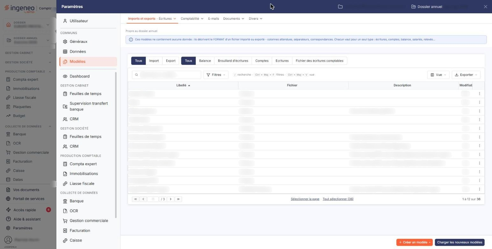
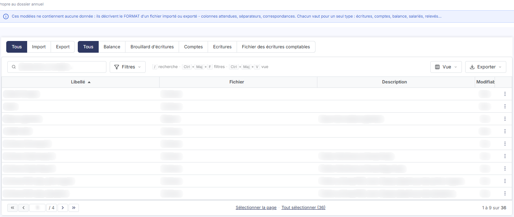
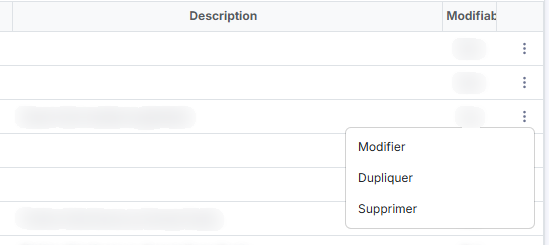
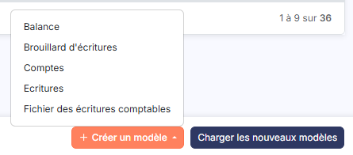

# Modèles d'import export


**Où le trouver :** Panneau **Paramètres**



**En bref** — Cet écran liste les modèles d'import du module, qui décrivent comment lire le fichier que vous remettez, et vous permet d'en créer.

* Pour créer un modèle : bouton \[Créer un modèle], puis choisissez Balance, Brouillard d'écritures, Comptes, Écritures ou Fichier des écritures comptables.
* Pour partir d'un modèle livré ou figé : commande « Dupliquer » de sa ligne, la copie vous appartient.
* Pour supprimer des modèles : cochez-les dans la grille, puis bouton \[Supprimer].


Cette option présente les modèles d'import du module et vous permet d'en créer. Un modèle décrit la façon dont le logiciel doit lire le fichier que vous lui remettez ; c'est lui que vous désignerez ensuite, dans la liste déroulante **Modèle**, au moment d'importer des données.

<figure><figcaption>
Écran « Modèles d'import export » de la nouvelle interface
</figcaption></figure>

L'écran se présente comme une grille, sans onglet et sans zone de filtre au-dessus d'elle.

## La grille

<figure><figcaption>
Rubrique « La grille »
</figcaption></figure>

Elle présente les modèles existants sur trois colonnes, triées par défaut sur le libellé, par ordre croissant.

| Champ           | Ce qu'il faut savoir                            |
| --------------- | ----------------------------------------------- |
| **Libellé**     | Le nom que vous avez donné au modèle.           |
| **Fichier**     | Le type de fichier auquel le modèle s'applique. |
| **Description** | Le commentaire libre attaché au modèle.         |

Les trois colonnes se trient, se redimensionnent et se déplacent. La ligne d'en-tête porte les commandes habituelles des grilles du logiciel : la case qui sélectionne toutes les lignes de la page, le pictogramme « Roue crantée » qui vous permet de choisir les colonnes affichées, le pictogramme « Entonnoir » qui ouvre la fenêtre des filtres et le pictogramme « Imprimante » qui imprime la grille.

## Les commandes d'une ligne

<figure><figcaption>
Rubrique « Les commandes d'une ligne »
</figcaption></figure>

<figure><figcaption>
Bouton [Créer un modèle]
</figcaption></figure>

Chaque ligne porte trois commandes, à gauche :

* « Modifier » ouvre la fiche du modèle ;
* « Supprimer » supprime le modèle ;
* « Dupliquer » crée un nouveau modèle à partir de celui-ci.

Tous les modèles ne sont pas modifiables : ceux que l'éditeur livre et ceux que le logiciel a figés ne s'ouvrent pas, et le logiciel vous ramène alors à la liste sans rien afficher. Pour partir d'un tel modèle, utilisez « Dupliquer » : la copie, elle, vous appartient.

Il n'y a pas de commande d'aperçu sur cet écran.

bouton **\[Créer un modèle]**

Placé dans le pied du panneau, il propose cinq entrées : Balance, Brouillard d'écritures, Comptes, Écritures et Fichier des écritures comptables.

bouton **\[Supprimer]**

Il supprime en une seule fois tous les modèles que vous avez cochés dans la grille.
