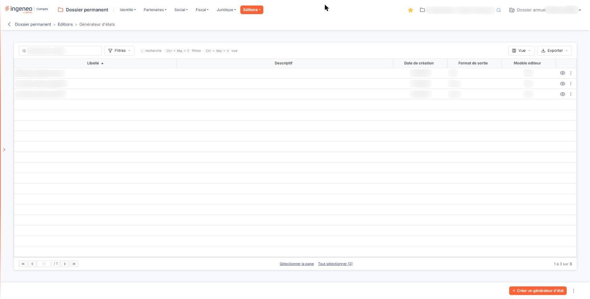
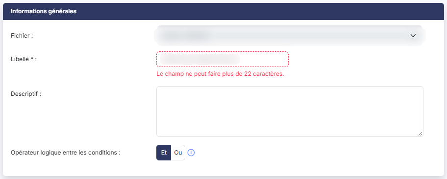
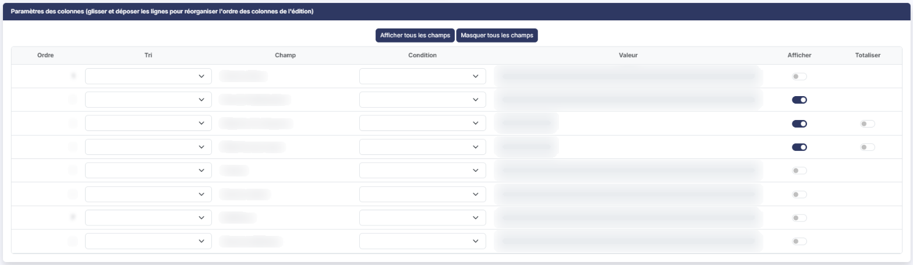
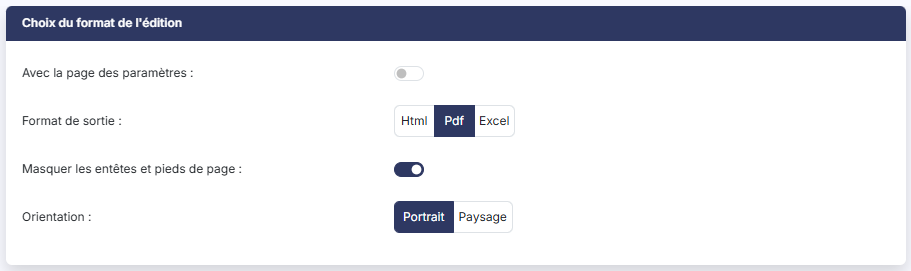

# Générateur d'états


**Où le trouver :** Menu **Editions › Générateur d'états**



**En bref** — Cet écran liste les états de la société et vous permet de créer vos propres éditions du Dossier permanent : fichier à éditer, colonnes, ordre, conditions de sélection et format de sortie.

* Pour créer un état : bouton \[Créer un générateur d'état], renseignez la fiche, puis bouton \[Enregistrer].
* Pour produire un état : pictogramme « Œil » de sa ligne, choisissez le format, puis bouton \[Lancer l'édition].
* Pour récupérer les modèles de l'éditeur : entrée de menu « Charger les nouveaux modèles ».


Le générateur d'états vous permet de créer vos propres éditions à partir des informations saisies dans le Dossier permanent : vous choisissez le fichier à éditer, les colonnes qui doivent y figurer, leur ordre, les conditions de sélection des lignes et le format du document produit.

<figure><figcaption>
Écran « Générateur d'états » de la nouvelle interface
</figcaption></figure>

L'écran affiche la liste des états déjà créés pour la société en cours.

La colonne « Modèle éditeur » de la liste vous indique, pour chaque état, s'il a été fourni par l'éditeur du logiciel ou créé par votre cabinet.

La liste comporte cinq colonnes :

* **Libellé** : le nom que vous avez donné à l'état. C'est la colonne de tri initial, par ordre croissant.
* **Descriptif** : le commentaire libre que vous avez pu saisir pour expliquer à quoi sert l'état. Il peut rester vide.
* **Date de création** : la date à laquelle l'état a été créé.
* **Format de sortie** : le format du document produit lorsque l'état est lancé : « Html », « Pdf » ou « Excel ».
* **Modèle éditeur** : indique si l'état est un modèle fourni par l'éditeur du logiciel, ou un état créé par votre cabinet.

Les cinq colonnes sont triables : cliquez sur l'en-tête de la colonne pour trier la liste. Sur les colonnes « Date de création » et « Format de sortie », qui sont les plus étroites, la flèche de tri n'apparaît pas à l'écran alors que le tri fonctionne : ne vous fiez pas à la flèche pour savoir si une colonne est triable.

Au-dessus de la liste, la zone « Rechercher un état… » restreint la liste au fil de la saisie. Trois boutons se trouvent à côté :

* bouton **\[Filtres]** : ouvre le volet « Filtrer », où vous ajoutez des critères de filtre,
* bouton **\[Vue]** : permet de choisir les colonnes affichées et d'enregistrer l'état de la liste sous un nom,
* bouton **\[Exporter]** : propose l'aperçu, l'impression, l'export en Excel ou en PDF et l'envoi de la liste par e-mail.

Les liens « Sélectionner la page » et « Tout sélectionner (n) » se trouvent sous ces boutons, n étant le nombre d'états de la liste.

Le bas de la liste comporte les boutons de changement de page, une zone où saisir directement un numéro de page, et à droite le nombre de lignes affichées sur le nombre total.

Un clic sur une ligne la sélectionne. Au survol d'une ligne apparaissent, à son extrémité droite, quatre pictogrammes :

* le pictogramme « Crayon », d'infobulle « Modifier », qui ouvre l'état pour le modifier,
* le pictogramme « Œil », d'infobulle « Afficher l'aperçu », qui n'ouvre pas l'état à l'écran : il ouvre une fenêtre « Format de l'édition » où vous choisissez le format et les options, avec le Bouton \[Lancer l'édition] et le Bouton \[Annuler]. C'est \[Lancer l'édition] qui produit le document : affiché dans un nouvel onglet en « Html », téléchargé en « Pdf » et en « Excel »,
* le pictogramme « Deux feuilles », d'infobulle « Dupliquer », qui **duplique** l'état : il ouvre une fiche préremplie à valider, rien n'est créé tant que vous n'avez pas cliqué sur \[Enregistrer]. La fiche s'ouvre avec toutes les valeurs de l'état d'origine mais sans son identifiant, et le logiciel affiche « Vous êtes positionné sur la fiche dupliquée. ». La copie n'est jamais un modèle éditeur,
* le pictogramme à trois points verticaux, d'infobulle « Autres actions », dont le menu propose « Supprimer ».

bouton **\[Créer un générateur d'état]**

Vous ouvrez la fiche de création d'un nouvel état.

**Entrée de menu « Charger les nouveaux modèles »**

Cette entrée récupère les modèles d'états mis à disposition par l'éditeur du logiciel. Il ouvre une fenêtre « Nouveaux modèles » qui vous invite à choisir les modèles à charger et à valider. Ils viennent de la base modèle de l'éditeur, filtrée sur votre type d'abonné et sur le module en cours. Le chargement ajoute : seuls les modèles dont le libellé n'existe pas déjà dans la société vous sont proposés, un modèle déjà présent ne peut donc pas être écrasé. Messages possibles : « Il n'existe aucun modèle disponible. », « Ce dossier contient déjà tous les modèles disponibles. », « n nouveaux modèles ont été chargés. ».

bouton **\[Exporter]**

Il ne produit aucun fichier : c'est l'export de données standard des listes du logiciel, qui recopie vers d'autres sociétés les éléments cochés. Il porte sur la sélection, pas sur la page ni sur la liste entière : sans case cochée, le logiciel répond « Veuillez sélectionner au moins un élément à exporter. ». Ne le confondez pas avec le bouton \[Exporter] placé au-dessus de la liste, décrit plus haut.

bouton **\[Supprimer]**

Vous supprimez les états sélectionnés. Sélectionnez-les en cliquant sur leurs lignes : un bandeau apparaît en bas de l'écran ; il indique le nombre d'états sélectionnés et porte ce bouton. Tant qu'aucune ligne n'est sélectionnée, ce bouton n'est pas proposé.

La fiche comporte trois rubriques, que vous atteignez en faisant défiler l'écran : la troisième se trouve en bas de la fiche et rien ne signale sa présence depuis le haut.

* **Fichier** : le fichier du Dossier permanent sur lequel porte l'état. Ce champ est **obligatoire à la création** et il devient **non modifiable** une fois l'état enregistré : pour éditer un autre fichier, créez un nouvel état. Sur une fiche en modification, la liste est donc grisée et l'astérisque disparaît.
* **Libellé** \* : le nom de l'état. Champ obligatoire.
* **Descriptif** : un commentaire libre sur plusieurs lignes. C'est ce texte qui s'affiche dans la colonne « Descriptif » de la liste.
* **Opérateur logique entre les conditions** : deux boutons, « Et » et « Ou », qui déterminent comment se combinent les conditions que vous posez dans la rubrique suivante. « Et » est retenu par défaut. Le pictogramme d'information placé à côté rappelle la règle : « Le "et" impose que toutes les conditions soient respectées. Le "ou" impose qu'une condition au moins soit respectée. »

La liste « Fichier » ne propose que les fichiers du Dossier permanent. Trois points sont à connaître :

* les libellés de cette liste ne reprennent pas toujours le chemin du menu. Ainsi l'écran du menu « Fichiers », sous-option « Taxes » y figure sous le nom « Paramètres - Taxes », alors qu'il n'existe pas de menu « Paramètres » dans ce module ;
* les six sous-options du menu « Partenaires » sont éditées par une **seule** entrée, « Partenaires » : un état sur les partenaires porte sur tous les types d'interlocuteurs à la fois ;
* les écrans qui ne présentent pas de liste ne sont pas éditables par le générateur, et n'apparaissent donc pas : « Identité » > « Fiche société », « Identité » > « Activité », « Juridique » > « Informations générales », « Fiscal » > « Impôts directs » et « Fiscal » > « TVA ». Le menu « Fichiers », sous-option « Banques », n'y figure pas non plus.

Le titre de la rubrique porte lui-même le mode d'emploi : pour changer l'ordre des colonnes de votre édition, vous saisissez une ligne du tableau à la souris et vous la déposez à sa nouvelle place. C'est le seul endroit où cette manipulation est expliquée.

Le tableau comporte une ligne par champ du fichier retenu, et sept colonnes :

* **Ordre** : le rang de la colonne dans l'édition. Il n'est pas saisissable : il suit le glisser-déposer.
* **Tri** : « Ascendant », « Descendant », ou vide si le champ ne sert pas au tri.
* **Champ** : le nom du champ. Il n'est pas saisissable.
* **Condition** : l'opérateur de sélection des lignes. Les opérateurs proposés dépendent du type du champ (voir ci-dessous).
* **Valeur** : la valeur à laquelle le champ est comparé. Sur un champ de type date, un pictogramme « Calendrier » vous permet de choisir la date ; il n'apparaît que sur ces champs.
* **Afficher** : « Oui » si la colonne doit figurer dans l'édition, « Non » sinon. Un champ peut donc servir à sélectionner des lignes sans être affiché.
* **Totaliser** : « Oui » pour obtenir un total en bas de la colonne. Cette case n'existe que sur les champs numériques : sur les autres lignes, la cellule est vide.

Les opérateurs proposés dans la colonne « Condition » sont les suivants :

* sur un champ de type date ou numérique : « Est égal à », « Est différent de », « Est vide », « N'est pas vide », « Supérieur à », « Supérieur ou égal à », « Inférieur à », « Inférieur ou égal à » ;
* sur un champ de type texte : les mêmes, plus « Commence par », « Contient » et « Se termine par ».

Le tableau propose tous les champs du fichier, y compris les champs de suivi (« Créé par », « Date de création », « Modifié par », « Date de modification ») : rien ne les distingue des champs métier.

Tant que vous n'avez pas choisi de fichier, le tableau n'existe pas et la rubrique affiche le message « Aucun filtre n'est disponible. » : commencez par renseigner le champ « Fichier » de la rubrique précédente.

Deux boutons sont placés au-dessus du tableau :

bouton **\[Afficher tous les champs]**

Vous passez la colonne « Afficher » à « Oui » sur toutes les lignes du tableau.

bouton **\[Masquer tous les champs]**

Vous passez la colonne « Afficher » à « Non » sur toutes les lignes du tableau.

Cette rubrique **change de composition selon le format de sortie retenu** : aucun des trois formats n'affiche tous les champs.

* **Avec la page des paramètres** : répondez « Oui » pour que le document produit comporte une page rappelant les paramètres de l'état. Affiché quel que soit le format.
* **Format de sortie** : trois boutons, « Html », « Pdf » et « Excel ». « Html » est retenu par défaut sur une fiche de création.
* **Masquer les entêtes et pieds de page** : répondez « Oui » pour supprimer les en-têtes et pieds de page du document. Affiché en sortie « Pdf » et « Excel » seulement.
* **Orientation** : deux boutons, « Portrait » et « Paysage ». Affiché en sortie « Pdf » seulement.
* **Tronquer les libellés trop longs** : répondez « Oui » pour que les libellés qui dépassent la largeur de leur colonne soient coupés. Affiché en sortie « Html » seulement.

bouton **\[Enregistrer]**

Vous enregistrez l'état, sans le lancer.

bouton **\[Lancer l'édition]**

Vous produisez le document dans le format retenu dans la troisième rubrique. Ce bouton a la même apparence que le bouton \[Enregistrer] : vérifiez le libellé avant de cliquer.

bouton **\[Retour]**

Vous quittez la fiche et revenez à la liste des états.

## Autres vues de l'écran

<figure><figcaption>
Informations générales
</figcaption></figure>

<figure><figcaption>
Paramètres des colonnes (glisser et déposer les lignes pour réorganiser l'ordre des colonnes de l'édition)
</figcaption></figure>

<figure><figcaption>
Choix du format de l'édition
</figcaption></figure>
