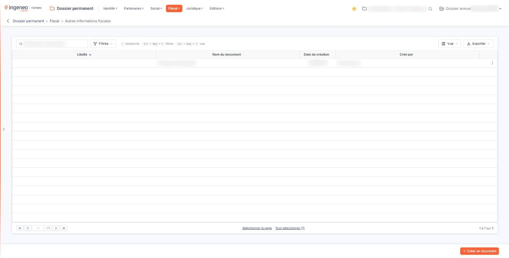
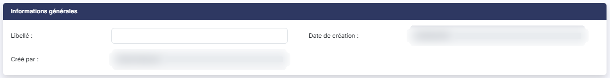
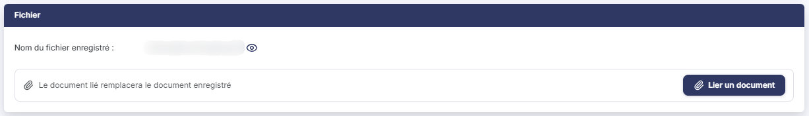

# Autres informations fiscales


**Où le trouver :** Menu **Fiscal › Autres informations fiscales**



**En bref** — Cet écran conserve les documents fiscaux de la société qui ne relèvent d'aucune autre sous-option du menu « Fiscal » : chaque ligne porte un libellé facultatif et un fichier joint.

* Pour ajouter un document : bouton \[Créer un document], bouton \[Lier un document] pour joindre le fichier, puis bouton \[Enregistrer].
* Pour retrouver un document : bouton \[Filtres], ou triez la liste en cliquant sur l'en-tête d'une colonne.


Cet écran vous permet de conserver dans le dossier permanent les documents fiscaux qui ne relèvent d'aucune des autres sous-options de la rubrique « Fiscal ».

<figure><figcaption>
Écran « Autres informations fiscales » de la nouvelle interface
</figcaption></figure>

Chaque ligne de la liste est un document : vous lui donnez un libellé si vous le souhaitez, et vous joignez le fichier correspondant.

La liste comporte quatre colonnes, toutes triables. Cliquez sur l'en-tête d'une colonne pour trier la liste ; à l'ouverture, elle est triée sur le libellé, par ordre croissant. Le nombre de lignes affichées par page s'ajuste à la hauteur de votre écran.

* **Libellé** : le libellé que vous avez saisi. Comme il n'est pas obligatoire, cette colonne peut être vide — y compris sur toutes les lignes, alors que c'est sur elle que la liste est triée.
* **Nom du document** : le nom du fichier joint, tel qu'il s'appelait lorsque vous l'avez envoyé. En pratique, c'est lui qui vous permet de reconnaître une ligne.
* **Date de création** : la date à laquelle la ligne a été créée.
* **Créé par** : l'utilisateur qui l'a créée.

**Donnez un libellé à vos documents** : c'est le seul moyen de les distinguer autrement que par le nom de leur fichier, et de rendre le tri de la liste utilisable.

Au-dessus de la liste, une barre d'outils comporte :

* une zone « Rechercher un document… ». Elle ne cherche que dans la colonne « Libellé » : ce que vous tapez devient un filtre « Libellé Contient … », affiché au-dessus de la liste avec le lien « Tout effacer ». Un document sans libellé n'est donc jamais trouvé par cette zone,
* les boutons \[Filtres] et \[Vue], qui fonctionnent comme sur toutes les listes de l'application et sont décrits dans la page « Les listes »,
* le Bouton \[Exporter], qui donne accès à l'aperçu (« Aperçu édition HTML »), à l'impression (« Imprimer »), à l'export (« Exporter en Excel », « Exporter en PDF ») et à l'envoi de la liste par e-mail (« Envoyer la liste par e-mail »).

Le bas de la liste comporte les boutons de changement de page, une zone où saisir directement un numéro de page, au centre les liens « Sélectionner la page » et « Tout sélectionner », et à droite le nombre de lignes affichées sur le nombre total.

Un clic sur une ligne la sélectionne ; un second clic la désélectionne. Lorsque vous survolez une ligne, elle affiche à droite trois commandes :

* le pictogramme « Crayon », d'infobulle « Modifier », qui ouvre la fiche,
* le pictogramme « Œil », d'infobulle « Afficher l'aperçu », qui **télécharge** le document joint sur votre poste — son infobulle promet un aperçu à l'écran, mais c'est bien un téléchargement,
* le pictogramme à trois points verticaux, d'infobulle « Autres actions », qui ouvre un menu portant l'entrée « Supprimer » : elle supprime la ligne et le document qu'elle porte.

bouton **\[Créer un document]**

Vous ouvrez la fiche de création.

bouton **\[Supprimer]**

Ce bouton n'apparaît que lorsqu'au moins une ligne est sélectionnée, dans un bandeau affiché en bas de l'écran qui rappelle le nombre de documents sélectionnés. Vous supprimez les lignes sélectionnées.

Cet écran ne comporte aucun autre bouton : l'impression et l'export se font depuis le Bouton \[Exporter] de la barre d'outils (voir a)).

La fiche comporte deux rubriques, et **elle ne se présente pas de la même façon selon que vous créez une ligne ou que vous modifiez une ligne existante**.

* **Libellé** : le libellé de la ligne, sur cinquante caractères au plus. Ce champ **n'est pas obligatoire**, ni à la création, ni en modification. C'est le seul champ saisissable de la rubrique.
* **Date de création** : et **Créé par :** les informations de suivi, jamais saisissables. Elles n'apparaissent pas sur une fiche de création.

Cet écran ne comporte **aucun champ de date propre à l'information fiscale** : la seule date de la fiche est celle de sa création.

C'est ici que se joue la différence entre la création et la modification.

**À la création**

La rubrique ne comporte qu'un champ, **Fichier \* :**, et il est **obligatoire** : vous ne pouvez pas créer de ligne sans joindre un document. Tant qu'aucun document n'est choisi, il affiche « Aucun document lié » et le Bouton \[Lier un document].

**En modification**

La rubrique comporte deux éléments :

* **Nom du fichier enregistré** : le nom du document joint. Il s'affiche en simple texte : ce n'est pas un lien, et cliquer dessus ne fait rien. Le pictogramme « Œil » placé à sa droite, d'infobulle « Visualiser », est le seul moyen d'accéder au document depuis la fiche : il le **télécharge** sur votre poste, malgré ce que promet son infobulle.
* la mention « Le document lié remplacera le document enregistré », suivie du Bouton \[Lier un document], qui vous permet de choisir un nouveau fichier. Ici, le document n'est donc plus obligatoire : il existe déjà.

Le Bouton \[Lier un document] ouvre le volet « Lier un document ». Vous y choisissez la source du document, « Depuis mon poste » ou « Depuis la GED », puis vous déposez le fichier dans la zone prévue ou vous parcourez vos fichiers. Le volet annonce les fichiers acceptés : « Tous formats sauf .exe, .bat, .cmd, .sh — nom de 100 caractères maximum ». Le Bouton \[Lier le document] est grisé à l'ouverture du volet ; le Bouton \[Annuler] le referme. Il n'y a pas de liste des documents joints : la rubrique s'appelle « Fichier » au singulier, une ligne ne porte qu'un document.

La fiche ne comporte pas de commande permettant de retirer le document : pour supprimer un document, vous supprimez la ligne depuis la liste.

bouton **\[Enregistrer]**

Vous enregistrez la ligne.

Pour quitter la fiche et revenir à la liste, utilisez la flèche « Revenir en arrière » placée à gauche du fil d'Ariane, en haut de l'écran.

## Autres vues de l'écran

<figure><figcaption>
Informations générales
</figcaption></figure>

<figure><figcaption>
Fichier
</figcaption></figure>
