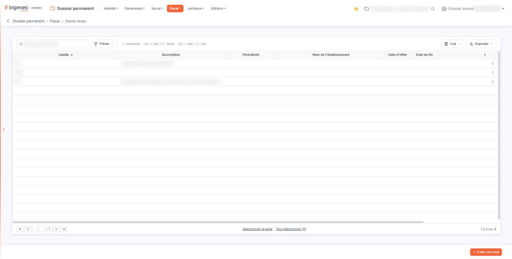
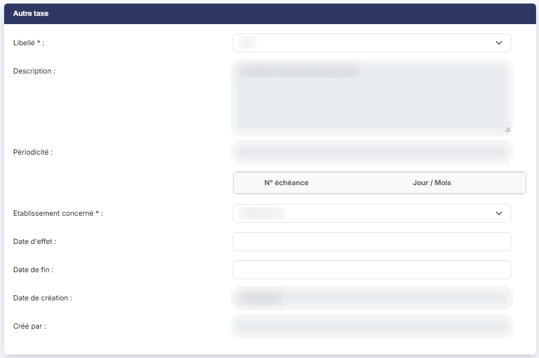

# Autres taxes


**Où le trouver :** Menu **Fiscal › Autres taxes**



**En bref** — Cet écran déclare les taxes auxquelles la société est soumise, en rattachant chacune, choisie dans le fichier « Taxes », à un établissement et éventuellement à une période.

* Pour déclarer une taxe : bouton \[Créer une taxe], choisissez le Libellé et l'établissement, puis bouton \[Enregistrer].
* Si la liste des taxes est vide : créez-les d'abord dans l'écran « Taxes », depuis l'entrée « Préférences » de la barre latérale.


Cette option vous permet de déclarer les taxes auxquelles la société est soumise, en rattachant chacune d'elles à un établissement et, si vous le souhaitez, à une période.

<figure><figcaption>
Écran « Autres taxes » de la nouvelle interface
</figcaption></figure>

Vous ne créez pas la taxe elle-même sur cet écran : vous la choisissez dans une liste, puis vous précisez l'établissement concerné. Le libellé de la taxe, sa description, sa périodicité et ses échéances sont repris de la taxe choisie et ne se saisissent pas ici.

**Deux informations doivent exister avant de pouvoir déclarer une autre taxe**, car les deux champs obligatoires de la fiche sont des listes alimentées par d'autres options du dossier permanent :

* la liste du champ **Libellé** propose les taxes que vous avez définies dans l'écran « Taxes ». Cet écran n'est pas dans la barre de menus du dossier permanent : vous l'ouvrez par l'entrée « Paramètres » (roue dentée) de la navigation latérale, qui affiche le panneau « Paramètres » (hors tableau de bord, cette barre est masquée : cliquez sur le bord gauche de l'écran pour l'ouvrir), puis par la rubrique « Données », le menu « Dossier et comptabilité » et son entrée « Taxes ». Tant qu'aucune taxe n'y figure, cette liste ne propose que « Sélectionnez » et aucune autre taxe ne peut être créée ;
* la liste du champ **Etablissement concerné** propose les établissements que vous avez déclarés dans l'option « Etablissements » du menu « Social ». Tant qu'aucun établissement n'y figure, cette liste ne propose elle aussi que « Sélectionnez ».

Le logiciel n'affiche aucun message pour vous le signaler : si l'une des deux listes vous paraît vide, c'est l'option correspondante qu'il faut renseigner d'abord.

**a) La liste des autres taxes**

La liste présente huit colonnes, toutes triables : cliquez sur le titre de l'une d'elles pour trier la liste. À l'ouverture, elle est triée par **Libellé** croissant. La liste étant plus large que l'écran, une barre de défilement horizontale vous permet d'atteindre les dernières colonnes.

| Champ                      | Ce qu'il faut savoir                                                                                                                                                                                                                                                                                                                                                                                                                                                                                                                                                                                                                                                                                                                                                                                                                                                                                                                                                                                                                                                                                                                                                                                                                                                                                                                                                                                                                                                                                                                                                                                                                                                                                                                                                                                                                                                                                                                                                                                                                                                                                                                                                                                                                                                              |
| -------------------------- | --------------------------------------------------------------------------------------------------------------------------------------------------------------------------------------------------------------------------------------------------------------------------------------------------------------------------------------------------------------------------------------------------------------------------------------------------------------------------------------------------------------------------------------------------------------------------------------------------------------------------------------------------------------------------------------------------------------------------------------------------------------------------------------------------------------------------------------------------------------------------------------------------------------------------------------------------------------------------------------------------------------------------------------------------------------------------------------------------------------------------------------------------------------------------------------------------------------------------------------------------------------------------------------------------------------------------------------------------------------------------------------------------------------------------------------------------------------------------------------------------------------------------------------------------------------------------------------------------------------------------------------------------------------------------------------------------------------------------------------------------------------------------------------------------------------------------------------------------------------------------------------------------------------------------------------------------------------------------------------------------------------------------------------------------------------------------------------------------------------------------------------------------------------------------------------------------------------------------------------------------------------------------------- |
| **Libellé**                | Le libellé de la taxe, tel qu'il a été défini dans l'écran « Taxes » du panneau « Paramètres ».                                                                                                                                                                                                                                                                                                                                                                                                                                                                                                                                                                                                                                                                                                                                                                                                                                                                                                                                                                                                                                                                                                                                                                                                                                                                                                                                                                                                                                                                                                                                                                                                                                                                                                                                                                                                                                                                                                                                                                                                                                                                                                                                                                                   |
| **Description**            | La description de cette même taxe. Lorsqu'elle est longue, elle est tronquée dans la liste, et la coupure est signalée par des points de suspension : ouvrez la fiche pour la lire en entier.                                                                                                                                                                                                                                                                                                                                                                                                                                                                                                                                                                                                                                                                                                                                                                                                                                                                                                                                                                                                                                                                                                                                                                                                                                                                                                                                                                                                                                                                                                                                                                                                                                                                                                                                                                                                                                                                                                                                                                                                                                                                                     |
| **Périodicité**            | La périodicité de la taxe. Elle n'est renseignée que si la taxe en porte une dans l'option « Taxes ».                                                                                                                                                                                                                                                                                                                                                                                                                                                                                                                                                                                                                                                                                                                                                                                                                                                                                                                                                                                                                                                                                                                                                                                                                                                                                                                                                                                                                                                                                                                                                                                                                                                                                                                                                                                                                                                                                                                                                                                                                                                                                                                                                                             |
| **Nom de l'établissement** | L'établissement concerné. Attention, cette colonne porte un intitulé différent de celui du champ de la fiche, qui s'appelle « Etablissement concerné » : il s'agit de la même information.                                                                                                                                                                                                                                                                                                                                                                                                                                                                                                                                                                                                                                                                                                                                                                                                                                                                                                                                                                                                                                                                                                                                                                                                                                                                                                                                                                                                                                                                                                                                                                                                                                                                                                                                                                                                                                                                                                                                                                                                                                                                                        |
| **Date d'effet**           | La date à partir de laquelle la taxe s'applique à cet établissement.                                                                                                                                                                                                                                                                                                                                                                                                                                                                                                                                                                                                                                                                                                                                                                                                                                                                                                                                                                                                                                                                                                                                                                                                                                                                                                                                                                                                                                                                                                                                                                                                                                                                                                                                                                                                                                                                                                                                                                                                                                                                                                                                                                                                              |
| **Date de fin**            | La date au-delà de laquelle elle ne s'applique plus.                                                                                                                                                                                                                                                                                                                                                                                                                                                                                                                                                                                                                                                                                                                                                                                                                                                                                                                                                                                                                                                                                                                                                                                                                                                                                                                                                                                                                                                                                                                                                                                                                                                                                                                                                                                                                                                                                                                                                                                                                                                                                                                                                                                                                              |
| **Créé par**               | L'utilisateur qui a créé la ligne. Sur des lignes anciennes, cette colonne peut être vide alors que la date de création est renseignée.                                                                                                                                                                                                                                                                                                                                                                                                                                                                                                                                                                                                                                                                                                                                                                                                                                                                                                                                                                                                                                                                                                                                                                                                                                                                                                                                                                                                                                                                                                                                                                                                                                                                                                                                                                                                                                                                                                                                                                                                                                                                                                                                           |
| **Date de création**       | 
La date à laquelle la ligne a été créée. Un clic sur une ligne la sélectionne. Au survol d'une ligne apparaissent, à son extrémité droite, le pictogramme « Crayon » (infobulle « Modifier »), qui ouvre la fiche, et le pictogramme « Autres actions », dont le menu propose « Supprimer ». Au-dessus de la liste, la zone « Rechercher une taxe… » restreint la liste au fil de la saisie ; elle porte sur le libellé de la taxe, et un mot de la description ne ramène aucune ligne. Cette recherche est conservée quand vous quittez l'écran puis y revenez, comme sur toutes les listes (voir « Les listes ») : videz la zone pour retrouver toutes les taxes. bouton <strong>[Filtres]</strong> : ouvre un volet « Filtrer » où vous ajoutez des critères colonne par colonne. Outre les huit colonnes de la liste, il propose « Modifié par » et « Date de modification ». bouton <strong>[Vue]</strong> : permet de choisir les colonnes affichées (huit des dix colonnes disponibles le sont à l'ouverture) et d'enregistrer l'état de la liste sous un nom. bouton <strong>[Exporter]</strong> : propose l'aperçu, l'impression, l'export en Excel ou en PDF et l'envoi de la liste par e-mail. bouton <strong>[Créer une taxe]</strong> Placé en bas à droite de l'écran, il ouvre une fiche vierge pour déclarer une nouvelle taxe. bouton <strong>[Supprimer]</strong> Sélectionnez les taxes à supprimer en cliquant sur leurs lignes : un bandeau apparaît en bas de l'écran ; il indique le nombre de taxes sélectionnées, propose le lien « Tout désélectionner » et porte ce bouton. <strong>b) Rubrique « Autre taxe »</strong> La fiche ne comporte qu'une seule rubrique, intitulée « Autre taxe » au singulier. <strong>Elle ne se présente pas de la même façon selon que vous créez la taxe ou que vous la modifiez.</strong> À la création, quatre champs seulement vous sont proposés : le libellé, l'établissement concerné et les deux dates. La description, la périodicité et les échéances de la taxe n'apparaissent qu'après l'enregistrement, lorsque vous rouvrez la fiche : vous choisissez donc la taxe sur son seul libellé, souvent abrégé, et vous en découvrez le détail dans un second temps.
 |
| **Libellé**                | Ce n'est pas une zone de saisie mais une liste déroulante, qui propose les taxes définies dans l'écran « Taxes » du panneau « Paramètres ». Vous pouvez en changer à tout moment, y compris sur une taxe déjà enregistrée.                                                                                                                                                                                                                                                                                                                                                                                                                                                                                                                                                                                                                                                                                                                                                                                                                                                                                                                                                                                                                                                                                                                                                                                                                                                                                                                                                                                                                                                                                                                                                                                                                                                                                                                                                                                                                                                                                                                                                                                                                                                        |
| **Description**            | Présentée seulement en modification, et non modifiable. Elle est reprise de la taxe choisie, et le logiciel la remplace immédiatement si vous changez le libellé.                                                                                                                                                                                                                                                                                                                                                                                                                                                                                                                                                                                                                                                                                                                                                                                                                                                                                                                                                                                                                                                                                                                                                                                                                                                                                                                                                                                                                                                                                                                                                                                                                                                                                                                                                                                                                                                                                                                                                                                                                                                                                                                 |
| **Périodicité**            | 
Présentée seulement en modification, et non modifiable. Elle est reprise de la taxe choisie et reste vide si celle-ci n'en porte pas. Sous la périodicité, un tableau sans intitulé présente les échéances de la taxe, sous les colonnes « N° échéance » et « Jour / Mois ». Il est en lecture seule et ne comporte aucun bouton : les échéances se définissent dans l'écran « Taxes » du panneau « Paramètres » et se consultent seulement ici. Si la taxe choisie n'a pas de périodicité, ce tableau apparaît réduit à ses deux titres de colonnes, sans aucune ligne et sans message.
                                                                                                                                                                                                                                                                                                                                                                                                                                                                                                                                                                                                                                                                                                                                                                                                                                                                                                                                                                                                                                                                                                                                                                                                                                                                                                                                                                                                                                                                                                                                                                                                                                                                                |
| **Etablissement concerné** | Liste déroulante des établissements déclarés dans l'option « Etablissements » du menu « Social ». Attention, ces établissements ne sont pas présentés ici dans le même ordre que dans cette option : ne les cherchez pas à la même place.                                                                                                                                                                                                                                                                                                                                                                                                                                                                                                                                                                                                                                                                                                                                                                                                                                                                                                                                                                                                                                                                                                                                                                                                                                                                                                                                                                                                                                                                                                                                                                                                                                                                                                                                                                                                                                                                                                                                                                                                                                         |
| **Date d'effet**           | La date à partir de laquelle la taxe s'applique. Un clic dans le champ ouvre un calendrier qui vous permet de choisir la date.                                                                                                                                                                                                                                                                                                                                                                                                                                                                                                                                                                                                                                                                                                                                                                                                                                                                                                                                                                                                                                                                                                                                                                                                                                                                                                                                                                                                                                                                                                                                                                                                                                                                                                                                                                                                                                                                                                                                                                                                                                                                                                                                                    |
| **Date de fin**            | La date au-delà de laquelle la taxe ne s'applique plus, à choisir de la même façon. Ces deux dates ne sont pas obligatoires ; lorsque vous les renseignez toutes les deux, la date de fin ne peut pas être antérieure à la date d'effet.                                                                                                                                                                                                                                                                                                                                                                                                                                                                                                                                                                                                                                                                                                                                                                                                                                                                                                                                                                                                                                                                                                                                                                                                                                                                                                                                                                                                                                                                                                                                                                                                                                                                                                                                                                                                                                                                                                                                                                                                                                          |
| **Date de création**       | Présentée seulement en modification, et non modifiable.                                                                                                                                                                                                                                                                                                                                                                                                                                                                                                                                                                                                                                                                                                                                                                                                                                                                                                                                                                                                                                                                                                                                                                                                                                                                                                                                                                                                                                                                                                                                                                                                                                                                                                                                                                                                                                                                                                                                                                                                                                                                                                                                                                                                                           |
| **Créé par**               | Présenté seulement en modification, et non modifiable.                                                                                                                                                                                                                                                                                                                                                                                                                                                                                                                                                                                                                                                                                                                                                                                                                                                                                                                                                                                                                                                                                                                                                                                                                                                                                                                                                                                                                                                                                                                                                                                                                                                                                                                                                                                                                                                                                                                                                                                                                                                                                                                                                                                                                            |

**c) Enregistrement de la fiche**

bouton **\[Enregistrer]** : il valide votre saisie. Le libellé et l'établissement concerné sont obligatoires. Une même taxe ne peut pas être déclarée deux fois pour le même établissement sur la même période : le logiciel refuse alors l'enregistrement et vous l'indique.

Pour revenir à la liste des autres taxes sans enregistrer, cliquez sur la flèche placée à gauche du fil d'Ariane, en haut de l'écran : le retour se fait sans vous demander de confirmation.

## Autres vues de l'écran

<figure><figcaption>
Autre taxe
</figcaption></figure>
