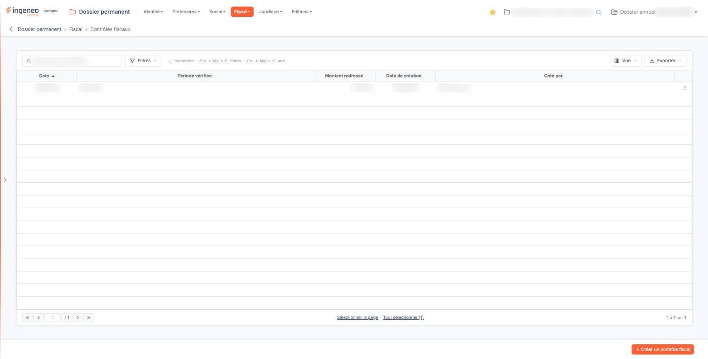
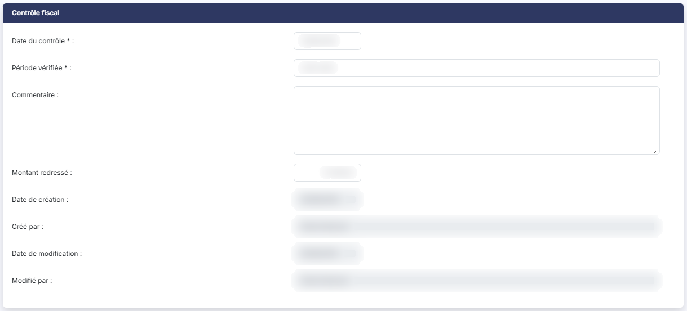
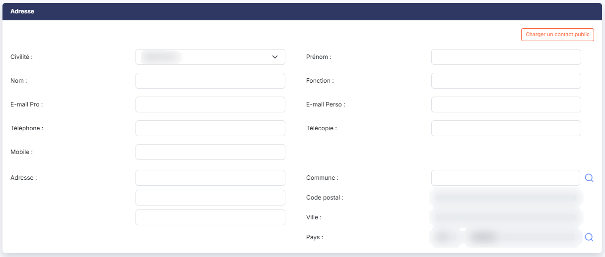
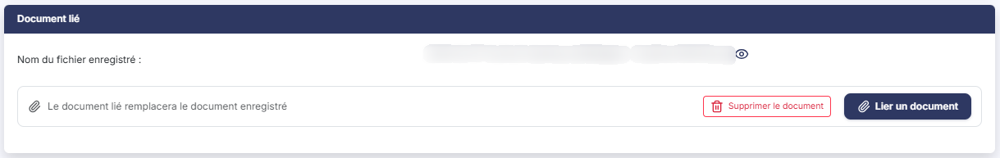

# Contrôles fiscaux


**Où le trouver :** Menu **Fiscal › Contrôles fiscaux**



**En bref** — Cet écran conserve l'historique des contrôles fiscaux de la société : date, période vérifiée, montant redressé, commentaire, coordonnées de votre interlocuteur et document justificatif.

* Pour enregistrer un contrôle : bouton \[Créer un contrôle fiscal], renseignez la fiche, puis bouton \[Enregistrer].
* Pour reprendre les coordonnées d'un interlocuteur déjà connu : bouton \[Charger un contact public] ; bouton \[Privatiser ce contact] pour les rendre de nouveau modifiables.
* Pour joindre le justificatif : bouton \[Lier un document] dans la fiche.


Cette option vous permet de conserver la trace des contrôles fiscaux dont la société a fait l'objet : la date du contrôle, la période vérifiée, le montant redressé, un commentaire libre, les coordonnées de votre interlocuteur et un document justificatif.

<figure><figcaption>
Écran « Contrôles fiscaux » de la nouvelle interface
</figcaption></figure>

Vous constituez ainsi un historique qui reste attaché à la société, indépendamment des dossiers annuels.

**a) La liste des contrôles fiscaux**

La liste présente cinq colonnes, toutes triables : cliquez sur le titre de l'une d'elles pour trier la liste. À l'ouverture, elle est triée par **Date** croissante.

| Champ                | Ce qu'il faut savoir                                                                                                                                                                                                                                                                                                                                                                                                                                                                                                                                                                                                                                                                                                                                                                                                                                                                                                                                                                                                                                                                                                                                                                                                                                                                                                                                                                                                                                                                                                                                                                                                                                                                                                                                                                                                                                                                                                                                                                                                                                             |
| -------------------- | ---------------------------------------------------------------------------------------------------------------------------------------------------------------------------------------------------------------------------------------------------------------------------------------------------------------------------------------------------------------------------------------------------------------------------------------------------------------------------------------------------------------------------------------------------------------------------------------------------------------------------------------------------------------------------------------------------------------------------------------------------------------------------------------------------------------------------------------------------------------------------------------------------------------------------------------------------------------------------------------------------------------------------------------------------------------------------------------------------------------------------------------------------------------------------------------------------------------------------------------------------------------------------------------------------------------------------------------------------------------------------------------------------------------------------------------------------------------------------------------------------------------------------------------------------------------------------------------------------------------------------------------------------------------------------------------------------------------------------------------------------------------------------------------------------------------------------------------------------------------------------------------------------------------------------------------------------------------------------------------------------------------------------------------------------------------- |
| **Date**             | La date du contrôle. Attention, la colonne s'intitule simplement « Date » alors que le champ de la fiche s'appelle « Date du contrôle » : il s'agit de la même information.                                                                                                                                                                                                                                                                                                                                                                                                                                                                                                                                                                                                                                                                                                                                                                                                                                                                                                                                                                                                                                                                                                                                                                                                                                                                                                                                                                                                                                                                                                                                                                                                                                                                                                                                                                                                                                                                                      |
| **Période vérifiée** | La période sur laquelle le contrôle a porté, telle que vous l'avez saisie.                                                                                                                                                                                                                                                                                                                                                                                                                                                                                                                                                                                                                                                                                                                                                                                                                                                                                                                                                                                                                                                                                                                                                                                                                                                                                                                                                                                                                                                                                                                                                                                                                                                                                                                                                                                                                                                                                                                                                                                       |
| **Montant redressé** | Le montant du redressement.                                                                                                                                                                                                                                                                                                                                                                                                                                                                                                                                                                                                                                                                                                                                                                                                                                                                                                                                                                                                                                                                                                                                                                                                                                                                                                                                                                                                                                                                                                                                                                                                                                                                                                                                                                                                                                                                                                                                                                                                                                      |
| **Date de création** | La date à laquelle la fiche a été créée.                                                                                                                                                                                                                                                                                                                                                                                                                                                                                                                                                                                                                                                                                                                                                                                                                                                                                                                                                                                                                                                                                                                                                                                                                                                                                                                                                                                                                                                                                                                                                                                                                                                                                                                                                                                                                                                                                                                                                                                                                         |
| **Créé par**         | 
L'utilisateur qui l'a créée. Un clic sur une ligne la sélectionne. Au survol d'une ligne apparaissent, à son extrémité droite, le pictogramme « Crayon » (infobulle « Modifier »), qui ouvre la fiche, le pictogramme « Dupliquer », qui crée un nouveau contrôle à partir de celui-ci, et le pictogramme « Autres actions », dont le menu propose « Supprimer ». Au-dessus de la liste, la zone « Rechercher un contrôle… » restreint la liste au fil de la saisie : une partie de la période vérifiée, « 2015 » par exemple, retrouve le contrôle. bouton <strong>[Filtres]</strong> : ouvre un volet « Filtrer » où vous ajoutez des critères colonne par colonne. Il ne se limite pas aux cinq colonnes affichées : il propose aussi le commentaire, chacun des champs de la rubrique « Adresse », la date de modification et l'auteur de la modification. bouton <strong>[Vue]</strong> : permet de choisir les colonnes affichées — cinq des vingt-trois colonnes disponibles le sont à l'ouverture — et d'enregistrer l'état de la liste sous un nom. bouton <strong>[Exporter]</strong> : propose l'aperçu, l'impression, l'export en Excel ou en PDF et l'envoi de la liste par e-mail. bouton <strong>[Créer un contrôle fiscal]</strong> Placé en bas à droite de l'écran, il ouvre une fiche vierge pour enregistrer un nouveau contrôle fiscal. bouton <strong>[Supprimer]</strong> Sélectionnez les contrôles à supprimer en cliquant sur leurs lignes : un bandeau apparaît en bas de l'écran ; il indique le nombre de contrôles sélectionnés, propose le lien « Tout désélectionner » et porte ce bouton. La fiche d'un contrôle fiscal comporte trois rubriques, dans cet ordre : « Contrôle fiscal », « Adresse » et « Document lié ». <strong>b) Rubrique « Contrôle fiscal »</strong>
                                                                                                                                                                                                               |
| **Date du contrôle** | Un clic dans le champ ouvre un calendrier qui vous permet de choisir la date.                                                                                                                                                                                                                                                                                                                                                                                                                                                                                                                                                                                                                                                                                                                                                                                                                                                                                                                                                                                                                                                                                                                                                                                                                                                                                                                                                                                                                                                                                                                                                                                                                                                                                                                                                                                                                                                                                                                                                                                    |
| **Période vérifiée** | 50 caractères au plus. C'est une zone de **saisie libre**, et non un couple de dates ni une liste d'exercices : aucun format ne vous est imposé et rien ne vous en indique un. Comme la liste trie cette colonne comme du texte, adoptez une écriture constante d'un contrôle à l'autre — par exemple « 2015-2016 » — si vous voulez que le tri reste lisible.                                                                                                                                                                                                                                                                                                                                                                                                                                                                                                                                                                                                                                                                                                                                                                                                                                                                                                                                                                                                                                                                                                                                                                                                                                                                                                                                                                                                                                                                                                                                                                                                                                                                                                   |
| **Commentaire**      | Zone de texte libre, 1024 caractères au plus, pour consigner le déroulement du contrôle, les points examinés ou les suites données.                                                                                                                                                                                                                                                                                                                                                                                                                                                                                                                                                                                                                                                                                                                                                                                                                                                                                                                                                                                                                                                                                                                                                                                                                                                                                                                                                                                                                                                                                                                                                                                                                                                                                                                                                                                                                                                                                                                              |
| **Montant redressé** | 
Le montant du redressement, saisi comme un montant. Les quatre informations suivantes ne sont présentées qu'en modification, et ne sont pas modifiables : <strong>Date de création :</strong> et <strong>Créé par :</strong>, puis <strong>Date de modification :</strong> et <strong>Modifié par :</strong>. Elles n'apparaissent pas sur une fiche en cours de création. <strong>c) Rubrique « Adresse »</strong> Cette rubrique porte les coordonnées de votre interlocuteur pour ce contrôle. Elle est facultative : aucun de ses champs n'est obligatoire, et elle peut rester entièrement vide. bouton <strong>[Charger un contact public]</strong> : placé en tête de la rubrique, il permet de reprendre les coordonnées d'un contact déjà enregistré au lieu de les saisir. Ce bouton fait deux choses que rien à l'écran n'annonce, et qu'il vaut mieux savoir avant de cliquer. D'abord, le logiciel <strong>contrôle votre saisie avant d'ouvrir la fenêtre de choix</strong> : s'il manque une information obligatoire, la fenêtre ne s'ouvre pas et l'écran vous réaffiche ses messages. Ensuite, lorsque vous retenez un contact dans cette fenêtre et que vous la validez, <strong>le logiciel enregistre aussitôt le contrôle</strong>, puis recharge la fiche. Sur une fiche que vous étiez en train de créer, l'enregistrement a donc lieu à ce moment-là, sans que vous ayez cliqué sur le bouton <strong>[Enregistrer]</strong>, et revenir à la liste par la flèche du fil d'Ariane ne le défait pas. Enfin, les coordonnées reprises de cette façon ne sont pas recopiées dans la fiche : elles sont lues dans l'annuaire du cabinet, et les champs de la rubrique « Adresse » s'affichent alors <strong>en lecture seule</strong>, sans que le logiciel vous l'explique par un message. Le bouton <strong>[Privatiser ce contact]</strong>, qui s'ajoute à côté du premier dans ce cas, détache le contact de l'annuaire en conservant ses coordonnées dans la fiche : elles redeviennent alors modifiables.
 |
| **Civilité**         | À choisir parmi « Madame » et « Monsieur ».                                                                                                                                                                                                                                                                                                                                                                                                                                                                                                                                                                                                                                                                                                                                                                                                                                                                                                                                                                                                                                                                                                                                                                                                                                                                                                                                                                                                                                                                                                                                                                                                                                                                                                                                                                                                                                                                                                                                                                                                                      |
| **Prénom**           | 15 caractères au plus, et **Nom :** 30 caractères au plus.                                                                                                                                                                                                                                                                                                                                                                                                                                                                                                                                                                                                                                                                                                                                                                                                                                                                                                                                                                                                                                                                                                                                                                                                                                                                                                                                                                                                                                                                                                                                                                                                                                                                                                                                                                                                                                                                                                                                                                                                       |
| **Fonction**         | 50 caractères au plus, et **E-mail Pro :** 50 caractères au plus.                                                                                                                                                                                                                                                                                                                                                                                                                                                                                                                                                                                                                                                                                                                                                                                                                                                                                                                                                                                                                                                                                                                                                                                                                                                                                                                                                                                                                                                                                                                                                                                                                                                                                                                                                                                                                                                                                                                                                                                                |
| **E-mail Perso**     | 50 caractères au plus.                                                                                                                                                                                                                                                                                                                                                                                                                                                                                                                                                                                                                                                                                                                                                                                                                                                                                                                                                                                                                                                                                                                                                                                                                                                                                                                                                                                                                                                                                                                                                                                                                                                                                                                                                                                                                                                                                                                                                                                                                                           |
| **Téléphone**        | , **Télécopie :** et **Mobile :** 14 caractères au plus chacun.                                                                                                                                                                                                                                                                                                                                                                                                                                                                                                                                                                                                                                                                                                                                                                                                                                                                                                                                                                                                                                                                                                                                                                                                                                                                                                                                                                                                                                                                                                                                                                                                                                                                                                                                                                                                                                                                                                                                                                                                  |
| **Adresse**          | Trois lignes de 38 caractères au plus, présentées sous un seul intitulé.                                                                                                                                                                                                                                                                                                                                                                                                                                                                                                                                                                                                                                                                                                                                                                                                                                                                                                                                                                                                                                                                                                                                                                                                                                                                                                                                                                                                                                                                                                                                                                                                                                                                                                                                                                                                                                                                                                                                                                                         |
| **Commune**          | Saisissez le début de son nom : la zone propose les communes sous la forme « code - nom (département) » ; la loupe placée à droite ouvre un panneau « Sélection d'une commune », dont la liste (Code INSEE, Ville, Département) se filtre par nom ou par code INSEE.                                                                                                                                                                                                                                                                                                                                                                                                                                                                                                                                                                                                                                                                                                                                                                                                                                                                                                                                                                                                                                                                                                                                                                                                                                                                                                                                                                                                                                                                                                                                                                                                                                                                                                                                                                                             |
| **Code postal**      | **Ville :** sont en lecture seule (« Déduit de la commune »).                                                                                                                                                                                                                                                                                                                                                                                                                                                                                                                                                                                                                                                                                                                                                                                                                                                                                                                                                                                                                                                                                                                                                                                                                                                                                                                                                                                                                                                                                                                                                                                                                                                                                                                                                                                                                                                                                                                                                                                                    |
| **Pays**             | La ligne comporte deux zones, le code du pays puis son libellé (« FR » et « FRANCE » à l'ouverture), et un pictogramme « Loupe » qui ouvre un panneau « Sélection d'un pays ». Le code n'est pas saisissable directement : il se renseigne par la recherche que vous ouvrez avec la loupe.                                                                                                                                                                                                                                                                                                                                                                                                                                                                                                                                                                                                                                                                                                                                                                                                                                                                                                                                                                                                                                                                                                                                                                                                                                                                                                                                                                                                                                                                                                                                                                                                                                                                                                                                                                       |

**d) Rubrique « Document lié »**

Cette rubrique vous permet de joindre **un seul** document au contrôle fiscal — l'avis de vérification, la proposition de rectification, la réponse apportée…

Sur une fiche en cours de création, la rubrique affiche « Aucun document lié ».

bouton **\[Lier un document]** : ouvre la fenêtre « Lier un document », qui propose deux sources. « Depuis mon poste » vous permet de déposer un document dans la zone prévue ou de parcourir vos fichiers ; tous les formats sont acceptés sauf .exe, .bat, .cmd et .sh, et le nom du fichier ne doit pas dépasser 100 caractères. « Depuis la GED » porte un bouton « Ouvrir la GED », pour y choisir le document. Le bouton **\[Lier le document]** joint le document choisi ; le bouton **\[Annuler]** referme la fenêtre sans rien joindre.

Sur une fiche déjà enregistrée avec un document, un champ **Nom du fichier enregistré :** affiche le nom du document joint, accompagné d'un pictogramme « Œil » dont l'infobulle indique « Visualiser » — et qui **télécharge** le document sur votre poste plutôt que de l'afficher à l'écran. En dessous, l'écran rappelle que « Le document lié remplacera le document enregistré » : lier un nouveau document remplace le document existant, puisque la rubrique n'en accepte qu'un. Le bouton **\[Supprimer le document]** y est également proposé.

**e) Enregistrement de la fiche**

bouton **\[Enregistrer]** : il valide votre saisie. La date du contrôle et la période vérifiée sont obligatoires.

Pour revenir à la liste des contrôles fiscaux sans enregistrer, cliquez sur la flèche placée à gauche du fil d'Ariane, en haut de l'écran.

## Autres vues de l'écran

<figure><figcaption>
Contrôle fiscal
</figcaption></figure>

<figure><figcaption>
Adresse
</figcaption></figure>

<figure><figcaption>
Document lié
</figcaption></figure>
