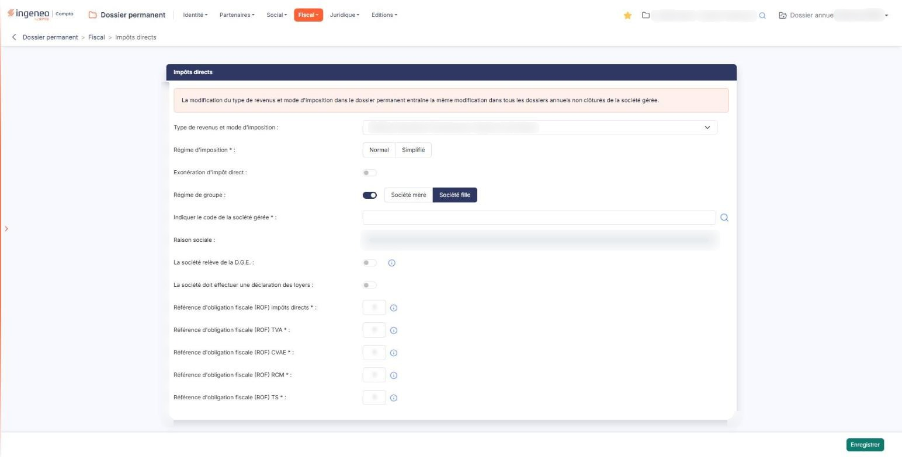
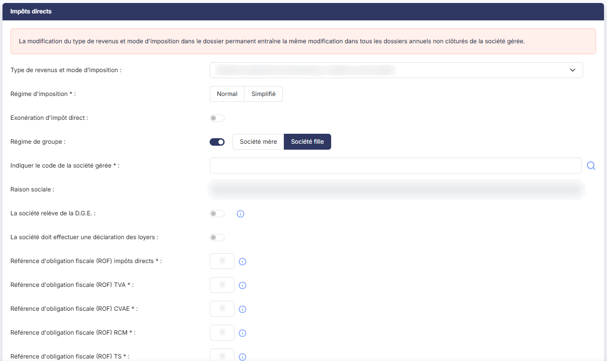
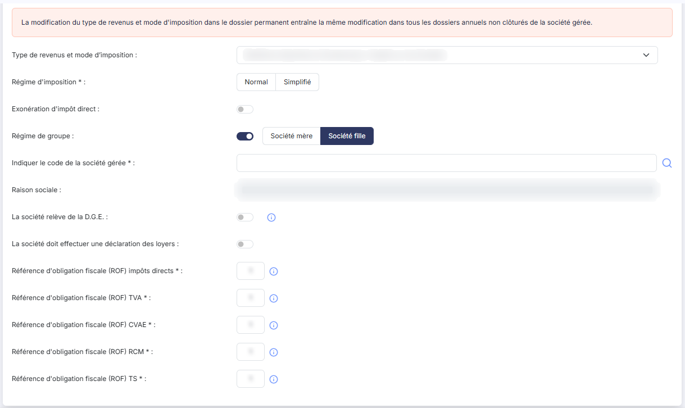

# Impôts directs


**Où le trouver :** Menu **Fiscal › Impôts directs**



**En bref** — Cet écran porte le régime fiscal de la société : type de revenus et mode d'imposition, régime, exonération, groupe et références d'obligation fiscale. Il s'applique à tous les dossiers annuels non clôturés.

* Pour modifier le régime fiscal : complétez les zones, puis bouton \[Enregistrer], seul bouton de l'écran.
* Pour ne rien modifier : quittez l'écran par le menu, sans utiliser le bouton \[Enregistrer].


Cette option porte le régime fiscal de la société : son type de revenus et son mode d'imposition, son régime d'imposition, son éventuelle exonération, son rattachement à un groupe et ses références d'obligation fiscale.

<figure><figcaption>
Écran « Impôts directs » de la nouvelle interface
</figcaption></figure>

**Ce n'est pas une fiche parmi d'autres, c'est un paramétrage de la société.** Un avertissement encadré, en tête de l'écran, vous le rappelle : « La modification du type de revenus et mode d'imposition dans le dossier permanent entraîne la même modification dans tous les dossiers annuels non clôturés de la société gérée. » Ce que vous modifiez ici ne concerne donc pas seulement le dossier annuel dans lequel vous travaillez.

L'écran ne comporte **ni Bouton \[Retour], ni Bouton \[Annuler]** : le seul bouton **\[Enregistrer]**, en bas de l'écran, valide votre saisie. Si vous ne voulez rien modifier, quittez l'écran par le menu.

La totalité des informations est regroupée dans une seule rubrique, « Impôts directs ». Il n'y a ni liste, ni onglet.

**a) Le type de revenus, qui commande tout l'écran**

| Champ                                                    | Ce qu'il faut savoir                                                                                                                                                                                                                                                                                                                                                                                                                                                                                                                                                                                                                                                                                                                                                                                                                                                                                                                                                                                                                                                                                                                                                                                                                                                                                                                                                                                                                                                                                                                                                     |
| -------------------------------------------------------- | ------------------------------------------------------------------------------------------------------------------------------------------------------------------------------------------------------------------------------------------------------------------------------------------------------------------------------------------------------------------------------------------------------------------------------------------------------------------------------------------------------------------------------------------------------------------------------------------------------------------------------------------------------------------------------------------------------------------------------------------------------------------------------------------------------------------------------------------------------------------------------------------------------------------------------------------------------------------------------------------------------------------------------------------------------------------------------------------------------------------------------------------------------------------------------------------------------------------------------------------------------------------------------------------------------------------------------------------------------------------------------------------------------------------------------------------------------------------------------------------------------------------------------------------------------------------------ |
| **Type de revenus et mode d’imposition**                 | 
À choisir parmi « Bénéfices Agricoles », « Bénéfices Industriels et Commerciaux / Impôts sur le Revenu », « Bénéfices Industriels et Commerciaux / Impôts sur les Sociétés », « Bénéfices Non Commerciaux », « Non imposable », « Nouvelle-Calédonie », « Revenus Fonciers », « Revenus Fonciers Professionnels » et « Revenus Fonciers professionnels et non professionnels ». <strong>C'est ce choix qui détermine les informations que l'écran vous présente ensuite</strong>, et c'est celui dont la modification se répercute sur tous les dossiers annuels non clôturés. Si vous retenez « Non imposable », l'écran ne vous propose rien d'autre. Tant qu'aucun type n'est choisi, en revanche, il vous propose déjà l'exonération d'impôt direct, le régime de groupe, la D.G.E. et les cinq références d'obligation fiscale — mais pas la déclaration des loyers. Le champ ne porte pas d'astérisque, alors que c'est l'information la plus structurante de l'écran. <strong>b) Le régime d'imposition</strong>
                                                                                                                                                                                                                                                                                                                                                                                                                                                                                                                                     |
| **Régime d'imposition**                                  | 
À choisir entre les deux boutons « Normal » et « Simplifié ». Il ne vous est proposé que pour les bénéfices agricoles et les bénéfices industriels et commerciaux, à l'impôt sur le revenu comme à l'impôt sur les sociétés. Sur une société déjà paramétrée, il arrive qu'aucun des deux boutons ne soit coché : le régime n'a alors jamais été renseigné, et rien à l'écran ne vous en avertit. Comme le champ est obligatoire, pensez à le renseigner avant d'enregistrer. <strong>c) Les informations propres aux bénéfices non commerciaux</strong> Les informations suivantes ne vous sont proposées que pour certains types de revenus.
                                                                                                                                                                                                                                                                                                                                                                                                                                                                                                                                                                                                                                                                                                                                                                                                                                                                                                           |
| **Mode de détermination du résultat**                    | À choisir entre « Recettes/Dépenses » et « Créances/Dettes ». Proposé pour les seuls bénéfices non commerciaux.                                                                                                                                                                                                                                                                                                                                                                                                                                                                                                                                                                                                                                                                                                                                                                                                                                                                                                                                                                                                                                                                                                                                                                                                                                                                                                                                                                                                                                                          |
| **Mode de tenue de la comptabilité**                     | À choisir entre « Hors taxes », « TTC » et « Non assujetti à la TVA ». Proposé pour les seuls bénéfices non commerciaux.                                                                                                                                                                                                                                                                                                                                                                                                                                                                                                                                                                                                                                                                                                                                                                                                                                                                                                                                                                                                                                                                                                                                                                                                                                                                                                                                                                                                                                                 |
| **Praticien médical**                                    | 
Interrupteur, activé ou désactivé : activez-le s'il s'agit d'un praticien médical. Proposée pour les seuls bénéfices non commerciaux. Les deux informations suivantes n'apparaissent que si l'option précédente est activée :
                                                                                                                                                                                                                                                                                                                                                                                                                                                                                                                                                                                                                                                                                                                                                                                                                                                                                                                                                                                                                                                                                                                                                                                                                                                                                                                                  |
| **Code activité pour les praticiens médicaux**           | À choisir parmi « Conventionnés du secteur 1 sans droit à dépassement », « Conventionnés du secteur 1 avec droit de dépassement », « Conventionnés du secteur 2 avec honoraires libres » et « Omnipraticiens et spécialistes médicaux et chirurgicaux non conventionnés ».                                                                                                                                                                                                                                                                                                                                                                                                                                                                                                                                                                                                                                                                                                                                                                                                                                                                                                                                                                                                                                                                                                                                                                                                                                                                                               |
| **Catégorie de médecins**                                | À choisir parmi « Omnipraticiens », « Spécialistes médicaux », « Chirurgiens et spécialistes médicaux » et « Electro-radiologistes qualifiés ».                                                                                                                                                                                                                                                                                                                                                                                                                                                                                                                                                                                                                                                                                                                                                                                                                                                                                                                                                                                                                                                                                                                                                                                                                                                                                                                                                                                                                          |
| **Option pour la comptabilité super-simplifiée**         | 
Interrupteur, activé ou désactivé, proposé pour les seuls bénéfices industriels et commerciaux à l'impôt sur le revenu. <strong>d) L'exonération d'impôt direct</strong>
                                                                                                                                                                                                                                                                                                                                                                                                                                                                                                                                                                                                                                                                                                                                                                                                                                                                                                                                                                                                                                                                                                                                                                                                                                                                                                                                                                                       |
| **Exonération d'impôt direct**                           | 
Interrupteur, activé ou désactivé. Il vous est proposé pour tous les types de revenus, sauf « Non imposable ». Les informations suivantes n'apparaissent que si vous l'activez :
                                                                                                                                                                                                                                                                                                                                                                                                                                                                                                                                                                                                                                                                                                                                                                                                                                                                                                                                                                                                                                                                                                                                                                                                                                                                                                                                                                               |
| **Motif d'exonération**                                  | 
Le dispositif dont la société bénéficie. <strong>La liste proposée n'est pas la même pour tous les types de revenus</strong> : chaque type a la sienne, et le logiciel la recompose chaque fois que vous changez de type. Les motifs y sont présentés dans l'ordre du logiciel, et non par ordre alphabétique. Pour les bénéfices industriels et commerciaux à l'impôt sur les sociétés, par exemple, elle propose « Entreprise nouvelle CGI, art. 44 sexies », « Jeunes entreprises innovantes », « SII cotée », « Zone franche d'activité, art. 44 quaterdecies », « Zone franche Urbaine – Territoire entrepreneur, art. 44 octies A », « Zone de restructuration de la défense, art. 44 terdecies », « Autres dispositifs », « Entreprise nouvelle CGI, art. 44 septies », « Bassins urbains à dynamiser (BUD), art. 44 sexdecies », « Zone de développement prioritaire, art. 44 septdecies », « Option pour le crédit d'impôt outre-mer dans le secteur productif, art. 244 quater W », « France Ruralités Revitalisation FRR art. 44 quindecies A », « Bassins d’emploi à redynamiser, art.44 duodecies » et « Zone de revitalisation rurale, art. 44 quindecies ». Pour les revenus fonciers, le logiciel ne propose aucune liste : il affiche à la place le message « Les dispositifs de déductions spécifiques sont gérés par immeuble dans le module "Immobilisations". ». Pour les autres types de revenus, la liste peut vous être présentée sans contenir aucun motif — c'est le cas de la Nouvelle-Calédonie —, aucun dispositif n'étant prévu.
 |
| **Date d'entrée dans le dispositif**                     | Elle n'apparaît qu'une fois le motif choisi. Un clic dans le champ ouvre un calendrier qui vous permet de choisir la date.                                                                                                                                                                                                                                                                                                                                                                                                                                                                                                                                                                                                                                                                                                                                                                                                                                                                                                                                                                                                                                                                                                                                                                                                                                                                                                                                                                                                                                               |
| **Commentaire**                                          | 
Zone de texte libre, 1024 caractères au plus. <strong>e) Le régime de groupe</strong>
                                                                                                                                                                                                                                                                                                                                                                                                                                                                                                                                                                                                                                                                                                                                                                                                                                                                                                                                                                                                                                                                                                                                                                                                                                                                                                                                                                                                                                                                          |
| **Régime de groupe**                                     | 
Activez cet interrupteur si la société appartient à un groupe fiscalement intégré. Le logiciel vous demande alors de préciser sa place dans le groupe, au moyen de deux boutons « Société mère » et « Société fille ». <strong>Ce choix est obligatoire mais son intitulé est réduit à un astérisque</strong> : vous ne trouverez donc, à gauche des deux boutons, aucun libellé pour vous guider. Si vous retenez « Société mère », le logiciel vous demande la <strong>Date d’entrée dans le groupe :</strong>, obligatoire. Si vous retenez « Société fille », il vous demande à la place :
                                                                                                                                                                                                                                                                                                                                                                                                                                                                                                                                                                                                                                                                                                                                                                                                                                                                                                                                                              |
| **Indiquer le code de la société gérée**                 | La société mère du groupe. Renseignez-la par le pictogramme « Loupe » placé à droite du champ, qui ouvre la recherche parmi les sociétés gérées.                                                                                                                                                                                                                                                                                                                                                                                                                                                                                                                                                                                                                                                                                                                                                                                                                                                                                                                                                                                                                                                                                                                                                                                                                                                                                                                                                                                                                         |
| **Raison sociale**                                       | 
Non modifiable. Le logiciel la reprend de la société que vous avez désignée par la loupe. Si ce champ et le précédent restent vides alors que le régime de groupe est activé, c'est que le rattachement n'est pas exploitable en l'état : reprenez la désignation de la société par la loupe. <strong>f) Les autres obligations</strong>
                                                                                                                                                                                                                                                                                                                                                                                                                                                                                                                                                                                                                                                                                                                                                                                                                                                                                                                                                                                                                                                                                                                                                                                                                       |
| **La société relève de la D.G.E.**                       | Interrupteur, activé ou désactivé. Le pictogramme d'information placé à droite du libellé rappelle qu'il s'agit de la « Direction des Grandes Entreprises ».                                                                                                                                                                                                                                                                                                                                                                                                                                                                                                                                                                                                                                                                                                                                                                                                                                                                                                                                                                                                                                                                                                                                                                                                                                                                                                                                                                                                             |
| **La société doit effectuer une déclaration des loyers** | Interrupteur, activé ou désactivé.                                                                                                                                                                                                                                                                                                                                                                                                                                                                                                                                                                                                                                                                                                                                                                                                                                                                                                                                                                                                                                                                                                                                                                                                                                                                                                                                                                                                                                                                                                                                       |

Ces deux informations vous sont proposées pour tous les types de revenus, sauf « Non imposable ». La déclaration des loyers est en outre absente tant qu'aucun type n'est choisi.

**g) Les références d'obligation fiscale**

Cinq références d'obligation fiscale vous sont demandées, toutes obligatoires et toutes numériques :

**Référence d'obligation fiscale (ROF) impôts directs**

**Référence d'obligation fiscale (ROF) TVA**

**Référence d'obligation fiscale (ROF) CVAE**

**Référence d'obligation fiscale (ROF) RCM**

**Référence d'obligation fiscale (ROF) TS**

Le pictogramme d'information placé à droite de chacun des cinq libellés porte la même explication : « La référence d'obligation fiscale est un numéro attribué par l'administration fiscale, en fonction de l'obligation déclarative du contribuable. Dans la grande majorité des cas il est égal à 1. À chaque type de déclaration ou régime d'imposition correspond un code ROF différent. En cas de changement d'activité la partie numérique du code ROF est modifiée. »

Ces cinq références vous sont proposées pour tous les types de revenus, sauf « Non imposable ».

bouton **\[Enregistrer]**

Il valide votre saisie, et le logiciel vous confirme que vos modifications ont bien été enregistrées. Rappelez-vous que l'enregistrement du type de revenus et du mode d'imposition modifie aussi tous les dossiers annuels non clôturés de la société.

## Autres vues de l'écran

<figure><figcaption>
Le type de revenus, qui commande tout l'écran
</figcaption></figure>

<figure><figcaption>
Les références d'obligation fiscale
</figcaption></figure>
