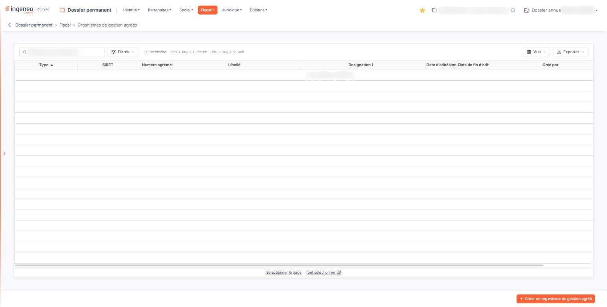
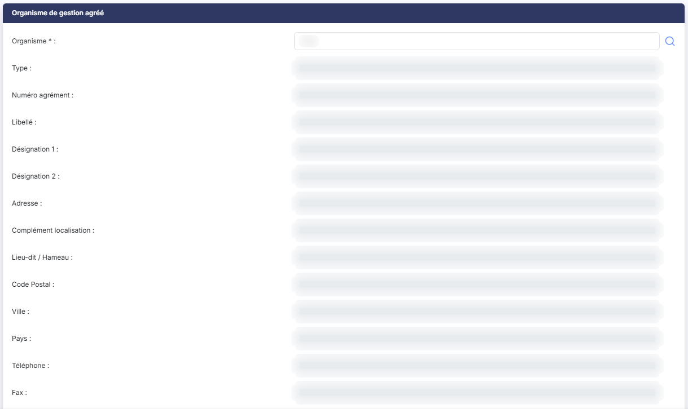

# Organismes de gestion agréés


**Où le trouver :** Menu **Fiscal › Organismes de gestion agréés**



**En bref** — Cet écran enregistre l'adhésion de la société à un organisme de gestion agréé, choisi dans un référentiel, avec le numéro d'adhérent et la période d'adhésion.

* Pour enregistrer une adhésion : bouton \[Créer un organisme de gestion agréé], choisissez l'organisme avec le pictogramme « Loupe », saisissez la période, puis bouton \[Enregistrer].


Cette option vous permet d'enregistrer l'adhésion de la société à un organisme de gestion agréé, avec son numéro d'adhérent et la période d'adhésion.

<figure><figcaption>
Écran « Organismes de gestion agréés » de la nouvelle interface
</figcaption></figure>

Vous ne saisissez pas l'organisme : vous le choisissez dans un référentiel tenu par Ingeneo Compta, à l'aide du pictogramme « Loupe ». Le logiciel reprend alors de lui-même son type, son numéro d'agrément, son libellé, ses désignations, son adresse, ses coordonnées et le nom de son correspondant. Vous n'avez à saisir que la période d'adhésion et, si vous le souhaitez, votre numéro d'adhérent.

**a) La liste des organismes de gestion agréés**

Tant qu'aucune adhésion n'est enregistrée, la liste affiche « Aucun élément à afficher. ».

Elle présente neuf colonnes, toutes triables : cliquez sur le titre de l'une d'elles pour trier la liste. La liste étant plus large que l'écran, une barre de défilement horizontale vous permet d'atteindre les dernières colonnes, dont deux titres apparaissent tronqués.

| Champ                                            | Ce qu'il faut savoir                                                                                                                                                                                                                                                                                                                                                                                                                                                                                                                                                                                                                                                                                                                                                                                                                                                                                                                                                                                                                                                                                                                                                                                                                                                                                                                                                            |
| ------------------------------------------------ | ------------------------------------------------------------------------------------------------------------------------------------------------------------------------------------------------------------------------------------------------------------------------------------------------------------------------------------------------------------------------------------------------------------------------------------------------------------------------------------------------------------------------------------------------------------------------------------------------------------------------------------------------------------------------------------------------------------------------------------------------------------------------------------------------------------------------------------------------------------------------------------------------------------------------------------------------------------------------------------------------------------------------------------------------------------------------------------------------------------------------------------------------------------------------------------------------------------------------------------------------------------------------------------------------------------------------------------------------------------------------------- |
| **Type**                                         | Le type de l'organisme, repris du référentiel.                                                                                                                                                                                                                                                                                                                                                                                                                                                                                                                                                                                                                                                                                                                                                                                                                                                                                                                                                                                                                                                                                                                                                                                                                                                                                                                                  |
| **SIRET**                                        | Le numéro SIRET de l'organisme.                                                                                                                                                                                                                                                                                                                                                                                                                                                                                                                                                                                                                                                                                                                                                                                                                                                                                                                                                                                                                                                                                                                                                                                                                                                                                                                                                 |
| **Numéro agrément**                              | Son numéro d'agrément.                                                                                                                                                                                                                                                                                                                                                                                                                                                                                                                                                                                                                                                                                                                                                                                                                                                                                                                                                                                                                                                                                                                                                                                                                                                                                                                                                          |
| **Libellé**                                      | Son libellé.                                                                                                                                                                                                                                                                                                                                                                                                                                                                                                                                                                                                                                                                                                                                                                                                                                                                                                                                                                                                                                                                                                                                                                                                                                                                                                                                                                    |
| **Designation 1**                                | Sa première désignation. Notez que cette colonne s'écrit sans accent, alors que le champ correspondant de la fiche s'intitule « Désignation 1 » : il s'agit de la même information.                                                                                                                                                                                                                                                                                                                                                                                                                                                                                                                                                                                                                                                                                                                                                                                                                                                                                                                                                                                                                                                                                                                                                                                             |
| **Date d’adhésion**                              | La date à laquelle la société a adhéré.                                                                                                                                                                                                                                                                                                                                                                                                                                                                                                                                                                                                                                                                                                                                                                                                                                                                                                                                                                                                                                                                                                                                                                                                                                                                                                                                         |
| **Date de fin d’adhésion**                       | La date à laquelle l'adhésion a pris fin.                                                                                                                                                                                                                                                                                                                                                                                                                                                                                                                                                                                                                                                                                                                                                                                                                                                                                                                                                                                                                                                                                                                                                                                                                                                                                                                                       |
| **Créé par**                                     | 
L'utilisateur qui a enregistré l'adhésion, et <strong>Date de création :</strong> la date à laquelle il l'a fait. Au-dessus de la liste, la zone « Rechercher un organisme… » restreint la liste au fil de la saisie. bouton <strong>[Filtres]</strong> : ouvre un volet « Filtrer » où vous ajoutez des critères colonne par colonne. Il ne se limite pas aux neuf colonnes affichées : il propose aussi la seconde désignation, l'adresse et les coordonnées de l'organisme, le nom du correspondant, le numéro d'adhérent, la date de modification et l'auteur de la modification. bouton <strong>[Vue]</strong> : permet de choisir les colonnes affichées — neuf des vingt-trois colonnes disponibles le sont à l'ouverture — et d'enregistrer l'état de la liste sous un nom. bouton <strong>[Exporter]</strong> : propose l'aperçu, l'impression, l'export en Excel ou en PDF et l'envoi de la liste par e-mail. bouton <strong>[Créer un organisme de gestion agréé]</strong> Placé en bas à droite de l'écran, il ouvre une fiche vierge pour enregistrer une adhésion. bouton <strong>[Supprimer]</strong> Il supprime les adhésions sélectionnées dans la liste. <strong>b) Rubrique « Organisme de gestion agréé »</strong> La fiche ne comporte qu'une seule rubrique, intitulée « Organisme de gestion agréé » au singulier.
 |
| **Quatre champs seulement se saisissent**        | La recherche de l'organisme, les deux dates d'adhésion et le numéro d'adhérent. Tous les autres sont présentés en lecture seule et se remplissent d'eux-mêmes lorsque vous choisissez l'organisme.                                                                                                                                                                                                                                                                                                                                                                                                                                                                                                                                                                                                                                                                                                                                                                                                                                                                                                                                                                                                                                                                                                                                                                              |
| **Organisme**                                    | 
La zone attend un numéro SIRET — c'est ce qu'indique le texte d'invite affiché à l'intérieur — mais le plus simple est de passer par le pictogramme « Loupe » placé à sa droite, qui ouvre la recherche dans le référentiel. Les informations suivantes sont reprises de l'organisme choisi et ne sont pas modifiables : <strong>Type :</strong>, <strong>Numéro agrément :</strong>, <strong>Libellé :</strong>, <strong>Désignation 1 :</strong>, <strong>Désignation 2 :</strong>, <strong>Adresse :</strong>, <strong>Complément localisation :</strong>, <strong>Lieu-dit / Hameau :</strong>, <strong>Code Postal :</strong>, <strong>Ville :</strong>, <strong>Pays :</strong>, <strong>Téléphone :</strong>, <strong>Fax :</strong>, <strong>E-mail :</strong> et <strong>Nom correspondant :</strong>. Si l'une d'elles vous paraît manquer, c'est qu'elle n'est pas renseignée dans le référentiel : vous ne pouvez pas la compléter ici.
                                                                                                                                                                                                                                                                                                                                                                                                                   |
| **Date d’adhésion**                              | Un clic dans le champ ouvre un calendrier qui vous permet de choisir la date.                                                                                                                                                                                                                                                                                                                                                                                                                                                                                                                                                                                                                                                                                                                                                                                                                                                                                                                                                                                                                                                                                                                                                                                                                                                                                                   |
| **Date de fin d’adhésion**                       | À choisir de la même façon.                                                                                                                                                                                                                                                                                                                                                                                                                                                                                                                                                                                                                                                                                                                                                                                                                                                                                                                                                                                                                                                                                                                                                                                                                                                                                                                                                     |
| **N° d’adhérent de la société dans l’organisme** | 35 caractères au plus. C'est le numéro que l'organisme a attribué à la société.                                                                                                                                                                                                                                                                                                                                                                                                                                                                                                                                                                                                                                                                                                                                                                                                                                                                                                                                                                                                                                                                                                                                                                                                                                                                                                 |

**c) Enregistrement de la fiche**

bouton **\[Enregistrer]** : il valide votre saisie. L'organisme et la date d'adhésion sont obligatoires, et la date de fin d'adhésion ne peut pas être antérieure à la date d'adhésion.

Vous pouvez enregistrer plusieurs adhésions successives pour la même société, mais **leurs périodes ne doivent pas se chevaucher** : le logiciel refuse une adhésion dont les dates empiètent sur celles d'une adhésion déjà enregistrée.

Pour revenir à la liste des organismes de gestion agréés sans enregistrer, cliquez sur la flèche placée à gauche du fil d'Ariane, en haut de l'écran.

## Autres vues de l'écran

<figure><figcaption>
Organisme de gestion agréé
</figcaption></figure>

<figure><figcaption>
Organisme de gestion agréé
</figcaption></figure>
