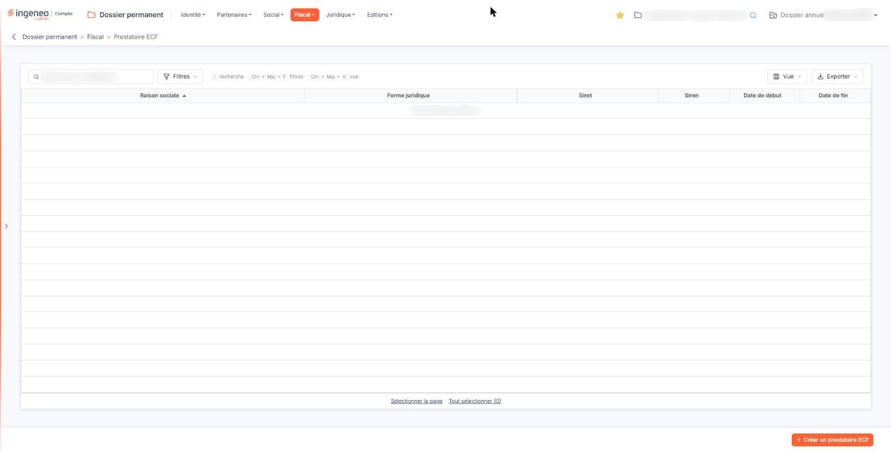
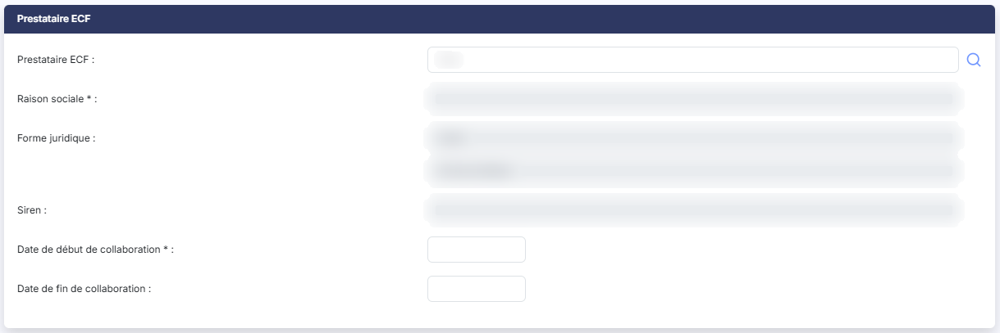

# Prestataire ECF


**Où le trouver :** Menu **Fiscal › Prestataire ECF**



**En bref** — Cet écran indique qui réalise l'examen de conformité fiscale (ECF) de la société, choisi parmi les contacts de l'annuaire, et la période de collaboration avec ce prestataire.

* Pour désigner un prestataire : bouton \[Créer un prestataire ECF], choisissez-le avec le pictogramme « Loupe », saisissez les dates de collaboration, puis bouton \[Enregistrer].


Cette option vous permet d'indiquer qui réalise l'examen de conformité fiscale — l'ECF — de la société, et sur quelle période vous collaborez avec ce prestataire.

<figure><figcaption>
Écran « Prestataire ECF » de la nouvelle interface
</figcaption></figure>

Vous ne saisissez pas le prestataire : vous le désignez parmi les contacts de l'annuaire, à l'aide du pictogramme « Loupe ». Le logiciel reprend alors de lui-même sa raison sociale, sa forme juridique, son numéro SIREN, l'identité de votre interlocuteur et son adresse. Vous n'avez à saisir que les dates de collaboration.

**a) La liste des prestataires**

Tant qu'aucun prestataire n'est enregistré, la liste affiche « Aucun élément à afficher. ».

Elle présente six colonnes, toutes triables : cliquez sur le titre de l'une d'elles pour trier la liste.

| Champ                                    | Ce qu'il faut savoir                                                                                                                                                                                                                                                                                                                                                                                                                                                                                                                                                                                                                                                                                                                                                                                                                                                                                                                                                                                                                                                                                                                                                                                                                                                                                                                                                                                                                                                                                                                                                            |
| ---------------------------------------- | ------------------------------------------------------------------------------------------------------------------------------------------------------------------------------------------------------------------------------------------------------------------------------------------------------------------------------------------------------------------------------------------------------------------------------------------------------------------------------------------------------------------------------------------------------------------------------------------------------------------------------------------------------------------------------------------------------------------------------------------------------------------------------------------------------------------------------------------------------------------------------------------------------------------------------------------------------------------------------------------------------------------------------------------------------------------------------------------------------------------------------------------------------------------------------------------------------------------------------------------------------------------------------------------------------------------------------------------------------------------------------------------------------------------------------------------------------------------------------------------------------------------------------------------------------------------------------- |
| **Raison sociale**                       | La raison sociale du prestataire.                                                                                                                                                                                                                                                                                                                                                                                                                                                                                                                                                                                                                                                                                                                                                                                                                                                                                                                                                                                                                                                                                                                                                                                                                                                                                                                                                                                                                                                                                                                                               |
| **Forme juridique**                      | Sa forme juridique.                                                                                                                                                                                                                                                                                                                                                                                                                                                                                                                                                                                                                                                                                                                                                                                                                                                                                                                                                                                                                                                                                                                                                                                                                                                                                                                                                                                                                                                                                                                                                             |
| **Siret**                                | Son numéro SIRET, et **Siren :** son numéro SIREN.                                                                                                                                                                                                                                                                                                                                                                                                                                                                                                                                                                                                                                                                                                                                                                                                                                                                                                                                                                                                                                                                                                                                                                                                                                                                                                                                                                                                                                                                                                                              |
| **Date de début**                        | 
<strong>Date de fin :</strong> les dates de la collaboration. Ces deux colonnes portent un intitulé plus court que les champs de la fiche, qui s'appellent « Date de début de collaboration » et « Date de fin de collaboration ». Au-dessus de la liste, la zone « Rechercher un prestataire… » restreint la liste au fil de la saisie. bouton <strong>[Filtres]</strong> : ouvre un volet « Filtrer » où vous ajoutez des critères colonne par colonne. Il ne se limite pas aux six colonnes affichées : il propose aussi l'adresse, l'identité et les coordonnées de l'interlocuteur, la date de création, l'auteur de la création, la date de modification et l'auteur de la modification. bouton <strong>[Vue]</strong> : permet de choisir les colonnes affichées — six des vingt-trois colonnes disponibles le sont à l'ouverture — et d'enregistrer l'état de la liste sous un nom. bouton <strong>[Exporter]</strong> : propose l'aperçu, l'impression, l'export en Excel ou en PDF et l'envoi de la liste par e-mail. bouton <strong>[Créer un prestataire ECF]</strong> Placé en bas à droite de l'écran, il ouvre une fiche vierge pour enregistrer un prestataire. bouton <strong>[Supprimer]</strong> Il supprime les prestataires sélectionnés dans la liste. <strong>b) Rubrique « Prestataire ECF »</strong> La fiche comporte deux rubriques : « Prestataire ECF », qui porte l'identité du prestataire et les dates de collaboration, puis « Adresse », qui porte l'identité et les coordonnées de votre interlocuteur.
 |
| **Trois champs seulement se saisissent** | La recherche du prestataire et les deux dates de collaboration. Tous les autres sont présentés en lecture seule et se remplissent d'eux-mêmes lorsque vous désignez le prestataire.                                                                                                                                                                                                                                                                                                                                                                                                                                                                                                                                                                                                                                                                                                                                                                                                                                                                                                                                                                                                                                                                                                                                                                                                                                                                                                                                                                                             |
| **Prestataire ECF**                      | La zone attend un numéro SIRET — c'est ce qu'indique le texte d'invite affiché à l'intérieur — et vous propose des correspondances dès les premiers caractères saisis. Le plus simple est de passer par le pictogramme « Loupe » placé à sa droite, qui ouvre la recherche dans l'annuaire. Ce champ ne porte pas d'astérisque, alors que c'est lui qui renseigne tout le reste de la fiche : sans lui, la fiche ne peut pas être enregistrée.                                                                                                                                                                                                                                                                                                                                                                                                                                                                                                                                                                                                                                                                                                                                                                                                                                                                                                                                                                                                                                                                                                                                  |
| **Raison sociale**                       | 
Pourtant <strong>non modifiable</strong>. Vous ne pouvez donc pas la saisir : elle est reprise du prestataire que vous désignez. Les informations suivantes sont reprises du prestataire et ne sont pas modifiables : <strong>Forme juridique :</strong> — présentée en deux zones, son code puis son libellé — et <strong>Siren :</strong>. Dans la rubrique « Adresse », sont reprises de la même façon, et toutes non modifiables : <strong>Civilité :</strong>, <strong>Prénom :</strong>, <strong>Nom :</strong>, <strong>Fonction :</strong>, <strong>E-mail pro. :</strong>, <strong>E-mail perso. :</strong>, <strong>Téléphone :</strong>, <strong>Télécopie :</strong>, <strong>Mobile :</strong>, <strong>Adresse :</strong> — trois lignes sous un seul intitulé —, <strong>Code postal :</strong>, <strong>Ville :</strong> et <strong>Pays :</strong>, ce dernier présenté en deux zones, son code puis son libellé.
                                                                                                                                                                                                                                                                                                                                                                                                                                                                                                                                                                                                                                 |
| **Date de début de collaboration**       | Un clic dans le champ ouvre un calendrier qui vous permet de choisir la date.                                                                                                                                                                                                                                                                                                                                                                                                                                                                                                                                                                                                                                                                                                                                                                                                                                                                                                                                                                                                                                                                                                                                                                                                                                                                                                                                                                                                                                                                                                   |
| **Date de fin de collaboration**         | À choisir de la même façon.                                                                                                                                                                                                                                                                                                                                                                                                                                                                                                                                                                                                                                                                                                                                                                                                                                                                                                                                                                                                                                                                                                                                                                                                                                                                                                                                                                                                                                                                                                                                                     |

**c) Enregistrement de la fiche**

bouton **\[Enregistrer]** : il valide votre saisie. La raison sociale — donc le choix du prestataire — et la date de début de collaboration sont obligatoires, et la date de fin ne peut pas être antérieure à la date de début.

Vous pouvez enregistrer plusieurs prestataires successifs, mais **leurs périodes de collaboration ne doivent pas se chevaucher**, et **une seule ligne peut rester sans date de fin** : le logiciel refuse l'enregistrement lorsque les périodes empiètent l'une sur l'autre.

Pour revenir à la liste des prestataires sans enregistrer, cliquez sur la flèche placée à gauche du fil d'Ariane, en haut de l'écran.

## Autres vues de l'écran

<figure><figcaption>
Prestataire ECF
</figcaption></figure>

<figure><figcaption>
Prestataire ECF
</figcaption></figure>

<figure><figcaption>
Prestataire ECF
</figcaption></figure>
