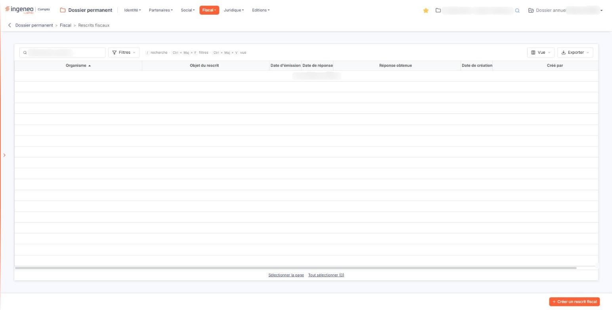
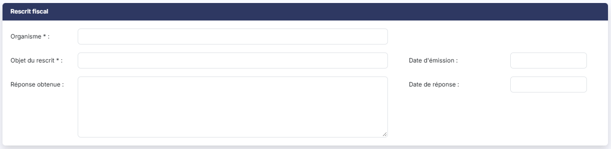
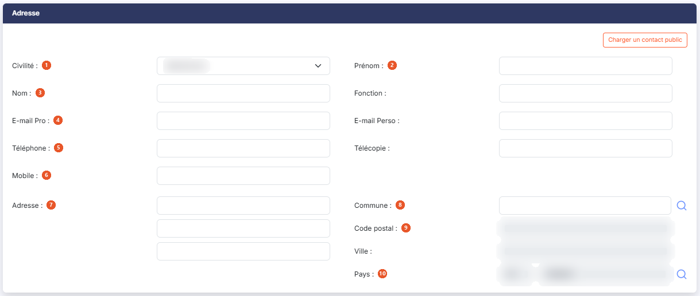
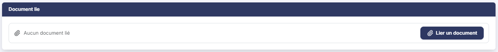

# Rescrits fiscaux


**Où le trouver :** Menu **Fiscal › Rescrits fiscaux**



**En bref** — Cet écran tient la liste des rescrits fiscaux de la société : organisme saisi, objet, dates de demande et de réponse, teneur de la réponse, interlocuteur et document.

* Pour enregistrer un rescrit : bouton \[Créer un rescrit fiscal], renseignez la fiche, puis bouton \[Enregistrer].
* Pour reprendre un interlocuteur déjà connu : bouton \[Charger un contact public].
* Pour joindre le document : bouton \[Lier un document] dans la fiche.


Cette option vous permet de tenir la liste des **rescrits fiscaux** de la société : les prises de position formelles que vous avez demandées à l'administration sur le logiciel d'un texte fiscal à la situation de votre client, et les réponses obtenues.

<figure><figcaption>
Écran « Rescrits fiscaux » de la nouvelle interface
</figcaption></figure>

Pour chaque rescrit, vous conservez au même endroit l'organisme saisi, l'objet de la demande, la date à laquelle vous l'avez émise, celle de la réponse, la teneur de cette réponse, les coordonnées de votre interlocuteur, et le document lui-même. C'est la mémoire du dossier sur un point souvent décisif à la révision comme au contrôle : ce que l'administration a répondu, quand, et à qui.

L'écran fonctionne en deux temps, comme la plupart des options de ce menu : une liste des rescrits déjà enregistrés, et une fiche que vous ouvrez pour en créer un ou en modifier un.

## La liste des rescrits fiscaux

L'écran s'ouvre sur la liste des rescrits, triée par ordre croissant d'organisme. Il n'y a pas d'onglet. Lorsqu'aucun rescrit n'est encore enregistré, la grille affiche « Aucun élément à afficher. » et aucun pagineur.

Elle présente sept colonnes, toutes triables : cliquez sur l'intitulé d'une colonne pour trier dessus.

| Champ                | Ce qu'il faut savoir                                                                                                                                                                                                                                                                                                                                                                                                                                                                                        |
| -------------------- | ----------------------------------------------------------------------------------------------------------------------------------------------------------------------------------------------------------------------------------------------------------------------------------------------------------------------------------------------------------------------------------------------------------------------------------------------------------------------------------------------------------- |
| **Organisme**        | L'organisme auquel vous avez adressé la demande. C'est la colonne de tri d'origine.                                                                                                                                                                                                                                                                                                                                                                                                                         |
| **Objet du rescrit** | La question posée, en une ligne.                                                                                                                                                                                                                                                                                                                                                                                                                                                                            |
| **Date d'émission**  | La date à laquelle vous avez adressé la demande.                                                                                                                                                                                                                                                                                                                                                                                                                                                            |
| **Date de réponse**  | 
La date à laquelle l'administration a répondu. <strong>Réponse obtenue :ne vous attendez pas ici à un Oui ou à un Non.</strong> Cette colonne reprend le texte que vous avez saisi dans la zone de commentaire de la fiche, qui accepte jusqu'à 1 024 caractères : un commentaire un peu long y sera donc illisible. Si vous souhaitez pouvoir repérer d'un coup d'œil, depuis la liste, les rescrits auxquels il a été répondu, commencez votre commentaire par une mention courte et constante.
 |
| **Date de création** | La date à laquelle la fiche a été créée dans le logiciel. Ce n'est pas la date d'émission de la demande.                                                                                                                                                                                                                                                                                                                                                                                                    |
| **Créé par**         | Le collaborateur qui a créé la fiche.                                                                                                                                                                                                                                                                                                                                                                                                                                                                       |

Au-dessus de la grille, une barre d'outils s'applique à la liste entière. Des raccourcis clavier y sont rappelés : « / » pour la recherche, Ctrl + Maj + F pour les filtres, Ctrl + Maj + V pour la vue.

La zone « Rechercher un rescrit… » restreint la liste dès la saisie. Elle porte sur l'**Objet du rescrit** — et non sur l'organisme — : la recherche saisie s'affiche d'ailleurs à droite du bouton \[Filtres] sous la forme d'un critère « Objet du rescrit Contient … », que la croix ou le lien « Tout effacer » retire.

bouton **\[Filtres]** : déroule un volet « Filtrer », vide à l'ouverture. La liste « + Ajouter un critère sur… » propose les sept colonnes de la grille, mais aussi les coordonnées de l'interlocuteur (civilité, nom, prénom, fonction, e-mails, téléphones, adresse, code postal, ville, pays) ainsi que la date de modification de la fiche et son auteur ; pour chaque critère, vous choisissez un opérateur et une valeur. bouton **\[Filtrer]** applique les critères à la liste, bouton **\[Vider les filtres]** les efface.

bouton **\[Vue]** : rassemble, sous « Mes vues », l'enregistrement de l'état de la liste sous un nom (« Enregistrer la vue actuelle ») et, sous « Colonnes affichées », le choix des colonnes à afficher — les mêmes informations que celles du volet de filtres peuvent y être ajoutées aux sept colonnes d'origine —, avec « Rétablir les colonnes d'origine » et « Appliquer ».

bouton **\[Exporter]** : rappelle l'étendue concernée (« La liste affichée », suivie du nombre de rescrits) et propose « Aperçu édition HTML », « Imprimer », « Exporter en Excel », « Exporter en PDF » et « Envoyer la liste par e-mail ».

Sous la grille, deux liens de sélection : « Sélectionner la page » et « Tout sélectionner », ce dernier rappelant entre parenthèses le nombre total de rescrits.

## Les commandes de chaque ligne

Un clic sur une ligne la sélectionne. Au survol d'une ligne apparaissent, à son extrémité droite, trois pictogrammes.

Le pictogramme « Crayon » (Modifier) ouvre la fiche du rescrit.

Le pictogramme « Dupliquer » ouvre une nouvelle fiche préremplie avec le contenu du rescrit choisi. Rien n'est encore enregistré à ce stade : vous modifiez ce qui doit l'être, puis vous enregistrez. Le document joint au rescrit d'origine est recopié sur la nouvelle fiche.

Le pictogramme « Autres actions » ouvre un menu qui propose « Supprimer » : cette commande supprime le rescrit, ainsi que le document qui lui est joint.

Selon les droits qui vous sont accordés, l'une ou l'autre de ces trois commandes peut ne pas vous être proposée : la modification, la duplication et la suppression sont soumises à trois droits distincts.

## Bouton \[Créer un rescrit fiscal]

<figure><figcaption>
Rubrique « Rescrit fiscal »
</figcaption></figure>

Il ouvre une fiche vide.

## Bouton \[Supprimer]

Dès qu'au moins une ligne est sélectionnée, un bandeau apparaît en bas de l'écran ; il indique le nombre de rescrits sélectionnés et porte le bouton \[Supprimer], qui supprime en une fois **tous les rescrits sélectionnés**. C'est une suppression de plusieurs lignes : vérifiez votre sélection avant de le presser.

## La fiche d'un rescrit — rubrique « Rescrit fiscal »

La fiche comporte trois rubriques, dans cet ordre : « Rescrit fiscal », « Adresse » et « Document lié ». La première se présente sur deux colonnes : les trois zones de contenu à gauche, les deux dates à droite.

| Champ                                                            | Ce qu'il faut savoir                                                                                                                                                                                                                                                                                                                                                                                                                                                                                                                                                                                                                   |
| ---------------------------------------------------------------- | -------------------------------------------------------------------------------------------------------------------------------------------------------------------------------------------------------------------------------------------------------------------------------------------------------------------------------------------------------------------------------------------------------------------------------------------------------------------------------------------------------------------------------------------------------------------------------------------------------------------------------------- |
| 
<strong>Organisme</strong> <em>Obligatoire</em>
        | 50 caractères au maximum. **C'est une zone de saisie libre** : ni liste déroulante, ni pictogramme de recherche. Prenez garde à ce point, parce qu'il est contre-intuitif — l'option « Organismes de gestion agréés », dans ce même menu « Fiscal », tient un fichier d'organismes, mais cette zone **ne s'y rattache pas** et ne vous en propose rien. Vous saisissez donc le nom vous-même, et vous avez tout intérêt à adopter une orthographe constante d'un rescrit à l'autre : sans cela, le tri de la liste éclatera « DGFIP », « D.G.F.I.P. » et « Direction générale des finances publiques » en trois organismes différents. |
| **Date d'émission**                                              | Facultative. La date à laquelle vous avez adressé la demande. Vous la saisissez au clavier ou vous la choisissez dans le calendrier qui s'ouvre sous la zone dès que vous cliquez dedans.                                                                                                                                                                                                                                                                                                                                                                                                                                              |
| 
<strong>Objet du rescrit</strong> <em>Obligatoire</em>
 | 50 caractères au maximum. La question posée, en une ligne. C'est court : réservez cette zone à l'intitulé, et détaillez dans la réponse.                                                                                                                                                                                                                                                                                                                                                                                                                                                                                               |
| **Date de réponse**                                              | Facultative, et se saisit de la même façon.                                                                                                                                                                                                                                                                                                                                                                                                                                                                                                                                                                                            |
| **Réponse obtenue**                                              | Facultative. Zone de plusieurs lignes, 1 024 caractères au maximum, où vous consignez la teneur de la réponse de l'administration. C'est cette zone que la liste reprend dans sa colonne « Réponse obtenue ».                                                                                                                                                                                                                                                                                                                                                                                                                          |

En modification, la fiche affiche en outre, en lecture seule, la date de création de la fiche et le nom du collaborateur qui l'a créée ; dès qu'une modification a été enregistrée, elle affiche également la date de cette modification et son auteur.

## La fiche d'un rescrit — rubrique « Adresse »

<figure><figcaption>
Rubrique « Adresse »
</figcaption></figure>

Cette rubrique porte les coordonnées de votre interlocuteur sur ce rescrit. **Aucune de ses zones n'est obligatoire**, et vous pouvez enregistrer un rescrit sans en renseigner une seule.

| Champ              | Ce qu'il faut savoir                                                                                                                                                                                                                                                          |
| ------------------ | ----------------------------------------------------------------------------------------------------------------------------------------------------------------------------------------------------------------------------------------------------------------------------- |
| 1. **Civilité**    | Liste déroulante à deux valeurs, « Madame » et « Monsieur ».                                                                                                                                                                                                                  |
| 2. **Prénom**      | 15 caractères au maximum, à droite de la civilité.                                                                                                                                                                                                                            |
| 3. **Nom**         | 30 caractères. **Fonction :** 50 caractères, à sa droite.                                                                                                                                                                                                                     |
| 4. **E-mail Pro**  | 50 caractères. **E-mail Perso :** 50 caractères, à sa droite.                                                                                                                                                                                                                 |
| 5. **Téléphone**   | 14 caractères. **Télécopie :** 14 caractères, à sa droite.                                                                                                                                                                                                                    |
| 6. **Mobile**      | 14 caractères.                                                                                                                                                                                                                                                                |
| 7. **Adresse**     | Un seul intitulé pour **trois lignes de saisie** superposées, de 38 caractères chacune. Servez-vous en pour un complément d'adressage, un bâtiment, un service.                                                                                                               |
| 8. **Commune**     | Saisissez le début de son nom : la zone propose les communes sous la forme « code - nom (département) » ; la loupe placée à droite ouvre un panneau « Sélection d'une commune », dont la liste (Code INSEE, Ville, Département) se filtre par nom ou par code INSEE.          |
| 9. **Code postal** | **Ville :** sont en lecture seule (« Déduit de la commune »).                                                                                                                                                                                                                 |
| 10. **Pays**       | Deux zones et un pictogramme. La première, courte, invite « Code » et n'est **pas saisissable** : le code du pays s'inscrit tout seul. La seconde, invite « Pays », reçoit le libellé. Le pictogramme « Loupe » placé à leur droite ouvre un panneau « Sélection d'un pays ». |

En tête de rubrique, le bouton **\[Charger un contact public]** reprend dans ces zones les coordonnées d'un contact partagé plutôt que de vous les faire saisir. Lorsque l'adresse a été chargée de cette façon, un bouton **\[Privatiser ce contact]** s'ajoute à côté du premier : il détache les coordonnées du contact partagé pour les rattacher au seul rescrit, ce qui vous permet de les modifier sans toucher au contact d'origine.

Tant que l'adresse vient d'un contact partagé, ses zones s'affichent **en lecture seule** : elles ne sont pas conservées dans la fiche, mais lues dans l'annuaire du cabinet à chaque affichage, et le logiciel ne vous l'explique par aucun message.

Ce bouton fait deux choses que rien à l'écran n'annonce, et qu'il vaut mieux savoir avant de cliquer. D'abord, le logiciel **contrôle votre saisie avant d'ouvrir la fenêtre de choix** : s'il manque une information obligatoire, la fenêtre ne s'ouvre pas et l'écran vous réaffiche ses messages.

Ensuite, lorsque vous retenez un contact dans cette fenêtre et que vous la validez, **le logiciel enregistre aussitôt le rescrit**, puis recharge la fiche. Sur une fiche que vous étiez en train de créer, l'enregistrement a donc lieu à ce moment-là, sans que vous ayez cliqué sur le bouton **\[Enregistrer]**, et revenir à la liste par la flèche du fil d'Ariane ne le défait pas.

## La fiche d'un rescrit — rubrique « Document lié »

<figure><figcaption>
Rubrique « Document lié »
</figcaption></figure>

Cette rubrique vous permet de joindre le rescrit lui-même — la demande, la réponse de l'administration — à la fiche. Il n'y en a qu'un par rescrit.

En création, la rubrique ne porte aucun intitulé : elle affiche la mention « Aucun document lié » et le bouton **\[Lier un document]**. Ce bouton ouvre, à droite de l'écran, un volet « Lier un document » : vous y choisissez la source du document, « Depuis mon poste » ou « Depuis la GED », puis, depuis votre poste, vous déposez le fichier dans la zone prévue ou vous parcourez vos fichiers — le volet précise « Tous formats sauf .exe, .bat, .cmd, .sh — nom de 100 caractères maximum ». Le bouton **\[Lier le document]** retient le document, le bouton **\[Annuler]** referme le volet sans rien lier.

Une fois un document enregistré, la rubrique affiche à la place la ligne **Nom du fichier enregistré :** suivie du nom du document et d'un pictogramme « Œil », dont l'infobulle indique « Visualiser » — et qui **télécharge** le document sur votre poste plutôt que de l'afficher à l'écran. Le Bouton \[Lier un document] reste proposé en dessous : c'est par lui que vous remplacez le document. Vous pouvez aussi retirer le document joint : le bouton **\[Supprimer le document]** le marque pour suppression, ce que la rubrique rappelle par la mention « Le document enregistré sera supprimé à l’enregistrement », avec un lien « Annuler ». La suppression n'a lieu qu'au clic sur le bouton **\[Enregistrer]**.

L'ajout d'un document et sa visualisation sont soumis à deux droits distincts : selon les droits qui vous sont accordés, la rubrique peut ne pas vous être proposée du tout, ou vous être proposée en consultation seulement.

## Bouton \[Enregistrer]

<figure><figcaption>
Bouton [Enregistrer]
</figcaption></figure>

Il enregistre la fiche. Les deux zones suivies d'un astérisque — **Organisme** et **Objet du rescrit** — doivent être renseignées.

## Revenir à la liste

Pour revenir à la liste sans rien enregistrer, cliquez sur la flèche placée à gauche du fil d'Ariane, en haut de l'écran.

## Écran voisin

L'option « Contrôles fiscaux », dans ce même menu, est bâtie sur le même modèle : trois rubriques, dont la même rubrique « Adresse » et la même rubrique de document. Seule la première rubrique diffère. Si vous êtes à l'aise sur l'une, vous l'êtes sur l'autre.
