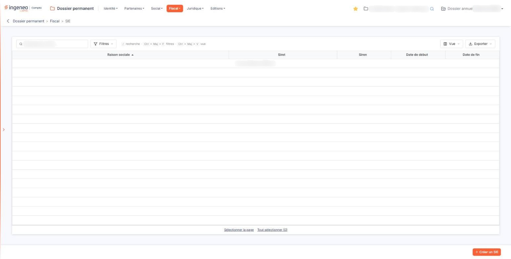
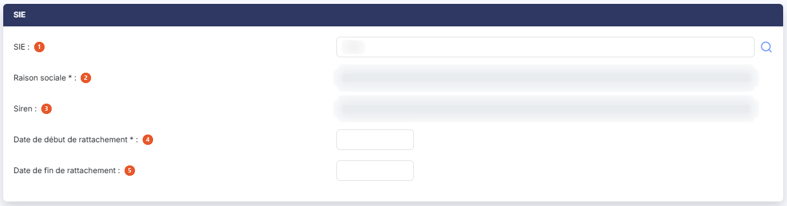
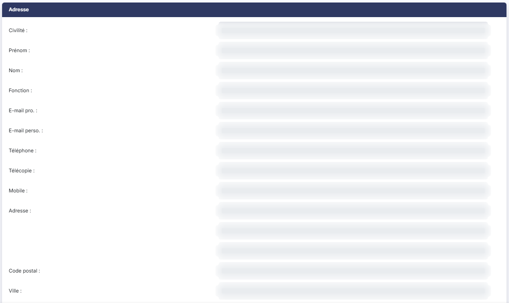

# SIE


**Où le trouver :** Menu **Fiscal › SIE**



**En bref** — Cet écran enregistre le rattachement daté de la société à son Service des impôts des entreprises, et conserve l'historique des changements de service.

* Pour enregistrer un rattachement : bouton \[Créer un SIE], désignez le service et saisissez les dates, puis bouton \[Enregistrer] ; les autres zones se remplissent seules.


Cette option vous permet d'enregistrer le **rattachement de la société à son Service des impôts des entreprises**, et de le dater. « SIE » est l'abréviation de Service des impôts des entreprises.

<figure><figcaption>
Écran « SIE » de la nouvelle interface
</figcaption></figure>

Ce n'est pas une simple coordonnée : c'est un rattachement **daté**, avec une date de début et, le cas échéant, une date de fin. Vous pouvez donc en enregistrer plusieurs et conserver l'historique des changements de service — un déménagement, une réorganisation de l'administration, un changement de régime.

**Retenez d'emblée le point qui déroute le plus sur cet écran** : la fiche est **presque entièrement en lecture seule**. Vous ne saisissez que trois choses — le service, et les deux dates. Tout le reste, la raison sociale, le Siren, l'adresse et les coordonnées du contact, **s'inscrit tout seul** lorsque vous désignez le service. Si vous cliquez dans la zone « Ville » et que rien ne se passe, ce n'est pas une anomalie : cette zone n'est pas saisissable, et l'écran ne vous le dit pas.

## La liste des rattachements

L'écran s'ouvre sur la liste des rattachements enregistrés. Il n'y a pas d'onglet. Lorsqu'aucun rattachement n'est encore enregistré, la grille affiche « Aucun élément à afficher. » et aucun pagineur.

Elle présente cinq colonnes, toutes triables : cliquez sur l'intitulé d'une colonne pour trier dessus.

| Champ              | Ce qu'il faut savoir                                                                                 |
| ------------------ | ---------------------------------------------------------------------------------------------------- |
| **Raison sociale** | Le nom du service des impôts.                                                                        |
| **Siret**          | Le numéro Siret du service.                                                                          |
| **Siren**          | Son numéro Siren.                                                                                    |
| **Date de début**  | La date à partir de laquelle la société est rattachée à ce service.                                  |
| **Date de fin**    | La date à laquelle ce rattachement a cessé. Une ligne sans date de fin est le rattachement en cours. |

Au-dessus de la grille, une barre d'outils s'applique à la liste entière. Des raccourcis clavier y sont rappelés : « / » pour la recherche, Ctrl + Maj + F pour les filtres, Ctrl + Maj + V pour la vue.

La zone « Rechercher un SIE… » restreint la liste dès la saisie ; elle porte sur la **Raison sociale**.

bouton **\[Filtres]** : déroule le volet de critères décrit au paragraphe b). Une fois un filtre appliqué, chaque critère est rappelé à droite du bouton sous forme d'étiquette, qu'une croix retire, et le lien « Tout effacer » les retire tous.

bouton **\[Vue]** : rassemble, sous « Mes vues », l'enregistrement de l'état de la liste sous un nom (« Enregistrer la vue actuelle ») et, sous « Colonnes affichées », le choix des colonnes à afficher — les mêmes informations que celles du volet de filtres peuvent y être ajoutées aux cinq colonnes d'origine —, avec « Rétablir les colonnes d'origine » et « Appliquer ».

bouton **\[Exporter]** : rappelle l'étendue concernée (« La liste affichée », suivie du nombre de rattachements) et propose « Aperçu édition HTML », « Imprimer », « Exporter en Excel », « Exporter en PDF » et « Envoyer la liste par e-mail ».

Sous la grille, deux liens de sélection : « Sélectionner la page » et « Tout sélectionner », ce dernier rappelant entre parenthèses le nombre total de rattachements.

## Le volet « Filtres »

Le bouton \[Filtres] déroule un volet intitulé « Filtrer », vide à l'ouverture, où vous composez vos propres critères de recherche : la liste « + Ajouter un critère sur… » vous en propose bien plus que les cinq colonnes affichées : outre celles-ci, vous pouvez filtrer sur l'adresse, le code postal, la ville, le pays, la civilité, le nom, le prénom, la fonction, le téléphone, le mobile, la télécopie, l'e-mail professionnel, l'e-mail personnel, ainsi que sur la date de création de la fiche, son auteur, sa date de modification et l'auteur de celle-ci.

Chaque critère occupe une ligne : la colonne, un opérateur, une valeur, et une croix qui retire le critère. Deux critères sont reliés par une bascule « ET », retenue par défaut, qu'un clic fait passer à « OU ». Sur une zone de texte, douze opérateurs vous sont proposés : « Égal », retenu par défaut, « Est vide », « N'est pas vide », « Différent », « Contient », « Ne contient pas », « Commence par », « Termine par », « Est avant », « Est avant ou égal », « Est après » et « Est après ou égal ». Sur une zone de date — « Date de début », « Date de fin », « Date de création » et « Date de modification » —, les quatre opérateurs propres au texte, « Contient », « Ne contient pas », « Commence par » et « Termine par », ne sont pas proposés : il en reste huit.

Prenez garde en revanche à un point : la liste servie sur une zone de texte, elle, comporte **les opérateurs de comparaison de dates**. « Est avant » vous est donc proposé sur une raison sociale : cette combinaison n'a pas de sens, ne l'employez pas.

Deux commandes closent le volet : bouton **\[Filtrer]**, qui applique vos critères à la liste, et le lien « Vider les filtres », qui les efface tous.

## Boutons \[Créer un SIE] et \[Supprimer]

bouton **\[Créer un SIE]** ouvre une fiche vide. Il est soumis à un droit propre.

bouton **\[Supprimer]** : il supprime en une fois **tous les rattachements sélectionnés**.

## La fiche d'un rattachement — rubriques « SIE » et « Adresse »

<figure><figcaption>
Rubrique « La fiche d'un rattachement »
</figcaption></figure>

<figure><figcaption>
Rubrique « La fiche d'un rattachement »
</figcaption></figure>

<figure><figcaption>
Rubrique « La fiche d'un rattachement »
</figcaption></figure>

La fiche comporte deux rubriques. La première, « SIE », porte l'identification du service puis les deux dates de rattachement ; la seconde, « Adresse », porte ses coordonnées.

| Champ                                                                            | Ce qu'il faut savoir                                                                                                                                                                                                                                                                                                                                                                                                                                                                                                                                                                                                                                                                                                                                                                                                                                                                                                                                                                                                                                                                                                                                                                                                                                                                                                                                                                                                                                                                                                                                                                                                                                                                                                                                                                               |
| -------------------------------------------------------------------------------- | -------------------------------------------------------------------------------------------------------------------------------------------------------------------------------------------------------------------------------------------------------------------------------------------------------------------------------------------------------------------------------------------------------------------------------------------------------------------------------------------------------------------------------------------------------------------------------------------------------------------------------------------------------------------------------------------------------------------------------------------------------------------------------------------------------------------------------------------------------------------------------------------------------------------------------------------------------------------------------------------------------------------------------------------------------------------------------------------------------------------------------------------------------------------------------------------------------------------------------------------------------------------------------------------------------------------------------------------------------------------------------------------------------------------------------------------------------------------------------------------------------------------------------------------------------------------------------------------------------------------------------------------------------------------------------------------------------------------------------------------------------------------------------------------------- |
| 1. **SIE**                                                                       | 
C'est <strong>la seule zone par laquelle la fiche se remplit</strong>, et paradoxalement la seule des trois zones utiles qui ne porte pas d'astérisque. Elle attend un numéro Siret — la zone l'indique par l'invite « Siret ». Deux façons de désigner le service : en saisissant directement dans la zone : dès le deuxième caractère, le logiciel vous propose les services qui correspondent — et il cherche aussi bien sur la <strong>raison sociale</strong> que sur le Siret, en dépit de l'invite —, et vous choisissez dans la liste proposée ; ou en cliquant sur le pictogramme « Loupe » placé à droite de la zone, qui ouvre la fenêtre « Sélection d'un contact de l'annuaire ». Cette fenêtre présente les contacts de <strong>votre annuaire</strong> qui sont classés dans la catégorie « Service des impôts des entreprises », avec une zone de recherche d'invite « Rechercher par raison sociale / Siret… », qui restreint la liste dès la saisie, et six colonnes : « Raison sociale », « Siret », « Code postal », « Ville », « Nom » et « Prénom ». Le pied de la liste porte la barre de navigation entre les pages et le décompte des lignes. Un clic sur une ligne la retient et fait apparaître le bouton [Sélectionner] à côté du bouton [Annuler] ; la mention « Cliquez pour sélectionner » n'existe plus. Dans les deux cas, le logiciel reporte alors dans la fiche <strong>l'ensemble des informations du contact retenu</strong> : la raison sociale, le Siren, et la totalité de la rubrique « Adresse ». Il en découle une conséquence pratique qu'il vaut mieux connaître avant de chercher longtemps : <strong>si le service que vous cherchez n'est pas dans votre annuaire, sous cette catégorie, il ne vous sera pas proposé.</strong>
 |
| 
2. <strong>Raison sociale</strong> <em>Obligatoire</em>
                | Le nom du service. Cette zone porte un astérisque — elle est donc obligatoire — **mais elle n'est pas saisissable**. Ne cherchez pas à la remplir : elle s'inscrit toute seule quand vous désignez le service par la zone **SIE**. C'est ce qui rend cette dernière indispensable, en dépit de l'absence d'astérisque.                                                                                                                                                                                                                                                                                                                                                                                                                                                                                                                                                                                                                                                                                                                                                                                                                                                                                                                                                                                                                                                                                                                                                                                                                                                                                                                                                                                                                                                                             |
| 3. **Siren**                                                                     | 
En lecture seule, renseigné de la même façon. La rubrique « Adresse » porte les coordonnées du service, <strong>toutes en lecture seule</strong>, toutes reportées depuis le contact retenu et présentées l'une sous l'autre : <strong>Civilité :</strong> — qui est ici une simple zone de texte et non une liste —, <strong>Prénom :</strong>, <strong>Nom :</strong>, <strong>Fonction :</strong>, <strong>E-mail pro. :</strong>, <strong>E-mail perso. :</strong>, <strong>Téléphone :</strong>, <strong>Télécopie :</strong>, <strong>Mobile :</strong>, puis <strong>Adresse :</strong> — un seul intitulé pour <strong>trois lignes</strong> superposées —, <strong>Code postal :</strong>, <strong>Ville :</strong>, et enfin <strong>Pays :</strong>, en deux zones, le code puis le libellé. Il n'y a <strong>pas</strong> de pictogramme de recherche de pays sur cet écran : le pays étant reporté, il n'y a rien à y chercher. Les deux dates, placées dans la rubrique « SIE » sous le Siren, sont, avec la zone <strong>SIE</strong>, les seules que vous saisissez :
                                                                                                                                                                                                                                                                                                                                                                                                                                                                                                                                                                                                                                                                                                 |
| 
4. <strong>Date de début de rattachement</strong> <em>Obligatoire</em>
 | La date à partir de laquelle la société relève de ce service. Vous la saisissez au clavier ou vous la choisissez dans le calendrier qui s'ouvre sous la zone dès que vous cliquez dedans.                                                                                                                                                                                                                                                                                                                                                                                                                                                                                                                                                                                                                                                                                                                                                                                                                                                                                                                                                                                                                                                                                                                                                                                                                                                                                                                                                                                                                                                                                                                                                                                                          |
| 5. **Date de fin de rattachement**                                               | Facultative, et se saisit de la même façon.                                                                                                                                                                                                                                                                                                                                                                                                                                                                                                                                                                                                                                                                                                                                                                                                                                                                                                                                                                                                                                                                                                                                                                                                                                                                                                                                                                                                                                                                                                                                                                                                                                                                                                                                                        |

Les rattachements ne peuvent pas se chevaucher : le logiciel refuse une date de fin antérieure à la date de début, comme une période qui empiète sur celle d'un autre rattachement. Il refuse également de laisser deux rattachements sans date de fin. Renseignez donc la date de fin du rattachement en cours avant de créer le suivant.

## Bouton \[Enregistrer] et retour à la liste

<figure><figcaption>
Bouton [Enregistrer] et retour à la liste
</figcaption></figure>

bouton **\[Enregistrer]** enregistre la fiche. La zone **Date de début de rattachement** doit être renseignée, et le service doit avoir été désigné — sans quoi la raison sociale, obligatoire, reste vide.

Pour revenir à la liste sans rien enregistrer, cliquez sur la flèche placée à gauche du fil d'Ariane, en haut de l'écran.

## Un écran jumeau

L'option « Prestataire ECF » de ce même menu fonctionne exactement de la même façon : une zone de recherche, une loupe qui puise dans votre annuaire, et une fiche qui se remplit toute seule. Seule change la catégorie de contacts interrogée.
