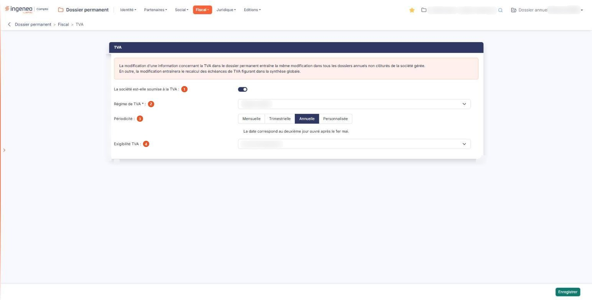
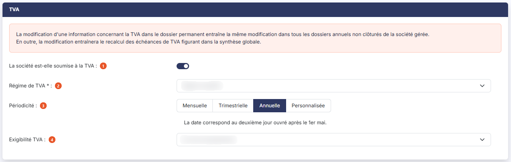

# TVA


**Où le trouver :** Menu **Fiscal › TVA**



**En bref** — Cet écran porte le paramétrage de TVA de la société : assujettissement, régime, périodicité et exigibilité. Toute modification vaut pour tous les dossiers annuels non clôturés et recalcule les échéances de TVA.

* Pour modifier le paramétrage : complétez les zones, puis bouton \[Enregistrer].
* Pour saisir des échéances personnalisées : bouton \[Nouvelle ligne] sous le tableau ; bouton \[Supprimer ligne] retire la dernière.


Cette option porte le **paramétrage de TVA de la société** : est-elle soumise à la TVA, sous quel régime, à quelle périodicité déclare-t-elle, et sur quelle base sa taxe devient-elle exigible.

<figure><figcaption>
Écran « TVA » de la nouvelle interface
</figcaption></figure>

**Ce n'est pas une fiche parmi d'autres, c'est un réglage de portée générale.** Il n'y a ni liste, ni ligne à ouvrir, ni bouton de création : la société ne possède qu'un seul paramétrage de TVA, et l'écran vous le présente directement.

**Ce que vous modifiez ici ne reste pas ici.** L'écran vous en avertit lui-même, dans un encadré de couleur placé avant tout champ :

_« La modification d’une information concernant la TVA dans le dossier permanent entraîne la même modification dans tous les dossiers annuels non clôturés de la société gérée. »_

_« En outre, la modification entraînera le recalcul des échéances de TVA figurant dans la synthèse globale. »_

Autrement dit : vous ne réglez pas la TVA d'un exercice, vous réglez celle de la société, et **tous ses dossiers annuels encore ouverts suivent**. Les dossiers déjà clôturés, eux, conservent leur paramétrage. Avant de toucher à un champ de cet écran, assurez-vous donc que le changement vaut bien pour tous les exercices non clôturés, et attendez-vous à voir les échéances de TVA de la synthèse globale recalculées.

Enfin, **cet écran n'offre aucun bouton de retour ni d'abandon** : le seul bouton de l'écran est le bouton d'enregistrement. Pour renoncer à une modification, vous quittez l'écran par le menu, sans enregistrer.

## Rubrique « TVA »

<figure><figcaption>
Rubrique « TVA »
</figcaption></figure>

Le volet s'ouvre sur les deux lignes d'avertissement citées plus haut, puis sur les réglages.

| Champ                                                            | Ce qu'il faut savoir                                                                                                                                                                                                                                                                                                                                                                                                                                                                               |
| ---------------------------------------------------------------- | -------------------------------------------------------------------------------------------------------------------------------------------------------------------------------------------------------------------------------------------------------------------------------------------------------------------------------------------------------------------------------------------------------------------------------------------------------------------------------------------------- |
| 1. **La société est-elle soumise à la TVA**                      | Interrupteur, activé ou désactivé. C'est le premier réglage, et celui qui commande les autres.                                                                                                                                                                                                                                                                                                                                                                                                     |
| 
2. <strong>Régime de TVA</strong> <em>Obligatoire</em>
 | Liste déroulante, dont les valeurs sont, dans l'ordre : « Franchise de TVA », « Mini réel », « Régime réel », « Régime réel agricole », « Régime simplifié », « Régime simplifié agricole », « Taxe générale sur la consommation », « TVA groupe ». Tant que vous n'avez pas choisi, la liste affiche « Sélectionnez ».                                                                                                                                                                            |
| 3. **Périodicité**                                               | 
Quatre boutons à cliquer, présentés de gauche à droite : « Mensuelle », « Trimestrielle », « Annuelle », « Personnalisée ». Un seul est actif à la fois, et celui qui est retenu apparaît enfoncé. Sous ces boutons, le logiciel affiche un texte qui dépend de la périodicité retenue. Lorsque la périodicité est « Annuelle », il indique : <em>« La date correspond au deuxième jour ouvré après le 1er mai. »</em> — vous n'avez alors aucune date à saisir, le logiciel la calcule.
 |
| 4. **Exigibilité TVA**                                           | Liste déroulante à trois valeurs : « Sur les débits », « Sur les encaissements », « Mixte ». Tant que vous n'avez pas choisi, la liste affiche « Sélectionnez ». Ce réglage n'est pas suivi d'un astérisque, mais il conditionne l'affichage d'un réglage complémentaire — voir le paragraphe suivant.                                                                                                                                                                                             |

## Les réglages qui n'apparaissent que dans certains cas

Cet écran **ne montre jamais tous ses réglages à la fois** : il en découvre ou en masque une partie au fur et à mesure de vos choix, et il le fait **sans aucun message**. Ne concluez donc pas qu'un réglage n'existe pas parce que vous ne le voyez pas : c'est le plus souvent qu'un choix fait au-dessus le tient masqué.

Le premier interrupteur commande tout le reste : lorsque **La société est-elle soumise à la TVA** est désactivé, l'écran ne conserve que les deux lignes d'avertissement et cet interrupteur — le régime, la périodicité, l'exigibilité, l'option sur les débits et le volet « Fichier » disparaissent tous.

Les autres réglages concernés sont les suivants.

| Champ                                                        | Ce qu'il faut savoir                                                                                                                                                                                                                                                                                                                                                                                                                                                                                                                                                                                                                                                                                                                                                                                                                                                                                                                                                                                                                                                                                                                                                                                                                                                                                                                                                                                                     |
| ------------------------------------------------------------ | ------------------------------------------------------------------------------------------------------------------------------------------------------------------------------------------------------------------------------------------------------------------------------------------------------------------------------------------------------------------------------------------------------------------------------------------------------------------------------------------------------------------------------------------------------------------------------------------------------------------------------------------------------------------------------------------------------------------------------------------------------------------------------------------------------------------------------------------------------------------------------------------------------------------------------------------------------------------------------------------------------------------------------------------------------------------------------------------------------------------------------------------------------------------------------------------------------------------------------------------------------------------------------------------------------------------------------------------------------------------------------------------------------------------------ |
| 
<strong>Jour du mois</strong> <em>Obligatoire</em>
 | Une zone numérique courte, bornée de 1 à 31, où vous indiquez le jour du mois auquel la déclaration est attendue. Elle n'est proposée que pour les périodicités « Mensuelle » et « Trimestrielle ». Elle est obligatoire lorsqu'elle est proposée, et elle occupe l'emplacement où figure, en périodicité « Annuelle », le texte sur le deuxième jour ouvré après le 1er mai.                                                                                                                                                                                                                                                                                                                                                                                                                                                                                                                                                                                                                                                                                                                                                                                                                                                                                                                                                                                                                                            |
| **La grille des échéances**                                  | 
Un tableau, proposé pour la seule périodicité « Personnalisée », où vous saisissez vous-même les échéances de déclaration, une par ligne. Tant qu'aucune échéance n'a été enregistrée, ce tableau s'affiche <strong>sans aucune ligne</strong> : la première est à créer. Deux boutons l'accompagnent : bouton <strong>[Nouvelle ligne]</strong>, qui ajoute une ligne au bas du tableau, et bouton <strong>[Supprimer ligne]</strong>, qui retire la dernière — sans jamais faire descendre le tableau en dessous d'une ligne. Le tableau présente deux colonnes, « N° échéance » et « Jour / Mois ». Dans la seconde, chaque ligne porte <strong>deux zones de saisie séparées par une barre oblique</strong> : le <strong>jour</strong> à gauche, dont la zone affiche l'invite « jj », puis le <strong>mois</strong> à droite, invite « mm ». Les deux sont obligatoires et se saisissent sur deux chiffres. Une échéance se lit donc « jour / mois », par exemple 20 / 04 pour le 20 avril. Le logiciel contrôle chaque couple dès que vous quittez la zone : si le jour et le mois ne forment pas une date possible — un 31 février, par exemple —, les deux zones passent en rouge. Corrigez-les avant d'enregistrer. Vous retrouverez la même présentation dans la grille des échéances de l'option « Taxes », que vous ouvrez désormais depuis le panneau « Paramètres », rubrique « Données ».
 |
| **Option sur les débits**                                    | Interrupteur, activé ou désactivé, qui n'est pas proposé dans tous les cas d'exigibilité.                                                                                                                                                                                                                                                                                                                                                                                                                                                                                                                                                                                                                                                                                                                                                                                                                                                                                                                                                                                                                                                                                                                                                                                                                                                                                                                                |
| **La rubrique « Fichier »**                                  | Un second volet, sous le volet « TVA », qui vous permet de joindre un document à ce paramétrage — le justificatif de l'option. Tant qu'aucun document n'est joint, il affiche la mention « Aucun document lié » et le bouton **\[Lier un document]**. Ce bouton ouvre, à droite de l'écran, un volet « Lier un document » : vous y choisissez la source du document, « Depuis mon poste » ou « Depuis la GED », puis, depuis votre poste, vous déposez le fichier dans la zone prévue ou vous parcourez vos fichiers — le volet précise « Tous formats sauf .exe, .bat, .cmd, .sh — nom de 100 caractères maximum ». Le bouton **\[Lier le document]** retient le document, le bouton **\[Annuler]** referme le volet sans rien lier. Lorsqu'un document a déjà été joint, le volet « Fichier » affiche en plus la ligne **Nom du fichier enregistré :** suivie du nom du document et d'un pictogramme « Œil », et le Bouton \[Lier un document] reste proposé : c'est par lui que vous remplacez le document. Vous pouvez aussi retirer le document joint : le bouton **\[Supprimer le document]** le marque pour suppression, ce que le volet rappelle par la mention « Le document enregistré sera supprimé à l’enregistrement », avec un lien « Annuler ». La suppression n'a lieu qu'au clic sur le bouton **\[Enregistrer]**.                                                                                      |

## Bouton \[Enregistrer]

<figure><figcaption>
Bouton [Enregistrer]
</figcaption></figure>

Il enregistre le paramétrage, **et déclenche la répercussion annoncée par les deux avertissements de l'encadré** : la même modification dans tous les dossiers annuels non clôturés de la société, et le recalcul des échéances de TVA de la synthèse globale.

C'est le **seul** bouton de l'écran. Selon les droits qui vous sont accordés, il peut ne pas vous être proposé : l'écran s'affiche alors en consultation, et vous pouvez lire le paramétrage sans pouvoir le modifier.
