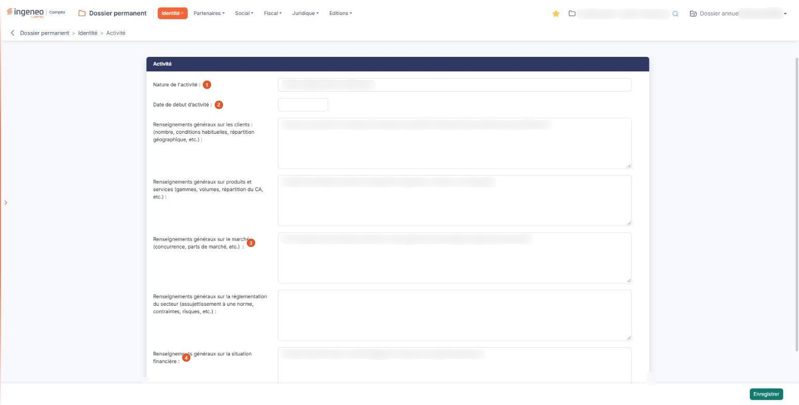
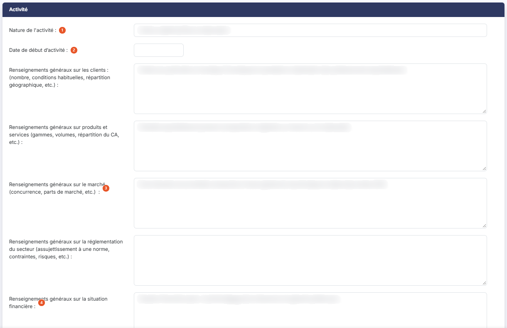
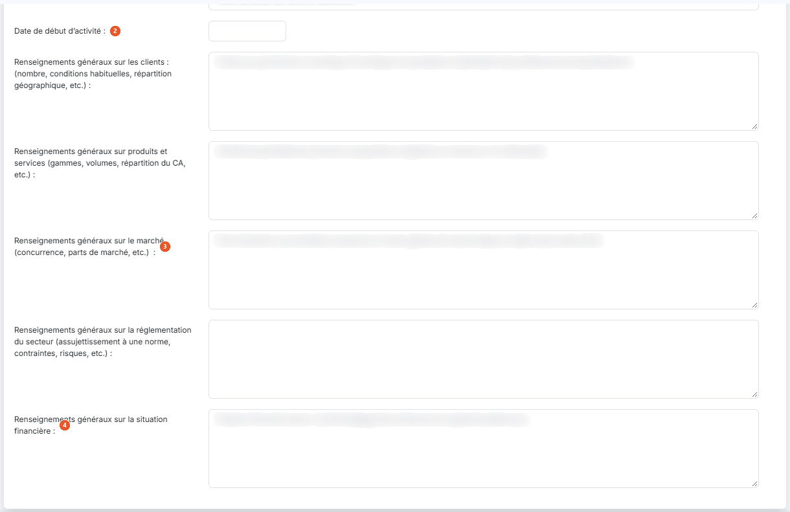

# Activité


**Où le trouver :** Menu **Identité › Activité**



**En bref** — Cet écran décrit en texte libre l'activité de la société : ce qu'elle vend, à qui, sur quel marché, sa réglementation et sa situation financière. Aucune zone n'est obligatoire.

* Pour décrire l'activité : complétez les zones voulues, en faisant défiler le volet jusqu'aux dernières, puis bouton \[Enregistrer].


Cette option vous permet de décrire, en texte libre, l'activité de la société : ce qu'elle vend, à qui, sur quel marché, dans quel cadre réglementaire, et dans quelle situation financière. C'est la fiche de connaissance du dossier.

<figure><figcaption>
Écran « Activité » de la nouvelle interface
</figcaption></figure>

L'écran ne comporte qu'un seul volet et se saisit d'un trait : il n'y a ni liste, ni fiche à ouvrir, ni onglet, ni pictogramme de commande. **Aucune de ces informations n'est obligatoire** : vous pouvez n'en renseigner qu'une, ou aucune, et revenir les compléter plus tard.

L'écran est plus haut que votre fenêtre : une barre de défilement apparaît à droite du volet, et les deux dernières zones — la réglementation du secteur et la situation financière — ne sont pas visibles tant que vous n'avez pas fait défiler. Pensez-y avant de conclure que l'écran s'arrête au marché.

## Rubrique « Activité »

<figure><figcaption>
Rubrique « Activité »
</figcaption></figure>

<figure><figcaption>
Rubrique « Activité »
</figcaption></figure>

Les sept zones se présentent dans l'ordre suivant. Les cinq dernières sont des zones de plusieurs lignes, ; elles affichent six lignes au repos.

| Champ                                                                             | Ce qu'il faut savoir                                                                                                                                                                                                                                                                                                                                                                                                                                                                                                                                                                                                                                                                                                                                                                            |
| --------------------------------------------------------------------------------- | ----------------------------------------------------------------------------------------------------------------------------------------------------------------------------------------------------------------------------------------------------------------------------------------------------------------------------------------------------------------------------------------------------------------------------------------------------------------------------------------------------------------------------------------------------------------------------------------------------------------------------------------------------------------------------------------------------------------------------------------------------------------------------------------------- |
| 1. **Nature de l'activité**                                                       | L'activité de la société en une ligne, **50 caractères au maximum**. C'est la donnée la plus structurante de l'écran, et c'est aussi la plus courte : préférez une formule ramassée du type « Vente au détail de fleurs et décoration », et renvoyez le détail aux zones suivantes.                                                                                                                                                                                                                                                                                                                                                                                                                                                                                                             |
| 2. **Date de début d’activité**                                                   | 
La date à laquelle la société a commencé son activité. Vous la saisissez au clavier ou vous la choisissez dans le calendrier qui s'ouvre sous la zone dès que vous cliquez dedans. Le format attendu est jj/mm/aaaa, sur dix caractères au plus ; le seul message possible est « Le champ "Date de début d’activité" est hors limite. ». <strong>Renseignements généraux sur les clients : (nombre, conditions habituelles, répartition géographique, etc.) :</strong> la clientèle de la société. <strong>1 000 caractères au maximum</strong>, comme les quatre zones suivantes. <strong>Renseignements généraux sur produits et services (gammes, volumes, répartition du CA, etc.) :</strong> ce que la société vend, et le poids de chaque gamme dans son chiffre d'affaires.
 |
| 3. **Renseignements généraux sur le marché (concurrence, parts de marché, etc.)** | 
L'environnement concurrentiel dans lequel la société se situe. <strong>Renseignements généraux sur la réglementation du secteur (assujettissement à une norme, contraintes, risques, etc.) :</strong> les obligations propres au secteur — agrément, norme, autorisation d'exercer, risque particulier.
                                                                                                                                                                                                                                                                                                                                                                                                                                                                               |
| 4. **Renseignements généraux sur la situation financière**                        | L'appréciation d'ensemble que vous portez sur la santé financière de la société.                                                                                                                                                                                                                                                                                                                                                                                                                                                                                                                                                                                                                                                                                                                |

La plupart de ces intitulés portent leurs exemples entre parenthèses — le dernier, sur la situation financière, n'en donne aucun : lisez-les jusqu'au bout, ils tiennent lieu de mode d'emploi et vous disent ce que l'on attend à cet endroit.

## Bouton \[Enregistrer]

<figure><figcaption>
Bouton [Enregistrer]
</figcaption></figure>

Il enregistre ce que vous avez saisi. C'est le **seul** bouton de l'écran. Il n'est proposé que si le droit d'enregistrer vous est accordé. Après l'enregistrement, le logiciel affiche la notification « Vos modifications ont bien été enregistrées. » (ou « Une erreur est survenue durant l'enregistrement. »), et vous restez sur l'écran, rechargé avec les valeurs relues en base. Il est impossible de dépasser les longueurs maximales : la frappe s'arrête d'elle-même, à 50 caractères pour la nature de l'activité et à 1 000 pour chacune des cinq zones de renseignements généraux.

Il n'y a donc **aucun bouton de retour ni d'annulation** : si vous avez modifié une zone et que vous souhaitez renoncer, vous quittez l'écran par le menu, sans enregistrer. Inversement, ne quittez pas l'écran par le menu en croyant que votre saisie est conservée : elle ne l'est que si vous avez cliqué sur \[Enregistrer].

## Bon usage de cet écran

Chaque zone a son sujet, et l'écran ne vous en avertit pas si vous vous trompez de zone : une description de la clientèle saisie dans la zone des produits et services y reste, sans message. Relisez l'intitulé avant de saisir — c'est la seule vérification qui existe.

Prenez garde également à la longueur de la première zone : **Nature de l'activité** s'arrête à 50 caractères là où les cinq zones de renseignements généraux en acceptent 1 000. Une activité qui ne tient pas en 50 caractères se résume dans cette zone et se détaille dans les suivantes.
