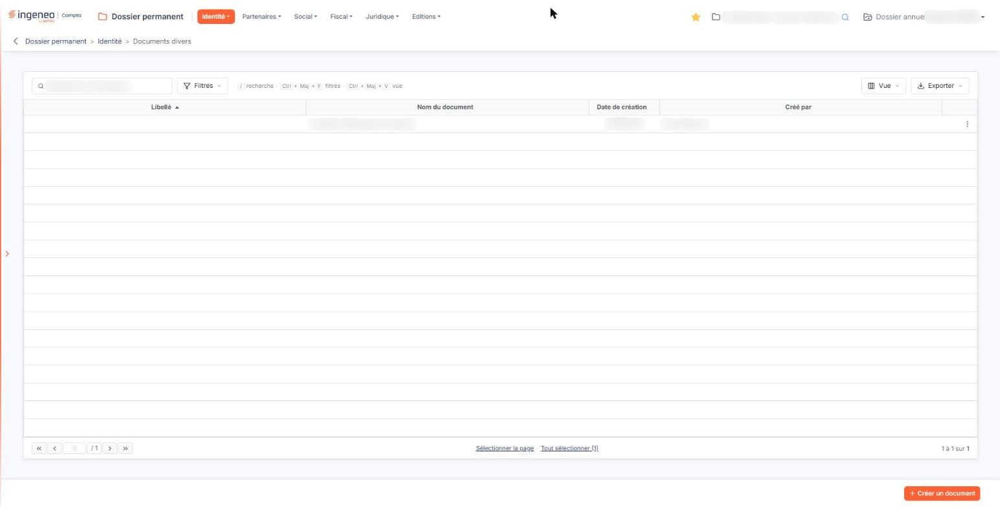
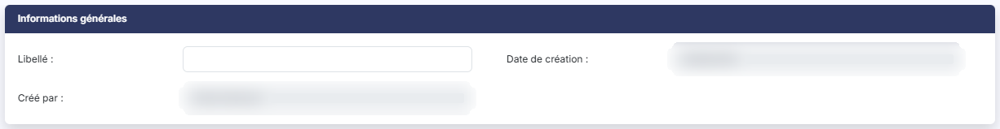
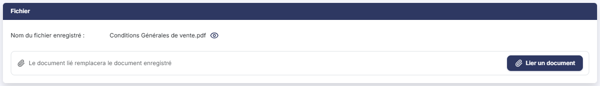
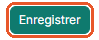

# Documents divers


**Où le trouver :** Menu **Identité › Documents divers**



**En bref** — Cet écran joint au dossier permanent les documents sans place ailleurs (conditions générales de vente, contrat, attestation…) : chaque enregistrement porte un libellé et un seul document.

* Pour déposer un document : bouton \[Créer un document], saisissez le libellé, bouton \[Lier un document], puis bouton \[Enregistrer].
* Pour retrouver un document : bouton \[Filtres] ; bouton \[Vider les filtres] pour revenir à la liste complète.


Cette option vous permet de **joindre au dossier permanent des documents qui n'ont pas leur place ailleurs** : tout ce qui doit rester attaché à la société sans relever du juridique, du social ni du fiscal — des conditions générales de vente, un contrat, un plan, une attestation.

<figure><figcaption>
Écran « Documents divers » de la nouvelle interface
</figcaption></figure>

C'est un porte-documents, et rien de plus : le logiciel ne fait ici aucun contrôle de contenu et n'attend aucune date. Chaque enregistrement porte **un libellé et un document, un seul**.

L'écran fonctionne en deux temps : une liste des documents déjà déposés, et une fiche que vous ouvrez pour en déposer un ou en modifier un.

Le même écran vous sert ailleurs dans le dossier permanent — pour les statuts, le K-bis, les autres documents légaux, les autres informations sociales et les autres informations fiscales. Vous y retrouverez la même présentation, à ceci près que certaines de ces options attendent en plus une date propre à leur type de document ; ici, il n'y en a aucune.

## La liste des documents

L'écran s'ouvre sur la liste des documents déposés, triée par ordre croissant de libellé. Il n'y a pas d'onglet.

Elle présente quatre colonnes, toutes triables : cliquez sur l'intitulé d'une colonne pour trier dessus.

| Champ                | Ce qu'il faut savoir                                                       |
| -------------------- | -------------------------------------------------------------------------- |
| **Libellé**          | Le nom que vous avez donné au document. C'est la colonne de tri d'origine. |
| **Nom du document**  | Le nom du fichier tel qu'il s'appelait sur votre poste au moment du dépôt. |
| **Date de création** | La date à laquelle la fiche a été créée dans le logiciel.                  |
| **Créé par**         | Le collaborateur qui l'a créée.                                            |

Au-dessus de la grille, une barre d'outils s'applique à la liste entière. Des raccourcis clavier y sont rappelés : « / » pour la recherche, Ctrl + Maj + F pour les filtres, Ctrl + Maj + V pour la vue.

La zone « Rechercher un document… » restreint la liste dès la saisie. Elle ne porte que sur le **Libellé** : un document enregistré sans libellé n'y est jamais retrouvé, pas même par le nom de son fichier. La recherche saisie s'affiche ensuite à droite du bouton \[Filtres], sous la forme d'un critère « Libellé Contient … », que la croix ou le lien « Tout effacer » retire.

bouton **\[Filtres]** : déroule un volet « Filtrer », vide à l'ouverture. La liste « + Ajouter un critère sur… » propose les quatre colonnes de la grille ; pour chaque critère, vous choisissez un opérateur et une valeur. bouton **\[Filtrer]** applique les critères à la liste, bouton **\[Vider les filtres]** les efface.

bouton **\[Vue]** : rassemble, sous « Mes vues », l'enregistrement de l'état de la liste sous un nom (« Enregistrer la vue actuelle ») et, sous « Colonnes affichées », le choix des colonnes à afficher, avec « Rétablir les colonnes d'origine » et « Appliquer ».

bouton **\[Exporter]** : rappelle l'étendue concernée (« La liste affichée », suivie du nombre de documents) et propose « Aperçu édition HTML », « Imprimer », « Exporter en Excel », « Exporter en PDF » et « Envoyer la liste par e-mail ».

Le pied de la liste porte la barre de navigation entre les pages, au centre deux liens de sélection — « Sélectionner la page » et « Tout sélectionner », ce dernier rappelant entre parenthèses le nombre total de documents — et, à droite, le décompte des lignes affichées. La grille conserve une hauteur fixe : lorsque vos documents sont peu nombreux, des lignes vides s'affichent en dessous — ce n'est pas de la donnée manquante, ni un chargement en cours.

## Le conseil le plus utile sur cet écran : renseignez le libellé

Le **Libellé** est la colonne principale de la liste et celle sur laquelle elle se trie — mais **il n'est pas obligatoire**. Un document déposé sans libellé s'affiche donc avec une **première colonne vide**, se trie en tête de liste, et n'est plus identifiable que par le nom de son fichier.

Prenez donc l'habitude de le renseigner, même brièvement, et de préférence avec une formulation homogène d'un document à l'autre : c'est la seule chose qui rendra votre liste lisible quand elle comptera vingt documents.

## Les commandes de chaque ligne

Un clic sur une ligne la sélectionne. Au survol d'une ligne apparaissent, à son extrémité droite, trois pictogrammes. Il n'y a **pas** de commande de duplication sur cet écran.

Le pictogramme « Crayon », d'infobulle « Modifier », ouvre la fiche du document.

Le pictogramme « Œil », d'infobulle « Afficher l'aperçu », **télécharge** le document déposé sur votre poste. Son infobulle promet un aperçu à l'écran : ce n'en est pas un.

Le pictogramme « Autres actions » ouvre un menu qui propose « Supprimer » : cette commande supprime la fiche et son document.

Selon les droits qui vous sont accordés, l'une ou l'autre de ces trois commandes peut ne pas vous être proposée : la modification, la consultation du document et la suppression sont soumises à trois droits distincts.

## Boutons \[Créer un document] et \[Supprimer]

bouton **\[Créer un document]** ouvre une fiche vide. Il est soumis à un droit propre.

bouton **\[Supprimer]** : dès qu'au moins une ligne est sélectionnée, un bandeau apparaît en bas de l'écran ; il indique le nombre de documents sélectionnés et porte le bouton \[Supprimer], qui supprime en une fois **tous les documents sélectionnés**. Vérifiez votre sélection avant de le presser.

## Déposer un document — la fiche en création

La fiche comporte deux rubriques, dans cet ordre : « Informations générales » et « Fichier ». En création, elle ne vous demande que deux choses.

**Libellé :facultatif**, 50 caractères au maximum. Voyez cependant le conseil du paragraphe b).

**Fichier \* :obligatoire**. Tant qu'aucun document n'est lié, la rubrique affiche « Aucun document lié ». Le bouton **\[Lier un document]** ouvre, à droite de l'écran, un volet « Lier un document » : vous y choisissez la source du document, « Depuis mon poste » ou « Depuis la GED », puis, depuis votre poste, vous déposez le fichier dans la zone prévue ou vous parcourez vos fichiers. Le bouton **\[Lier le document]** retient le document, le bouton **\[Annuler]** referme le volet sans rien lier. C'est la seule information obligatoire de la fiche : sans document, il n'y a rien à enregistrer.

Le volet annonce « Tous formats sauf .exe, .bat, .cmd, .sh — nom de 100 caractères maximum » ; il n'annonce aucune taille maximale.

## Modifier un document — la fiche en modification

<figure><figcaption>
Rubrique « Modifier un document »
</figcaption></figure>

<figure><figcaption>
Rubrique « Modifier un document »
</figcaption></figure>

La fiche présente les mêmes deux rubriques, mais elle ne se présente **pas** tout à fait comme en création. Ne vous laissez pas surprendre par ces trois différences.

D'abord, la rubrique « Informations générales » affiche deux informations de plus, **en lecture seule** : **Date de création :** et **Créé par :**. Elles rappellent quand et par qui la fiche a été créée. Il n'y a en revanche **aucune trace de la dernière modification** sur cet écran : si vous corrigez un libellé, la fiche n'en gardera pas le souvenir.

Ensuite, la rubrique « Fichier » affiche la ligne **Nom du fichier enregistré :** suivie du nom du document déposé et d'un pictogramme « Œil », dont l'infobulle indique ici « Visualiser » — et non « Afficher l'aperçu » comme dans la liste, bien qu'il s'agisse de la même action, et bien que l'une comme l'autre soit trompeuse : le document est **téléchargé** sur votre poste, il n'est pas affiché à l'écran.

Enfin, et c'est le point à retenir : **le Bouton \[Lier un document] reste proposé, mais l'intitulé « Fichier \* : » et son astérisque ont disparu** ; à leur place, la mention « Le document lié remplacera le document enregistré ». Le document n'est donc plus obligatoire — vous pouvez modifier le seul libellé et enregistrer sans toucher au document. Le bouton sert, si vous le souhaitez, à **remplacer** le document par un autre : enregistrer sans choisir de fichier ne met à jour que les informations de la fiche, le document déjà déposé n'est pas touché ; choisir un fichier supprime le précédent puis dépose le nouveau.

Autrement dit : **le document est obligatoire à la création, et seulement à la création.** C'est la règle à retenir de cet écran, parce que rien à l'écran ne vous l'explique — l'astérisque disparaît sans un mot.

## Bouton \[Enregistrer] et retour à la liste

<figure><figcaption>
Bouton [Enregistrer] et retour à la liste
</figcaption></figure>

bouton **\[Enregistrer]** enregistre la fiche. En création, un document doit avoir été choisi.

Pour revenir à la liste sans rien enregistrer — et, en création, sans déposer le document que vous auriez choisi —, cliquez sur la flèche placée à gauche du fil d'Ariane, en haut de l'écran.
