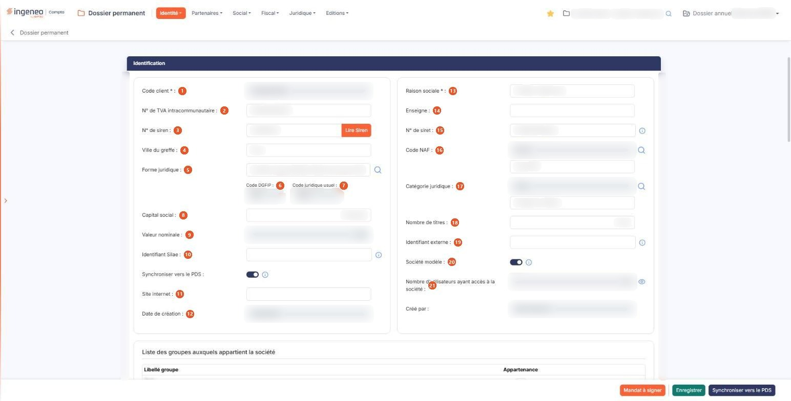
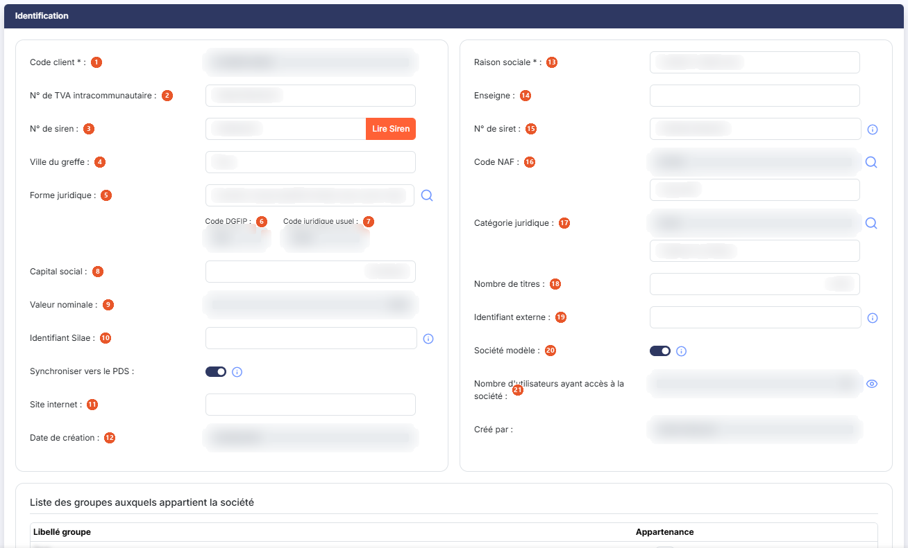
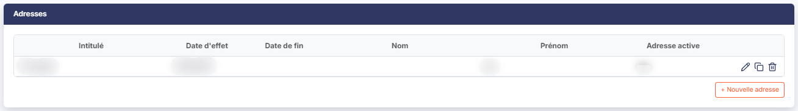
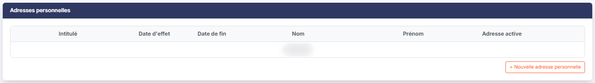
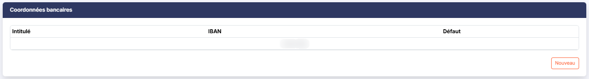
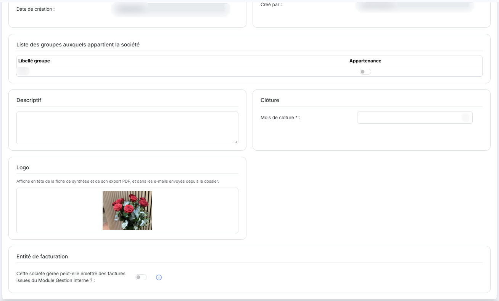
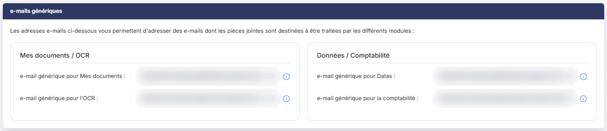
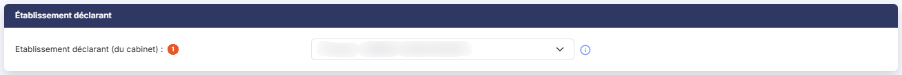
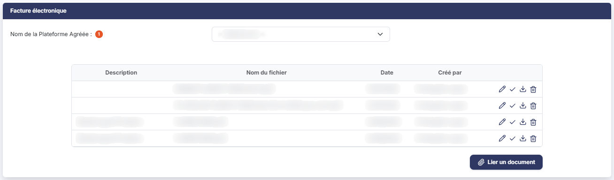
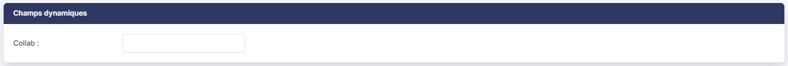

# Fiche société


**Où le trouver :** Menu **Identité › Fiche société**



**En bref** — La fiche société rassemble l'identité de la société gérée : raison sociale, identifiants légaux, forme juridique, capital, adresses, coordonnées bancaires, clôture et facture électronique. C'est la fiche de référence du dossier.

* Pour reprendre l'identification à partir du numéro SIREN : saisissez le N° de siren, puis bouton \[Lire Siren].
* Pour enregistrer vos modifications : bouton \[Enregistrer], qui sauvegarde l'ensemble des volets.
* Pour produire le mandat de la plateforme agréée : bouton \[Mandat à signer], puis bouton \[Imprimer].


La fiche société rassemble l'identité de la société gérée : sa raison sociale, ses identifiants légaux, sa forme juridique, son capital, ses adresses, ses coordonnées bancaires, son mois de clôture et son inscription sur une plateforme agréée de facturation électronique. C'est la fiche de référence du dossier.

<figure><figcaption>
Écran « Fiche société » de la nouvelle interface
</figcaption></figure>

L'écran s'ouvre directement en modification, sans liste préalable. Il se présente comme une série de volets, tous dépliés au chargement, que vous parcourez en faisant défiler l'écran. Il n'y a pas d'onglet.

Les volets se succèdent dans cet ordre : « Identification » — qui regroupe aussi, dans des encadrés placés sous ses zones, la liste des groupes, le descriptif, la clôture, le logo et l'entité de facturation —, « Adresses », « Adresses personnelles », « Facture électronique », « Coordonnées bancaires », « e-mails génériques », « Établissement déclarant » et « Champs dynamiques ». Les paragraphes qui suivent les décrivent dans un ordre différent.

**Trois précautions avant de commencer**

1. **Le bas de l'écran porte trois boutons, et un seul enregistre.** Ils se distinguent par leur couleur, mais l'un des deux autres transmet des informations hors du logiciel. Lisez le paragraphe « Les boutons du bas de l'écran » avant de cliquer sur l'un d'eux.
2. **Cet écran ne porte aucun bouton permettant de renoncer à la saisie en cours.** Si vous avez commencé une saisie et quittez l'écran par le menu, le logiciel ne vous avertit pas que votre saisie sera perdue.
3. **Le bandeau de position n'affiche que « Dossier permanent »**, sans le menu « Identité » ni l'option « Fiche société ». Ne vous fiez pas au bandeau pour savoir où vous êtes.

## Volet « Identification »

<figure><figcaption>
Rubrique « Identification »
</figcaption></figure>

C'est le volet d'identité de la société. Il s'affiche sur deux colonnes.

| Champ                                                              | Ce qu'il faut savoir                                                                                                                                                                                                                                                                                        |
| ------------------------------------------------------------------ | ----------------------------------------------------------------------------------------------------------------------------------------------------------------------------------------------------------------------------------------------------------------------------------------------------------- |
| 
1. <strong>Code client</strong> <em>Obligatoire</em>
     | Le code du dossier dans votre abonnement. Il est obligatoire mais **non modifiable ici** : il se fixe à la création de la société gérée.                                                                                                                                                                    |
| 2. **N° de TVA intracommunautaire**                                | Le numéro de TVA de la société.                                                                                                                                                                                                                                                                             |
| 3. **N° de siren**                                                 | Le numéro d'identité de la société. Le bouton **\[Lire Siren]**, placé à sa droite, interroge un service de renseignement d'entreprises et ramène des informations d'identification à partir du numéro saisi.                                                                                               |
| 4. **Ville du greffe**                                             | Le greffe d'immatriculation.                                                                                                                                                                                                                                                                                |
| 5. **Forme juridique**                                             | Le libellé de la forme juridique, saisissable, avec un pictogramme « Loupe » pour le choisir dans le référentiel.                                                                                                                                                                                           |
| 6. **Code DGFIP**                                                  | Le code abrégé de la forme juridique attendu par l'administration fiscale. **Non modifiable** : il se déduit de la forme juridique.                                                                                                                                                                         |
| 7. **Code juridique usuel**                                        | L'abréviation courante de la forme juridique. **Non modifiable**, déduite elle aussi.                                                                                                                                                                                                                       |
| 8. **Capital social**                                              | Le montant du capital.                                                                                                                                                                                                                                                                                      |
| 9. **Valeur nominale**                                             | La valeur d'un titre. **Non modifiable** : elle se calcule.                                                                                                                                                                                                                                                 |
| 10. **Identifiant Silae**                                          | Son infobulle précise : « _Ce champ permet de redéfinir le code abonné utilisé par l'API Silae._ »                                                                                                                                                                                                          |
| 11. **Site internet**                                              | L'adresse du site de la société.                                                                                                                                                                                                                                                                            |
| 12. **Date de création**                                           | **Créé par :** la date de création de la fiche et son auteur. **Non modifiables.** Le volet ne porte ni date ni auteur de dernière modification.                                                                                                                                                            |
| 
13. <strong>Raison sociale</strong> <em>Obligatoire</em>
 | La dénomination de la société, obligatoire.                                                                                                                                                                                                                                                                 |
| 14. **Enseigne**                                                   | Le nom commercial, s'il diffère de la raison sociale.                                                                                                                                                                                                                                                       |
| 15. **N° de siret**                                                | Le numéro de l'établissement. Il ne porte pas d'astérisque, mais son infobulle vous prévient : « _Ce champ est obligatoire pour télétransmettre les déclarations._ » Autrement dit l'obligation n'est pas générale, elle apparaît le jour où vous télétransmettez — renseignez-le sans attendre ce jour-là. |
| 16. **Code NAF**                                                   | L'activité principale. Le code est en lecture seule ; vous le renseignez en cliquant sur le pictogramme « Loupe » placé à droite, qui ouvre la recherche dans le référentiel. Le libellé, affiché **sous** le code et non à côté, reste saisissable.                                                        |
| 17. **Catégorie juridique**                                        | La catégorie juridique de l'entreprise. Comme pour le code NAF, le code est en lecture seule et se choisit par le pictogramme « Loupe » ; le libellé, affiché sous le code, reste saisissable.                                                                                                              |
| 18. **Nombre de titres**                                           | Le nombre total de titres composant le capital. C'est cette valeur qui sert de total de référence aux fiches d'actionnaires du menu « Juridique », et qui détermine leur pourcentage de détention.                                                                                                          |
| 19. **Identifiant externe**                                        | Son infobulle précise l'usage : « _Ce champ n'est utile que pour les abonnés utilisant un annuaire externe et réalisant des mises à jour via l'API._ » Si vous n'êtes pas dans ce cas, laissez-le vide.                                                                                                     |
| 20. **Société modèle**                                             | Interrupteur, activé ou désactivé. Son infobulle en donne l'usage : « _Permet de définir si cette société est un modèle pouvant être utilisé pour la création de nouvelles sociétés gérées._ » Activé, le dossier vous sera proposé comme modèle de départ lorsque vous créerez une nouvelle société gérée. |
| 21. **Nombre d'utilisateurs ayant accès à la société**             | Information calculée, **non modifiable**. Un pictogramme « Œil », sans infobulle, est placé à sa droite.                                                                                                                                                                                                    |
| **Descriptif**                                                     | Zone de texte libre sur plusieurs lignes, pour vos commentaires sur le dossier. Elle n'est pas parmi les zones du volet : elle occupe un encadré à part, intitulé « Descriptif », placé à côté de l'encadré « Clôture ».                                                                                    |

## Volet « Adresses »

<figure><figcaption>
Rubrique « Adresses »
</figcaption></figure>

Une société peut porter plusieurs adresses, chacune valable sur une période. Le volet présente la liste de ces adresses, avec les colonnes suivantes : **Intitulé**, **Date d'effet**, **Date de fin**, **Nom**, **Prénom** et **Adresse active**.

L'adresse dont l'intitulé est « Principale » est celle que le logiciel reprend par défaut, notamment dans le volet « Facture électronique » décrit plus bas.

bouton **\[+ Nouvelle adresse]**

Ouvre la saisie d'une nouvelle adresse, qui s'affiche sous la liste, dans le volet.

**Les commandes de chaque ligne**

Chaque ligne de la liste porte trois pictogrammes, dans cet ordre :

* le crayon (infobulle « Modifier ») rouvre l'adresse en modification ;
* les deux feuilles superposées (infobulle « Dupliquer ») créent une adresse à partir de celle-ci ;
* la corbeille (infobulle « Supprimer ») retire l'adresse.

## Volet « Adresses personnelles »

<figure><figcaption>
Rubrique « Adresses personnelles »
</figcaption></figure>

Même présentation et mêmes colonnes que le volet « Adresses », pour les adresses personnelles : **Intitulé**, **Date d'effet**, **Date de fin**, **Nom**, **Prénom**, **Adresse active**. Tant qu'aucune adresse personnelle n'est enregistrée, le volet affiche « Liste vide ».

Le bouton **\[+ Nouvelle adresse personnelle]** ouvre la saisie d'une adresse personnelle.

## Volet « Coordonnées bancaires »

<figure><figcaption>
Rubrique « Coordonnées bancaires »
</figcaption></figure>

La liste des comptes bancaires de la société, avec les colonnes **Intitulé**, **IBAN** et **Défaut**. La colonne **Défaut** désigne le compte que le logiciel proposera en premier. Tant qu'aucune coordonnée n'est enregistrée, le volet affiche « Liste vide ».

Le bouton **\[+ Nouvelle coordonnée bancaire]** ouvre la saisie d'un compte bancaire.

## Encadré « Liste des groupes auxquels appartient la société »

<figure><figcaption>
Rubrique « Liste des groupes auxquels appartient la société »
</figcaption></figure>

Cet encadré, placé dans le volet « Identification », ne sert qu'au **rattachement** : les groupes de travail eux-mêmes se créent ailleurs, et vous ne pouvez pas en ajouter depuis cette fiche. L'encadré ne porte donc aucun bouton.

La liste comporte deux colonnes : **Libellé groupe**, le nom du groupe, et **Appartenance**, un interrupteur par ligne, activé ou désactivé. Activez l'interrupteur de chaque groupe auquel la société doit appartenir, puis enregistrez.

## Encadré « Clôture » (volet « Identification »)

**Mois de clôture** \* : le mois de clôture habituel de l'exercice, obligatoire. Ce n'est pas une liste de mois : c'est une zone de saisie à masque, dans laquelle vous indiquez le **numéro du mois** — 12 pour une clôture au 31 décembre. L'écran ne le précise pas.

## Volet « e-mails génériques »

<figure><figcaption>
Rubrique « e-mails génériques »
</figcaption></figure>

Le volet s'ouvre sur cette phrase : « _Les adresses e-mails ci-dessous vous permettent d'adresser des e-mails dont les pièces jointes sont destinées à être traitées par les différents modules :_ »

Il présente ensuite une adresse par module destinataire, toutes **en lecture seule**, réparties en deux encadrés, « Mes documents / OCR » et « Données / Comptabilité » : **e-mail générique pour Mes documents :**, **e-mail générique pour l'OCR :**, **e-mail générique pour Datas :** et **e-mail générique pour la comptabilité :**. Le volet ne porte aucun bouton, et ces adresses ne se saisissent pas.

Chaque adresse porte, à sa droite, un pictogramme « Information » qui précise ce que le module destinataire fera des pièces jointes :

* pour Mes documents : « _Toutes les pièces jointes seront traitées comme de nouveaux documents qui seront placés dans la bannette société en vue d'un classement ultérieur._ »
* pour l'OCR : « _Toutes les pièces jointes seront considérées comme des documents à océriser._ »
* pour Datas : « _Les e-mails destinés à cette adresse ne doivent contenir qu'un seul fichier d'écritures comptables._ »
* pour la comptabilité : « _Les e-mails destinés à cette adresse ne doivent contenir qu'un seul fichier d'écritures comptables qui seront intégrées dans l'option "Import" du menu "Traitements"._ »

Retenez de ces deux dernières : **un seul fichier d'écritures par message**.

## Le logo

Le logo de la société est facultatif. L'encadré « Logo » précise qu'il est affiché en tête de la fiche de synthèse et de son export PDF, et dans les e-mails envoyés depuis le dossier. Tant qu'aucun logo n'est enregistré, l'encadré propose « Choisir une image ».

Cliquez sur l'image (ou sur « Choisir une image ») : la fenêtre « Logo de la société » s'ouvre, avec la raison sociale en rappel. Elle montre le « Logo actuel » (« Aucun logo » s'il n'y en a pas) et une zone « Glissez votre image ou cliquez-ici » pour choisir le fichier sur votre ordinateur. Un format est conseillé : un logo en PNG sur fond transparent, sans marge autour, de 1200 px au plus sur son plus grand côté.

Une fois l'image choisie, cliquez sur le bouton **\[Appliquer]** pour la retenir.

## Volet « Établissement déclarant »

<figure><figcaption>
Rubrique « Établissement déclarant »
</figcaption></figure>

**Etablissement déclarant (du cabinet)** : liste déroulante désignant, parmi les établissements de votre propre structure, celui qui apparaîtra comme déclarant pour ce dossier. Les options proposées sont les établissements enregistrés au menu « Social », option « Etablissements », de votre société de cabinet.

Un pictogramme « Information », à droite de la liste, en donne la portée : « _Il s'agit de l'établissement du cabinet qui effectue les télédéclarations et donc généralement celui en charge du dossier._ »

La liste ne propose **aucune valeur vide** : il y a toujours un établissement déclarant désigné, et vous ne pouvez pas n'en désigner aucun.

## Encadré « Entité de facturation » (volet « Identification »)

**Cette société gérée peut-elle émettre des factures issues du Module Gestion interne ?** : interrupteur, activé ou désactivé. Un pictogramme « Information » en donne l'effet exact : « _Si vous répondez « Oui », lors de la création d’une mission en gestion interne, vous pourrez générer les factures de la mission depuis cette société._ »

## Volet « Facture électronique »

<figure><figcaption>
Rubrique « Facture électronique »
</figcaption></figure>

C'est le volet le plus long de la fiche. Il sert à inscrire la société sur une plateforme agréée de facturation électronique, à suivre l'avancement de cette inscription, et à conserver les documents qui s'y rapportent — mandat notamment.

**Le choix de la plateforme**

**Nom de la Plateforme Agréée** : liste déroulante. L'invite « -- Sélectionner -- » signifie qu'aucune plateforme n'est choisie. Deux plateformes sont proposées : « Plateforme agréée Septeo » et « Jefacture.com ».

**Ce choix commande le contenu du volet.** Tant qu'aucune plateforme n'est choisie, le volet se réduit à cette liste et à la liste des documents décrite plus bas.

**La liste des documents**

La partie basse du volet conserve les documents liés à la facturation électronique. Ses colonnes sont : **Description**, **Nom du fichier**, **Date** et **Créé par**.

La colonne **Description** est une zone de commentaire propre à chaque document. Elle n'est pas renseignée automatiquement : prenez l'habitude de la remplir, car c'est le seul moyen de distinguer deux documents qui porteraient le même nom de fichier. Cette liste n'a ni pagineur ni compteur.

Chaque ligne porte trois pictogrammes : « Crayon » (infobulle « Modifier »), « Œil » (infobulle « Visualiser ») et la corbeille (infobulle « Supprimer »), qui vous donne accès au document.

bouton **\[Lier un document]** — ouvre le volet « Lier un document », où vous choisissez la source du document : « Depuis mon poste », « Depuis la GED » du dossier ou « Depuis l'OCR ». Le volet annonce « Tous formats sauf .exe, .bat, .cmd, .sh — nom de 100 caractères maximum ». Le bouton **\[Lier le document]** valide ce choix, le bouton **\[Annuler]** referme le volet sans rien ajouter.

## Volet « Champs dynamiques »

<figure><figcaption>
Rubrique « Champs dynamiques »
</figcaption></figure>

Ce volet n'est pas livré avec un contenu fixe : les zones qu'il affiche sont **déclarées par votre cabinet**. Chaque cabinet y définit les informations complémentaires qu'il souhaite tenir sur ses dossiers, avec son propre libellé, son type et sa longueur. Vous n'y trouverez donc pas les mêmes zones que dans un autre cabinet, et le volet peut être vide.

Ici, vous ne faites que **renseigner** ces zones : la fiche ne porte aucun bouton permettant d'en ajouter, d'en modifier ou d'en supprimer la définition. Cela se fait dans le paramétrage du cabinet.

## Les boutons du bas de l'écran

Les trois boutons du bas de l'écran se distinguent par leur couleur — le Bouton \[Enregistrer] est vert —, mais un seul enregistre. **Lisez le libellé avant de cliquer** : l'un des deux autres transmet des informations hors du logiciel.

bouton **\[Enregistrer]**

Enregistre les modifications apportées à l'ensemble des volets de la fiche. C'est le seul des trois qui se contente de sauvegarder votre saisie.

bouton **\[Synchroniser vers le PDS]**

Ce bouton **n'enregistre pas** : il synchronise la société en cours d'édition vers le portail de services. Il n'est présent que lorsque le portail de services est actif pour votre abonnement, et la société doit avoir été enregistrée au préalable.

bouton **\[Mandat à signer]**

Ce bouton **n'enregistre pas**, et il **n'envoie rien** : il ouvre une fenêtre « Mandat Cabinet Plateforme Agréée », qui vous propose le courrier de mandat à produire.

Cette fenêtre porte une zone **Courrier \* :** en lecture seule — le modèle d'impression du mandat, que le logiciel impose — et deux boutons. Le bouton **\[Imprimer]** engendre le **PDF du mandat** et vous le remet sur votre poste ; le bouton **\[Annuler]** referme la fenêtre sans rien produire. Si votre cabinet n'a aucun modèle de courrier de ce type, la fenêtre ne s'ouvre pas : un message vous le signale.

La signature se fait donc **hors du logiciel**, sur le mandat imprimé.

L'écran ne porte **aucun bouton de retour ni de suppression**. Une société gérée ne se supprime pas depuis sa fiche.
