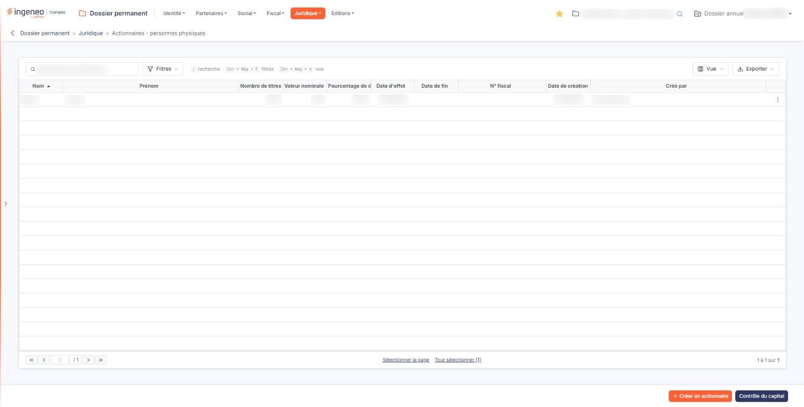
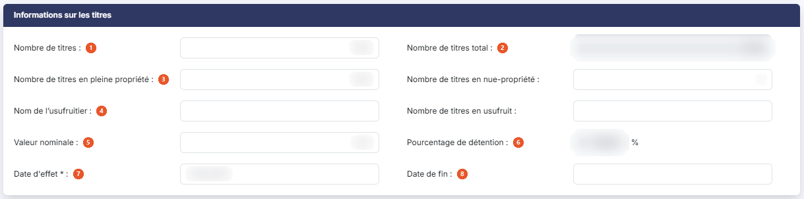

# Actionnaires - personnes physiques


**Où le trouver :** Menu **Juridique › Actionnaires - personnes physiques**



**En bref** — Cet écran recense les particuliers actionnaires de la société, avec leur état civil, leurs titres, la période de détention et un justificatif ; il se lit avec les personnes morales.

* Pour ajouter un actionnaire : bouton \[Créer un actionnaire], renseignez la fiche, puis bouton \[Enregistrer].
* Pour vérifier la répartition du capital : bouton \[Contrôle du capital], puis bouton \[Fermer].


Cette option recense les **particuliers** qui détiennent des titres de votre société. Les actionnaires qui sont des sociétés ou d'autres personnes morales se saisissent, eux, dans l'option « Actionnaires - personnes morales » : les deux options se partagent la répartition du capital, et se lisent ensemble.

<figure><figcaption>
Écran « Actionnaires - personnes physiques » de la nouvelle interface
</figcaption></figure>

Chaque fiche décrit un actionnaire, son état civil, les titres qu'il détient, la période pendant laquelle il les détient, et peut porter un document justificatif.

## La liste des actionnaires

L'écran s'ouvre sur la liste des personnes physiques déjà enregistrées, triée par défaut sur le **Nom** croissant. Au-dessus de la liste, une barre d'outils permet de la restreindre et de l'exporter ; elle est décrite plus bas. Il n'y a pas d'onglet.

**Les colonnes**

| Champ                        | Ce qu'il faut savoir                                                                                                                                                                   |
| ---------------------------- | -------------------------------------------------------------------------------------------------------------------------------------------------------------------------------------- |
| **Nom**                      | **Prénom :** l'identité de l'actionnaire.                                                                                                                                              |
| **Nombre de titres**         | Le nombre de titres détenus.                                                                                                                                                           |
| **Valeur nominale**          | La valeur d'un titre.                                                                                                                                                                  |
| **Pourcentage de détention** | La part du capital détenue. Elle est **calculée**, jamais saisie.                                                                                                                      |
| **Date d'effet**             | **Date de fin :** la période de détention. Une date de fin vide signifie que la détention est toujours en cours.                                                                       |
| **N° fiscal**                | Le numéro fiscal de l'actionnaire. C'est une colonne propre à cette option ; la liste des personnes morales ne la porte pas.                                                           |
| **Date de création**         | **Créé par :** la date à laquelle la fiche a été créée dans le logiciel, et son auteur. Ces deux colonnes ne renseignent pas sur l'actionnaire lui-même, mais sur la tenue du dossier. |

Toutes les colonnes sont triables — cliquez sur leur en-tête — et redimensionnables.

**La barre d'outils au-dessus de la liste**

* la zone « Rechercher un actionnaire… » restreint la liste aux actionnaires dont le **Nom** contient le texte saisi — le prénom n'est pas cherché ;
* le bouton **\[Filtres]** ouvre le volet « Filtrer », où vous ajoutez des critères sur les colonnes (« + Ajouter un critère sur… ») avant de cliquer sur le bouton **\[Filtrer]** ; le lien « Vider les filtres » les retire ;
* le bouton **\[Vue]** vous fait choisir les colonnes affichées et leur ordre, et enregistrer cette présentation sous « Mes vues » ;
* le bouton **\[Exporter]** propose « Aperçu édition HTML », « Imprimer », « Exporter en Excel », « Exporter en PDF » et « Envoyer la liste par e-mail ».

**Les commandes de chaque ligne**

Un clic sur une ligne la sélectionne, en vue d'une suppression groupée : il n'y a plus de case à cocher. Les autres commandes apparaissent au survol de la ligne, à droite, dans cet ordre :

* le crayon (infobulle « Modifier ») ouvre la fiche de l'actionnaire ;
* les deux feuilles superposées (infobulle « Dupliquer ») créent un nouvel actionnaire à partir de celui-ci ;
* les trois points (infobulle « Autres actions ») ouvrent un menu qui propose « Supprimer » : il supprime cet actionnaire.

**Le pied de la liste**

Vous y trouvez, à gauche, les boutons de déplacement de page — première page, page précédente, page suivante, dernière page — et une zone où saisir directement un numéro de page, suivie du nombre de pages ; au centre, les liens « Sélectionner la page » et « Tout sélectionner », qui sélectionnent d'un coup les lignes de la page affichée ou toutes les lignes ; à droite, le rappel des lignes affichées et du nombre total d'actionnaires enregistrés.

## Les boutons de la liste

bouton **\[Créer un actionnaire]**

Placé en bas à droite de l'écran. Ouvre une fiche vierge pour enregistrer un nouvel actionnaire personne physique.

bouton **\[Supprimer]**

Il n'apparaît que lorsqu'au moins une ligne est sélectionnée, dans le bandeau qui s'affiche alors sous la liste, avec le nombre d'actionnaires sélectionnés et le lien « Tout désélectionner ». Il supprime **toutes les lignes sélectionnées**, et non la seule ligne courante. Sélectionnez d'abord, supprimez ensuite.

bouton **\[Contrôle du capital]**

Placé à gauche du Bouton \[Créer un actionnaire]. Ce bouton **n'enregistre rien** et n'ouvre pas une fiche : il ouvre une fenêtre d'information intitulée « Contrôle du capital », que vous refermez par son bouton **\[Fermer]**.

La fenêtre rapproche deux valeurs, sous ces deux intitulés : « _Informations indiquées dans la fiche d'identification :_ », suivi du **Nombre de titres** de la fiche société, et « _Somme des informations saisies dans les fiches actionnaires :_ », suivi du **Nombre de titres** additionné sur les fiches d'actionnaires. Les deux valeurs sont en lecture seule.

Lorsque les deux valeurs diffèrent, une troisième ligne **Écart** s'affiche en rouge. Et lorsque les titres en nue-propriété et les titres en usufruit ne se correspondent pas, la fenêtre ajoute, en rouge également, un message d'incohérence qui rappelle les deux totaux et leur différence.

C'est le même bouton, et la même fenêtre, que sur l'option « Actionnaires - personnes morales » : la somme rapprochée porte sur les deux options ensemble.

## La fiche d'un actionnaire

La fiche se présente en trois rubriques, dans cet ordre : « Informations sur l'actionnaire », « Informations sur les titres » et « Fichier ». Elle est identique en création et en modification, à une exception près : les informations de création et de modification ne s'affichent qu'en modification, puisqu'elles n'existent pas encore sur une fiche que vous êtes en train de créer.

## c1) Rubrique « Informations sur l'actionnaire »

<figure><figcaption>
Rubrique « Informations sur l'actionnaire »
</figcaption></figure>

<figure><figcaption>
Rubrique « Informations sur l'actionnaire »
</figcaption></figure>

| Champ                                                     | Ce qu'il faut savoir                                                                                                                                                                                                                                                                                                                                                                                                                     |
| --------------------------------------------------------- | ---------------------------------------------------------------------------------------------------------------------------------------------------------------------------------------------------------------------------------------------------------------------------------------------------------------------------------------------------------------------------------------------------------------------------------------- |
| 1. **Civilité**                                           | Liste proposant « Madame » et « Monsieur », l'invite « Sélectionnez » signifiant qu'aucune n'est choisie.                                                                                                                                                                                                                                                                                                                                |
| 
2. <strong>Prénom</strong> <em>Obligatoire</em>
 | **Nom \* :** l'identité de l'actionnaire. **Les deux sont obligatoires** — c'est un écart avec l'option des personnes morales, qui n'exige qu'une raison sociale.                                                                                                                                                                                                                                                                        |
| 3. **SIREN**                                              | Le numéro d'identité, avec le bouton **\[Lire Siren]** à sa droite, qui interroge un service de renseignement d'entreprises et complète la fiche à partir de ce numéro.                                                                                                                                                                                                                                                                  |
| 4. **Nom marital**                                        | Le nom d'usage, s'il diffère du nom de naissance.                                                                                                                                                                                                                                                                                                                                                                                        |
| 5. **Associé gérant**                                     | Interrupteur, activé ou désactivé : activez-le lorsque l'actionnaire exerce aussi la gérance.                                                                                                                                                                                                                                                                                                                                            |
| 6. **Catégorie juridique**                                | Le code, non modifiable, puis le libellé, avec un pictogramme « Loupe » pour le rechercher.                                                                                                                                                                                                                                                                                                                                              |
| 7. **Fonction**                                           | La fonction exercée dans la société.                                                                                                                                                                                                                                                                                                                                                                                                     |
| 8. **E-mail Pro**                                         | , **E-mail Perso :**, **Téléphone :**, **Télécopie :** et **Mobile :** les coordonnées de l'actionnaire.                                                                                                                                                                                                                                                                                                                                 |
| 9. **Adresse**                                            | Trois zones de saisie superposées sous un seul libellé, pour les trois lignes de l'adresse.                                                                                                                                                                                                                                                                                                                                              |
| 10. **Code postal**                                       | **Ville :** la commune de résidence ; ces deux zones sont en lecture seule (« Déduit de la commune »).                                                                                                                                                                                                                                                                                                                                   |
| 11. **Code Officiel Géographique INSEE**                  | Le code géographique de la commune de résidence, non modifiable, puis son libellé. Le pictogramme « Loupe » ouvre la recherche. La zone du code ne reçoit que **trois caractères** : elle ne porte que le code de la commune au sein de son département — « 350 » pour Lille. Le numéro du département, lui, est conservé par le logiciel sans être affiché. Le code complet à cinq chiffres n'apparaît donc jamais en entier à l'écran. |
| 12. **Pays**                                              | Le code du pays, non modifiable, puis son libellé, avec un pictogramme « Loupe ».                                                                                                                                                                                                                                                                                                                                                        |
| 13. **Code postal de naissance**                          | , **Ville de naissance :**, **Code Officiel Géographique INSEE de naissance :** et **Pays de naissance :** le lieu de naissance, sur le même modèle que l'adresse de résidence. Rien n'oblige à renseigner ces zones ensemble : vous pouvez enregistrer une ville de naissance sans son code postal, et le logiciel ne vous le signale pas.                                                                                              |
| 14. **Date de naissance**                                 | Un calendrier s'ouvre sous la zone dès que vous cliquez dedans.                                                                                                                                                                                                                                                                                                                                                                          |
| 15. **N° fiscal**                                         | Le numéro fiscal de l'actionnaire.                                                                                                                                                                                                                                                                                                                                                                                                       |
| 16. **Régime fiscal**                                     | Liste proposant, dans cet ordre, « Bénéfices industriels et commerciaux », « Impôts sur les sociétés », « Bénéfices non commerciaux », « Bénéfice agricole » et « Revenus fonciers ». L'invite « Sélectionnez » signifie qu'aucun régime n'est indiqué.                                                                                                                                                                                  |
| 17. **N° de compte courant**                              | **N° de compte des règlements effectués :** les comptes comptables rattachés à cet actionnaire. Chacun porte trois pictogrammes : « Plus » pour créer le compte, « Loupe » pour le rechercher dans le plan comptable, et « Information », dont l'infobulle indique : « _Ce compte est nécessaire en cas de SCM._ ».                                                                                                                      |
| **Date de création**                                      | , **Créé par :**, **Date de modification :** et **Modifié par :** la traçabilité de la fiche, en lecture seule, affichée uniquement en modification.                                                                                                                                                                                                                                                                                     |

bouton **\[Charger un contact public]**

Placé en tête de la rubrique. Il reprend un contact déjà enregistré comme contact public pour alimenter la fiche, plutôt que de ressaisir ses coordonnées.

Le logiciel ouvre une fenêtre de choix, puis reporte les coordonnées du contact retenu dans les zones de la fiche. **Rien n'est enregistré à ce moment-là** : la fiche n'est conservée que lorsque vous cliquez sur le bouton **\[Enregistrer]**.

En revanche, les zones ainsi reprises passent **en lecture seule** — l'identité, les coordonnées et l'adresse du contact — et le bouton **\[Privatiser ce contact]** s'affiche à la place du bouton **\[Exporter dans l'annuaire]**. Il détache le contact pour rendre ces zones de nouveau modifiables.

bouton **\[Exporter dans l'annuaire]**

Placé à côté du précédent. Il **écrit en dehors de cette fiche** : il crée une fiche dans l'annuaire du cabinet, dans la catégorie des actionnaires personnes physiques, dont la raison sociale est formée du nom suivi du prénom, avec une adresse unique intitulée « Principale » et marquée adresse par défaut ; il ne met jamais à jour une fiche existante. Aucune confirmation n'est demandée : le bouton enregistre aussi la fiche d'actionnaire (création ou modification, pièce jointe comprise), la relie à l'adresse créée, puis affiche « L'actionnaire a été exporté. » et rouvre la fiche. Si une fiche portant déjà cette raison sociale existe dans la catégorie, l'export est refusé avant tout enregistrement, avec le message « Création impossible dans l'annuaire, il existe déjà une fiche avec cette raison sociale (formée par le nom et le prénom) dans la catégorie des "Actionnaires personnes physiques". ». Le bouton est en outre soumis à un droit propre.

## c2) Rubrique « Informations sur les titres »

<figure><figcaption>
Rubrique « Informations sur les titres »
</figcaption></figure>

Cette rubrique est identique à celle de l'option « Actionnaires - personnes morales ».

| Champ                                                           | Ce qu'il faut savoir                                                                                                                                                                                                                                                                                                                                                                                                                                                                                                                              |
| --------------------------------------------------------------- | ------------------------------------------------------------------------------------------------------------------------------------------------------------------------------------------------------------------------------------------------------------------------------------------------------------------------------------------------------------------------------------------------------------------------------------------------------------------------------------------------------------------------------------------------- |
| 1. **Nombre de titres**                                         | Le nombre de titres détenus par cet actionnaire. La zone affiche la valeur sans séparateur de milliers ; la liste, elle, l'affiche avec.                                                                                                                                                                                                                                                                                                                                                                                                          |
| 2. **Nombre de titres total**                                   | Non modifiable. C'est le nombre total de titres de **votre** société, tel qu'il est renseigné au menu « Identité », option « Fiche société », zone **Nombre de titres**. La même valeur s'affiche donc sur toutes les fiches d'actionnaires, personnes physiques comme personnes morales. Si elle vous paraît fausse, c'est la fiche société qu'il faut corriger.                                                                                                                                                                                 |
| 3. **Nombre de titres en pleine propriété**                     | , **Nombre de titres en nue-propriété :** et **Nombre de titres en usufruit :** la répartition des titres selon la nature du droit détenu. Le nombre de titres doit être égal à la somme des titres en pleine propriété et des titres en nue-propriété ; l'usufruit n'entre pas dans cette somme. Le contrôle ne se déclenche que si l'une au moins de ces trois zones est renseignée, et le logiciel affiche « Le nombre de titres doit être égal à la somme du nombre de titres en pleine propriété et du nombre de titres en nue-propriété. ». |
| 4. **Nom de l’usufruitier**                                     | Le nom de l'usufruitier, lorsque des titres sont détenus en nue-propriété.                                                                                                                                                                                                                                                                                                                                                                                                                                                                        |
| 5. **Valeur nominale**                                          | La valeur d'un titre.                                                                                                                                                                                                                                                                                                                                                                                                                                                                                                                             |
| 6. **Pourcentage de détention**                                 | Non modifiable, suivi du signe pour cent. Le logiciel le calcule à partir du nombre de titres détenus et du nombre de titres total de la société.                                                                                                                                                                                                                                                                                                                                                                                                 |
| 
7. <strong>Date d'effet</strong> <em>Obligatoire</em>
 | : la date à partir de laquelle l'actionnaire détient ces titres. Un calendrier s'ouvre sous la zone dès que vous cliquez dedans.                                                                                                                                                                                                                                                                                                                                                                                                                  |
| 8. **Date de fin**                                              | La date à laquelle la détention cesse. Laissez-la vide tant que l'actionnaire détient toujours ses titres.                                                                                                                                                                                                                                                                                                                                                                                                                                        |

## c3) Rubrique « Fichier »

<figure><figcaption>
Rubrique « Fichier »
</figcaption></figure>

Vous pouvez joindre un document justificatif à la fiche. Un seul document par actionnaire. Tant qu'aucun document n'est joint, la rubrique affiche « Aucun document lié ».

Le bouton **\[Lier un document]** ouvre le volet « Lier un document ». Vous y choisissez la source — « Depuis mon poste » ou « Depuis la GED » —, puis le fichier, que vous pouvez aussi déposer dans la zone prévue ; le volet annonce « Tous formats sauf .exe, .bat, .cmd, .sh — nom de 100 caractères maximum ». Le bouton **\[Lier le document]** valide ce choix, le bouton **\[Annuler]** referme le volet sans rien joindre. La taille maximale n'est pas indiquée.

bouton **\[Enregistrer]**

Enregistre la fiche.

**Revenir à la liste**

La fiche n'affiche plus de Bouton \[Retour] : vous revenez à la liste par la flèche « Revenir en arrière », placée à gauche du fil d'Ariane, **sans enregistrer** ce que vous avez saisi.

## Ce qu'il est utile de savoir avant de saisir

* **Le total du capital ne se saisit pas ici.** Il vient de la fiche société. Une répartition qui ne tombe pas juste vient donc souvent d'un nombre de titres erroné sur la fiche société, et non des fiches d'actionnaires.
* **Les deux options d'actionnaires se partagent ce total.** Pour vérifier que la répartition est complète, il faut consulter les deux listes.
* **Une détention se datant, un actionnaire sorti ne se supprime pas.** Renseignez sa **Date de fin** : vous conservez ainsi l'historique de la répartition du capital, alors qu'une suppression l'effacerait.
