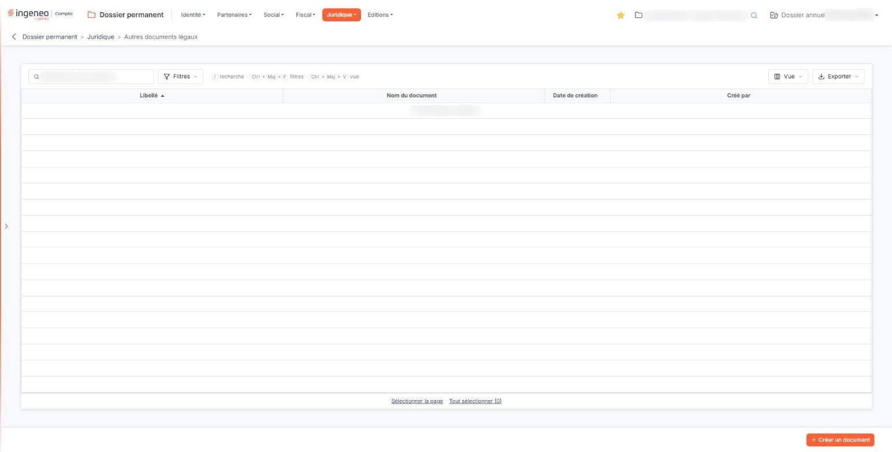
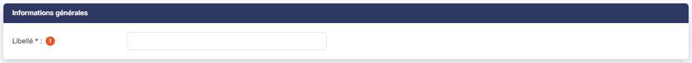
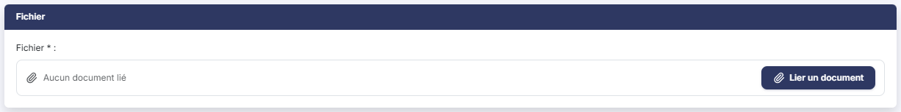

# Autres documents légaux


**Où le trouver :** Menu **Juridique › Autres documents légaux**



**En bref** — Cet écran conserve les documents légaux sans option dédiée (actes, attestations, décisions…) : chaque enregistrement porte un libellé, votre seul repère, et un document.

* Pour ajouter un document : bouton \[Créer un document], saisissez le libellé, bouton \[Lier un document], puis bouton \[Enregistrer].


Cette option conserve, dans le dossier permanent de la société, les **documents légaux qui n'ont pas d'option dédiée** : tout ce qui n'est ni les statuts, ni l'extrait K-bis, ni une convention règlementée, et que vous souhaitez pourtant garder à portée de main — procès-verbaux, actes, attestations, décisions.

<figure><figcaption>
Écran « Autres documents légaux » de la nouvelle interface
</figcaption></figure>

Le principe est simple : un enregistrement porte un libellé, qui vous servira à le retrouver, et un document.

## La liste des documents

L'écran s'ouvre sur la liste des documents déjà enregistrés, triée par défaut sur le **Libellé** croissant. Au-dessus de la liste, une barre d'outils permet de la restreindre et de l'exporter ; elle est décrite plus bas. Il n'y a pas d'onglet. Tant qu'aucun document n'est enregistré, la liste affiche « Aucun élément à afficher. »

**Les colonnes**

| Champ                | Ce qu'il faut savoir                                                                           |
| -------------------- | ---------------------------------------------------------------------------------------------- |
| **Libellé**          | Le libellé que vous avez donné à l'enregistrement. C'est votre seul repère : soignez-le.       |
| **Nom du document**  | Le nom du fichier que vous avez joint.                                                         |
| **Date de création** | **Créé par :** la date à laquelle l'enregistrement a été créé dans le logiciel, et son auteur. |

Les quatre colonnes sont triables — cliquez sur leur en-tête — et redimensionnables.

**La barre d'outils au-dessus de la liste**

* la zone « Rechercher un document… » restreint la liste aux documents dont le **Libellé** contient le texte saisi — le nom du fichier n'est pas cherché ;
* le bouton **\[Filtres]** ouvre le volet « Filtrer », où vous ajoutez des critères sur les colonnes (« + Ajouter un critère sur… ») avant de cliquer sur le bouton **\[Filtrer]** ; le lien « Vider les filtres » les retire ;
* le bouton **\[Vue]** vous fait choisir les colonnes affichées et leur ordre, et enregistrer cette présentation sous « Mes vues » ;
* le bouton **\[Exporter]** propose « Aperçu édition HTML », « Imprimer », « Exporter en Excel », « Exporter en PDF » et « Envoyer la liste par e-mail ».

Sous la liste, les liens « Sélectionner la page » et « Tout sélectionner » sélectionnent d'un coup les lignes de la page affichée, ou toutes les lignes.

**Les commandes de chaque ligne**

Un clic sur une ligne la sélectionne, en vue d'une suppression groupée : il n'y a plus de case à cocher. Les autres commandes apparaissent au survol de la ligne, à droite :

* le pictogramme « Modifier » ouvre l'enregistrement ;
* le pictogramme « Afficher l'aperçu » **télécharge** le document joint sur votre poste — ni le dessin ni l'infobulle ne disent vrai, il n'y a pas d'aperçu à l'écran ;
* le pictogramme « Autres actions » ouvre un menu qui propose « Supprimer » : il supprime l'enregistrement, document compris.

## Les boutons de la liste

bouton **\[Créer un document]**

Placé en bas à droite de l'écran. Ouvre une fiche vierge pour enregistrer un nouveau document.

bouton **\[Supprimer]**

Il n'apparaît que lorsqu'au moins une ligne est sélectionnée, dans le bandeau qui s'affiche alors sous la liste. Il supprime **toutes les lignes sélectionnées**, et non la seule ligne courante. Sélectionnez d'abord, supprimez ensuite.

## La fiche d'un document

La fiche se présente en deux rubriques, dans cet ordre : « Informations générales » et « Fichier ».

## c1) Rubrique « Informations générales »

<figure><figcaption>
Rubrique « Informations générales »
</figcaption></figure>

**Libellé** \* : obligatoire. C'est le nom sous lequel vous retrouverez le document dans la liste. Une remarque utile si vous employez aussi les options « Statuts » et « Kbis » du même menu : sur celles-ci, le libellé n'est **pas** obligatoire, alors qu'il l'est ici. Le formulaire se ressemble d'une option à l'autre, mais les obligations ne sont pas les mêmes.

## c2) Rubrique « Fichier »

<figure><figcaption>
Rubrique « Fichier »
</figcaption></figure>

**Fichier \* :obligatoire à la création** : vous ne pouvez pas enregistrer un nouveau document sans joindre un fichier. Un seul fichier par enregistrement. Tant qu'aucun fichier n'est joint, la rubrique affiche « Aucun document lié ».

Le bouton **\[Lier un document]** ouvre le volet « Lier un document ». Vous y choisissez la source — « Depuis mon poste » ou « Depuis la GED » —, puis le fichier, que vous pouvez aussi déposer dans la zone prévue ; le volet annonce « Tous formats sauf .exe, .bat, .cmd, .sh — nom de 100 caractères maximum ». Le bouton **\[Lier le document]** valide ce choix, le bouton **\[Annuler]** referme le volet sans rien joindre.

Lorsque vous rouvrez ensuite l'enregistrement pour le modifier, cette rubrique change de présentation : elle vous rappelle le nom du fichier déjà enregistré, et le fichier n'est plus obligatoire — vous pouvez modifier le seul libellé sans avoir à fournir de nouveau le document. Le bouton **\[Lier un document]** reste toutefois proposé, accompagné de la mention « Le document lié remplacera le document enregistré » : il sert alors à **remplacer** le document par un autre.

La taille maximale n'est pas indiquée.

bouton **\[Enregistrer]**

Enregistre la fiche.

**Revenir à la liste**

La fiche n'affiche plus de Bouton \[Retour] : vous revenez à la liste par la flèche « Revenir en arrière », placée à gauche du fil d'Ariane, **sans enregistrer** ce que vous avez saisi.

La fiche ne porte aucun autre bouton, aucun pictogramme de recherche et aucun calendrier.
