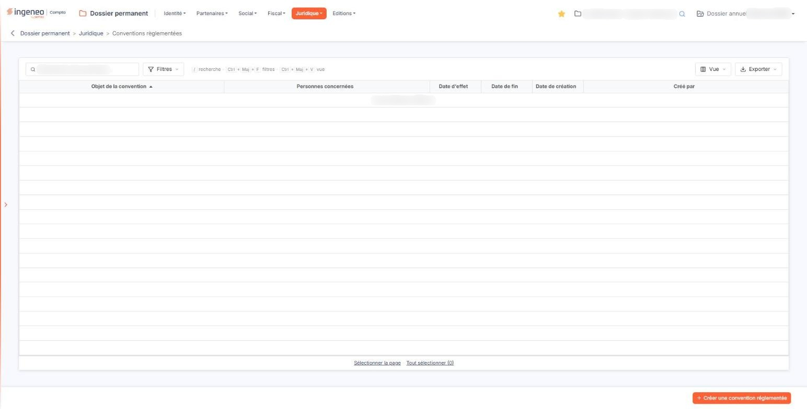
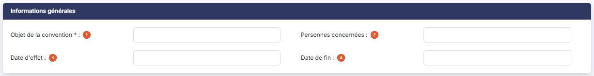
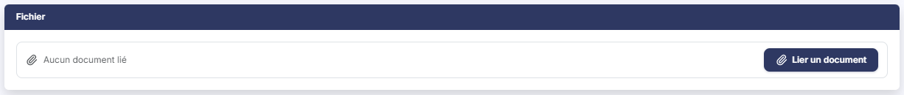

# Conventions règlementées


**Où le trouver :** Menu **Juridique › Conventions règlementées**



**En bref** — Cet écran recense les conventions règlementées entre la société et ses dirigeants ou associés : objet, personnes concernées, période d'application et document.

* Pour enregistrer une convention : bouton \[Créer une convention réglementée], renseignez la fiche, puis bouton \[Enregistrer].
* Pour joindre le document : bouton \[Lier un document] dans la fiche.


Cette option tient la liste des **conventions règlementées** de la société : les conventions passées entre la société et ses dirigeants ou ses associés, qui doivent être recensées et présentées à l'assemblée. Vous y consignez l'objet de chaque convention, les personnes qui y sont parties, la période pendant laquelle elle s'applique, et vous pouvez y joindre le document.

<figure><figcaption>
Écran « Conventions règlementées » de la nouvelle interface
</figcaption></figure>

C'est un recensement : vous y consignez les conventions, sans autre traitement depuis cet écran.

## La liste des conventions

L'écran s'ouvre sur la liste des conventions déjà enregistrées, triée par défaut sur l'**Objet de la convention** croissant. Au-dessus de la liste, une barre d'outils permet de la restreindre et de l'exporter ; elle est décrite plus bas. Il n'y a pas d'onglet. Tant qu'aucune convention n'est enregistrée, la liste affiche « Aucun élément à afficher. »

**Les colonnes**

| Champ                      | Ce qu'il faut savoir                                                                                                                                                                               |
| -------------------------- | -------------------------------------------------------------------------------------------------------------------------------------------------------------------------------------------------- |
| **Objet de la convention** | L'objet que vous avez saisi. C'est votre repère principal dans la liste.                                                                                                                           |
| **Personnes concernées**   | Les personnes parties à la convention, telles que vous les avez écrites.                                                                                                                           |
| **Date d'effet**           | **Date de fin :** la période d'application de la convention.                                                                                                                                       |
| **Date de création**       | **Créé par :** la date à laquelle la convention a été enregistrée dans le logiciel, et son auteur. Ces deux colonnes ne renseignent pas sur la convention elle-même, mais sur la tenue du dossier. |

Toutes les colonnes sont triables — cliquez sur leur en-tête — et redimensionnables. La colonne **Personnes concernées** se trie comme du texte, dans l'ordre où vous avez saisi les noms.

**La barre d'outils au-dessus de la liste**

* la zone « Rechercher une convention… » restreint la liste aux conventions dont l'**Objet de la convention** contient le texte saisi ;
* le bouton **\[Filtres]** ouvre le volet « Filtrer », où vous ajoutez des critères sur les colonnes (« + Ajouter un critère sur… ») avant de cliquer sur le bouton **\[Filtrer]** ; le lien « Vider les filtres » les retire ;
* le bouton **\[Vue]** vous fait choisir les colonnes affichées et leur ordre (« Colonnes affichées », « Rétablir les colonnes d'origine »), et enregistrer cette présentation sous « Mes vues » ;
* le bouton **\[Exporter]** propose « Aperçu édition HTML », « Imprimer », « Exporter en Excel », « Exporter en PDF » et « Envoyer la liste par e-mail ».

Sous la liste, les liens « Sélectionner la page » et « Tout sélectionner » sélectionnent d'un coup les lignes de la page affichée, ou toutes les lignes.

## Les boutons de la liste

bouton **\[Créer une convention réglementée]**

Placé en bas à droite de l'écran. Ouvre une fiche vierge pour enregistrer une nouvelle convention.

bouton **\[Supprimer]**

Il supprime **toutes les lignes sélectionnées**, et non la seule ligne courante.

## La fiche d'une convention

La fiche se présente en deux rubriques, dans cet ordre : « Informations générales » et « Fichier ».

## c1) Rubrique « Informations générales »

<figure><figcaption>
Rubrique « Informations générales »
</figcaption></figure>

| Champ                                                                     | Ce qu'il faut savoir                                                                                                                                                                                                                                                                                                                                                                                                                                                              |
| ------------------------------------------------------------------------- | --------------------------------------------------------------------------------------------------------------------------------------------------------------------------------------------------------------------------------------------------------------------------------------------------------------------------------------------------------------------------------------------------------------------------------------------------------------------------------- |
| 
1. <strong>Objet de la convention</strong> <em>Obligatoire</em>
 | Seule information obligatoire de la fiche. C'est le libellé sous lequel la convention apparaîtra dans la liste.                                                                                                                                                                                                                                                                                                                                                                   |
| 2. **Personnes concernées**                                               | Les personnes parties à la convention. **C'est une zone de texte libre sur une seule ligne**, et non une liste où choisir des noms : le logiciel ne propose rien et ne vérifie rien. En particulier, cette zone **n'est pas rattachée aux actionnaires** que vous avez saisis dans les options « Actionnaires - personnes morales » et « Actionnaires - personnes physiques » du même menu : un nom saisi ici n'y renvoie pas, et un actionnaire supprimé là-bas reste écrit ici. |
| 3. **Date d'effet**                                                       | La date à partir de laquelle la convention s'applique. Elle n'est **pas** obligatoire ici. Un calendrier s'ouvre sous la zone dès que vous cliquez dedans.                                                                                                                                                                                                                                                                                                                        |
| 4. **Date de fin**                                                        | La date à laquelle la convention cesse de s'appliquer. Le même calendrier s'ouvre lorsque vous cliquez dans la zone.                                                                                                                                                                                                                                                                                                                                                              |

## c2) Rubrique « Fichier »

<figure><figcaption>
Rubrique « Fichier »
</figcaption></figure>

Vous pouvez joindre la convention elle-même. Ce n'est **pas obligatoire** : une convention peut être recensée sans son document. Un seul fichier par convention. Tant qu'aucun document n'est joint, la rubrique affiche « Aucun document lié ».

Le bouton **\[Lier un document]** ouvre le volet « Lier un document ». Vous y choisissez la source — « Depuis mon poste » ou « Depuis la GED » —, puis le fichier, que vous pouvez aussi déposer dans la zone prévue ; le volet annonce « Tous formats sauf .exe, .bat, .cmd, .sh — nom de 100 caractères maximum ». Le bouton **\[Lier le document]** valide ce choix, le bouton **\[Annuler]** referme le volet sans rien joindre. La taille maximale n'est pas indiquée.

bouton **\[Enregistrer]**

Enregistre la fiche.

**Revenir à la liste**

La fiche n'affiche plus de Bouton \[Retour] : vous revenez à la liste par la flèche « Revenir en arrière », placée à gauche du fil d'Ariane, **sans enregistrer** ce que vous avez saisi.

La fiche ne porte aucun autre bouton, aucun pictogramme de recherche, aucun chargement de contact et aucun export.
