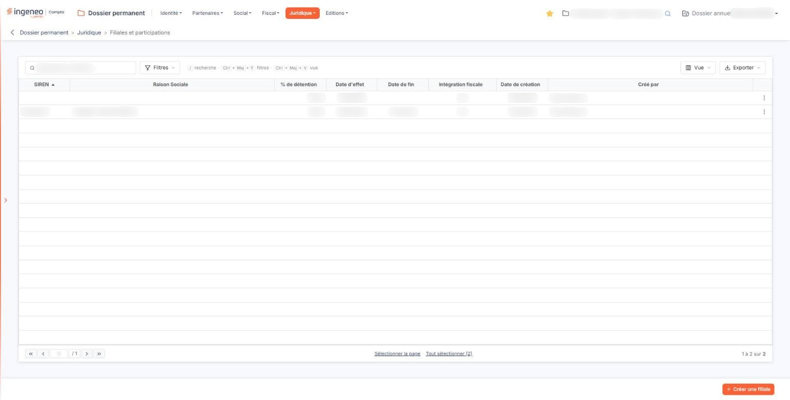
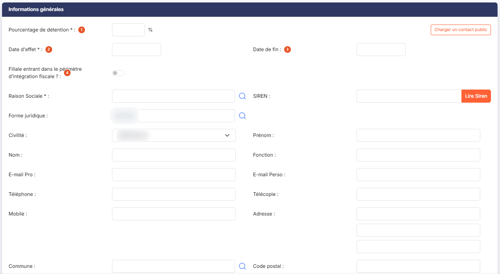
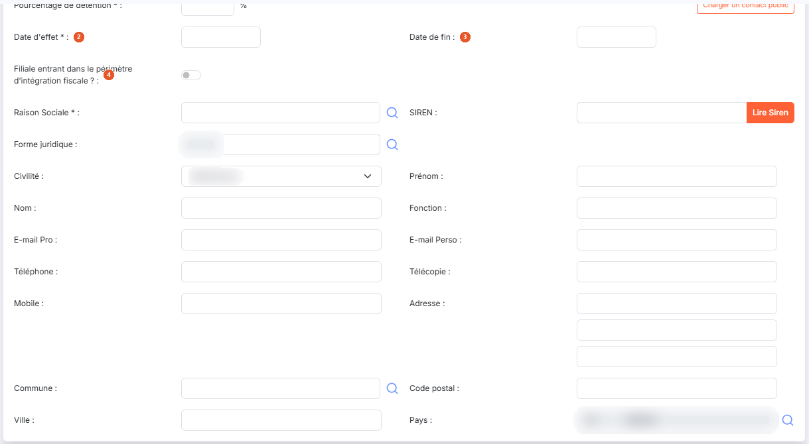
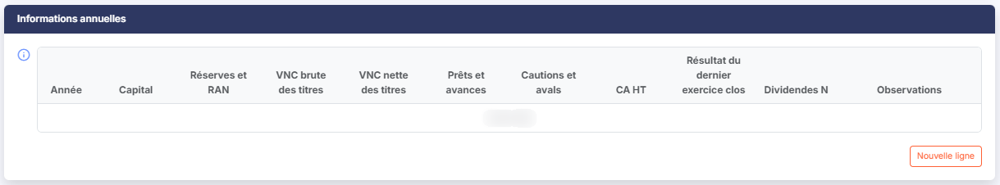

# Filiales et participations


**Où le trouver :** Menu **Juridique › Filiales et participations**



**En bref** — Cet écran recense les filiales et participations de la société : part détenue, période, intégration fiscale, données financières annuelles et document. La fiche change selon la réponse sur l'intégration fiscale.

* Pour ajouter une filiale : bouton \[Créer une filiale], renseignez la fiche, puis bouton \[Enregistrer].
* Pour saisir les données financières d'une année : bouton \[Nouvelle ligne] sous le tableau ; bouton \[Supprimer la dernière ligne] pour la retirer.


Cette option vous permet de recenser les filiales et les participations de la société : les sociétés dont elle détient une part du capital, la proportion de cette détention, la période pendant laquelle elle l'a détenue, et son appartenance ou non au périmètre d'intégration fiscale.

<figure><figcaption>
Écran « Filiales et participations » de la nouvelle interface
</figcaption></figure>

Pour chacune, vous pouvez en outre consigner les données financières annuelles — capital, réserves, valeur des titres, chiffre d'affaires, résultat, dividendes — et joindre un document.

**La fiche de cette option se présente de deux façons très différentes** selon la réponse que vous donnez à la question de l'intégration fiscale. C'est le point essentiel de cet écran, et il est détaillé à la rubrique b).

## Ce que présente l'écran

L'écran s'ouvre sur la liste des filiales et participations déjà enregistrées. Cette liste ne comporte pas d'onglet ; au-dessus d'elle, une barre porte une zone de recherche et trois boutons, décrits plus bas.

Les colonnes sont les suivantes, dans leur ordre d'affichage.

| Champ                   | Ce qu'il faut savoir                                                                                                                                                                                                         |
| ----------------------- | ---------------------------------------------------------------------------------------------------------------------------------------------------------------------------------------------------------------------------- |
| **SIREN**               | Le numéro d'identification de la société détenue. C'est sur cette colonne que le logiciel établit le tri initial de la liste, par ordre croissant.                                                                           |
| **Raison Sociale**      | Sa dénomination.                                                                                                                                                                                                             |
| **% de détention**      | La proportion du capital détenue. Notez que cette colonne s'intitule ici avec le signe pour cent, alors que le champ correspondant de la fiche s'intitule **Pourcentage de détention :** — il s'agit de la même information. |
| **Date d'effet**        | **Date de fin :** les bornes de la détention. La date de fin reste vide tant que la participation est en cours.                                                                                                              |
| **Intégration fiscale** | Cette colonne affiche « Oui » lorsque la filiale entre dans le périmètre d'intégration fiscale.                                                                                                                              |
| **Date de création**    | **Créé par :** la date à laquelle la fiche a été enregistrée dans le logiciel, et son auteur.                                                                                                                                |

Toutes ces colonnes peuvent être triées en cliquant sur leur titre, et leur largeur peut être ajustée.

**La barre au-dessus de la liste**

La zone « Rechercher une filiale… » restreint la liste au fil de la saisie.

bouton **\[Filtres]** : ouvre un volet « Filtrer » où vous ajoutez des critères colonne par colonne. Il ne se limite pas aux huit colonnes affichées : il propose aussi le code de la société gérée, les dates d'entrée et de sortie du périmètre d'intégration, l'impôt étranger, la forme juridique, chacune des coordonnées de la société détenue, la date de modification et l'auteur de la modification.

bouton **\[Vue]** : permet de choisir les colonnes affichées — huit des trente colonnes disponibles le sont à l'ouverture — et d'enregistrer l'état de la liste sous un nom.

bouton **\[Exporter]** : propose l'aperçu, l'impression, l'export en Excel ou en PDF et l'envoi de la liste par e-mail.

**Les commandes d'une ligne**

Un clic sur une ligne la sélectionne. Au survol d'une ligne apparaissent, à son extrémité droite, trois pictogrammes.

Le pictogramme « Crayon », d'infobulle « Modifier », ouvre la fiche de la filiale ou de la participation.

Le pictogramme à deux feuilles superposées, d'infobulle « Dupliquer », reprend la ligne pour en établir une nouvelle.

Le pictogramme à trois points verticaux, d'infobulle « Autres actions », ouvre un menu qui propose « Supprimer », pour supprimer la ligne.

**Sélectionner plusieurs lignes**

Sous la liste, le lien « Sélectionner la page » sélectionne toutes les lignes de la page affichée ; le lien « Tout sélectionner », suivi du nombre de lignes de la liste, étend la sélection à toutes les pages. Le choix des colonnes affichées se fait par le bouton **\[Vue]**, décrit plus haut.

**Le bas de l'écran**

Sous la liste, la barre de pagination vous permet d'aller à la première page, à la page précédente, à la page suivante ou à la dernière, ou de saisir directement un numéro de page. À sa droite, le logiciel indique les lignes affichées et le nombre total de lignes enregistrées.

Deux boutons complètent la liste.

bouton **\[Créer une filiale]**

Placé en bas à droite de l'écran, il ouvre une fiche vierge.

bouton **\[Supprimer]**

Sélectionnez les lignes à supprimer en cliquant dessus : un bandeau apparaît en bas de l'écran ; il indique le nombre de lignes sélectionnées (« 1 filiale sélectionnée »), propose le lien « Tout désélectionner » et porte ce bouton, qui supprime en une seule fois toutes les lignes sélectionnées.

## La fiche, et la question qui la transforme

<figure><figcaption>
Rubrique « La fiche, et la question qui la transforme »
</figcaption></figure>

<figure><figcaption>
Rubrique « La fiche, et la question qui la transforme »
</figcaption></figure>

La fiche présente trois rubriques, dans cet ordre : « Informations générales », « Informations annuelles » puis « Fichier ». Elle ne comporte aucun onglet.

Dans la première rubrique, quatre champs vous sont demandés d'emblée, quelle que soit la suite.

| Champ                                                            | Ce qu'il faut savoir                                                                                                                                                                                                                                                                                                                                                                                                                                                                                                                                                                                                                                                                                                                                                                                                                                                                                                                                                                                                                                                                                                                                                                                                                                                                                                                                                                                                                                                                                                                                                                                                                                                                                                                                                                                                                                                                                                                                                                                                                                                                                                                                                                                                                                                                                                                                                                                                                                                                                                                                                                                                                                                                                                                                                                                                                                                                                                                                                                                                                                                                                                                                                                                                                                                                              |
| ---------------------------------------------------------------- | ------------------------------------------------------------------------------------------------------------------------------------------------------------------------------------------------------------------------------------------------------------------------------------------------------------------------------------------------------------------------------------------------------------------------------------------------------------------------------------------------------------------------------------------------------------------------------------------------------------------------------------------------------------------------------------------------------------------------------------------------------------------------------------------------------------------------------------------------------------------------------------------------------------------------------------------------------------------------------------------------------------------------------------------------------------------------------------------------------------------------------------------------------------------------------------------------------------------------------------------------------------------------------------------------------------------------------------------------------------------------------------------------------------------------------------------------------------------------------------------------------------------------------------------------------------------------------------------------------------------------------------------------------------------------------------------------------------------------------------------------------------------------------------------------------------------------------------------------------------------------------------------------------------------------------------------------------------------------------------------------------------------------------------------------------------------------------------------------------------------------------------------------------------------------------------------------------------------------------------------------------------------------------------------------------------------------------------------------------------------------------------------------------------------------------------------------------------------------------------------------------------------------------------------------------------------------------------------------------------------------------------------------------------------------------------------------------------------------------------------------------------------------------------------------------------------------------------------------------------------------------------------------------------------------------------------------------------------------------------------------------------------------------------------------------------------------------------------------------------------------------------------------------------------------------------------------------------------------------------------------------------------------------------------------- |
| 1. **Pourcentage de détention**                                  | La proportion du capital détenue, suivie du signe pour cent. Ce champ est **obligatoire**.                                                                                                                                                                                                                                                                                                                                                                                                                                                                                                                                                                                                                                                                                                                                                                                                                                                                                                                                                                                                                                                                                                                                                                                                                                                                                                                                                                                                                                                                                                                                                                                                                                                                                                                                                                                                                                                                                                                                                                                                                                                                                                                                                                                                                                                                                                                                                                                                                                                                                                                                                                                                                                                                                                                                                                                                                                                                                                                                                                                                                                                                                                                                                                                                        |
| 2. **Date d'effet**                                              | La date à laquelle la détention a pris effet. Ce champ est **obligatoire** ; un clic dans le champ ouvre un calendrier qui vous aide à le renseigner.                                                                                                                                                                                                                                                                                                                                                                                                                                                                                                                                                                                                                                                                                                                                                                                                                                                                                                                                                                                                                                                                                                                                                                                                                                                                                                                                                                                                                                                                                                                                                                                                                                                                                                                                                                                                                                                                                                                                                                                                                                                                                                                                                                                                                                                                                                                                                                                                                                                                                                                                                                                                                                                                                                                                                                                                                                                                                                                                                                                                                                                                                                                                             |
| 3. **Date de fin**                                               | La date à laquelle elle a cessé, à laisser vide si la détention est en cours. Facultatif.                                                                                                                                                                                                                                                                                                                                                                                                                                                                                                                                                                                                                                                                                                                                                                                                                                                                                                                                                                                                                                                                                                                                                                                                                                                                                                                                                                                                                                                                                                                                                                                                                                                                                                                                                                                                                                                                                                                                                                                                                                                                                                                                                                                                                                                                                                                                                                                                                                                                                                                                                                                                                                                                                                                                                                                                                                                                                                                                                                                                                                                                                                                                                                                                         |
| 4. **Filiale entrant dans le périmètre d’intégration fiscale ?** | 
Un interrupteur, activé ou désactivé. <strong>C'est lui qui décide de tout ce qui suit</strong> : sur une fiche vierge il est <strong>désactivé</strong>. <strong>Deux fiches en une, et aucun message pour vous en avertir</strong> Lorsque vous basculez cet interrupteur, <strong>la moitié de la fiche change</strong> : des champs apparaissent, d'autres disparaissent, des champs jusque-là saisissables cessent de l'être, des boutons et des pictogrammes de recherche apparaissent ou s'en vont, et les champs marqués obligatoires ne sont plus les mêmes. Le logiciel n'affiche <strong>aucun message</strong> pour vous le signaler : c'est à vous de savoir dans quel des deux cas vous vous trouvez. <strong>L'interrupteur désactivé — vous saisissez l'identité</strong> C'est l'état d'une fiche vierge. Aucun champ propre à l'intégration fiscale ne vous est demandé, et <strong>toute l'identité de la société détenue est à votre saisie</strong> : <strong>Raison Sociale :</strong> — le seul champ obligatoire de ce bloc —, <strong>SIREN :</strong>, <strong>Forme juridique :</strong>, <strong>Civilité :</strong>, <strong>Prénom :</strong>, <strong>Nom :</strong>, <strong>Fonction :</strong>, <strong>E-mail Pro :</strong>, <strong>E-mail Perso :</strong>, <strong>Téléphone :</strong>, <strong>Télécopie :</strong>, <strong>Mobile :</strong>, <strong>Adresse :</strong> — sur trois lignes sous un libellé unique —, <strong>Commune :</strong>, <strong>Code postal :</strong>, <strong>Ville :</strong> et <strong>Pays :</strong>. La zone « Commune » porte l'invite « Commune » : saisissez le début du nom, ou ouvrez la loupe (panneau « Sélection d'une commune »). Les zones « Code postal » et « Ville » portent l'invite « Déduit de la commune ». Quatre pictogrammes « Loupe » vous sont proposés dans cet état, sur <strong>Raison Sociale :</strong>, sur <strong>Forme juridique :</strong>, sur <strong>Commune :</strong> et sur <strong>Pays :</strong>, pour choisir la valeur au lieu de la taper. Les deux champs de code, celui de la forme juridique et celui du pays, restent d'ailleurs non modifiables : ils sont renseignés par la loupe de leur ligne. Deux boutons vous évitent une partie de la saisie. bouton <strong>[Lire Siren]</strong> Renseigne l'identité de la société à partir de son numéro SIREN. bouton <strong>[Charger un contact public]</strong> Reprend les coordonnées d'un contact déjà connu au lieu de les ressaisir. Le logiciel ouvre une fenêtre de choix, puis reporte ces coordonnées dans les zones de la fiche : <strong>rien n'est enregistré à ce moment-là</strong>, la fiche n'étant conservée que lorsque vous cliquez sur le bouton <strong>[Enregistrer]</strong>. En revanche, les zones ainsi reprises passent <strong>en lecture seule</strong>, et un bouton <strong>[Privatiser ce contact]</strong> s'affiche pour les rendre de nouveau modifiables. <strong>L'interrupteur activé — l'identité est reprise, et trois à cinq champs apparaissent</strong> Trois champs vous sont alors demandés en plus, dans cet ordre — et deux autres s'y ajoutent, mais seulement lorsque le pays de la société détenue n'est pas la France.
 |
| **Code de la société gérée**                                     | 
Le code de la société détenue parmi celles que vous gérez. Ce champ est <strong>obligatoire</strong>, et son pictogramme « Loupe » vous permet de la choisir. <strong>Date d'entrée dans le périmètre :obligatoire</strong>.
                                                                                                                                                                                                                                                                                                                                                                                                                                                                                                                                                                                                                                                                                                                                                                                                                                                                                                                                                                                                                                                                                                                                                                                                                                                                                                                                                                                                                                                                                                                                                                                                                                                                                                                                                                                                                                                                                                                                                                                                                                                                                                                                                                                                                                                                                                                                                                                                                                                                                                                                                                                                                                                                                                                                                                                                                                                                                                                                                                                                                                                            |
| **Date de sortie du périmètre**                                  | Facultative, à laisser vide tant que la filiale est dans le périmètre.                                                                                                                                                                                                                                                                                                                                                                                                                                                                                                                                                                                                                                                                                                                                                                                                                                                                                                                                                                                                                                                                                                                                                                                                                                                                                                                                                                                                                                                                                                                                                                                                                                                                                                                                                                                                                                                                                                                                                                                                                                                                                                                                                                                                                                                                                                                                                                                                                                                                                                                                                                                                                                                                                                                                                                                                                                                                                                                                                                                                                                                                                                                                                                                                                            |
| **Statut de l'entreprise**                                       | Ce champ n'apparaît **que si le pays de la société détenue n'est pas la France** ; dès lors qu'il apparaît, il est **obligatoire**, à choisir dans une liste de trois valeurs : « Société intermédiaire », « Entité mère non résidente » ou « Société étrangère ».                                                                                                                                                                                                                                                                                                                                                                                                                                                                                                                                                                                                                                                                                                                                                                                                                                                                                                                                                                                                                                                                                                                                                                                                                                                                                                                                                                                                                                                                                                                                                                                                                                                                                                                                                                                                                                                                                                                                                                                                                                                                                                                                                                                                                                                                                                                                                                                                                                                                                                                                                                                                                                                                                                                                                                                                                                                                                                                                                                                                                                |
| **Impôt étranger équivalent à l'impôt sur les sociétés**         | Ce champ apparaît dans la même condition que le précédent, et lui reste facultatif, en quarante caractères au plus.                                                                                                                                                                                                                                                                                                                                                                                                                                                                                                                                                                                                                                                                                                                                                                                                                                                                                                                                                                                                                                                                                                                                                                                                                                                                                                                                                                                                                                                                                                                                                                                                                                                                                                                                                                                                                                                                                                                                                                                                                                                                                                                                                                                                                                                                                                                                                                                                                                                                                                                                                                                                                                                                                                                                                                                                                                                                                                                                                                                                                                                                                                                                                                               |

Sur une filiale française, ces deux derniers champs ne vous sont donc pas présentés : ne les cherchez pas, l'écran ne les affiche que pour une société détenue à l'étranger.

Dans le même temps, **toute l'identité de la société détenue cesse d'être modifiable** — de la raison sociale au pays, en passant par le contact et l'adresse — puisqu'elle est reprise de la société gérée que vous désignez. Les bouton **\[Lire Siren]** et bouton **\[Charger un contact public]** disparaissent, ainsi que les trois pictogrammes « Loupe » de l'identité ; seule reste celle du code de la société gérée. Enfin, **SIREN :**, **Forme juridique :**, **Adresse :**, **Code postal :**, **Ville :** et **Pays :** s'affichent alors comme obligatoires, bien qu'ils ne soient pas saisissables : ces informations sont attendues, mais c'est la fiche de la société gérée qui doit les porter.

**Renseignez donc toujours le code de la société gérée.** S'il reste vide alors que l'interrupteur est activé, l'identité de la filiale reste à la fois **vide et non modifiable** : la ligne apparaît alors dans la liste sans SIREN ni raison sociale, et rien à l'écran ne vous explique pourquoi vous ne pouvez pas la corriger. Si vous rencontrez une telle ligne, renseignez son code de société gérée, ou désactivez son interrupteur pour saisir l'identité à la main.

**La traçabilité de la fiche**

La rubrique se termine par quatre informations que le logiciel renseigne lui-même et que vous ne pouvez pas modifier : **Date de création :** et **Créé par :**, puis **Date de modification :** et **Modifié par :**. Elles n'apparaissent que sur une fiche existante ; une fiche vierge ne les affiche pas.

## Rubrique « Informations annuelles »

<figure><figcaption>
Rubrique « Informations annuelles »
</figcaption></figure>

Cette deuxième rubrique vous permet de consigner, année après année, les données financières de la société détenue. Elle se présente comme un tableau de saisie, dont les colonnes sont les suivantes, dans leur ordre d'affichage.

**Le pictogramme « Information » de l'en-tête**

À gauche de la première colonne, un pictogramme « Information » précise ce qui est attendu dans chaque colonne, et surtout **dans quelle monnaie** : le **Capital** et les **Réserves et RAN** se saisissent **dans la monnaie locale d'opération**, toutes les autres valeurs **en euros**.

Il précise également que les **Réserves et RAN** s'entendent avant affectation des résultats, que les **Prêts et avances** sont ceux consentis par la société et non encore remboursés à la clôture de l'exercice, que le **CA HT** et le **Résultat du dernier exercice clos** portent sur le dernier exercice écoulé, que les **Dividendes N** sont ceux encaissés par la société au cours de l'exercice, et que les **Observations** reçoivent notamment un écart de réévaluation sur les titres détenus, une provision sur les prêts et avances, ou un exercice de clôture qui ne coïncide pas avec celui de la société. Lisez-le avant votre première saisie : ces précisions ne figurent nulle part ailleurs à l'écran.

Tant qu'aucune donnée annuelle n'a été consignée, le tableau affiche « Liste vide ». Ce tableau n'est pas une liste comme celle de l'écran d'accueil : ses colonnes ne se trient pas, il n'a pas de pagination, et son en-tête ne porte ni case de sélection ni personnalisation des colonnes.

bouton **\[Nouvelle ligne]**

Placé sous le tableau, ce bouton ajoute une **ligne de saisie** — sans quitter la fiche et sans recharger l'écran.

L'**Année** y est **préremplie** : l'année en cours pour la première ligne, puis l'année suivante à chaque ligne ajoutée. Vous pouvez la corriger ; elle se saisit sur quatre chiffres.

Les neuf colonnes de montants attendent des nombres à deux décimales. Seules les **Réserves et RAN** et le **Résultat du dernier exercice clos** acceptent une valeur **négative** ; les autres n'acceptent que des valeurs positives.

La colonne **Observations** est une zone de texte de **cent cinquante caractères** au plus, sur plusieurs lignes.

bouton **\[Supprimer la dernière ligne]**

Placé à droite du précédent, ce bouton retire la **dernière** ligne du tableau. Il n'apparaît que lorsque le tableau porte au moins une ligne.

C'est la **seule** commande de suppression de ce tableau : les lignes ne portent pas de croix, et vous ne pouvez donc pas retirer une ligne du milieu sans retirer aussi celles qui la suivent.

## Rubrique « Fichier »

<figure><figcaption>
Rubrique « Fichier »
</figcaption></figure>

La troisième rubrique est **facultative** : elle vous permet de joindre un document à la filiale ou à la participation, par exemple l'organigramme du groupe ou une attestation de détention. Tant qu'aucun document n'est joint, elle affiche « Aucun document lié ».

bouton **\[Lier un document]** : ouvre la fenêtre « Lier un document », qui propose deux sources. « Depuis mon poste » vous permet de déposer un document dans la zone prévue ou de parcourir vos fichiers ; tous les formats sont acceptés sauf .exe, .bat, .cmd et .sh, et le nom du fichier ne doit pas dépasser 100 caractères. « Depuis la GED » vous permet de choisir le document dans la GED. Le bouton **\[Lier le document]** joint le document choisi ; le bouton **\[Annuler]** referme la fenêtre sans rien joindre.

## Les boutons de la fiche

bouton **\[Enregistrer]**

Enregistre la fiche.

**La flèche « Revenir en arrière »**

Placée à gauche du fil d'Ariane, elle vous ramène à la liste sans rien enregistrer.

## Points à connaître

| Champ                                                                                | Ce qu'il faut savoir                                                                                                                                        |
| ------------------------------------------------------------------------------------ | ----------------------------------------------------------------------------------------------------------------------------------------------------------- |
| **La bascule de l'intégration fiscale ne s'annonce pas**                             | Relisez la rubrique b) avant de la manoeuvrer sur une fiche déjà renseignée, car elle change les champs affichés, leur saisissabilité et leurs obligations. |
| **Le tableau des informations annuelles est indépendant de la période de détention** | Vous y ajoutez une ligne par année pour laquelle vous disposez des chiffres, et vous n'êtes pas tenu de le remplir pour enregistrer la fiche.               |
