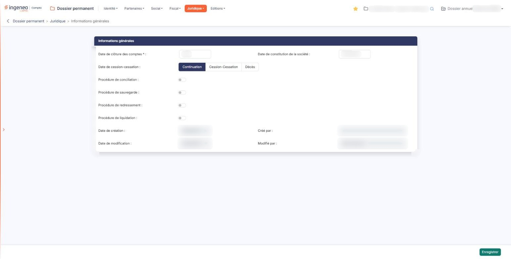
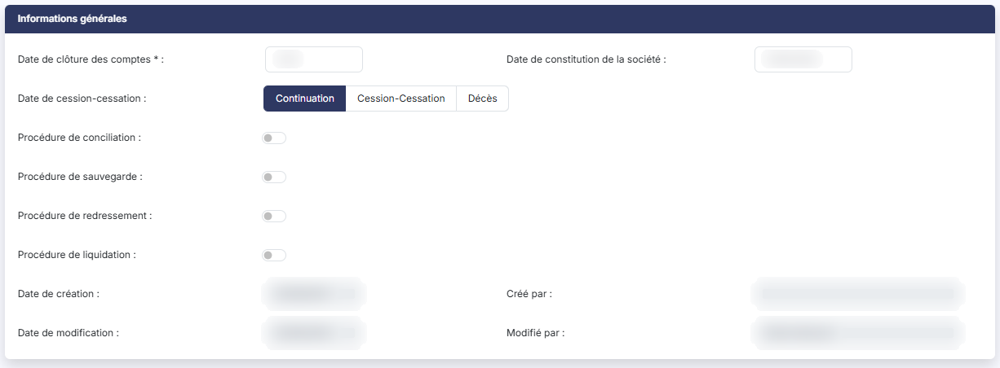

# Informations générales


**Où le trouver :** Menu **Juridique › Informations générales**



**En bref** — Cette fiche unique porte les informations juridiques de la société : date de clôture des comptes, date de constitution, poursuite ou cessation d'activité et procédures collectives. Elle vaut pour tous les exercices.

* Pour compléter la fiche : renseignez au moins la Date de clôture des comptes, puis bouton \[Enregistrer].


Cette option porte les informations juridiques de la vie de la société : la date à laquelle elle clôture ses comptes, la date de sa constitution, le fait qu'elle poursuive son activité ou qu'elle l'ait cessée, et les procédures collectives dont elle fait ou a fait l'objet.

<figure><figcaption>
Écran « Informations générales » de la nouvelle interface
</figcaption></figure>

**Ce n'est pas une liste, mais une fiche unique.** L'option ne présente ni liste, ni bouton **\[Nouveau]** : elle s'ouvre directement sur la fiche de la société, prête à être complétée. Vous n'avez donc rien à créer ni à sélectionner — vous complétez, puis vous enregistrez. Cette fiche est attachée à la société, et non à l'un de ses dossiers annuels : vous retrouvez la même fiche, avec les mêmes valeurs, quel que soit l'exercice ouvert, et une modification vaut pour tous.

La fiche comporte une seule rubrique, « Informations générales », et un seul champ obligatoire, la **Date de clôture des comptes :**. Une partie de ses champs n'apparaît qu'en fonction de vos réponses : ils sont signalés au fil des rubriques ci-dessous.

## Les dates de vie de la société

<figure><figcaption>
Rubrique « Les dates de vie de la société »
</figcaption></figure>

**Date de clôture des comptes**

C'est le **seul champ obligatoire** de l'écran, et le seul qui demande une attention particulière.

**Malgré son libellé, ce n'est pas une date complète : le champ n'attend que le jour et le mois**, sous la forme **31/12** pour une société qui clôture au 31 décembre. Il n'accepte pas d'année, et aucun calendrier ne lui est associé : une clôture se répète chaque année, seul le jour et le mois la caractérisent.

**Date de constitution de la société**

La date de constitution, en date complète cette fois. Ce champ est facultatif ; un clic dans le champ ouvre un calendrier qui vous aide à le renseigner.

**Date de cession-cessation**

**Malgré son libellé, cette ligne ne vous demande pas une date : elle vous demande un choix**, entre trois boutons présentés côte à côte. La date, elle, apparaît ensuite à droite de la ligne, sous un libellé propre au choix que vous avez fait.

Les trois choix sont **exclusifs** : un seul est retenu à la fois, et « Continuation » est celui qui est retenu au départ.

**Choix « Continuation »**

La société poursuit son activité. Aucune date supplémentaire ne vous est demandée.

**Choix « Cession-Cessation »**

La société a cédé ou cessé son activité. Le logiciel révèle alors, à droite de la ligne, le champ **Date de cessation d'activité :** — facultatif ; un clic dans le champ ouvre un calendrier.

**Choix « Décès »**

L'activité a pris fin par le décès de l'exploitant. Le logiciel révèle alors, à droite de la ligne, le champ **Date de décès de l'exploitant :** — facultatif ; un clic dans le champ ouvre un calendrier.

Si vous passez d'un choix à l'autre, la date du choix précédent disparaît de l'écran en même temps qu'apparaît celle du nouveau : à tout moment, une seule date de fin d'activité vous est présentée.

## Les procédures collectives

Quatre lignes suivent, construites toutes les quatre de la même façon, dans cet ordre : **Procédure de conciliation :**, **Procédure de sauvegarde :**, **Procédure de redressement :** et **Procédure de liquidation :**.

Chacune porte un interrupteur, activé ou désactivé. Tant qu'il est **désactivé**, la ligne se limite à son libellé. Dès que vous l'**activez**, le logiciel révèle sur cette même ligne **deux dates** : une **Date de début :** et une **Date de fin :**, toutes deux facultatives ; un clic dans chacune ouvre un calendrier.

Les quatre lignes sont **indépendantes** : vous pouvez en ouvrir plusieurs, ou les quatre, une société pouvant avoir connu plusieurs procédures successives.

**Repérez chaque date par sa ligne, non par son libellé**

C'est le point le plus délicat de cet écran. Lorsque plusieurs procédures sont **activées**, l'écran affiche plusieurs champs **Date de début :** et plusieurs champs **Date de fin :** qui portent **exactement le même libellé**. Rien dans le libellé ne dit à quelle procédure la date se rapporte.

C'est **la ligne** qui le dit, et elle seule : la date de début et la date de fin d'une procédure sont celles qui se trouvent sur **la ligne de cette procédure**, à droite de son libellé et de son interrupteur. Ainsi :

Avant de saisir une date, vérifiez donc sur quelle ligne vous vous trouvez.

## La traçabilité de la fiche

La fiche se termine par quatre informations que le logiciel renseigne lui-même et que vous ne pouvez pas modifier : **Date de création :** et **Créé par :** sur une première ligne, **Date de modification :** et **Modifié par :** sur la suivante. Elles vous disent quand la fiche a été renseignée pour la première fois, et par qui elle l'a été pour la dernière.

## Enregistrer votre saisie

bouton **\[Enregistrer]**

C'est le **seul bouton de l'écran** : il n'y a ni bouton de retour, ni bouton d'annulation, ni bouton de suppression. Pour quitter l'écran sans enregistrer, passez simplement à une autre option du menu.

## Points à connaître

| Champ                                                            | Ce qu'il faut savoir                                                                                                                                                                                     |
| ---------------------------------------------------------------- | -------------------------------------------------------------------------------------------------------------------------------------------------------------------------------------------------------- |
| **Deux libellés de cet écran ne disent pas ce qu'ils désignent** | La **Date de clôture des comptes :** n'attend qu'un jour et un mois, et la **Date de cession-cessation :** désigne un choix entre trois boutons, pas une date. Les deux sont détaillés à la rubrique a). |
| **Les dates des procédures collectives sont homonymes**          | Repérez-les par leur ligne, comme l'explique la rubrique b).                                                                                                                                             |
| **Aucune infobulle sur cet écran**                               | Aucun champ n'en porte. Cette page est donc la seule explication dont vous disposez en cours de saisie.                                                                                                  |
