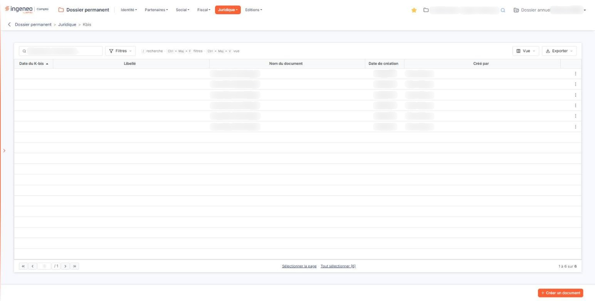
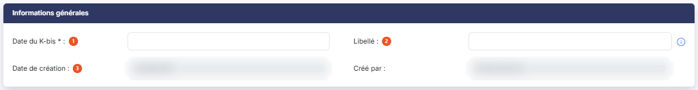
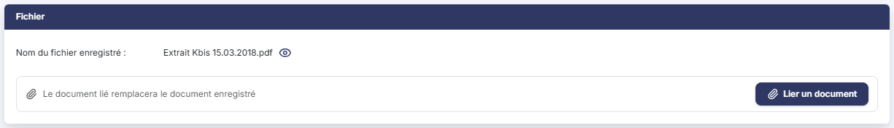

# Kbis


**Où le trouver :** Menu **Juridique › Kbis**



**En bref** — Cet écran conserve les extraits K-bis successifs de la société, chacun avec sa date, un libellé et le fichier joint, pour constituer leur historique.

* Pour ajouter un extrait : bouton \[Créer un document], saisissez la date et le libellé, bouton \[Lier un document], puis bouton \[Enregistrer].


Cette option vous permet de conserver dans le dossier permanent de la société les extraits K-bis successifs de l'entreprise. Chaque extrait fait l'objet d'un enregistrement propre, qui porte sa date, un libellé libre destiné à le repérer, et le document lui-même sous forme de fichier joint.

<figure><figcaption>
Écran « Kbis » de la nouvelle interface
</figcaption></figure>

Vous constituez ainsi l'historique des K-bis de la société : le plus récent n'écrase pas les précédents, chaque version reste consultable.

## Ce que présente l'écran

L'écran s'ouvre sur la liste des extraits déjà enregistrés pour la société. Cette liste ne comporte pas d'onglet ; au-dessus d'elle, une barre porte une zone de recherche et trois boutons, décrits plus bas.

Les colonnes sont les suivantes, dans leur ordre d'affichage.

| Champ                | Ce qu'il faut savoir                                                                                                                                                                                      |
| -------------------- | --------------------------------------------------------------------------------------------------------------------------------------------------------------------------------------------------------- |
| **Date du K-bis**    | La date de l'extrait, telle que vous l'avez saisie dans la fiche. C'est sur cette colonne que le logiciel établit le tri initial de la liste, par ordre croissant.                                        |
| **Libellé**          | Le repère que vous avez donné à cet extrait.                                                                                                                                                              |
| **Nom du document**  | Le nom du fichier joint à l'enregistrement. Ce texte n'est pas un lien : pour accéder au document, utilisez le pictogramme « Œil » de la ligne.                                                           |
| **Date de création** | **Créé par :** la date à laquelle la fiche a été enregistrée dans le logiciel, et son auteur. Ne confondez pas cette date avec la **Date du K-bis :** l'une repère la saisie, l'autre l'extrait lui-même. |

Toutes ces colonnes peuvent être triées en cliquant sur leur titre, et leur largeur peut être ajustée.

**La barre au-dessus de la liste**

La zone « Rechercher un document… » restreint la liste au fil de la saisie.

bouton **\[Filtres]** : ouvre un volet « Filtrer » où vous ajoutez des critères sur les cinq colonnes de la liste.

bouton **\[Vue]** : permet de choisir les colonnes affichées et d'enregistrer l'état de la liste sous un nom.

bouton **\[Exporter]** : propose l'aperçu, l'impression, l'export en Excel ou en PDF et l'envoi de la liste par e-mail.

**Les commandes d'une ligne**

Un clic sur une ligne la sélectionne. Au survol d'une ligne apparaissent, à son extrémité droite, trois pictogrammes.

Le pictogramme « Crayon », d'infobulle « Modifier », ouvre la fiche de l'extrait.

Le pictogramme « Œil », d'infobulle « Afficher l'aperçu », **télécharge** sur votre poste le document joint à cet extrait. Son infobulle promet un aperçu à l'écran : ce n'en est pas un.

Le pictogramme à trois points verticaux, d'infobulle « Autres actions », ouvre un menu qui propose « Supprimer », pour supprimer l'extrait.

**Sélectionner plusieurs lignes**

Sous la liste, le lien « Sélectionner la page » sélectionne toutes les lignes de la page affichée ; le lien « Tout sélectionner », suivi du nombre de lignes de la liste, étend la sélection à toutes les pages. Le choix des colonnes affichées se fait par le bouton **\[Vue]**, décrit plus haut.

**Le bas de l'écran**

Sous la liste, la barre de pagination vous permet d'aller à la première page, à la page précédente, à la page suivante ou à la dernière, ou de saisir directement un numéro de page. À sa droite, le logiciel indique les lignes affichées et le nombre total d'extraits enregistrés.

Deux boutons complètent la liste.

bouton **\[Créer un document]**

Placé en bas à droite de l'écran, il ouvre une fiche vierge pour enregistrer un nouvel extrait.

bouton **\[Supprimer]**

Sélectionnez les extraits à supprimer en cliquant sur leurs lignes : un bandeau apparaît en bas de l'écran ; il indique le nombre de lignes sélectionnées (« 1 document sélectionnée »), propose le lien « Tout désélectionner » et porte ce bouton, qui supprime en une seule fois tous les extraits sélectionnés.

## La fiche d'un extrait

Que vous ouvriez une fiche vierge par le bouton **\[Créer un document]** ou une fiche existante par le pictogramme « Crayon », la fiche présente les deux mêmes rubriques, dans le même ordre : « Informations générales » puis « Fichier ». Elle ne comporte aucun onglet.

## Rubrique « Informations générales »

<figure><figcaption>
Rubrique « Informations générales »
</figcaption></figure>

| Champ                   | Ce qu'il faut savoir                                                                                                                                                                                                                                                    |
| ----------------------- | ----------------------------------------------------------------------------------------------------------------------------------------------------------------------------------------------------------------------------------------------------------------------- |
| 1. **Date du K-bis**    | La date de l'extrait. Ce champ est **obligatoire**. Vous saisissez la date directement, ou vous la choisissez dans le calendrier qui s'ouvre au clic dans le champ.                                                                                                     |
| 2. **Libellé**          | Un repère libre de cinquante caractères au plus, destiné à distinguer cet extrait des autres dans la liste. Le pictogramme « Information » placé à sa droite vous rappelle l'usage attendu : « Indiquez, par exemple, la modification majeure de la version du K-bis. » |
| 3. **Date de création** | **Créé par :** la date d'enregistrement de la fiche et son auteur. Ces deux informations sont renseignées par le logiciel et ne sont pas modifiables. Elles n'apparaissent que sur une fiche existante : une fiche vierge ne les affiche pas.                           |

Cette rubrique ne porte pas de date de modification : la fiche conserve la trace de sa création, pas celle de ses mises à jour successives.

## Rubrique « Fichier »

<figure><figcaption>
Rubrique « Fichier »
</figcaption></figure>

C'est ici que vous joignez le document de l'extrait. **Cette rubrique ne se présente pas de la même façon selon que vous créez l'extrait ou que vous le modifiez**, et c'est le point à retenir de cet écran.

**Sur une fiche vierge**

La rubrique présente le champ **Fichier :**, qui affiche « Aucun document lié » tant que vous n'avez rien joint. Ce champ est **obligatoire** : un extrait ne peut pas être enregistré sans son document.

bouton **\[Lier un document]** : ouvre la fenêtre « Lier un document », qui propose deux sources. « Depuis mon poste » vous permet de déposer un document dans la zone prévue ou de parcourir vos fichiers ; tous les formats sont acceptés sauf .exe, .bat, .cmd et .sh, et le nom du fichier ne doit pas dépasser 100 caractères. « Depuis la GED » vous permet de choisir le document dans la GED. Le bouton **\[Lier le document]** joint le document choisi ; le bouton **\[Annuler]** referme la fenêtre sans rien joindre.

**Sur une fiche existante portant déjà un document**

Le champ change de nom : il s'intitule alors **Nom du fichier enregistré :** et vous présente le nom du document joint, suivi d'un pictogramme « Œil » d'infobulle « Visualiser », qui **télécharge** ce document sur votre poste.

**Et il n'est plus obligatoire** : l'astérisque disparaît. Sous le nom du document, l'écran rappelle que « Le document lié remplacera le document enregistré », et le bouton **\[Lier un document]** reste proposé : il vous sert à joindre un autre fichier à la place de celui qui est enregistré.

**Les boutons de la fiche**

bouton **\[Enregistrer]**

Enregistre la fiche.

**La flèche « Revenir en arrière »**

Placée à gauche du fil d'Ariane, elle vous ramène à la liste sans rien enregistrer.

## Points à connaître

| Champ                                                        | Ce qu'il faut savoir                                                                                                                                                                                                                                                                                                  |
| ------------------------------------------------------------ | --------------------------------------------------------------------------------------------------------------------------------------------------------------------------------------------------------------------------------------------------------------------------------------------------------------------- |
| **Le mot K-bis s'écrit de deux façons dans cet écran**       | L'option du menu s'intitule « Kbis », tandis que la colonne de la liste et le champ de la fiche s'intitulent tous deux « Date du K-bis ». Il s'agit bien de la même notion.                                                                                                                                           |
| **La liste peut être triée sur une colonne vide**            | La **Date du K-bis :** est obligatoire dans la fiche, et vous rencontrerez pourtant des extraits qui ne la portent pas. Comme c'est la colonne de tri initial, une liste de tels extraits paraîtra ne pas être triée. Complétez la date dans la fiche de chaque extrait concerné pour rétablir un classement lisible. |
| **La suppression d'un extrait porte aussi sur son document** | L'extrait et le fichier qui lui est joint ne se séparent pas dans cet écran ; il n'y a pas de commande permettant de retirer le document en conservant la fiche.                                                                                                                                                      |
