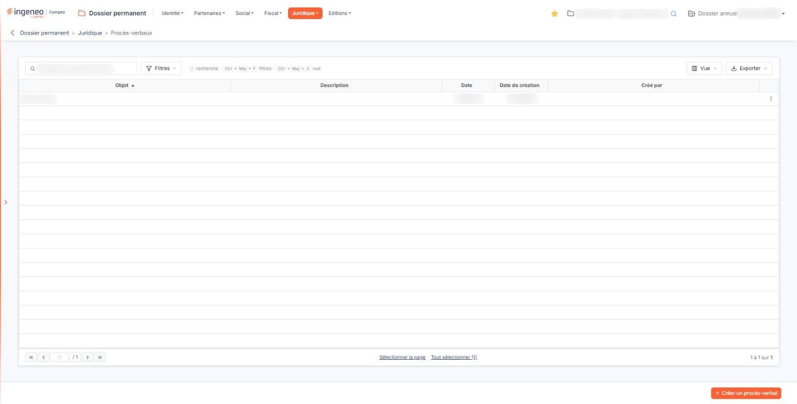
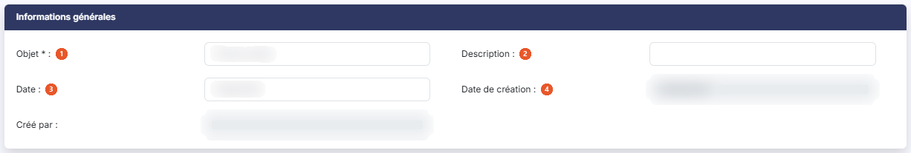
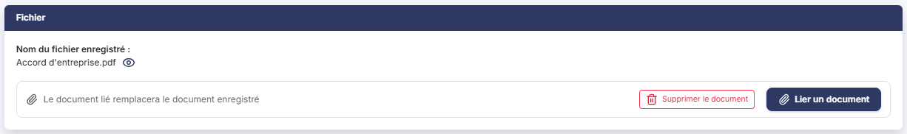

# Procès-verbaux


**Où le trouver :** Menu **Juridique › Procès-verbaux**



**En bref** — Cet écran conserve les procès-verbaux des assemblées et organes de direction de la société : objet, description, date et, si vous le souhaitez, le document joint.

* Pour enregistrer un procès-verbal : bouton \[Créer un procès-verbal], renseignez la fiche, puis bouton \[Enregistrer].
* Pour joindre le document plus tard : rouvrez la fiche, bouton \[Lier un document], puis bouton \[Enregistrer].


Cette option vous permet de conserver dans le dossier permanent de la société les procès-verbaux de ses assemblées et de ses organes de direction. Chaque procès-verbal fait l'objet d'un enregistrement portant un objet, une description, une date, et éventuellement le document lui-même sous forme de fichier joint.

<figure><figcaption>
Écran « Procès-verbaux » de la nouvelle interface
</figcaption></figure>

Le document est ici **facultatif** : vous pouvez enregistrer un procès-verbal en n'en consignant que la référence, puis y joindre le document plus tard.

## Ce que présente l'écran

L'écran s'ouvre sur la liste des procès-verbaux déjà enregistrés pour la société. Cette liste ne comporte pas d'onglet ; au-dessus d'elle, une barre porte une zone de recherche et trois boutons, décrits plus bas.

Les colonnes sont les suivantes, dans leur ordre d'affichage.

| Champ                | Ce qu'il faut savoir                                                                                                                           |
| -------------------- | ---------------------------------------------------------------------------------------------------------------------------------------------- |
| **Objet**            | L'objet que vous avez donné au procès-verbal. C'est sur cette colonne que le logiciel établit le tri initial de la liste, par ordre croissant. |
| **Description**      | La précision que vous avez ajoutée à cet objet.                                                                                                |
| **Date**             | La date du procès-verbal. Ce libellé n'est pas qualifié : il s'agit bien de la date de l'acte, et non de celle de sa saisie dans le logiciel.  |
| **Date de création** | **Créé par :** la date à laquelle la fiche a été enregistrée dans le logiciel, et son auteur. Ne confondez pas cette date avec la précédente.  |

Toutes ces colonnes peuvent être triées en cliquant sur leur titre, et leur largeur peut être ajustée.

**La barre au-dessus de la liste**

La zone « Rechercher un procès-verbal… » restreint la liste au fil de la saisie.

bouton **\[Filtres]** : ouvre un volet « Filtrer » où vous ajoutez des critères colonne par colonne. Outre les cinq colonnes de la liste, il propose la date de modification et l'auteur de la modification.

bouton **\[Vue]** : permet de choisir les colonnes affichées — cinq des sept colonnes disponibles le sont à l'ouverture — et d'enregistrer l'état de la liste sous un nom.

bouton **\[Exporter]** : propose l'aperçu, l'impression, l'export en Excel ou en PDF et l'envoi de la liste par e-mail.

**La liste ne vous dit pas quels procès-verbaux portent un document**

C'est le point le plus important à connaître sur cet écran, et il surprend souvent. La liste ne comporte **aucune colonne donnant le nom du document joint**, et la ligne ne porte **aucun pictogramme** permettant d'y accéder. Un procès-verbal auquel un document est joint se présente donc exactement comme un procès-verbal qui n'en porte pas.

Pour savoir si un procès-verbal a un document, et pour le consulter, vous devez **ouvrir sa fiche** par le pictogramme « Crayon ». C'est le seul chemin d'accès au document.

Si vous venez des options « Kbis » ou « Statuts » du même menu, ne cherchez donc pas ici la colonne du nom du document ni le pictogramme d'aperçu de la ligne : cet écran ne les propose pas.

**Les commandes d'une ligne**

Un clic sur une ligne la sélectionne. Au survol d'une ligne apparaissent, à son extrémité droite, deux pictogrammes.

Le pictogramme « Crayon », d'infobulle « Modifier », ouvre la fiche du procès-verbal.

Le pictogramme à trois points verticaux, d'infobulle « Autres actions », ouvre un menu qui propose « Supprimer », pour supprimer le procès-verbal.

**Sélectionner plusieurs lignes**

Sous la liste, le lien « Sélectionner la page » sélectionne toutes les lignes de la page affichée ; le lien « Tout sélectionner », suivi du nombre de lignes de la liste, étend la sélection à toutes les pages. Le choix des colonnes affichées se fait par le bouton **\[Vue]**, décrit plus haut.

**Le bas de l'écran**

Sous la liste, la barre de pagination vous permet d'aller à la première page, à la page précédente, à la page suivante ou à la dernière, ou de saisir directement un numéro de page. À sa droite, le logiciel indique les lignes affichées et le nombre total de procès-verbaux enregistrés.

Deux boutons complètent la liste.

bouton **\[Créer un procès-verbal]**

Placé en bas à droite de l'écran, il ouvre une fiche vierge pour enregistrer un nouveau procès-verbal.

bouton **\[Supprimer]**

Sélectionnez les procès-verbaux à supprimer en cliquant sur leurs lignes : un bandeau apparaît en bas de l'écran ; il indique le nombre de lignes sélectionnées (« 1 procès-verbal sélectionnée ») et porte ce bouton, qui supprime en une seule fois tous les procès-verbaux sélectionnés.

## La fiche d'un procès-verbal

Que vous ouvriez une fiche vierge par le bouton **\[Créer un procès-verbal]** ou une fiche existante par le pictogramme « Crayon », la fiche présente les deux mêmes rubriques, dans le même ordre : « Informations générales » puis « Fichier ». Elle ne comporte aucun onglet.

## Rubrique « Informations générales »

<figure><figcaption>
Rubrique « Informations générales »
</figcaption></figure>

| Champ                   | Ce qu'il faut savoir                                                                                                                                                                                                                                                                                       |
| ----------------------- | ---------------------------------------------------------------------------------------------------------------------------------------------------------------------------------------------------------------------------------------------------------------------------------------------------------- |
| 1. **Objet**            | L'objet du procès-verbal, en cinquante caractères au plus. C'est le **seul champ obligatoire** de la fiche, et c'est aussi la colonne de tri initial de la liste : soignez-le, c'est par lui que vous retrouverez l'acte.                                                                                  |
| 2. **Description**      | Une précision facultative. **Attention, ce champ n'est pas une zone de commentaire** : c'est une ligne unique, limitée elle aussi à cinquante caractères. N'y prévoyez pas un résumé de l'acte.                                                                                                            |
| 3. **Date**             | La date du procès-verbal. Ce champ est **facultatif**. Vous saisissez la date directement, ou vous la choisissez dans le calendrier qui s'ouvre au clic dans le champ. Renseignez-la néanmoins : c'est la seule information qui situe l'acte dans le temps, la date de création ne repérant que la saisie. |
| 4. **Date de création** | **Créé par :** la date d'enregistrement de la fiche et son auteur. Ces deux informations sont renseignées par le logiciel et ne sont pas modifiables. Elles n'apparaissent que sur une fiche existante : une fiche vierge ne les affiche pas.                                                              |

Cette rubrique ne porte pas de date de modification : la fiche conserve la trace de sa création, pas celle de ses mises à jour successives.

## Rubrique « Fichier »

<figure><figcaption>
Rubrique « Fichier »
</figcaption></figure>

C'est ici que vous joignez le document du procès-verbal, et c'est aussi le seul endroit d'où vous pouvez le consulter. Cette rubrique ne se présente pas de la même façon selon que la fiche porte déjà un document ou non.

**Sur une fiche vierge**

La rubrique affiche « Aucun document lié ». Le document est **facultatif** : un procès-verbal peut être enregistré sans document.

bouton **\[Lier un document]** : ouvre la fenêtre « Lier un document », qui propose deux sources. « Depuis mon poste » vous permet de déposer un document dans la zone prévue ou de parcourir vos fichiers ; tous les formats sont acceptés sauf .exe, .bat, .cmd et .sh, et le nom du fichier ne doit pas dépasser 100 caractères. « Depuis la GED » vous permet de choisir le document dans la GED. Le bouton **\[Lier le document]** joint le document choisi ; le bouton **\[Annuler]** referme la fenêtre sans rien joindre.

**Sur une fiche existante portant déjà un document**

Le champ change de nom : il s'intitule alors **Nom du fichier enregistré :** et vous présente le nom du document joint, suivi d'un pictogramme « Œil » d'infobulle « Visualiser », qui **télécharge** ce document sur votre poste plutôt que de l'afficher à l'écran.

Sous le nom du document, l'écran rappelle que « Le document lié remplacera le document enregistré » : le bouton **\[Lier un document]** vous sert à joindre un autre fichier à la place de celui qui est enregistré. Le bouton **\[Supprimer le document]** y est également proposé.

**Les boutons de la fiche**

bouton **\[Enregistrer]**

Enregistre la fiche.

**La flèche « Revenir en arrière »**

Placée à gauche du fil d'Ariane, elle vous ramène à la liste sans rien enregistrer.

## Points à connaître

| Champ                                                              | Ce qu'il faut savoir                                                                                                                                                                                                                                                  |
| ------------------------------------------------------------------ | --------------------------------------------------------------------------------------------------------------------------------------------------------------------------------------------------------------------------------------------------------------------- |
| **Cet écran est plus permissif que ses voisins**                   | Dans les options « Kbis » et « Statuts » du même menu, la date de l'acte et le document sont tous deux obligatoires à la création. Ici, seul l'**Objet :** l'est. Un procès-verbal peut donc exister sans date et sans document — et rien à l'écran ne vous alertera. |
| **L'objet et la description sont courts**                          | Cinquante caractères chacun, sur une seule ligne. Le corps de l'acte a sa place dans le document joint, pas dans ces deux champs.                                                                                                                                     |
| **La suppression d'un procès-verbal porte aussi sur son document** | La fiche et le fichier qui lui est joint ne se séparent pas lorsque vous supprimez le procès-verbal. Pour agir sur le seul document, la fiche porte le bouton **\[Supprimer le document]**, présenté à la rubrique b).                                                |
