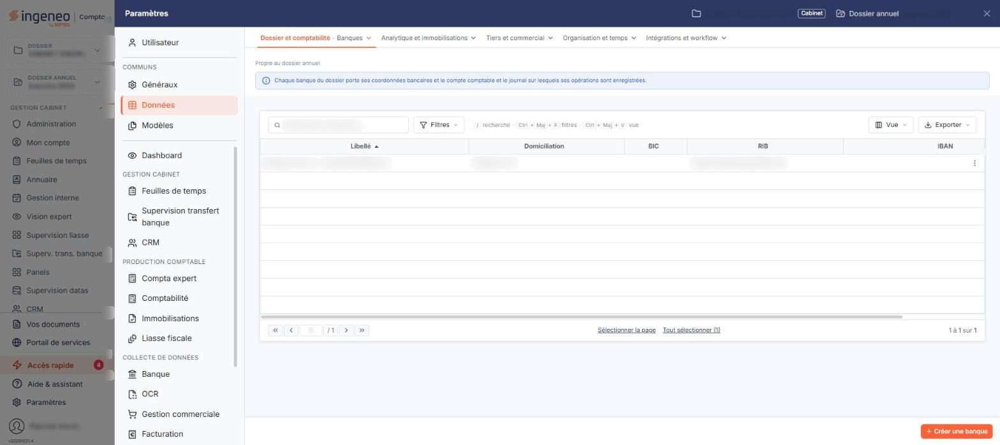
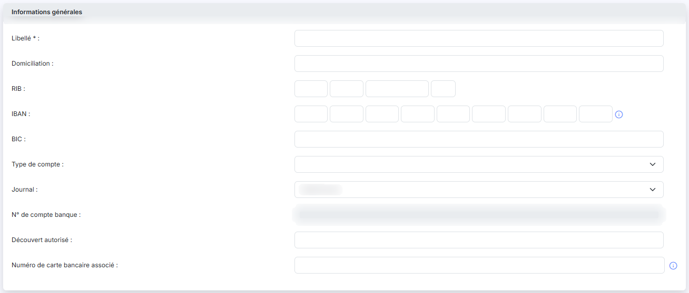
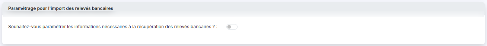
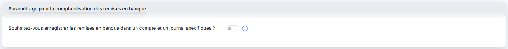
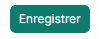
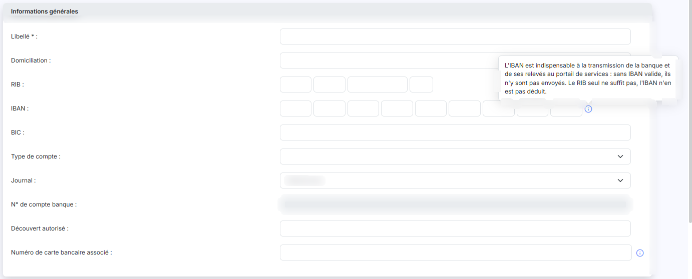

# Banques


**Où le trouver :** Panneau **Paramètres** › **Données** › **Dossier et comptabilité** › **Banques**



**En bref** — Cet écran recense les comptes bancaires de la société et paramètre leur journal, leur compte comptable, l'import des relevés et la comptabilisation des remises en banque, utilisés par les autres modules.

* Pour déclarer une banque : bouton \[Nouveau], renseignez la fiche, puis bouton \[Enregistrer].
* Pour créer un compte comptable manquant depuis la fiche : bouton \[+] à côté de la zone, ou pictogramme « Loupe » pour rechercher un compte existant.
* Pour retirer des banques : cochez leurs cases, puis bouton \[Supprimer].


Cet écran recense les comptes bancaires de la société : leurs coordonnées, le journal et le compte comptable auxquels ils sont rattachés, le paramétrage de l'import de leurs relevés et celui de la comptabilisation des remises en banque.

<figure><figcaption>
Écran « Banques » de la nouvelle interface
</figcaption></figure>

C'est donc à la fois un fichier d'identification des banques et un écran de paramétrage : les informations que vous y saisissez sont utilisées par les autres modules du logiciel, notamment pour la récupération des relevés bancaires et pour la saisie de caisse.

La liste comporte cinq colonnes, toutes triables. Cliquez sur l'en-tête d'une colonne pour trier la liste ; à l'ouverture, elle est triée sur le libellé, par ordre croissant.

* **Libellé** : le nom que vous avez donné au compte bancaire.
* **Domiciliation** : le texte libre saisi dans la fiche. Ce champ est un texte libre.
* **BIC** : le code d'identification international de la banque.
* **RIB** : le relevé d'identité bancaire.
* **IBAN** : le numéro de compte international, présenté par groupes de chiffres séparés par des tirets.

Aucune de ces colonnes n'est obligatoire dans la fiche : une banque peut apparaître dans la liste avec le seul libellé renseigné, et rien ne vous impose de saisir à la fois le RIB et l'IBAN.

L'en-tête de la première colonne, celle des commandes, comporte :

* une case qui sélectionne toutes les lignes de la page affichée,
* une case qui étend la sélection à toutes les pages de la liste ; son infobulle vous indique le nombre d'éléments sélectionnés (« Aucun élément sélectionné. » tant que vous n'avez rien coché),
* le pictogramme « Roue crantée », qui ouvre la personnalisation des colonnes,
* le pictogramme « Entonnoir », qui ouvre les filtres de la liste,
* le pictogramme « Imprimante », qui imprime la liste.

Le bas de la liste comporte les boutons de changement de page, une zone où saisir directement un numéro de page, et à droite le nombre de lignes affichées sur le nombre total.

Chaque ligne porte trois commandes, présentes sur toutes les lignes :

* la case à cocher, d'infobulle « Sélectionner »,
* le pictogramme « Crayon », d'infobulle « Modifier », qui ouvre la fiche de la banque,
* le pictogramme « Corbeille », d'infobulle « Supprimer », qui supprime la banque.

bouton **\[Nouveau]**

Vous ouvrez la fiche de création d'une banque.

bouton **\[Supprimer]**

Vous supprimez les banques dont vous avez coché la case. Ce bouton reste actif même lorsque aucune ligne n'est sélectionnée.

Cet écran ne comporte ni bouton d'export ni bouton d'import : c'est un fichier que vous alimentez à la main.

La fiche comporte trois rubriques. Les deux dernières s'ouvrent sur une question à laquelle vous répondez « Oui » ou « Non » : la réponse « Oui » fait apparaître les champs à renseigner.

Cette rubrique est disposée sur deux colonnes.

* **Libellé** \* : le nom du compte bancaire. C'est le **seul champ obligatoire** de cette rubrique, et le seul de la fiche tant que les deux questions des rubriques suivantes restent à « Non ».
* **Domiciliation** : le nom de l'agence ou de l'établissement qui tient le compte. Texte libre.
* **RIB** : le relevé d'identité bancaire se saisit en **quatre cases**, dans cet ordre : le code de la banque, le code du guichet, le numéro de compte, puis la clé. Aucune des quatre cases ne porte de libellé à l'écran.
* **IBAN** : le numéro de compte international se saisit lui aussi en plusieurs cases, à la suite. Le nombre de cases à renseigner dépend du pays du compte : sur un compte français, les dernières restent vides. Un pictogramme d'information, à droite des cases de l'IBAN, rappelle par son infobulle que l'IBAN est indispensable à la transmission de la banque et de ses relevés au portail de services : sans IBAN valide, ils n'y sont pas envoyés, et le RIB seul ne suffit pas, l'IBAN n'en étant pas déduit.
* **BIC** : le code d'identification international de la banque.
* **Type de compte** : la nature du compte, à choisir dans une liste : « Article 83 », « Assurance Vie », « Carte bancaire », « Compte chèque », « Compte de dépôt », « Compte épargne », « Compte joint », « Compte titres », « Emprunt », « Plan Épargne Entreprise », « Plan Épargne Retraite », « Réserve spéciale de participation ». La liste s'ouvre sur une valeur vide, que vous pouvez conserver.
* **Journal** : le journal comptable dans lequel les écritures de cette banque seront passées. La liste ne propose que les journaux de type « Banque » du dossier annuel en cours.
* **N° de compte banque** : le compte comptable de la banque. Ce champ n'est **pas saisissable** : il découle du journal retenu au-dessus et se remplit dès que vous choisissez le journal, sans attendre l'enregistrement. Tant qu'aucun journal n'est choisi, il reste vide.
* **Découvert autorisé** : le montant du découvert accordé par votre banque sur ce compte. Ce champ et « Type de compte » ne servent qu'aux banques connectées à la récupération automatique des relevés : le découvert autorisé sert à l'alerte de dépassement de découvert, et le type de compte à écarter du widget « Etat de trésorerie » les comptes qui ne sont pas des comptes courants (Emprunt, Article 83, Carte bancaire, Assurance vie, Plan Épargne Entreprise). Sur une banque non connectée, aucun des deux ne déclenche de traitement.
* **Numéro de carte bancaire associé** : le numéro de la carte rattachée au compte. Le pictogramme d'information placé à côté précise : « Ce numéro est notamment utile en cas d'import de fichier OFX. »

La rubrique se termine par les informations de suivi, qui ne sont jamais saisissables : **Date de création :**, **Créée par :**, **Date de modification :** et **Modifiée par :**. Sur les banques les plus anciennes, « Date de création » et « Créée par » peuvent s'afficher vides.

Deux remarques sur ces quatre champs :

* ils n'apparaissent pas sur une fiche de création, ce qui est normal : il n'y a encore rien à tracer ;
* « Date de modification » et « Modifiée par » n'apparaissent qu'à partir du moment où la banque a été modifiée au moins une fois. Sur une banque créée et jamais reprise, la fiche comporte donc deux champs de moins, sans que rien ne vous l'indique.

La rubrique s'ouvre sur une seule question : **Souhaitez-vous paramétrer les informations nécessaires à la récupération des relevés bancaires ? :**. Elle est à « Non » par défaut.

Si vous répondez « Oui », quatre champs apparaissent :

* **Date de début de récupération** : champ **non saisissable**. C'est un témoin : « Cette date est celle que vous avez indiquée lors du premier import pour cette banque. »
* **Date de dernière récupération** : champ **non saisissable**, également un témoin : « Date de la dernière récupération d'écriture automatique ou date de la dernière demande d'import manuel. »
* **Compte d'attente** \* : le compte comptable dans lequel sont enregistrées les écritures en attente d'affectation. Ce champ devient **obligatoire** dès que vous répondez « Oui ». Deux commandes vous aident à le renseigner : un bouton \[+], qui crée un compte comptable, et le pictogramme « Loupe », qui recherche un compte existant. Elles s'ouvrent par-dessus la fiche : vous ne la quittez pas, votre saisie en cours n'est pas perdue, et le compte retenu ou créé est reporté dans le champ à la fermeture de la fenêtre.
* **Référence par défaut des écritures** : la référence reprise sur les écritures issues des imports de cette banque, lorsque le relevé n'en fournit pas. Ce champ reste facultatif.

Les deux dates sont donc des informations que le logiciel renseigne lui-même, et non des paramètres : vous les consultez, vous ne les modifiez pas. Elles sont utiles pour vérifier depuis quand une banque n'a plus rien importé.

Sur une fiche de création, ces deux dates n'apparaissent pas : la réponse « Oui » n'y fait apparaître que le compte d'attente et la référence par défaut.

La rubrique s'ouvre elle aussi sur une seule question : **Souhaitez-vous enregistrer les remises en banque dans un compte et un journal spécifiques ? :**. Elle est à « Non » par défaut, et le pictogramme d'information placé à côté explique l'effet de la réponse dans les deux sens :

* à « Non », les remises en banque saisies dans la saisie de caisse et les paiements SEPA sont enregistrées dans le compte et le journal de la banque, c'est-à-dire ceux de la rubrique « Informations générales » ;
* à « Oui », vous indiquez vous-même le compte comptable et le journal dans lesquels ces opérations doivent être comptabilisées.

La réponse « Oui » fait apparaître deux champs, tous deux obligatoires :

* **N° de compte** \* : le compte comptable des remises en banque. Comme le compte d'attente, il est accompagné d'un bouton \[+] qui crée un compte et du pictogramme « Loupe » qui en recherche un.
* **Journal** \* : le journal des remises en banque, à choisir parmi les journaux de type « Banque », « Caisse » et « Opérations diverses » du dossier annuel en cours.

**Ne confondez pas les trois comptes de cette fiche** : le « N° de compte banque » de la première rubrique est le compte de la banque elle-même, et il n'est pas saisissable ; le « Compte d'attente » de la deuxième reçoit les écritures d'import non encore affectées ; le « N° de compte » de la troisième ne sert qu'aux remises en banque.

bouton **\[Enregistrer]**

Vous enregistrez la banque.

La fiche ne comporte ni bouton de suppression ni bouton de duplication : une banque se supprime depuis la liste.

## Autres vues de l'écran

<figure><figcaption>
Informations générales
</figcaption></figure>

<figure><figcaption>
Paramétrage pour l'import des relevés bancaires
</figcaption></figure>

<figure><figcaption>
Paramétrage pour la comptabilisation des remises en banque
</figcaption></figure>

<figure><figcaption>
Bouton [Enregistrer]
</figcaption></figure>

<figure><figcaption>
Informations générales
</figcaption></figure>
