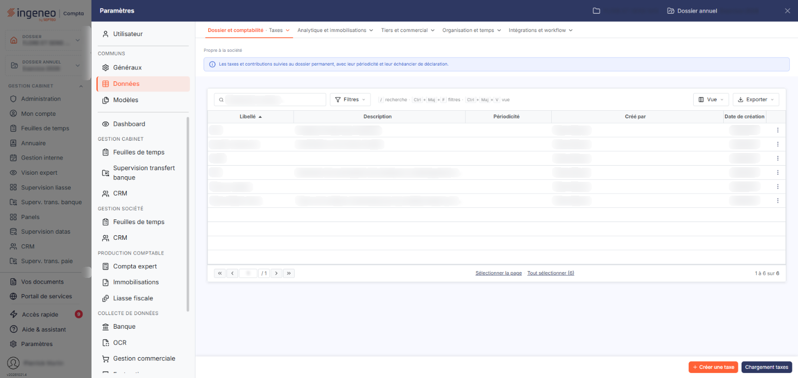
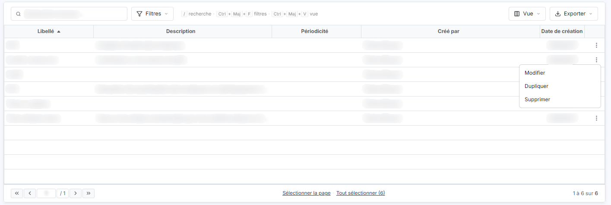
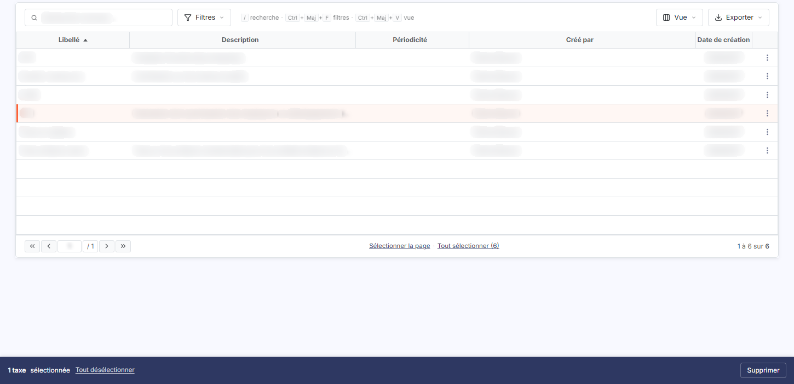
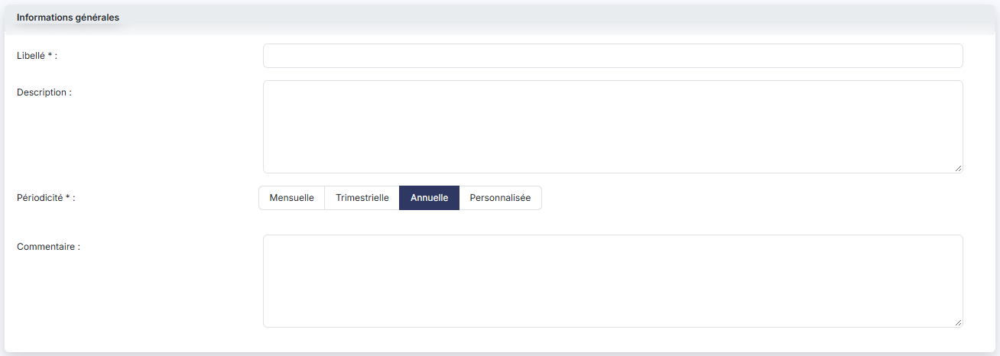
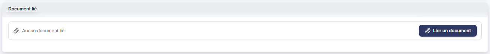
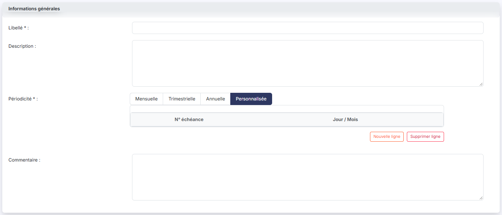
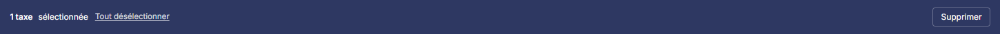

# Taxes


**Où le trouver :** Panneau **Paramètres** › **Données** › **Dossier et comptabilité** › **Taxes**



**En bref** — Cet écran est le fichier de référence des taxes que la société peut déclarer ou payer, avec leur périodicité et leurs échéances ; elles sont ensuite proposées dans « Fiscal », « Autres taxes ».

* Pour créer une taxe : bouton \[Nouveau], renseignez la fiche, puis bouton \[Enregistrer].
* Pour reprendre des taxes prédéfinies : bouton \[Chargement taxes], puis cochez celles qui vous intéressent.
* Pour retirer des taxes : cochez leurs cases, puis bouton \[Supprimer].


Cet écran recense les taxes que la société est susceptible de déclarer ou de payer, avec leur périodicité et, si vous le souhaitez, leurs échéances.

<figure><figcaption>
Écran « Taxes » de la nouvelle interface
</figcaption></figure>

C'est un fichier de référence : les taxes que vous y créez sont ensuite proposées dans le menu « Fiscal », sous-option « Autres taxes », où vous les rattachez à un établissement. Si la liste des taxes vous paraît vide sur cet écran-là, c'est ici qu'il faut commencer.

Cet écran ne figure pas dans le menu du module : vous l'ouvrez depuis le panneau « Paramètres » (entrée « Paramètres », roue dentée, de la navigation latérale ; hors tableau de bord, cette barre est masquée : cliquez sur le bord gauche de l'écran pour l'ouvrir), rubrique « Données », onglet « Dossier et comptabilité », option « Taxes ».

La liste comporte cinq colonnes, toutes triables. Cliquez sur l'en-tête d'une colonne pour trier la liste ; à l'ouverture, elle est triée sur le libellé, par ordre croissant.

* **Libellé** : le nom de la taxe. Il est limité à vingt caractères (voir la fiche), ce qui oblige souvent à l'abréger.
* **Description** : le texte que vous avez saisi pour expliquer la taxe. Une description longue est **coupée à l'affichage** sans que rien ne le signale : ouvrez la fiche pour la lire en entier.
* **Périodicité** : la périodicité retenue dans la fiche. Cette colonne peut rester vide, y compris sur une taxe déjà utilisée.
* **Créé par** : l'utilisateur qui a créé la taxe.
* **Date de création** : la date de création de la fiche.

Au-dessus de la liste, la zone « Rechercher une taxe… » restreint la liste au fil de la saisie : elle porte sur le libellé et s'affiche ensuite sous la forme d'une pastille « Libellé contient … » que vous retirez pour retrouver toutes les taxes.

bouton **\[Filtres]** : ouvre un volet « Filtrer » où vous ajoutez des critères colonne par colonne.

bouton **\[Vue]** : permet de choisir les colonnes affichées (cinq des huit colonnes disponibles le sont à l'ouverture ; « Commentaire », « Modifié par » et « Date de modification » peuvent s'y ajouter) et d'enregistrer l'état de la liste sous un nom.

bouton **\[Exporter]** : propose l'aperçu, l'impression, l'export en Excel ou en PDF et l'envoi de la liste par e-mail.

Il n'y a plus de case à cocher : un clic sur une ligne la sélectionne. Sous la liste, les liens « Sélectionner la page » et « Tout sélectionner (n) » sélectionnent toutes les lignes de la page ou de la liste.

Le bas de la liste comporte les boutons de changement de page, une zone où saisir directement un numéro de page, et à droite le nombre de lignes affichées sur le nombre total.

Chaque ligne porte, à son extrémité droite, le pictogramme « Autres actions » (trois points verticaux). Son menu propose trois commandes :

* « Modifier », qui ouvre la fiche de la taxe,
* « Dupliquer », qui recopie la taxe,
* « Supprimer », qui supprime la taxe.

bouton **\[Créer une taxe]**

Placé en bas à droite de l'écran, il ouvre la fiche de création d'une taxe.

bouton **\[Chargement taxes]**

Ce bouton alimente la liste avec un jeu de taxes prédéfinies, sans que vous ayez à les créer une par une.

Il est placé à côté du Bouton \[Créer une taxe] : l'un ouvre une fiche vide, l'autre agit sur toute la liste.

bouton **\[Supprimer]**

Sélectionnez les taxes à supprimer en cliquant sur leurs lignes : un bandeau apparaît en bas de l'écran, à la place des deux boutons précédents ; il indique le nombre de taxes sélectionnées, propose le lien « Tout désélectionner » et porte ce bouton.

**Supprimer une taxe supprime aussi toutes les lignes qui s'y rapportent dans le menu « Fiscal », sous-option « Autres taxes ».** Avant de supprimer une taxe de référence, allez donc voir dans « Autres taxes » ce qui lui est rattaché : c'est la seule façon de savoir ce que vous perdez. Il en va de même lorsque la même taxe est supprimée depuis la commande de suppression d'une ligne de la liste.

La fiche comporte deux rubriques.

* **Libellé** \* : le nom de la taxe. Champ obligatoire, **limité à vingt caractères** : la plupart des taxes doivent donc être abrégées, et c'est la description qui porte leur nom complet.
* **Description** : le libellé complet ou la définition de la taxe, sur plusieurs lignes, jusqu'à mille caractères. C'est ce texte qui apparaît dans la colonne « Description » de la liste.
* **Périodicité** \* : quatre boutons, « Mensuelle », « Trimestrielle », « Annuelle » et « Personnalisée ». Champ obligatoire. Le choix que vous faites ici **change la suite de la rubrique** (voir ci-dessous).
* **Commentaire** : une seconde zone de texte libre, sur plusieurs lignes, jusqu'à mille caractères.

La rubrique se termine par les informations de suivi, qui ne sont jamais saisissables : **Date de création :**, **Créé par :**, **Date de modification :** et **Modifié par :**. Elles n'apparaissent pas sur une fiche de création.

Sur une fiche de création, la périodicité « Annuelle » est **proposée par défaut**. En revanche, lorsque vous ouvrez une taxe déjà enregistrée, il est possible qu'aucun des quatre boutons ne soit retenu : la fiche s'ouvre alors sur un champ obligatoire sans valeur, et aucun message ne vous l'indique. Vérifiez donc la périodicité de vos taxes existantes avant de vous appuyer dessus.

* « Mensuelle » et « Trimestrielle » font apparaître un champ **Jour du mois :**, où vous saisissez le jour de l'échéance sur deux chiffres. Ce champ n'est pas marqué obligatoire.
* « Annuelle » ne fait apparaître aucun champ : aucune date d'échéance ne se saisit.
* « Personnalisée » remplace le champ « Jour du mois » par un tableau d'échéances, décrit ci-dessous.

Le tableau comporte deux en-têtes, « N° échéance » et « Jour / Mois », pour **trois informations** :

* **N° échéance** : le rang de l'échéance. Le logiciel le calcule ; vous ne le saisissez pas.
* **Jour / Mois** : la cellule contient **deux cases de saisie séparées par une barre oblique**. La première est le jour, la seconde le mois, chacune sur deux chiffres : une échéance du 15 avril se saisit donc « 15 / 04 ».

Un tableau sans échéance s'affiche vide, sans message.

Deux boutons sont placés sous le tableau, l'un pour ajouter une échéance, l'autre pour en retirer une :

bouton **\[Nouvelle ligne]**

Vous ajoutez une échéance au tableau. Le logiciel lui attribue son numéro.

bouton **\[Supprimer ligne]**

Vous retirez une échéance du tableau.

Cette rubrique vous permet de joindre **un** document à la taxe — la rubrique est au singulier, et il n'existe pas de liste des documents joints.

Le document n'est pas obligatoire. Tant qu'aucun n'est joint, la rubrique affiche « Aucun document lié » ; le Bouton \[Lier un document] sert à en joindre un.

bouton **\[Enregistrer]**

Vous enregistrez la taxe.

Pour quitter la fiche et revenir à la liste des taxes, utilisez le chevron « Retour » placé à gauche de la barre d'onglets du panneau « Paramètres ». Si vous avez modifié la fiche sans l'enregistrer, le logiciel ouvre la fenêtre « Modifications non enregistrées » et vous propose le Bouton \[Continuer sans enregistrer] ou le Bouton \[Enregistrer et quitter].

La fiche ne comporte ni bouton de suppression ni bouton de duplication : ces deux actions se font depuis la liste.

## Autres vues de l'écran

<figure><figcaption>
Les commandes de chaque ligne
</figcaption></figure>

<figure><figcaption>
Les boutons de la liste
</figcaption></figure>

<figure><figcaption>
Bouton [Créer une taxe]
</figcaption></figure>

<figure><figcaption>
Informations générales
</figcaption></figure>

<figure><figcaption>
Document lié
</figcaption></figure>

<figure><figcaption>
Bouton [Nouvelle ligne]
</figcaption></figure>

<figure><figcaption>
Bouton [Chargement taxes]
</figcaption></figure>

<figure><figcaption>
Bouton [Supprimer]
</figcaption></figure>

<figure><figcaption>
Bouton [Supprimer ligne]
</figcaption></figure>
