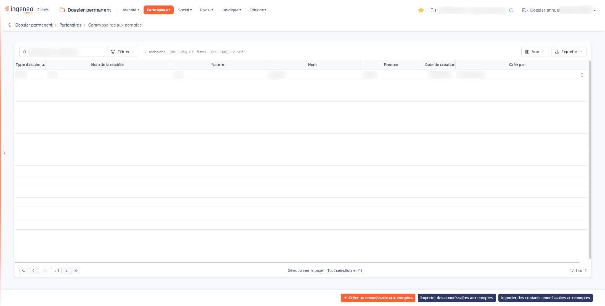
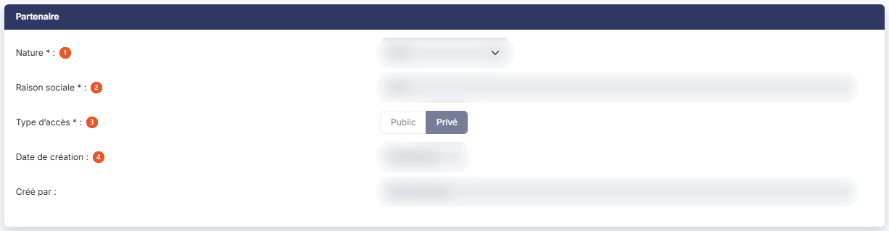
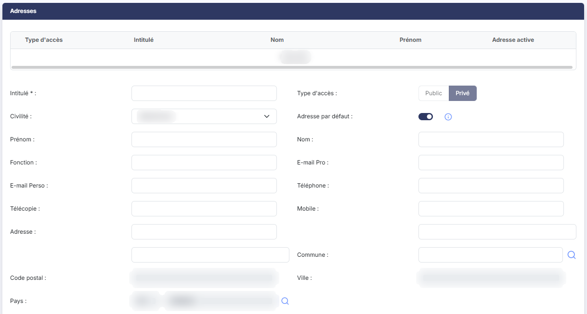
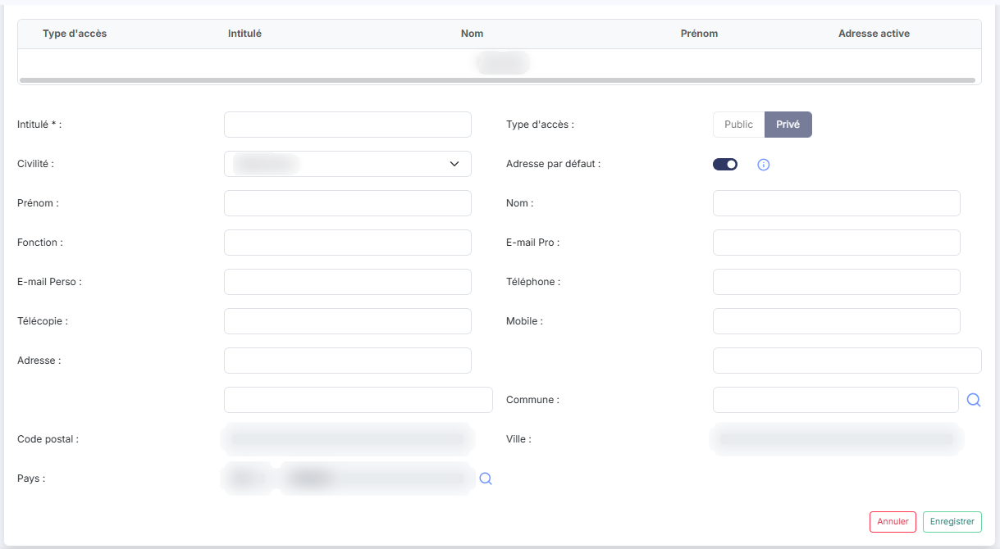
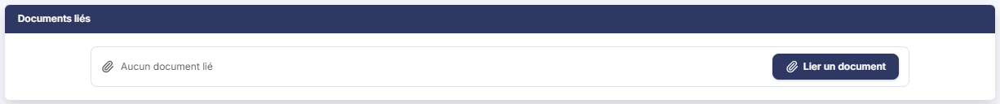

# Commissaires aux comptes


**Où le trouver :** Menu **Partenaires › Commissaires aux comptes**



**En bref** — Cet écran enregistre les commissaires aux comptes de la société, avec leurs adresses et documents, saisis à la main ou repris de l'annuaire général du cabinet.

* Pour créer une fiche : bouton \[Créer un commissaire aux comptes], renseignez-la, puis bouton \[Enregistrer].
* Pour reprendre des partenaires de l'annuaire : bouton \[Importer des commissaires aux comptes], ou bouton \[Importer des contacts commissaires aux comptes] pour choisir leurs contacts.


Cette option vous permet d'enregistrer les commissaires aux comptes de la société, avec leurs adresses et les documents qui s'y rapportent.

<figure><figcaption>
Écran « Commissaires aux comptes » de la nouvelle interface
</figcaption></figure>

Chaque commissaire aux comptes est décrit par une fiche en trois volets : le partenaire lui-même, ses adresses, et les documents qui lui sont liés. Vous saisissez cette fiche à la main, ou vous reprenez des partenaires déjà connus de l'annuaire général du cabinet grâce aux deux boutons d'import du bas de l'écran.

## La liste des commissaires aux comptes

L'écran s'ouvre directement sur la liste des commissaires aux comptes déjà enregistrés pour la société. Il n'y a pas d'onglet ; au-dessus de la grille, une barre d'outils décrite plus bas s'applique à la liste entière.

La grille comporte sept colonnes, toutes triables et toutes redimensionnables : **Type d’accès**, sur laquelle le tri est fait par défaut, en ordre croissant, puis **Nom de la société**, **Nature**, **Nom**, **Prénom**, **Date de création** et **Créé par**. Une barre de défilement horizontale apparaît sous la grille lorsque les colonnes ne tiennent pas toutes dans la largeur de votre fenêtre.

**Type d’accès** affiche « Public » ou « Prive ». La forme « Prive », sans accent, est celle que la grille affiche aujourd'hui ; la fiche du partenaire, elle, écrit « Privé ».

**Nom de la société** reprend la **Raison sociale** saisie dans la fiche. Le libellé n'est pas le même de part et d'autre, mais il s'agit bien du même renseignement.

**Nature** reprend la nature retenue dans la fiche : « CAC », « CAC suppléant », « Co-CAC » ou « Co-CAC suppléant ».

**Nom** et **Prénom** ne décrivent pas le partenaire, mais son **adresse** : ces deux colonnes reprennent les zones **Nom** et **Prénom** de la ligne d'adresse du partenaire, et la fiche du partenaire ne comporte elle-même aucune de ces deux zones. Trois conséquences, qui expliquent l'essentiel des surprises sur cette grille :

* un partenaire sans adresse laisse les deux colonnes vides, même s'il est parfaitement renseigné par ailleurs ;
* leur contenu est exactement ce qui a été saisi dans l'adresse : on y trouve aussi bien le nom d'une personne qu'une profession, une civilité ou un service ;
* elles ne sont pas modifiables depuis cette liste : pour les corriger, il faut ouvrir la fiche du partenaire, puis l'adresse concernée.

**Date de création** et **Créé par** indiquent le jour où la fiche a été créée et le collaborateur qui l'a créée. Le logiciel ne conserve pas de date ni d'auteur de dernière modification : ces deux renseignements ne figurent nulle part, ni en colonne, ni dans la fiche.

Au-dessus de la grille, une barre d'outils s'applique à la liste entière. Des raccourcis clavier y sont rappelés : « / » pour la recherche, Ctrl + Maj + F pour les filtres, Ctrl + Maj + V pour la vue.

La zone « Rechercher un partenaire… » restreint la liste dès la saisie. Elle ne porte que sur le **Nom de la société**.

bouton **\[Filtres]** : déroule un volet « Filtrer ». La liste « + Ajouter un critère sur… » propose les sept colonnes de la grille, mais aussi les coordonnées de l'adresse du partenaire : **Intitulé**, **Civilité**, **Fonction**, **E-mail Pro**, **E-mail Perso**, **Téléphone**, **Télécopie**, **Mobile**, **Adresse 1**, **Adresse 2**, **Adresse 3**, **Code postal**, **Ville** et **Pays**. Pour chaque critère, vous choisissez un opérateur et une valeur ; le bouton **\[Filtrer]** applique les critères à la liste, le bouton **\[Vider les filtres]** les efface.

bouton **\[Vue]** : rassemble, sous « Mes vues », l'enregistrement de l'état de la liste sous un nom (« Enregistrer la vue actuelle ») et, sous « Colonnes affichées », le choix des colonnes à afficher : sept colonnes sont affichées sur les vingt et une proposées, les quatorze autres reprenant les coordonnées de l'adresse énumérées ci-dessus. « Rétablir les colonnes d'origine » et « Appliquer » complètent ce menu.

bouton **\[Exporter]** : rappelle l'étendue concernée (« La liste affichée », suivie du décompte des lignes) et propose « Aperçu édition HTML », « Imprimer », « Exporter en Excel », « Exporter en PDF » et « Envoyer la liste par e-mail ».

Un clic sur une ligne la sélectionne. Au survol d'une ligne apparaissent, à son extrémité droite, deux pictogrammes : le « Crayon » (« Modifier »), qui ouvre la fiche du partenaire, et trois points verticaux (« Autres actions »), qui ouvrent un menu proposant « Supprimer » : cette commande supprime le partenaire. Il n'y a ni pictogramme « Œil », ni commande de duplication.

Le pied de la liste porte la barre de navigation entre les pages, au centre deux liens de sélection — « Sélectionner la page » et « Tout sélectionner », ce dernier rappelant entre parenthèses le nombre total de lignes — et, à droite, le décompte des lignes affichées.

## Créer, importer ou supprimer depuis la liste

Trois boutons figurent en bas de l'écran. Chacun porte une infobulle, qui s'affiche au survol du bouton lui-même ; le texte de ces infobulles est reproduit ci-dessous tel que le logiciel l'affiche.

bouton **\[Créer un commissaire aux comptes]** : ouvre une fiche vierge. Son infobulle indique « Permet de créer un nouveau commissaire aux comptes privé. » : un commissaire aux comptes que vous créez de cette façon est toujours privé.

bouton **\[Importer des commissaires aux comptes]** : son infobulle indique « Permet d’importer des commissaires aux comptes depuis l’annuaire général du cabinet avec tous leurs contacts. »

bouton **\[Importer des contacts commissaires aux comptes]** : son infobulle indique « Permet d’importer des commissaires aux comptes depuis l’annuaire général du cabinet avec tout ou partie de leurs contacts. »

Ces deux boutons ne créent pas un partenaire mais plusieurs à la fois.

bouton **\[Supprimer]** : dès qu'au moins une ligne est sélectionnée, un bandeau apparaît en bas de l'écran ; il indique le nombre de lignes sélectionnées et porte le bouton \[Supprimer], qui supprime en une fois tous les partenaires sélectionnés. Vérifiez votre sélection avant de le presser.

## Rubrique « Partenaire » de la fiche

<figure><figcaption>
Rubrique « Partenaire »
</figcaption></figure>

La fiche s'ouvre sur trois volets, toujours dans cet ordre : « Partenaire », « Adresses » et « Documents liés ». Il n'y a pas d'onglet.

Le volet « Partenaire » ne présente pas les mêmes zones selon que vous créez un partenaire ou que vous en modifiez un : trois zones en création, cinq en modification.

| Champ                                                             | Ce qu'il faut savoir                                                                                                                                                                                                                                                                                                                                                                                                                                                                                                     |
| ----------------------------------------------------------------- | ------------------------------------------------------------------------------------------------------------------------------------------------------------------------------------------------------------------------------------------------------------------------------------------------------------------------------------------------------------------------------------------------------------------------------------------------------------------------------------------------------------------------ |
| 
1. <strong>Nature</strong> <em>Obligatoire</em>
         | Zone obligatoire. À la création, c'est une liste déroulante : elle s'ouvre sur « Sélectionnez », qui ne vaut aucune valeur, et vous propose ensuite « CAC », « CAC suppléant », « Co-CAC » et « Co-CAC suppléant ». En modification, la même liste s'affiche mais elle est inactive : la nature retenue à la création ne se change plus, et le logiciel ne vous l'explique par aucun message.                                                                                                                            |
| 
2. <strong>Raison sociale</strong> <em>Obligatoire</em>
 | Zone obligatoire, cinquante caractères au maximum. Elle est saisissable à la création, et en **lecture seule** en modification : le nom du partenaire se fixe donc une fois pour toutes, sans que le logiciel vous en avertisse. C'est ce renseignement qui alimente la colonne **Nom de la société** de la liste.                                                                                                                                                                                                       |
| 
3. <strong>Type d’accès</strong> <em>Obligatoire</em>
   | Zone obligatoire, présentée sous la forme de deux boutons de choix, « Public » et « Privé ». Vous ne la renseignez jamais vous-même : le logiciel présente ces deux boutons **en lecture seule**, à la création comme en modification, et retient « Privé » pour tout partenaire que vous créez depuis cet écran. Un clic sur l'un ou l'autre de ces deux boutons reste sans effet. Ce choix n'est pas décoratif : il commande la possibilité de joindre des documents au partenaire, comme l'explique le paragraphe f). |
| 4. **Date de création**                                           | **Créé par :** ne s'affichent qu'en modification, l'une et l'autre en lecture seule. Elles n'existent pas sur une fiche en création. Il n'y a ni date, ni auteur de dernière modification.                                                                                                                                                                                                                                                                                                                               |

## Rubrique « Adresses »

<figure><figcaption>
Rubrique « Adresses »
</figcaption></figure>

<figure><figcaption>
Rubrique « Adresses »
</figcaption></figure>

Ce volet est une petite grille, sans tri, sans pagination et sans personnalisation des colonnes. Elle comporte cinq colonnes : **Type d'accès**, **Intitulé**, **Nom**, **Prénom** et **Adresse active**.

**Type d'accès** affiche ici le libellé accentué « Privé », là où la liste des partenaires affiche « Prive ». **Intitulé** est libre : on y trouve aussi bien le nom du partenaire qu'un simple mot comme « Adresse ». **Adresse active** affiche le texte « Oui » ; ce n'est ni une case à cocher, ni un pictogramme.

Ce sont les colonnes **Nom** et **Prénom** de ce volet que la liste des partenaires reprend dans ses deux colonnes de même nom.

Chaque ligne d'adresse porte trois commandes, dans cet ordre : le pictogramme « Crayon » (« Modifier »), le pictogramme à deux feuilles superposées (« Dupliquer ») et le pictogramme « Corbeille » (« Supprimer »). La commande de duplication, qui reprend une adresse existante pour en créer une seconde, n'existe nulle part ailleurs dans le dossier permanent.

bouton **\[+ Nouvelle adresse]** : ajoute une adresse au partenaire.

Ce bouton n'ouvre pas de fenêtre : la fiche de l'adresse s'affiche sous la grille, dans le volet lui-même. Elle présente, dans cet ordre, **Intitulé \* :** — seule zone obligatoire —, **Type d'accès :**, sous la forme des deux mêmes boutons de choix « Public » et « Privé » en lecture seule que le volet « Partenaire », **Civilité :** sous forme de liste déroulante, **Adresse par défaut :** sous forme d'interrupteur, activé ou désactivé, activé lorsque le partenaire n'a encore aucune adresse, puis **Prénom :**, **Nom :**, **Fonction :**, **E-mail Pro :**, **E-mail Perso :**, **Téléphone :**, **Télécopie :**, **Mobile :**, **Adresse :** sur trois lignes de saisie, **Commune :** saisissez le début de son nom : la zone propose les communes sous la forme « code - nom (département) » ; la loupe placée à droite ouvre un panneau « Sélection d'une commune », dont la liste (Code INSEE, Ville, Département) se filtre par nom ou par code INSEE. **Code postal :** et **Ville :** sont en lecture seule (« Déduit de la commune »). **Pays :** en deux zones — le code et le libellé (« FR » et « FRANCE » à l'ouverture) — suivies d'un pictogramme « Loupe » qui ouvre un panneau « Sélection d'un pays » (champ « Rechercher par pays… », colonnes Code et Pays). La fiche se termine par deux boutons qui ne concernent que l'adresse : le bouton **\[Enregistrer]** de l'adresse et le bouton **\[Annuler]**.

Un pictogramme « i » suit la zone **Adresse par défaut**. Son infobulle indique « Si un contact privé est enregistré comme contact par défaut il aura la primauté sur le contact par défaut public. Le fait de mettre un contact privé par défaut à Oui met tous les autres contacts privés par défaut à Non. »

## Rubrique « Documents liés »

<figure><figcaption>
Rubrique « Documents liés »
</figcaption></figure>

Ce volet est également une petite grille, sans tri ni pagination, à quatre colonnes : **Description**, **Nom du fichier**, **Date** et **Créé par**. Tant qu'aucun document n'est joint, le volet n'affiche pas cette grille mais la seule mention « Aucun document lié ». Vous pouvez rattacher **plusieurs** documents à un même partenaire.

**Date** n'affiche que le jour, sans l'heure. **Créé par** n'affiche que le nom de famille du collaborateur, là où la liste des partenaires et la fiche affichent son prénom et son nom. **Description** n'est pas un simple texte affiché : c'est une zone de saisie, présentée en lecture seule à l'ouverture de la fiche, qui accepte au plus mille vingt-quatre caractères. Aucun libellé ne l'annonce.

Chaque ligne de document porte quatre pictogrammes, dans cet ordre : le « Crayon » (« Modifier »), la « Coche » (« Valider »), l'« Œil » (« Visualiser ») et la « Corbeille » (« Supprimer »). Le pictogramme « Œil » ne montre pas le document à l'écran : il le **télécharge** sur votre poste, comme n'importe quel téléchargement de votre navigateur. Son infobulle « Visualiser » est trompeuse sur ce point.

Pour ajouter un document :

bouton **\[Lier un document]** : ouvre, à droite de l'écran, un volet « Lier un document ». Vous y choisissez la source du document, « Depuis mon poste » ou « Depuis la GED », puis, depuis votre poste, vous déposez le fichier dans la zone prévue ou vous parcourez vos fichiers. Le bouton **\[Lier le document]** retient le document, le bouton **\[Annuler]** referme le volet sans rien lier. Le volet ne propose pas de reprendre un document de l'OCR.

Le volet annonce « Tous formats sauf .exe, .bat, .cmd, .sh — nom de 100 caractères maximum ». Un fichier ne doit pas dépasser **cinquante méga-octets** : cette limite-là n'est écrite nulle part à l'écran.

## Le cas d'un partenaire « Public »

Lorsque le **Type d’accès** du partenaire vaut « Public », le volet « Documents liés » s'affiche — son titre, et la mention « Aucun document lié » s'il ne porte aucun document — **mais le bouton \[Lier un document] n'y figure pas**. Vous ne pouvez donc joindre aucun document à un tel partenaire.

Le logiciel ne vous l'annonce par aucun message, et le bouton n'est pas grisé : il est simplement absent. Ne le cherchez pas, et ne concluez pas à un défaut d'affichage.

Le volet « Adresses » n'est pas concerné : son bouton \[+ Nouvelle adresse] reste présent, et vous continuez à pouvoir ajouter une adresse.

Enfin, rien ne distingue dans la liste une ligne « Public » d'une ligne « Prive » : ni couleur, ni pictogramme. Seule la valeur de la colonne **Type d’accès** les sépare, alors que les deux n'ouvrent pas les mêmes possibilités.

## Enregistrer ou quitter la fiche

bouton **\[Enregistrer]** : enregistre les renseignements saisis.

Pour revenir à la liste sans enregistrer, cliquez sur la flèche « Revenir en arrière » placée à gauche du fil d'Ariane, en haut de l'écran : la fiche ne comporte pas de bouton **\[Retour]**.
