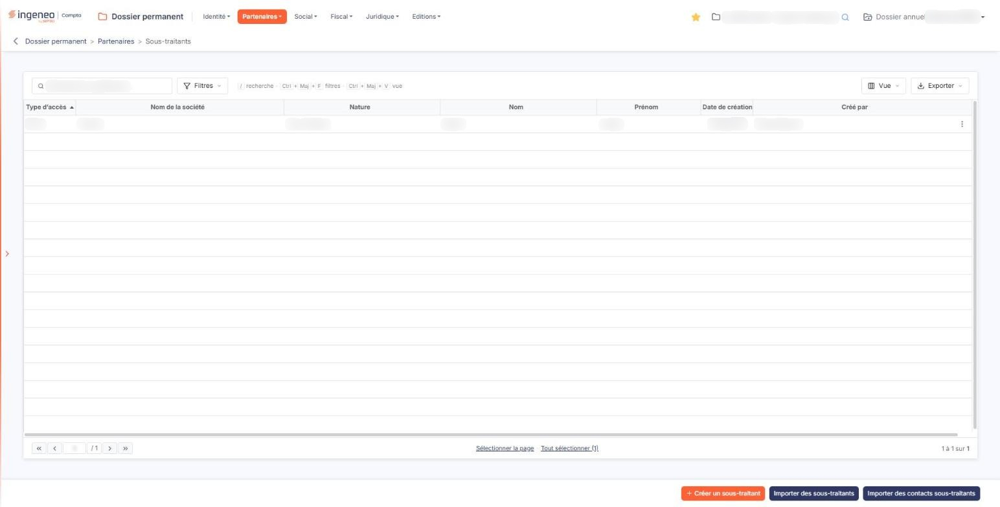
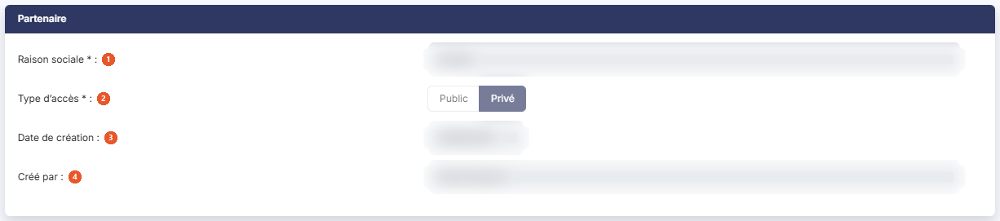
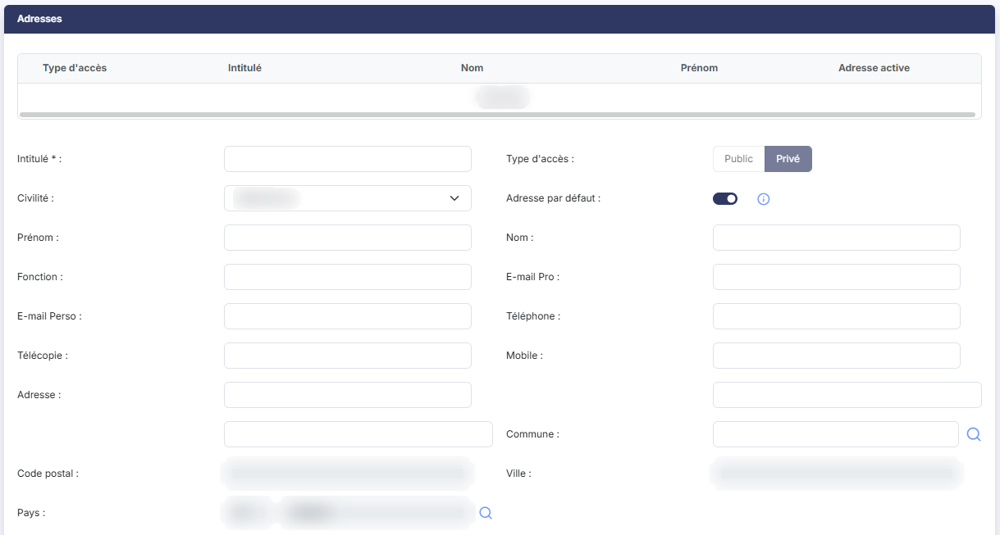
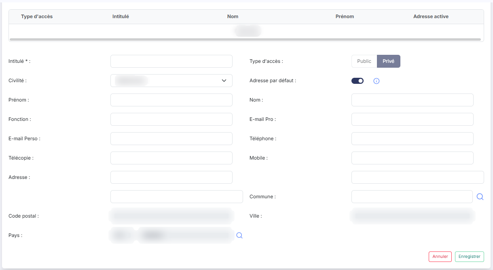
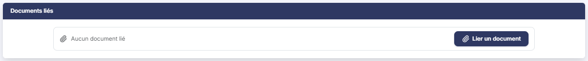
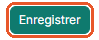

# Sous-traitants


**Où le trouver :** Menu **Partenaires › Sous-traitants**



**En bref** — Cet écran enregistre les sous-traitants de la société, avec leurs adresses et documents, saisis à la main ou repris de l'annuaire général du cabinet.

* Pour créer une fiche : bouton \[Créer un sous-traitant], renseignez-la, puis bouton \[Enregistrer].
* Pour reprendre des partenaires de l'annuaire : bouton \[Importer des sous-traitants], ou bouton \[Importer des contacts sous-traitants] pour choisir leurs contacts.


Cette option vous permet de recenser les sous-traitants de la société : les entreprises et les personnes auxquelles elle confie une partie de ses travaux. Pour chacune, vous conservez sa raison sociale, ses adresses et ses contacts, et vous pouvez lui joindre des documents.

<figure><figcaption>
Écran « Sous-traitants » de la nouvelle interface
</figcaption></figure>

L'écran se présente en deux temps : une **liste** des sous-traitants déjà enregistrés, puis une **fiche** que vous ouvrez pour en créer un ou en modifier un. La liste ne comporte ni onglet, ni rubrique : elle affiche directement les sous-traitants du dossier ; au-dessus d'elle, une barre d'outils, décrite plus bas, s'applique à la liste entière. Une barre de défilement horizontale apparaît sous la liste lorsque la largeur de votre fenêtre ne suffit pas à montrer toutes les colonnes.

## Les colonnes de la liste

La liste présente les colonnes suivantes, dans cet ordre. Toutes sont triables : vous cliquez sur l'intitulé d'une colonne pour trier la liste dessus. À l'ouverture, la liste est triée sur **Type d’accès**, par ordre croissant.

| Champ                 | Ce qu'il faut savoir                                                                                                                                                                                                                                                                                                                                                                                                                                               |
| --------------------- | ------------------------------------------------------------------------------------------------------------------------------------------------------------------------------------------------------------------------------------------------------------------------------------------------------------------------------------------------------------------------------------------------------------------------------------------------------------------ |
| **Type d’accès**      | Indique si le sous-traitant est privé ou public. Attention, cette colonne affiche la valeur **Prive**, sans accent, alors que la fiche écrit **Privé** : il s'agit bien de la même chose.                                                                                                                                                                                                                                                                          |
| **Nom de la société** | La raison sociale du sous-traitant, telle que vous l'avez saisie dans la fiche.                                                                                                                                                                                                                                                                                                                                                                                    |
| **Nature**            | Pour un sous-traitant, cette colonne affiche toujours **Sous-Traitant**. C'est le logiciel qui pose cette valeur, du fait du sous-menu par lequel vous êtes entré : la fiche d'un sous-traitant ne comporte aucune zone **Nature**, vous n'avez donc ni à la renseigner, ni à la corriger.                                                                                                                                                                         |
| **Nom**               | **Prénom :** ces deux colonnes **ne reprennent pas des zones de la fiche du sous-traitant**, qui n'en comporte aucune : elles affichent le nom et le prénom portés par l'**adresse** du sous-traitant, c'est-à-dire par la ligne de la rubrique « Adresses » de sa fiche. C'est ce qui explique qu'un sous-traitant sans adresse laisse ces deux colonnes vides, et que la valeur qui s'y affiche ne se retrouve nulle part dans la première rubrique de la fiche. |
| **Date de création**  | La date à laquelle le sous-traitant a été enregistré dans le dossier.                                                                                                                                                                                                                                                                                                                                                                                              |
| **Créé par**          | Le nom de l'utilisateur qui l'a enregistré.                                                                                                                                                                                                                                                                                                                                                                                                                        |

Le pied de la liste porte la barre de navigation entre les pages, au centre deux liens de sélection — « Sélectionner la page » et « Tout sélectionner », ce dernier rappelant entre parenthèses le nombre total de lignes — et, à droite, le décompte des lignes affichées.

Au-dessus de la liste, une barre d'outils s'applique à la liste entière.

La zone « Rechercher un partenaire… » restreint la liste dès la saisie. Elle ne porte que sur le **Nom de la société**.

bouton **\[Filtres]** : déroule un volet « Filtrer ». La liste « + Ajouter un critère sur… » propose les sept colonnes de la liste, mais aussi les coordonnées de l'adresse du sous-traitant : **Intitulé**, **Civilité**, **Fonction**, **E-mail Pro**, **E-mail Perso**, **Téléphone**, **Télécopie**, **Mobile**, **Adresse 1**, **Adresse 2**, **Adresse 3**, **Code postal**, **Ville** et **Pays**. Pour chaque critère, vous choisissez un opérateur et une valeur ; le bouton **\[Filtrer]** applique les critères à la liste, le bouton **\[Vider les filtres]** les efface.

bouton **\[Vue]** : rassemble, sous « Mes vues », l'enregistrement de l'état de la liste sous un nom (« Enregistrer la vue actuelle ») et, sous « Colonnes affichées », le choix des colonnes à afficher : sept colonnes sont affichées sur les vingt et une proposées, les quatorze autres reprenant les coordonnées de l'adresse énumérées ci-dessus. « Rétablir les colonnes d'origine » et « Appliquer » complètent ce menu.

bouton **\[Exporter]** : rappelle l'étendue concernée (« La liste affichée », suivie du décompte des lignes) et propose « Aperçu édition HTML », « Imprimer », « Exporter en Excel », « Exporter en PDF » et « Envoyer la liste par e-mail ».

## Les commandes d'une ligne de la liste

Un clic sur une ligne la sélectionne, pour la supprimer ensuite avec le bouton **\[Supprimer]**.

Au survol d'une ligne apparaissent, à son extrémité droite, deux pictogrammes : le « Crayon » (« Modifier »), qui ouvre la fiche du sous-traitant en modification, et trois points verticaux (« Autres actions »), qui ouvrent un menu proposant « Supprimer » : cette commande supprime le sous-traitant de la ligne.

Il n'y a **ni pictogramme « Œil », ni commande de duplication** sur cet écran : pour consulter un sous-traitant, vous ouvrez sa fiche en modification.

## Bouton \[Créer un sous-traitant]

<figure><figcaption>
Bouton [Créer un sous-traitant]
</figcaption></figure>

Il ouvre une fiche vide, pour enregistrer un nouveau sous-traitant. Son infobulle, qui s'affiche au survol du bouton, rappelle qu'il « permet de créer un nouveau sous-traitant privé » : le **Type d’accès** de la fiche est en effet préétabli sur **Privé**, et vous n'avez pas à le renseigner.

## Bouton \[Importer des sous-traitants]

Ce bouton reprend des sous-traitants déjà connus de l'annuaire général du cabinet, plutôt que de vous les faire ressaisir. Son infobulle indique qu'il « permet d’importer des sous-traitants depuis l’annuaire général du cabinet avec tous leurs contacts ».

La différence avec le bouton suivant tient à ce point précis : celui-ci reprend **tous** les contacts des sous-traitants importés.

Ce bouton déclenche une reprise portant sur plusieurs sous-traitants à la fois, et non l'enregistrement d'une seule fiche.

## Bouton \[Importer des contacts sous-traitants]

Ce bouton reprend également des sous-traitants de l'annuaire général du cabinet, mais avec « tout ou partie de leurs contacts » — c'est le texte de son infobulle. C'est donc celui que vous employez lorsque vous ne voulez pas reprendre l'intégralité des contacts d'un sous-traitant.

## Bouton \[Supprimer]

Dès qu'au moins une ligne est sélectionnée, un bandeau apparaît en bas de l'écran ; il indique le nombre de lignes sélectionnées, propose le lien « Tout désélectionner » et porte ce bouton, qui supprime **tous les sous-traitants sélectionnés**. Vérifiez votre sélection avant de le presser. Pour ne supprimer qu'un seul sous-traitant, la commande « Supprimer » du menu « Autres actions » de sa ligne suffit.

## La fiche d'un sous-traitant

Que vous l'ouvriez en création ou en modification, la fiche présente **trois rubriques**, toujours dans le même ordre : « Partenaire », « Adresses », « Documents liés ». Il n'y a aucun onglet : les trois rubriques sont affichées ensemble.

La fiche d'un sous-traitant est volontairement sobre : elle ne comporte \*\*aucune zone \*\*Nature, contrairement à celle d'un commissaire aux comptes, d'un financier ou d'un conseiller juridique. C'est normal, et c'est ce qui explique que la colonne **Nature** de la liste affiche une valeur que vous n'avez pas saisie.

## Rubrique « Partenaire »

<figure><figcaption>
Rubrique « Partenaire »
</figcaption></figure>

| Champ                                                             | Ce qu'il faut savoir                                                                                                                                                                                                                                                                                                                                                                                                                                                                                                                                                                                                                                                                                                                                                                                                                                                                                                                                                                                                                                                                                                                                                        |
| ----------------------------------------------------------------- | --------------------------------------------------------------------------------------------------------------------------------------------------------------------------------------------------------------------------------------------------------------------------------------------------------------------------------------------------------------------------------------------------------------------------------------------------------------------------------------------------------------------------------------------------------------------------------------------------------------------------------------------------------------------------------------------------------------------------------------------------------------------------------------------------------------------------------------------------------------------------------------------------------------------------------------------------------------------------------------------------------------------------------------------------------------------------------------------------------------------------------------------------------------------------- |
| 
1. <strong>Raison sociale</strong> <em>Obligatoire</em>
 | 
Le nom du sous-traitant, <strong>50 caractères au maximum</strong>. Cette zone est obligatoire. Elle ne se saisit <strong>qu'à la création</strong> : dès que le sous-traitant est enregistré, elle passe en lecture seule et vous ne pouvez plus la corriger, bien qu'elle porte toujours son astérisque d'obligation. Vérifiez-la donc avant d'enregistrer.
                                                                                                                                                                                                                                                                                                                                                                                                                                                                                                                                                                                                                                                                                                                                                                                                     |
| 
2. <strong>Type d’accès</strong> <em>Obligatoire</em>
   | 
Deux boutons, <strong>Public</strong> et <strong>Privé</strong>. Cette information est obligatoire, mais vous ne la renseignez jamais vous-même : le logiciel présente ces deux boutons <strong>en lecture seule</strong>, à la création comme en modification, et retient <strong>Privé</strong> pour tout sous-traitant que vous créez depuis cet écran — c'est ce qu'annonce l'infobulle du bouton <strong>[Créer un sous-traitant]</strong>, qui parle bien d'un « nouveau sous-traitant privé ». Les deux boutons s'affichent <strong>grisés</strong>, en création comme en modification, et ils ne répondent pas au clic : le <strong>Type d’accès</strong> d'un sous-traitant <strong>ne se change pas</strong> une fois la fiche enregistrée. Cette information n'est pas de pure forme : elle commande la possibilité de joindre des documents au sous-traitant, comme l'explique la rubrique « Documents liés » ci-dessous. Les deux zones suivantes n'apparaissent <strong>qu'en modification</strong> : elles ne sont donc pas visibles lorsque vous créez un sous-traitant. Ni l'une ni l'autre ne se saisit — le logiciel les renseigne seul.
 |
| 3. **Date de création**                                           | La date à laquelle le sous-traitant a été enregistré.                                                                                                                                                                                                                                                                                                                                                                                                                                                                                                                                                                                                                                                                                                                                                                                                                                                                                                                                                                                                                                                                                                                       |
| 4. **Créé par**                                                   | Le nom de l'utilisateur qui l'a enregistré.                                                                                                                                                                                                                                                                                                                                                                                                                                                                                                                                                                                                                                                                                                                                                                                                                                                                                                                                                                                                                                                                                                                                 |

Cette rubrique ne conserve **ni date, ni auteur de la dernière modification** : la traçabilité s'arrête à la création.

## Rubrique « Adresses »

<figure><figcaption>
Rubrique « Adresses »
</figcaption></figure>

<figure><figcaption>
Rubrique « Adresses »
</figcaption></figure>

Un sous-traitant peut porter plusieurs adresses, chacune avec son contact. Elles se présentent dans une liste propre à la fiche, sans tri, sans pagineur et sans personnalisation de colonnes, comportant les colonnes suivantes : **Type d'accès**, **Intitulé**, **Nom**, **Prénom** et **Adresse active**.

La colonne **Adresse active** affiche le texte **Oui** : ce n'est ni une case à cocher, ni un pictogramme.

Rappelez-vous que ce sont les colonnes **Nom** et **Prénom** de **cette** liste qui alimentent les colonnes de même nom dans la liste des sous-traitants.

Chaque ligne d'adresse porte trois commandes, dans cet ordre : le pictogramme « Crayon » (« Modifier ») pour la modifier, le pictogramme à deux feuilles superposées (« Dupliquer ») pour la **dupliquer**, et le pictogramme « Corbeille » (« Supprimer ») pour la supprimer — la commande de duplication n'existe que sur les adresses, pas sur les sous-traitants eux-mêmes.

Le bouton **\[+ Nouvelle adresse]** de la rubrique ajoute une adresse au sous-traitant.

## Rubrique « Documents liés »

<figure><figcaption>
Rubrique « Documents liés »
</figcaption></figure>

Vous joignez ici les pièces qui concernent le sous-traitant. La liste comporte les colonnes **Description**, **Nom du fichier**, **Date** et **Créé par**. Tant qu'aucun document n'est joint, la rubrique n'affiche pas cette liste mais la seule mention « Aucun document lié ».

Pour ajouter un document :

le bouton **\[Lier un document]** ouvre, à droite de l'écran, un volet « Lier un document ». Vous y choisissez la source du document, « Depuis mon poste » ou « Depuis la GED », puis, depuis votre poste, vous déposez le fichier dans la zone prévue ou vous parcourez vos fichiers. Le bouton **\[Lier le document]** retient le document, le bouton **\[Annuler]** referme le volet sans rien lier. Le volet ne propose pas de reprendre un document de l'OCR.

Le volet annonce « Tous formats sauf .exe, .bat, .cmd, .sh — nom de 100 caractères maximum ». Un fichier ne peut pas dépasser **50 Mo** ; au-delà, un message vous l'indique et le fichier n'est pas retenu.

**Un point important, que l'écran ne vous dira pas** : lorsque le **Type d’accès** du sous-traitant vaut **Public**, cette rubrique s'affiche — son titre, et ses documents déjà joints ou la mention « Aucun document lié » — **mais le Bouton \[Lier un document] n'y figure pas**, et vous ne pouvez plus non plus **modifier ni supprimer** les documents déjà joints. Rien ne l'annonce : aucun message, aucun bouton grisé, simplement un bouton absent. Ne cherchez donc pas un bouton qui n'existe pas : si vous devez joindre un document, c'est le **Type d’accès** du sous-traitant qu'il faut regarder d'abord.

Le Bouton \[Lier un document] peut aussi manquer parce que votre profil ne vous autorise pas à joindre un document à un sous-traitant : l'écran est alors le même, sans aucun message.

## Bouton \[Enregistrer] et retour à la liste

<figure><figcaption>
Bouton [Enregistrer] et retour à la liste
</figcaption></figure>

Le bouton **\[Enregistrer]**, **vert**, conserve la fiche.

Pour quitter la fiche sans enregistrer et revenir à la liste, cliquez sur la flèche « Revenir en arrière » placée à gauche du fil d'Ariane, en haut de l'écran : la fiche ne comporte pas de bouton de retour.
