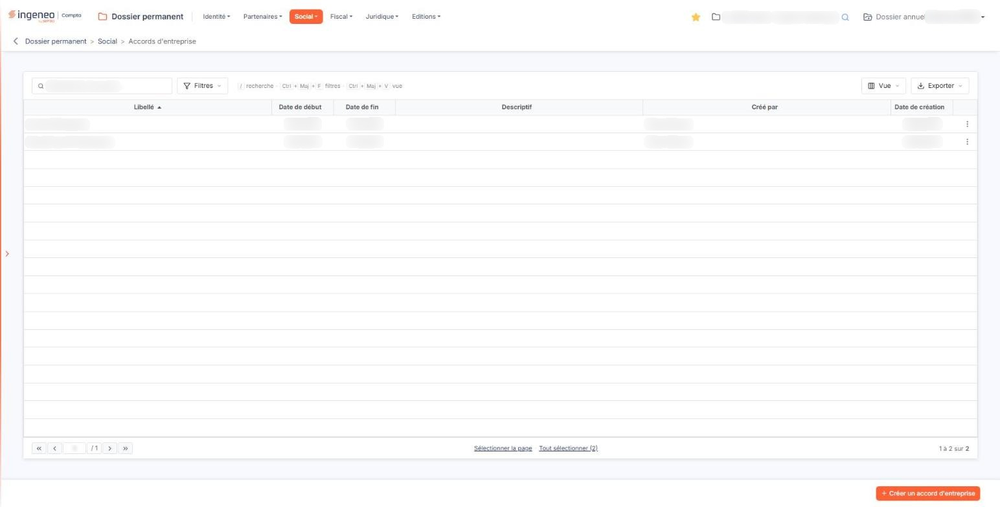
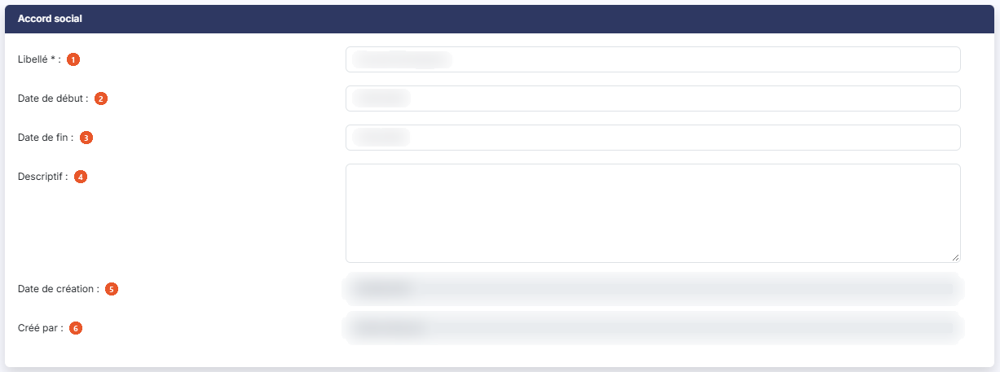
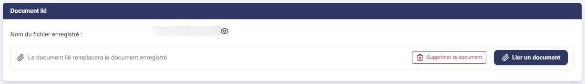
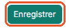

# Accords d'entreprise


**Où le trouver :** Menu **Social › Accords d'entreprise**



**En bref** — Cet écran conserve les accords d'entreprise de la société et leurs avenants : intitulé, période couverte, descriptif et pièce justificative.

* Pour enregistrer un accord : bouton \[Créer un accord d'entreprise], renseignez la fiche, puis bouton \[Enregistrer].
* Pour joindre la pièce : bouton \[Lier un document] dans la fiche ; la liste ne montre pas si un document est joint.


Cette option vous permet de conserver dans le dossier les accords d'entreprise de la société, et leurs avenants : leur intitulé, la période qu'ils couvrent, un descriptif libre, et la pièce qui en fait foi. C'est la mémoire sociale du dossier : elle vous évite d'aller rechercher un accord dans un classeur ou dans une messagerie lorsqu'une question de paie ou de contrôle se pose.

<figure><figcaption>
Écran « Accords d'entreprise » de la nouvelle interface
</figcaption></figure>

L'écran se présente en deux temps : une **liste** des accords déjà enregistrés, puis une **fiche** que vous ouvrez pour en créer un ou en modifier un. La liste ne comporte ni onglet, ni rubrique ; au-dessus d'elle, une barre d'outils, décrite plus bas, s'applique à la liste entière.

**Un point à savoir avant de commencer** : chaque accord peut porter **un** document, et la liste ne le montre pas. Elle n'a ni colonne indiquant le nom du document, ni pictogramme permettant de le consulter : pour savoir si un accord a bien sa pièce, vous devez ouvrir sa fiche. Prenez-en l'habitude, c'est la seule façon de le vérifier.

## Les colonnes de la liste

La liste présente les colonnes suivantes, dans cet ordre. Toutes sont triables : vous cliquez sur l'intitulé d'une colonne pour trier la liste dessus. À l'ouverture, la liste est triée sur **Libellé**, par ordre croissant — et non sur une date, comme on pourrait s'y attendre pour des accords qui se succèdent dans le temps. Si vous voulez les voir dans leur ordre chronologique, cliquez sur **Date de début**.

| Champ                | Ce qu'il faut savoir                                                                                                                                                    |
| -------------------- | ----------------------------------------------------------------------------------------------------------------------------------------------------------------------- |
| **Libellé**          | L'intitulé que vous avez donné à l'accord.                                                                                                                              |
| **Date de début**    | La date à partir de laquelle l'accord s'applique.                                                                                                                       |
| **Date de fin**      | La date jusqu'à laquelle il s'applique.                                                                                                                                 |
| **Descriptif**       | Le texte libre que vous avez saisi dans la fiche.                                                                                                                       |
| **Créé par**         | Le nom de l'utilisateur qui a enregistré l'accord.                                                                                                                      |
| **Date de création** | La date à laquelle il l'a enregistré. Ne la confondez pas avec la **Date de début** : celle-ci est la date de l'accord, celle-là la date de sa saisie dans le logiciel. |

Le pied de la liste porte la barre de navigation entre les pages, au centre deux liens de sélection — « Sélectionner la page » et « Tout sélectionner », ce dernier rappelant entre parenthèses le nombre total de lignes — et, à droite, le décompte des lignes affichées.

Au-dessus de la liste, une barre d'outils s'applique à la liste entière.

La zone « Rechercher un accord… » restreint la liste dès la saisie. Elle ne porte que sur la colonne **Libellé**.

bouton **\[Filtres]** : déroule un volet « Filtrer ». La liste « + Ajouter un critère sur… » propose les colonnes de la liste, ainsi que **Modifié par** et **Date de modification**. Pour chaque critère, vous choisissez un opérateur et une valeur ; le bouton **\[Filtrer]** applique les critères à la liste, le bouton **\[Vider les filtres]** les efface.

bouton **\[Vue]** : rassemble, sous « Mes vues », l'enregistrement de l'état de la liste sous un nom (« Enregistrer la vue actuelle ») et, sous « Colonnes affichées », le choix des colonnes à afficher : six colonnes sont affichées sur les huit proposées. « Rétablir les colonnes d'origine » et « Appliquer » complètent ce menu.

bouton **\[Exporter]** : rappelle l'étendue concernée (« La liste affichée », suivie du décompte des lignes) et propose « Aperçu édition HTML », « Imprimer », « Exporter en Excel », « Exporter en PDF » et « Envoyer la liste par e-mail ».

## Les commandes d'une ligne de la liste

Un clic sur une ligne la sélectionne, pour la supprimer ensuite avec le bouton **\[Supprimer]**.

Au survol d'une ligne apparaissent, à son extrémité droite, deux pictogrammes : le « Crayon » (« Modifier »), qui ouvre la fiche de l'accord en modification, et trois points verticaux (« Autres actions »), qui ouvrent un menu proposant « Supprimer » : cette commande supprime l'accord de la ligne.

Il n'y a **ni pictogramme « Œil », ni commande de duplication** : c'est en ouvrant la fiche que vous consultez le document joint.

## Bouton \[Créer un accord d'entreprise]

Placé en bas à droite de l'écran, il ouvre une fiche vide, pour enregistrer un nouvel accord.

## Bouton \[Supprimer]

Dès qu'au moins une ligne est sélectionnée, un bandeau apparaît en bas de l'écran ; il indique le nombre de lignes sélectionnées, propose le lien « Tout désélectionner » et porte ce bouton, qui supprime **tous les accords sélectionnés**. Vérifiez votre sélection avant de le presser. Pour n'en supprimer qu'un seul, la commande « Supprimer » du menu « Autres actions » de sa ligne suffit.

## La fiche d'un accord

Que vous l'ouvriez en création ou en modification, la fiche présente **deux rubriques**, dans cet ordre : « Accord social », puis « Document lié ». Il n'y a aucun onglet.

Ne vous étonnez pas du titre de la première rubrique : l'écran s'intitule « Accords d'entreprise » au menu comme en haut de la page, et sa première rubrique s'appelle **« Accord social »**. Il s'agit bien du même objet, désigné de deux façons.

## Rubrique « Accord social »

<figure><figcaption>
Rubrique « Accord social »
</figcaption></figure>

| Champ                                                      | Ce qu'il faut savoir                                                                                                                                                                                                                                                                                                                                                                                                                                                                                                                                                                                       |
| ---------------------------------------------------------- | ---------------------------------------------------------------------------------------------------------------------------------------------------------------------------------------------------------------------------------------------------------------------------------------------------------------------------------------------------------------------------------------------------------------------------------------------------------------------------------------------------------------------------------------------------------------------------------------------------------- |
| 
1. <strong>Libellé</strong> <em>Obligatoire</em>
 | 
L'intitulé de l'accord, <strong>50 caractères au maximum</strong>. C'est le <strong>seul renseignement obligatoire de tout l'écran</strong> : tout le reste, y compris le document, peut être complété plus tard. Comme c'est aussi la colonne sur laquelle la liste se trie, soignez-le : un intitulé du type « Accord d'entreprise » suivi de « Avenant accord d'entreprise » se lit bien mieux dans la liste que deux libellés sans rapport.
                                                                                                                                                  |
| 2. **Date de début**                                       | La date à partir de laquelle l'accord s'applique. Vous la saisissez au clavier ou vous la choisissez dans le calendrier qui s'ouvre au clic dans la zone.                                                                                                                                                                                                                                                                                                                                                                                                                                                  |
| 3. **Date de fin**                                         | 
La date jusqu'à laquelle il s'applique, saisie de la même façon. Elle est affichée <strong>sous</strong> la date de début. Ces deux dates ne sont <strong>pas obligatoires</strong>.
                                                                                                                                                                                                                                                                                                                                                                                                             |
| 4. **Descriptif**                                          | 
Une zone de plusieurs lignes, <strong>1 024 caractères au maximum</strong>, pour ce qu'il faut retenir de l'accord — son objet, les catégories de personnel concernées, les points qui auront une incidence sur la paie. C'est le texte qui s'affichera dans la colonne <strong>Descriptif</strong> de la liste. Les deux zones suivantes n'apparaissent <strong>qu'en modification</strong> : elles ne sont donc pas visibles lorsque vous créez un accord. Ni l'une ni l'autre ne se saisit — le logiciel les renseigne seul — et elles s'affichent l'une sous l'autre, en bas de la rubrique.
 |
| 5. **Date de création**                                    | La date à laquelle l'accord a été enregistré.                                                                                                                                                                                                                                                                                                                                                                                                                                                                                                                                                              |
| 6. **Créé par**                                            | Le nom de l'utilisateur qui l'a enregistré.                                                                                                                                                                                                                                                                                                                                                                                                                                                                                                                                                                |

## Rubrique « Document lié »

<figure><figcaption>
Rubrique « Document lié »
</figcaption></figure>

Vous joignez ici la pièce qui fait foi : l'accord signé, ou son avenant. Le titre de la rubrique est au **singulier**, et ce n'est pas un hasard — un accord ne porte **qu'un seul** document.

Cette rubrique ne se présente pas de la même façon selon que vous créez l'accord ou que vous le modifiez.

**À la création**, elle affiche « Aucun document lié » et le bouton **\[Lier un document]**. Rien n'y porte d'astérisque : le document n'est pas obligatoire, et vous pouvez enregistrer un accord sans sa pièce, quitte à la joindre plus tard.

**En modification**, la zone s'intitule **Nom du fichier enregistré :** et affiche le nom du document déjà joint, suivi du pictogramme « Œil » dont l'infobulle indique « Visualiser » — et qui **télécharge** le document sur votre poste plutôt que de l'afficher à l'écran. En dessous, l'écran rappelle que « Le document lié remplacera le document enregistré » ; le bouton **\[Supprimer le document]** et le bouton **\[Lier un document]** y sont proposés. Le nouveau document remplace l'ancien : l'accord ne conserve jamais qu'un seul document.

bouton **\[Lier un document]** : ouvre, à droite de l'écran, un volet « Lier un document ». Vous y choisissez la source du document, « Depuis mon poste » ou « Depuis la GED », puis, depuis votre poste, vous déposez le fichier dans la zone prévue ou vous parcourez vos fichiers. Le bouton **\[Lier le document]** retient le document, le bouton **\[Annuler]** referme le volet sans rien lier.

Le volet annonce « Tous formats sauf .exe, .bat, .cmd, .sh — nom de 100 caractères maximum ».

## Bouton \[Enregistrer] et retour à la liste

<figure><figcaption>
Bouton [Enregistrer] et retour à la liste
</figcaption></figure>

Le bouton **\[Enregistrer]** conserve la fiche.

Pour quitter la fiche sans enregistrer et revenir à la liste, cliquez sur la flèche « Revenir en arrière » placée à gauche du fil d'Ariane, en haut de l'écran : la fiche ne comporte pas de bouton de retour.
